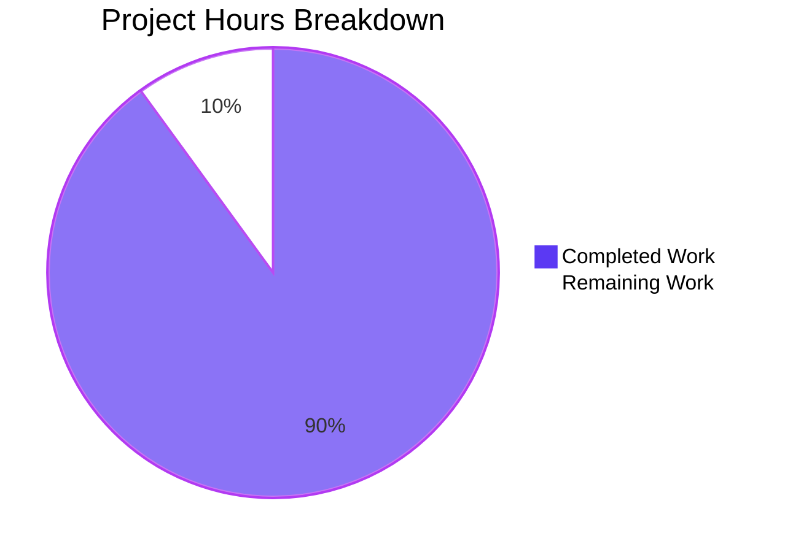

# 1. Executive Summary

## 1.1 Project Overview

The deliverable is two files: `welcome.js`, eleven lines whose single JSDoc summary sits above ten `console.log` statements that each write `Welcome to Blitzy`, and `README.md`, three lines recording that nothing needs installing and the one command that prints the greeting. Its users are a developer at a terminal and any automated step asserting the output. The value is a deterministic, dependency-free smoke surface — no build, install, configuration or service — reproducible from a clean checkout. Technical scope is one run-to-completion CommonJS script at the repository root plus the documentation that invokes it.

## 1.2 Completion Status

Completed hours are 9.0, remaining hours are 1.0 and total project hours are 10.0 — 90.0% complete (9.0 / (9.0 + 1.0) = 0.900).



| Metric | Value |
|---|---|
| Total Hours | 10.0 |
| Completed Hours (Baseline: Human with agentic-assist) | 9.0 |
| Remaining Hours | 1.0 |
| Percent Complete | 90.0% |

The remaining 1.0 hour is a handover decision on the documentation beyond the two mapped files, plus an output-contract sign-off on the target runtime.

## 1.3 Key Accomplishments

- Ten unformatted `Welcome to Blitzy` lines: 180 bytes, exit 0, empty stderr, byte-identical to an independent reference.
- One tag-free JSDoc summary above ten identical statements in eleven lines, byte-identical to the specified body.
- Three-line `README.md` recording the zero-install state and the `node welcome.js` command, replayed verbatim.
- One program, one run command: the twice-printing entry point and the stray port-3000 server removed at every level.
- Zero dependency and zero build: no manifest, lockfile, CI configuration, handler or environment read.
- Output invariant across arguments, stdin, environment, locale, colour, stream destination, directory and repetition.
- Reproducible from a clean tree: a `git archive HEAD` extraction runs to the same stream, nothing installed.

## 1.4 Critical Unresolved Issues

Three items are open: two boundary divergences covering three of the plan's 19 requirements, and one coverage gap.

| Issue | Impact | Owner | ETA |
|---|---|---|---|
| A third tracked path ships beside the two mapped files — the status document under `blitzy/documentation/` — so the repository is not limited to the program and its README | The repository inventory exceeds the agreed two-file scope; a recipient sees documentation the plan did not map and must decide whether it travels with the deliverable | Repository owner | 0.5 h |
| `README.md` was rewritten in place rather than created as the plan states, so the earlier wording was replaced (its third line; lines 1–2 are unchanged) | The plan's "no file is updated" clause does not hold, and the pre-change text survives only in commit history | Repository owner | 0.5 h (one decision with the item above) |
| Runtime behaviour outside Node.js v22.23.5 on Linux was never exercised | Deployment on a different runtime rests on inference — the program touches only the `console` global — rather than on observation | Whoever deploys or hands over | 0.5 h |

## 1.5 Access Issues

No access issues identified: no permission beyond read access to the checkout, no credential, no API key, no secret and no environment variable is involved.

## 1.6 Recommended Next Steps

1. **[High]** Decide whether the status document under `blitzy/documentation/` ships; if it does, keep it in the change set on every greeting change.
2. **[High]** Record that `README.md` was rewritten in place rather than created, so the change description matches history.
3. **[Medium]** Run `node --check welcome.js && node welcome.js` on the target runtime and compare with the reference stream.
4. **[Low]** Keep the zero-dependency contract; a future dependency adds a supply-chain surface.
5. **[Low]** Treat the ten statements, the README sentence and the status document as one atomic edit.

# 2. Project Hours Breakdown

## 2.1 Completed Work Detail

Every component below traces to a requirement of the plan; hours are engineering effort at a human-with-agentic-assist baseline, covering implementation, the documentation that invokes it, and the verification that proves it.

| Component | Hours | Description |
|---|---|---|
| Program deliverable — `welcome.js` | 2.5 | One tag-free JSDoc summary above ten literal `console.log` statements, eleven lines, byte-identical to the specified body; the file that produces the ten-line output on the Node.js runtime. |
| Run documentation — `README.md` | 1.5 | Three-line README recording the zero-install state and the single `node welcome.js` command, with the documented command replayed verbatim to confirm it executes as written. |
| Repository reconciliation to the two-file contract | 2.0 | Removal of the superseded twice-printing entry point and the stray port-3000 HTTP server, leaving one program, one run command and no competing referent at file, index or content level. |
| Output-contract and invocation-form verification | 2.0 | Byte-level assertions on stdout, stderr and exit status, the invocation matrix (arguments, stdin, environment, locale, colour forcing, stream destination, working directory, repetition), and the clean-tree replay. |
| Zero-dependency, exclusions and hardening audit | 1.0 | Confirmation that no manifest, lockfile, dependency, test suite, CI configuration, environment read, handler or placeholder exists anywhere in the tree. |
| **Total Completed** | **9.0** | Sum of the rows above. |

## 2.2 Remaining Work Detail

| Category | Hours | Priority |
|---|---|---|
| Handover decision on the documentation the repository carries beyond the two mapped files, and the README's create-versus-rewrite provenance | 0.5 | High |
| Independent output-contract sign-off on the runtime the project will ship on (portability of the observed behaviour) | 0.5 | Medium |
| **Total Remaining** | **1.0** | |

The two rows are the only work traceable to an unmet clause of the plan or to the path-to-production step it defines. No row covers rework of delivered code: the two bodies are byte-identical to the plan's specification, the output contract is proven, and every excluded artefact is absent.

## 2.3 Hours Calculation and Confidence

Total project hours = completed hours 9.0 + remaining hours 1.0 = 10.0. Completion = 9.0 / 10.0 = 90.0%, the figure carried in Sections 1.2, 7 and 8.

| Element | Value | Confidence | Basis |
|---|---|---|---|
| Completed hours | 9.0 | High | Measured against delivered files of 11 and 3 lines with a fully observed output contract; the effort is in verification and reconciliation, not in unknown code volume. |
| Remaining hours | 1.0 | Medium | Two bounded human decisions rather than implementation; the portability sign-off could expand if the target runtime differs from Node.js v22.23.5. |
| Total project hours | 10.0 | High | No work item lies outside the plan's two mapped files and the production step its README documents. |

# 3. Test Results

The repository ships no test suite and the plan forbids adding one, so the project's own gate — `node --check <file>` plus running the program and comparing its bytes — carries the verification, executed here on Node.js v22.23.5 (`/usr/bin/node`). Every number below was produced by running the assertions against the delivered tree; 80 checks were executed, 80 passed and 0 failed.

| Area / Category | Framework | Tests | Passed | Failed | Coverage | What This Proves |
|---|---|---|---|---|---|---|
| Program output contract | Node.js v22.23.5 with shell assertions (no test framework in the repository) | 18 | 18 | 0 | No coverage tooling exists and none may be added | The program writes ten lines of exactly `Welcome to Blitzy` — 180 bytes, exit 0, empty stderr, no ANSI, NUL, CR, BOM or trailing whitespace. |
| Invocation-form and environment invariance | Same assertion harness | 13 | 13 | 0 | Not instrumented | The same stream is produced regardless of arguments, stdin, environment, locale, colour forcing, pseudo-TTY, pipe versus redirect, working directory, module loading or repetition. |
| Failure and stream-edge behaviour | Same assertion harness | 4 | 4 | 0 | Not instrumented | An absent program file exits 1 with a resolution diagnostic and empty stdout; an unwritable stdout exits 0 with the output lost, which is the deliberate no-error-handler behaviour. |
| Source shape and byte-exact bodies | `cmp`, `wc`, `grep`, `od` | 18 | 18 | 0 | Not applicable (static) | Both files are byte-identical to the specified bodies: eleven lines and ten statements in the program, one JSDoc summary, three lines in the README with the U+2014 dash. |
| Documented run contract | Shell assertions replaying `README.md`'s command | 8 | 8 | 0 | Not instrumented | The command the README states runs verbatim from the repository root with nothing installed, exits 0 and reproduces the reference stream. |
| Tree inventory and exclusions | `find`, `git ls-files` | 9 | 9 | 0 | Not applicable (static) | Three tracked paths; no manifest, lockfile, `node_modules`, test, CI, container, configuration, licence, backup or duplicate artefact. |
| Deletion completeness and side-effect freedom | Shell assertions, `/proc/net` listener records, `curl` | 6 | 6 | 0 | Not instrumented | Both removed entry points resolve nothing and leave no referent; nothing listens on port 3000; the program opens no socket and creates no file. |
| Repository hygiene and suite state | `node --test`, `git status`, marker sweeps | 4 | 4 | 0 | Not applicable | Working tree clean, no placeholder or TODO marker anywhere, and the runtime's own runner reports zero tests — the expected state. |
| **Total** | | **80** | **80** | **0** | | |

`node --test` reports `1..0`, `# tests 0`, `# pass 0`, `# fail 0`, exit 0; `npm test` exits 254 with `ENOENT` for a missing manifest. Both are the designed state, not gaps: the plan excludes a manifest, a test suite, a coverage target and any quality gate.

## 3.1 Not Covered

- **Runtime portability.** Only Node.js v22.23.5 on Linux was exercised; no other runtime is installed and none may be added. A human should run `node --check welcome.js && node welcome.js` on the target runtime and compare the captured stream with `printf 'Welcome to Blitzy\n%.0s' {1..10}` before handover.
- **Output delivery to a consumer that closes or refuses its input.** The exit status alone does not report a lost write, so a human should confirm that whatever asserts on this program inspects the captured stream rather than the exit status in isolation.
- **An automated regression gate.** None exists and none may be added, so no test would catch a future single-statement edit that breaks the ten-line contract; the shipped gate plus the byte comparison is the check a human must run instead.
- **Markdown rendering.** `README.md` and the tracked status document under `blitzy/documentation/` were asserted textually (heading counts, tables, fences); no Markdown renderer is installed, so neither has been rendered.
- **Browser, UI, HTTP API, database, queue and external integration.** None exists in this project, so nothing of that kind was or could be exercised.

# 4. Runtime Validation & UI Verification

Every flow below was driven on Node.js v22.23.5 (`/usr/bin/node`) against the delivered tree.

- ✅ **Program run** — `node welcome.js` from the repository root: exit 0, ten identical lines, 180 bytes on stdout, 0 bytes on stderr (sha256 `c50caa06…`).
- ✅ **Parse gate** — `node --check welcome.js`: silent, exit 0.
- ✅ **Documented command** — the command extracted from `README.md:3`, replayed verbatim: exit 0 and byte-identical to the reference stream.
- ✅ **Clean-tree delivery** — a `git archive HEAD` extraction, run with nothing installed: the same three files and the same 180-byte stream, sha256 identical.
- ✅ **Invocation invariance** — thirteen forms observed identical: `--help` and positional arguments, stdin `/dev/null`, `env -i`, no `PATH`, C locale, forced colour, pseudo-TTY (no escape byte), pipe versus redirect, absolute path from `/`, `require()`, ten sequential runs and a shared pipe.
- ✅ **Failure propagation** — an absent program file exits 1 with empty stdout and Node's `Cannot find module` diagnostic on stderr.
- ✅ **Removed entry points** — invoking either abandoned path exits 1 with `MODULE_NOT_FOUND`; nothing serves port 3000 (`curl` refused with exit 7, no `:0BB8` listener record), and the listener set is unchanged across a run.
- ✅ **Side-effect freedom** — no socket opened, no child process spawned, no file created or mutated, no stdin read; the process exits on its own.
- ⚠ **Unwritable stdout** — with the descriptor closed or pointing at `/dev/full` the program exits 0, writes nothing and reports nothing. This is the deliberate consequence of shipping no error handler; the write itself fails and is not surfaced.
- ❌ **External integrations** — none exist in this project: no HTTP client or server, database, queue, third-party API, credential or configuration value. Nothing of that kind was exercised, and none can fail.

**Never exercised at runtime:** portability beyond Node.js v22.23.5 on Linux — no other runtime is installed and none may be added; and every surface the project does not have, namely a browser UI, an HTTP endpoint, a data store, an external service and a configuration layer. Nothing in the deliverable reads input, so no input-driven path was or could be driven. No screenshots or screen recordings exist because the project has no user interface; all runtime evidence is terminal output, exit status and byte counts.

# 5. Compliance & Quality Review

## 5.1 Compliance Matrix

Each row maps a deliverable of the plan to the requirement it satisfies and shows where it stands in the delivered tree.

| # | Deliverable | Requirement | Status | Progress | Evidence |
|---|---|---|---|---|---|
| 1 | Program output | Ten lines of exactly `Welcome to Blitzy`, unformatted (F1, F2) | ✅ PASS | 100% | `welcome.js:2-11`; 180-byte stream, exit 0, empty stderr, one distinct line. |
| 2 | Program form | One tag-free JSDoc summary above ten identical statements, eleven lines (F3, 0.5.1) | ✅ PASS | 100% | `welcome.js` byte-identical to the specified body; 11 lines / 394 bytes. |
| 3 | Run documentation | Install and run facts in fewer than five lines (F4, 0.5.1) | ✅ PASS | 100% | `README.md` 3 lines / 107 bytes, U+2014 dash, command replayed verbatim. |
| 4 | Acceptance criterion | Both bodies byte for byte (0.11.2) | ✅ PASS | 100% | `cmp` identical for both files. |
| 5 | Runtime | JavaScript on Node.js v22.23.5, no build or transpile step (0.3.1, 0.3.2) | ✅ PASS | 100% | Direct execution, no build artefact, no module construct. |
| 6 | Dependencies | No package, manifest or lockfile; only the `console` global (0.4, 0.5.1) | ✅ PASS | 100% | No manifest, lockfile or `node_modules` anywhere; run succeeds without an install. |
| 7 | Test and quality tooling | No test suite, coverage target or quality gate added (0.7.2, 0.11.2) | ✅ PASS | 100% | `node --test` reports zero tests; no runner, linter or CI configuration exists. |
| 8 | Exclusions and hardening | No handler, error handler, environment configuration or validation (0.5.1) | ✅ PASS | 100% | No `try`/`catch`, `process.env`, logger or route; output identical under `env -i`. |
| 9 | Single program, single command | One program prints the greeting; superseded artefacts removed (F1, F3, 0.8.1 intent) | ✅ PASS | 100% | Only `welcome.js` is executable; both removed paths resolve nothing and leave no referent. |
| 10 | Scope | Only the two mapped files ship; nothing else beside them (0.7.2, 0.1.2) | ⚠ PARTIAL | 70% | A third tracked path, `blitzy/documentation/Project Guide - d5d06770-1a28-4fee-846a-27d98a6d7cc0.md`, ships and was rewritten in place. |
| 11 | Delivery mode | Both mapped entries delivered as creates; no file updated or deleted (0.8.1) | ❌ NOT MET | 50% | `README.md` was rewritten in place (1 insertion / 1 deletion, commit `471b092`); `index.js` and `server (2).js` were deleted (commit `68b7ddb`). |
| 12 | User rules | Any user-specified rule honoured (0.9) | ✅ PASS | 100% | No user-specified rules exist for this project, so no rule obligation or conflict arises. |

## 5.2 AAP & Rule Divergences and Gaps

Three departures from the plan were delivered. None affects the correctness of the program or the README: both bodies are byte-identical to the plan's specification and every output-contract check passes. No user-specified rules exist for this project, so no departure from that layer is possible.

| # | What the AAP/Rule Required | What Was Delivered Instead | Why It Diverged | Impact | Remediation |
|---|---|---|---|---|---|
| D-1 | AAP 0.8.1: "No file is updated or deleted"; AAP 0.1.1 asserts "The repository root holds no files at all" | One update (`README.md`, commit `471b092`) and two deletions (`index.js`, `server (2).js`, commit `68b7ddb`) | The plan was written against an empty root, but the checkout it reached held `README.md`, `index.js`, a one-line HTTP server on fixed port 3000, and the documentation directory. The deleted entry point printed the greeting twice from a single statement — contradicting the ten-line contract and the one-command promise — and the HTTP server sat outside the two-file scope | Prior README wording was replaced and two paths are gone; the delivered tree now satisfies the ten-line contract with one run command. Commit `68b7ddb`'s subject still names the removed entry point, because history is not rewritten | None required. The delivered tree meets F1/F3 and the single-command contract; restoring either path would reintroduce the behaviour the plan excludes |
| D-2 | AAP 0.8.1: "Both entries are creates" | `README.md` was rewritten in place, its third line replaced (1 insertion / 1 deletion); lines 1–2 are byte-identical to the pre-change file | The file pre-dated the change set — it was added with the earlier entry point — so the plan's create instruction could not be followed without deleting and re-adding a tracked path, a larger change than editing one line | The change is an edit to a user-visible document rather than a create; the pre-change sentence survives only in commit history | 0.5 h: record the create-versus-rewrite provenance in the repository's change description so a reader comparing history to the plan is not misled |
| D-3 | AAP 0.7.2: nothing outside the two files mapped in 0.8.1 is in scope | The pre-existing tracked status document under `blitzy/documentation/` was rewritten in place (+147 / −182, commit `c982de8`); no path was created | The document pre-dates the change set and described the removed programs, their verification command and a port-3000 server. The deletions made it the only remaining consumer of facts the tree no longer held, and no other change could remove those references | The repository inventory exceeds the agreed two-file scope; a recipient sees documentation the plan did not map. The program and README are unaffected and remain byte-identical to plan | 0.5 h: the repository owner decides whether the document ships; if it does, it belongs in the change set whenever the greeting changes |

**D-1 in detail.** The plan's premise and its instruction are both contradicted by the tree as it stood. `README.md`, `index.js`, `server (2).js` and `blitzy/` were present before the change set began. `index.js` printed the greeting twice from a single `console.log` and gave a second run command that the README could not agree with; `server (2).js` bound fixed port 3000 and answered `Hello, World!`. Keeping either would have broken the ten-line, single-command contract the plan fixes, so both were removed and the README rewritten around the surviving program. The delivered state therefore satisfies the plan's functional requirements while departing from its letter; no human action is needed, and neither path can be restored without reversing a requirement.

**D-2 and D-3 in detail — a decision a human must take.** The two remaining departures share one root: the repository carried files before the plan assumed it empty. `README.md` existed with a sentence describing the earlier behaviour, so the delivery replaced one line instead of creating the file; the whole status document existed under `blitzy/documentation/` and was rewritten because it described programs the delivery removed. A reader comparing the plan to history sees two mapped files delivered as one create and one update, two deletions, and a third tracked path they did not ask for. The decision is whether that document ships. If it does, it belongs in the change set on any future greeting change; if it does not, dropping it brings the repository to exactly the two files the plan maps, after which no divergence remains. Recording the README's provenance in the change description closes the other half.

# 6. Risk Assessment

Risks below are forward-looking: what could still go wrong for whoever runs or ships this program. Each is structural — none is a defect in the delivered code.

| Risk | Category | Severity | Probability | Mitigation | Status |
|---|---|---|---|---|---|
| An unwritable stdout (closed descriptor, full device, consumer that closes early) loses the greeting while the process still exits 0 with nothing on stderr | Operational / Technical | Medium | Medium | Assert on the captured stream at the consumer rather than on the exit status alone; the plan excludes an error handler, so the program cannot report the lost write itself | Accepted |
| No automated regression gate exists, so a future edit to one statement silently breaks the ten-line contract | Technical | Medium | Medium | Run `node --check welcome.js && node welcome.js` and compare with `printf 'Welcome to Blitzy\n%.0s' {1..10}`; any greeting change must touch all ten statements and the README sentence together | Open (a test suite is excluded by the plan) |
| The tracked status document under `blitzy/documentation/` can fall out of step with the program again on the next change | Technical (maintainability) | Medium | Medium | Treat the document as part of the change set whenever the greeting or its count changes; otherwise drop it from the repository | Open |
| The Node.js dependency is undeclared — no manifest records a runtime version | Integration / Operational | Low | Medium | Pin Node at the host or image level; the README already states Node.js only and that nothing needs installing | Accepted |
| Behaviour outside Node.js v22.23.5 on Linux is unverified | Integration | Low | Low | Run the shipped gate on the target runtime and compare the stream byte for byte before deployment | Open |
| Removed paths remain named in immutable commit history (commit `68b7ddb`'s subject) | Technical | Low | Low | None; history is not rewritten and the tree carries no surviving referent | Accepted |
| Adding any dependency would introduce a supply-chain surface where the project currently has none | Security | Low | Low | Keep the zero-dependency contract; review any proposed dependency against the value it adds to a ten-line program | Accepted |

# 7. Visual Project Status

Completed work (Dark Blue #5B39F3) against remaining work (White #FFFFFF), in hours.


**Completed hours by component (9.0 total)**

| Component | Hours |
|---|---|
| Program deliverable — `welcome.js` | 2.5 |
| Run documentation — `README.md` | 1.5 |
| Repository reconciliation to the two-file contract | 2.0 |
| Output-contract and invocation-form verification | 2.0 |
| Zero-dependency, exclusions and hardening audit | 1.0 |

**Remaining hours by priority (1.0 total)**

| Priority | Category | Hours |
|---|---|---|
| High | Handover decision on the documentation beyond the two mapped files, and the README's create-versus-rewrite provenance | 0.5 |
| Medium | Independent output-contract sign-off on the runtime the project will ship on | 0.5 |

Completion stands at 90.0% — 9.0 completed hours of the 10.0 total, with 1.0 hour remaining and no code work outstanding.

# 8. Summary & Recommendations

**What was delivered and verified.** The repository now holds one program and one run instruction. `welcome.js` is eleven lines — a single tag-free JSDoc summary above ten identical `console.log` statements — and writes exactly ten unformatted lines of `Welcome to Blitzy`, 180 bytes on stdout, exit 0, nothing on stderr. `README.md` is three lines recording that nothing needs installing and that `node welcome.js` prints the greeting. Both files are byte-identical to the specified bodies. Verification covered 80 executed assertions across the output contract, thirteen invocation and environment forms, the documented command replayed verbatim, the source shape, the tree inventory, deletion completeness and repository hygiene: 80 passed, 0 failed. Delivery also reproduces from a clean `git archive HEAD` extraction with nothing installed.

**What remains.** The plan's 19 requirements break down as 16 met, 2 partially met and 1 not met as written; nothing is unimplemented. The open items are boundary matters rather than code. The repository carries a third tracked path — the status document under `blitzy/documentation/` — where the plan mapped two files; `README.md` was rewritten in place rather than created; and the superseded twice-printing entry point and the stray port-3000 HTTP server were deleted, which the plan's letter forbids but its ten-line, single-command contract requires. Behaviour was proven on Node.js v22.23.5 on Linux and nowhere else.

**Critical path to production.** Two steps: decide whether the status document ships and, if it does, keep it in the change set on future edits (0.5 h), recording the README's provenance in the same decision; then run `node --check welcome.js && node welcome.js` on the target runtime and compare the stream with `printf 'Welcome to Blitzy\n%.0s' {1..10}` (0.5 h). That path completes at 10.0 of 10.0 hours and 100% of the plan's work.

**Production readiness.** Ready for its stated purpose at 90.0% completion: the deliverable is a deterministic, idempotent, side-effect-free console writer with no input, no state, no dependency, no build step and no failure branch, invoked by one documented command. Its residual risks are structural and mandated by the plan — no automated gate may exist, an unwritable stdout loses output silently, and the runtime dependency is declared nowhere but the README. Success is measured by the byte-exact output contract, the three-path clean tree, and the absence of any excluded artefact; all three hold today.

# 9. Development Guide

All commands run from the repository root (the directory containing `welcome.js`). Every command below was executed on Node.js v22.23.5 at `/usr/bin/node`, and the output shown is the output it produced.

## 9.1 System Prerequisites

- **Node.js** — v22.23.5 verified; the program needs a runtime that provides the `console` global and no other capability. Check with:

```bash
node --version          # v22.23.5
command -v node          # /usr/bin/node
```

- **Operating system** — a POSIX shell environment (Linux verified). Nothing platform-specific is used.
- **Hardware** — nothing beyond what the runtime needs; the process completes in roughly 25 ms.
- No database, queue, container, service, port or environment variable is required.

## 9.2 Environment Setup

There is nothing to configure. No environment variable is read, so the program behaves identically in an empty environment:

```bash
env -i /usr/bin/node welcome.js | wc -l    # 10
```

No secret, credential or API key is involved, and no `.env` file exists or should be created.

## 9.3 Dependency Installation

There is nothing to install. The repository has no `package.json`, no lockfile and no `node_modules`, and the program uses only the runtime's `console` global:

```bash
ls package.json package-lock.json yarn.lock node_modules 2>&1   # all four: No such file or directory
```

Do not introduce a manifest, lockfile or dependency to run or test the program; the zero-dependency, no-build contract is part of what it delivers.

## 9.4 Running the Program

```bash
node welcome.js
```

Expected: ten lines reading `Welcome to Blitzy`, exit status 0, and nothing on standard error. The README documents this same command and it is the only supported way to run the program — `node .` exits 1 because no manifest declares a main.

## 9.5 Verification Steps

**Parse gate and run**, chained as the project's standing gate:

```bash
node --check welcome.js && node welcome.js
```

Expected: the check is silent, then ten lines are printed, exit status 0.

**Byte-level contract** — capture the stream, count it, and compare it with an independently built reference:

```bash
node welcome.js > out.txt
wc -l -c out.txt                                          # 10 180
cmp -s out.txt <(printf 'Welcome to Blitzy\n%.0s' {1..10}) && echo "bytes identical"
```

Expected: `10 180`, then `bytes identical`. A closed stdout or `/dev/full` does not fail this check — the program exits 0 either way — so always inspect the captured stream, not only the exit status.

**Inspect the exact bytes**:

```bash
od -c out.txt
```

Expected: ten repetitions of `W e l c o m e   t o   B l i t z y \n`, ending with the offset `0000264`.

**Tree checks** — three tracked paths, one program, a clean working tree:

```bash
git ls-files                                        # README.md, blitzy/documentation/…, welcome.js
find . -path ./.git -prune -o -name '*.js' -print   # ./welcome.js
git status --porcelain -uall                        # no output
```

**State of the test runner** — the project ships no test suite, so the runtime's runner reporting zero tests is the expected result:

```bash
node --test        # TAP 1..0, # tests 0, # pass 0, # fail 0, exit 0
```

## 9.6 Example Usage

```bash
$ node welcome.js
Welcome to Blitzy
Welcome to Blitzy
Welcome to Blitzy
Welcome to Blitzy
Welcome to Blitzy
Welcome to Blitzy
Welcome to Blitzy
Welcome to Blitzy
Welcome to Blitzy
Welcome to Blitzy
$ echo $?
0
```

Asserting on the output inside a script or a pipeline:

```bash
output="$(node welcome.js)"
test "$(printf '%s\n' "$output" | wc -l)" -eq 10 && echo "ten lines"
test "$output" = "$(printf 'Welcome to Blitzy\n%.0s' {1..10})" && echo "exact text"
```

Expected: `ten lines`, then `exact text`.

## 9.7 Troubleshooting

| Symptom | Cause | Resolution |
|---|---|---|
| `Error: Cannot find module '.../welcome.js'`, exit 1 | The command was run from a subdirectory; the documented path is root-relative | Change to the repository root before running, or pass the absolute path |
| `node .` fails with a module-resolution error | No manifest exists, so there is no `main` to resolve | Run `node welcome.js`, as the README states |
| `npm test` fails with `ENOENT … package.json` | The repository has no manifest and no test suite, by design | Do not create one; use `node --test` to confirm the zero-test state |
| No output and exit 0 when redirecting to a full device or a closed descriptor | The write failed and the program ships no error handler | Capture the stream and assert on its content; the exit status alone cannot report a lost write |
| `od -c` of a terminal capture shows `\r\n` | The pseudo-terminal driver translates line endings | Redirect to a file for byte comparison; the redirected stream contains `\n` only |
| Output contains colour or padding | The program never emits either | Check which command actually ran — a shell alias or wrapper, not `welcome.js` |
| A future edit changes the greeting and only nine lines print | The ten statements are literal, not a loop | Change all ten statements, the README sentence and the tracked status document in one pass, then re-run the byte comparison |

# 10. Appendices

## Appendix A — Command Reference

| Command | Purpose | Expected Result |
|---|---|---|
| `node welcome.js` | Run the program | Ten `Welcome to Blitzy` lines, exit 0, empty stderr |
| `node --check welcome.js` | Parse gate | Silent, exit 0 |
| `node --check welcome.js && node welcome.js` | The project's standing gate | Silent check, then ten lines, exit 0 |
| `node welcome.js > out.txt` | Capture the stream | `out.txt` of 180 bytes |
| `wc -l -c out.txt` | Count lines and bytes | `10 180` |
| `cmp -s out.txt <(printf 'Welcome to Blitzy\n%.0s' {1..10})` | Byte-exact comparison with an independent reference | Silent, exit 0 |
| `od -c out.txt` | Inspect the exact bytes | Ten greeting records, final offset `0000264` |
| `node --test` | State of the runtime's test runner | `1..0`, `# tests 0`, `# fail 0`, exit 0 |
| `git ls-files` | Tracked inventory | `README.md`, `welcome.js`, the status document under `blitzy/documentation/` |
| `git status --porcelain -uall` | Working-tree state | No output |
| `env -i /usr/bin/node welcome.js` | Environment independence | Ten lines, identical to a normal run |

## Appendix B — Port Reference

The program binds no port, opens no socket and starts no listener; it is a run-to-completion process that writes to stdout and exits. A listener-record check on the whole host shows nothing on port 3000 before, during or after a run, and connecting to `127.0.0.1:3000` is refused. No port needs to be free, reserved or exposed to run or verify this project.

## Appendix C — Key File Locations

| Path | Role |
|---|---|
| `welcome.js` | The program: eleven lines, one JSDoc summary above ten `console.log` statements (394 bytes) |
| `README.md` | The run instruction: three lines recording the zero-install state and `node welcome.js` (107 bytes) |
| `blitzy/documentation/Project Guide - d5d06770-1a28-4fee-846a-27d98a6d7cc0.md` | The tracked status document; a pre-existing third path whose place in the deliverable is the open handover decision |

There is no `src/`, `bin/`, `test/`, `docs/`, `.github/` or configuration directory.

## Appendix D — Technology Versions

| Technology | Version | Role |
|---|---|---|
| Node.js | v22.23.5 (`/usr/bin/node`) | The only runtime; executes `welcome.js` directly |
| npm | 11.21.3 | Present on the host but unused — there is no manifest and nothing to install |
| git | Branch `blitzy-55603ec7-f935-4bb9-bfc3-1adb60bf281e`, 4 commits above `origin/main` | History and inventory evidence |

## Appendix E — Environment Variable Reference

None. The program reads no environment variable, and its output is identical under `env -i`, with `PATH` unset, with a large environment, and with `NODE_OPTIONS`, `NODE_ENV`, `TZ`, `COLUMNS`, `NO_COLOR`, `FORCE_COLOR`, `TERM`, `LC_ALL` and `DEBUG` all set. No variable needs to be configured for the program to run, and none changes what it prints.

## Appendix F — Developer Tools Guide

| Tool | State | What to use instead |
|---|---|---|
| Test runner | No suite, no runner configuration | `node --test` to confirm the zero-test state; the byte comparison for behaviour |
| Linter / formatter | None configured | `node --check` for syntax; review the eleven lines directly |
| Build / bundler | None | Execute the source directly with `node welcome.js` |
| CI configuration | None | The standing gate command, run wherever the repository is delivered |
| Coverage tooling | None | Not applicable: no test suite exists and none may be added |

The project's entire toolchain is the Node.js runtime. Any editor with JavaScript syntax highlighting is sufficient; nothing needs installing to work on it.

## Appendix G — Glossary

| Term | Meaning |
|---|---|
| **Unformatted output** | Text written exactly as the string literal states — no ANSI colour, banner, label, numbering, markdown, JSON envelope or templating |
| **JSDoc summary** | A single `/** … */` comment line describing what the code does, with no tag block, parameters, returns or example |
| **Byte-exact acceptance** | The criterion that the delivered files must match the specified bodies byte for byte, verified with `cmp` |
| **Standing gate** | The project's verification command, `node --check welcome.js && node welcome.js`, which parses the file and then runs it |
| **Zero-dependency** | No package, manifest, lockfile or `node_modules`; the program uses only a runtime global |
| **Path-to-production** | The step that takes the deliverable from the repository to its user: running the command the README documents on the target runtime |
| **Tracked path** | A file recorded in the repository index, as listed by `git ls-files` |
