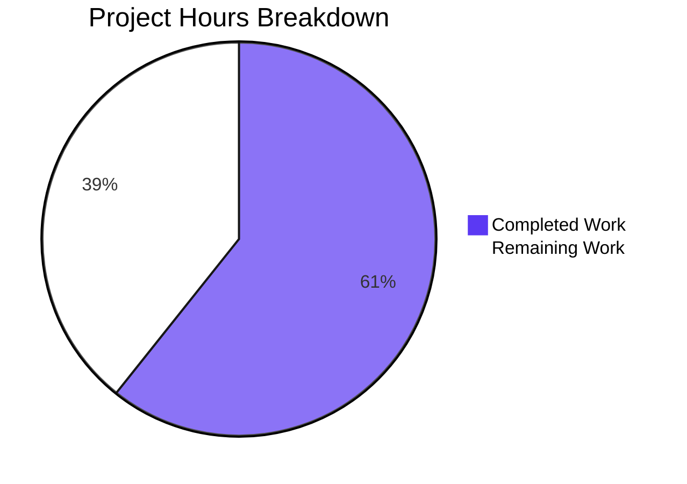
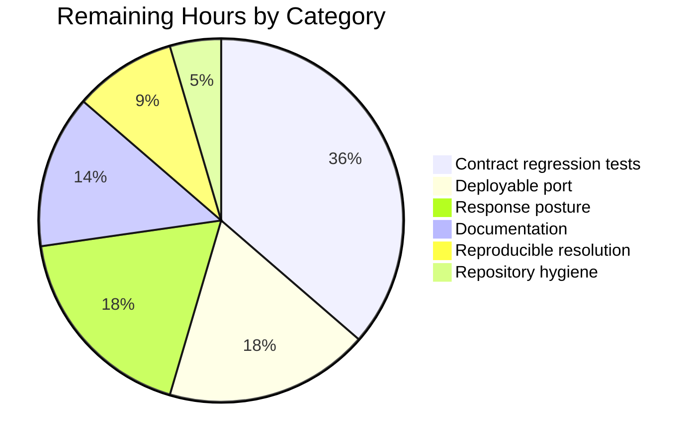
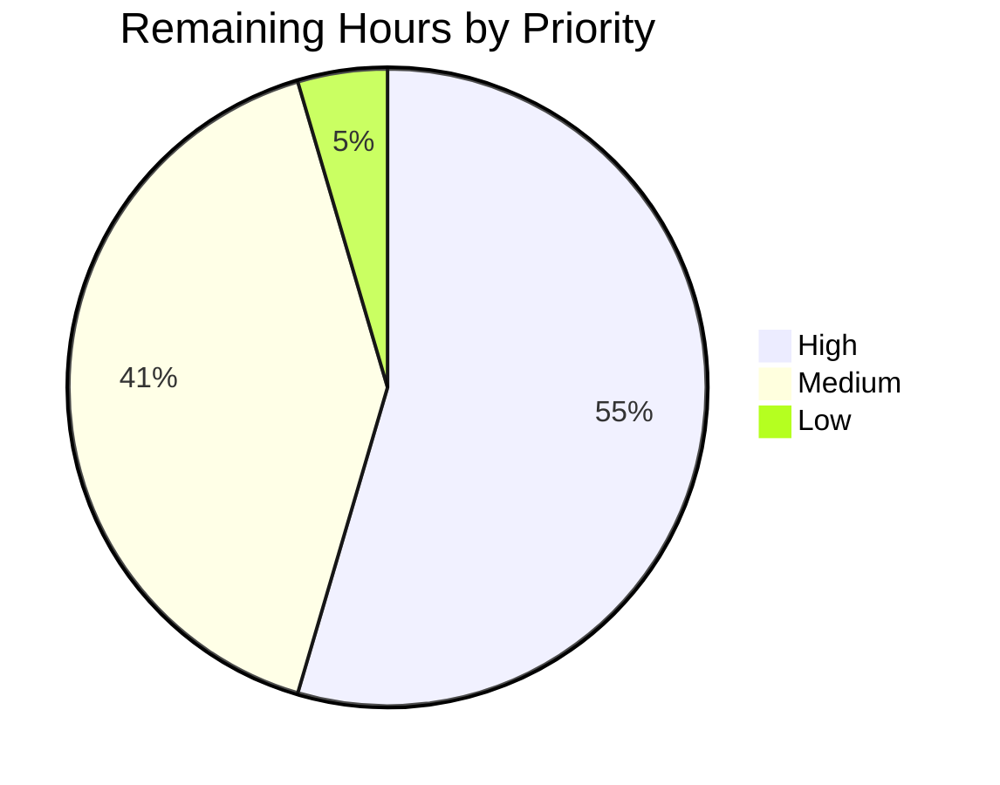

# 1. Executive Summary

## 1.1 Project Overview

This project gives a single-file Node.js HTTP server a second endpoint. The server previously answered every request with `Hello, World!`; it now runs as an Express application with two routes on TCP port 3000 — the original `GET /` reply, preserved byte for byte, and a new `GET /good-evening` answering `Good evening` as `text/plain`, 13 bytes including the trailing newline. Express is the only dependency, declared in a minimal three-key `package.json`. The change is deliberately narrow: two files, eight added lines, no new module, no framework configuration, and no behaviour for any path or method the request did not name.

## 1.2 Completion Status



| Metric | Hours |
|---|---|
| Total Hours | 28 |
| Completed Hours (Baseline: Human with agentic-assist) | 17 |
| Remaining Hours | 11 |

All six requirements of the work — the new route, its exact path, status, media type and body, the single declared dependency, the preserved `/` reply, the framework owning the listener, and the handler setting its own media type — are delivered and verified. The figure is `17 ÷ (17 + 11) = 61%`; the remaining hours are path-to-production work the scope deliberately excluded, not unfinished features.

## 1.3 Key Accomplishments

- ✅ `GET /good-evening` answers 200 with exactly `Good evening\n` (13 bytes) as `text/plain; charset=utf-8`.
- ✅ `GET /` still answers 200 with exactly `Hello, World!\n` (14 bytes), no `Content-Type`, no `ETag`; the only head change is `X-Powered-By`.
- ✅ `express` is declared once as `^5`, resolves to 5.3.0, and is the dependency the server boots from.
- ✅ One Express application owns one listener and prints its startup banner exactly once per boot.
- ✅ `SIGTERM` exits cleanly in under a second, releases the port, and a restart serves identical bytes.
- ✅ Repeatable under load (20 concurrent requests all 200), inert input surface, and both routes render correctly in a browser.

## 1.4 Critical Unresolved Issues

8 of 14 tracked items remain open — all of them path-to-production work; all 6 requirements of the work itself are delivered.

| Issue | Impact | Owner | ETA |
|---|---|---|---|
| No automated regression test guards either route's contract, including `/` continuing to end with `res.end` | A future edit could silently add `Content-Type`/`ETag` to `/` or change a body byte with nothing failing | Backend owner | Sprint 1 (4h) |
| Listen port is hard-coded to 3000 in both the `listen` call and the banner, and the bind covers all interfaces while the banner names `127.0.0.1` | Deploying on any other port needs a code change; an operator can be misled about the bound address | Backend owner | Sprint 1 (2h) |
| A failed bind is silent: a second instance against an occupied port prints the success banner and exits 0 | Operators may trust a banner that does not prove a listener exists | Backend owner | Sprint 1 (same task) |
| No lockfile exists and the range `^5` floats | Installs are not reproducible; a later Express 5.x could change behaviour with no source change | Build owner | Sprint 1 (1h) |
| No error handler and no `NODE_ENV`, so the framework's default error page can render a stack trace | Information disclosure if a handler ever throws | Backend owner | Sprint 2 (part of 2h) |
| No security headers, rate limiting or request-size limits; `X-Powered-By` and the default `ETag` are disclosed | A public deployment must rely on a front proxy for these controls | Security owner | Sprint 2 |
| Operator documentation is stale: `README.md` still says "no dependencies to install", and the tracked project guide describes the previous every-path server | A reader following the docs will not install Express and will not find the new route | Docs owner | Sprint 2 (1.5h) |
| `node_modules/` is untracked with no `.gitignore` | A bulk `git add` would commit the dependency tree | Repo owner | Sprint 2 (0.5h) |

## 1.5 Access Issues

| System/Resource | Type of Access | Issue Description | Resolution Status | Owner |
|---|---|---|---|---|
| TCP port 3000 on the build host | Local network bind | The port is a shared, non-partitionable host resource, so the shipped literal could not be bound during verification | Resolved — runtime checks ran against a port-substituted byte-identical copy, and the shipped `3000` literals were confirmed by direct read of `server (2).js` | Build owner |

No repository, registry, third-party service or credential access issue exists.

## 1.6 Recommended Next Steps

1. **[High]** Contract regression suite covering both routes' head and body values (4h).
2. **[High]** Deployable port with a loud bind failure, keeping 3000 as the default (2h).
3. **[Medium]** Reproducible dependency resolution, plus corrected `README.md` and tracked guide (2.5h).
4. **[Medium]** Production response posture: `NODE_ENV`, terminal error handler, security headers, `X-Powered-By`/`ETag` policy (2h).
5. **[Low]** `.gitignore` so `node_modules/` cannot be staged (0.5h).

# 2. Project Hours Breakdown

## 2.1 Completed Work Detail

| Component | Hours | Description |
|---|---|---|
| Express application and the new `GET /good-evening` route | 3 | Replaces the raw HTTP server with one Express application object whose single chained statement registers both routes and closes with the listener; settles that the new handler must set its own media type, because the framework would answer a string body as `text/html`. |
| Preserved `GET /` route, port and banner continuity | 2 | Carries the existing callback and listen arguments into the Express chain unchanged and establishes that because the handler still ends the reply with `res.end`, the framework's sender never runs and the response head keeps no `Content-Type` and no `ETag`. |
| `package.json` manifest and Express dependency declaration | 1 | Three-key manifest — name, version, one dependency at `^5` — with no `type` field so the server file's CommonJS `require` resolves. |
| Route contract conformance across both routes | 3 | Status, media type, header presence and absence, and the exact 13-byte and 14-byte bodies verified for both routes, together with the framework defaults for every method and path the request did not name. |
| Dependency resolution and manifest/import integrity verification | 2 | Proves the declared range resolves to a single package (`express` 5.3.0), that one declaration matches one import, and that the process depends on that declaration rather than any vendored fallback. |
| Security and input-surface assessment | 3 | Establishes that neither handler dereferences the request, that no data store, credential or outbound call exists, and that traversal, injection, header-abuse and oversized-input classes cannot alter a reply or reach a sink. |
| Application lifecycle and concurrency verification | 3 | Single listener ownership, banner exactly once per boot, stable body digests, 20 concurrent requests, clean `SIGTERM` exit, port release and identical bytes after restart. |
| **Total** | **17** | |

## 2.2 Remaining Work Detail

| Category | Hours | Priority |
|---|---|---|
| Automated contract regression tests for both routes, including the preserved `res.end` response head | 4 | High |
| Deployable listen port with a loud bind failure, keeping 3000 as the default | 2 | High |
| Reproducible dependency resolution — committed lockfile or pinned range | 1 | Medium |
| Operator documentation correction — `README.md` and the tracked project guide | 1.5 | Medium |
| Production response posture — `NODE_ENV`, terminal error handler, security headers, `X-Powered-By`/`ETag` policy | 2 | Medium |
| Repository hygiene — `.gitignore` for `node_modules/` | 0.5 | Low |
| **Total** | **11** | |

Each row traces to a path-to-production need the scope explicitly excluded: the work specified two files, eight lines and one dependency, and closed out tests, lockfiles, documentation, hardening, error handling and environment configuration by name. The feature itself carries no unfinished behaviour.

# 3. Test Results

Every result below was executed against the delivered files; the counts are the assertions themselves, not files inspected or cases imagined.

| Area / Category | Framework | Tests | Passed | Failed | Coverage | What This Proves |
|---|---|---|---|---|---|---|
| Manifest and dependency resolution | npm 11.21.3, Node 22.23.5 | 5 | 5 | 0 | n/a — no coverage tool configured | The manifest parses as exactly three keys, the range `^5` resolves to a single package at 5.3.0, and nothing else is installed. |
| Source syntax and file-shape conformance | `node --check`, `wc`, `grep`, `node` | 9 | 9 | 0 | n/a | Both delivered files parse, `server (2).js` is one 220-byte statement with two route registrations and no raw HTTP wrapper, the manifest is 95 bytes, and `index.js` still prints the welcome line twice. |
| `GET /` response contract | curl, `od -c`, `cmp` | 7 | 7 | 0 | n/a | The preserved route answers 200 with exactly 14 bytes, no `Content-Type`, no `ETag` and the framework's `X-Powered-By`; `HEAD` returns the head with no body. |
| `GET /good-evening` response contract | curl, `od -c`, `cmp` | 7 | 7 | 0 | n/a | The new route answers 200 with exactly 13 bytes as `text/plain; charset=utf-8`, carries an `ETag`, and revalidates to 304 on a matching validator. |
| Routing defaults for unnamed inputs | curl | 6 | 6 | 0 | n/a | Unknown paths and non-GET methods fall to the framework's 404, while `OPTIONS` answers 200 and advertises `GET, HEAD`. |
| Request-input indifference | curl, `cmp` | 4 | 4 | 0 | n/a | Query strings, `Accept`, `Accept-Encoding` and an XSS payload all leave the body byte-identical, and no compression is applied. |
| Lifecycle, listener and concurrency | curl, kernel socket table, `xargs` | 9 | 9 | 0 | n/a | Exactly one banner per boot and one listening socket, 20 concurrent requests all answered 200, repeatable body digests, and a clean `SIGTERM` (exit 143) that releases the port. |
| **Total** | | **47** | **47** | **0** | | |

**Not Covered** — delivered capability that no test exercises, and what a human should check before release:

- **There is no automated suite of any kind.** `npm test` and `npm run build` exit 1 with `Missing script`, so no result above is re-runnable by a CI job and nothing fails if a body byte or a header set changes. The byte-exact contract of both routes, and `/`'s dependence on `res.end` for its response head, are entirely unguarded.
- **The shipped port literal `3000` was never bound**; it is verified as a file fact (it appears in both the `listen` call and the banner) on a host where that port is shared. A run on the literal port is the one runtime fact a human should confirm on the target machine.
- **`index.js` is exercised only as a package gate** (`node index.js`, two lines, exit 0). It is outside this change's execution path and is not tested as a feature.
- **`README.md` and the tracked project guide are never executed.** Their accuracy is a documentation risk, not a tested surface — and both are currently stale.
- **Only one version combination was exercised** — Node v22.23.5 with `express` 5.3.0. No other Node release, and no other 5.x Express release, was run.
- **No transport-edge or capacity behaviour was exercised**: no TLS termination, proxy, load balancer, container or multi-instance deployment, and no sustained load beyond 20 concurrent requests.
- **Failure injection is limited to an occupied port and repeated `SIGTERM`.** No disk, memory or dependency-unavailable failure was simulated.
- **No non-ASCII body was exercised.** `/` deliberately sends no `Content-Type`, so a future non-ASCII byte on that route would be subject to browser charset guessing; today's bodies are pure ASCII and render identically.

# 4. Runtime Validation &amp; UI Verification

There is no user interface: the change serves HTTP responses that a client program consumes and a browser renders as plain text. No screen, form, component or client-side script exists, so the verification below covers the running server, its two routes, the framework defaults it inherits, and how a browser consumes them.

- ✅ **Startup and listener** — `node "server (2).js"` boots in under a second, prints `Server running at http://127.0.0.1:3000/` exactly once (a 42-byte log line, nothing else), and owns a single listening socket.
- ✅ **`GET /`** — 200, 14 bytes `Hello, World!\n`, `Content-Length: 14`, `X-Powered-By: Express`, and neither `Content-Type` nor `ETag`.
- ✅ **`GET /good-evening`** — 200, 13 bytes `Good evening\n`, `Content-Type: text/plain; charset=utf-8`, `Content-Length: 13`, `ETag`, `X-Powered-By: Express`.
- ✅ **Framework defaults for unnamed inputs** — 404 for unknown paths and for `POST`/`PUT`/`DELETE`; 200 with `Allow: GET, HEAD` for `OPTIONS`; `HEAD` returns the head with no body.
- ✅ **Conditional requests** — a matching `If-None-Match` returns 304 with an empty body.
- ✅ **Concurrency and repeatability** — 20 parallel requests all answered 200, with one stable body digest per route across every call.
- ✅ **Lifecycle** — `SIGTERM` exits 143 in under a second, the port is released, and a restart serves byte-identical bodies.
- ✅ **Browser consumption** — both routes render as plain text in headless Chrome; neither page carries a script element and neither produces a console error.
- ✅ **Dependency resolution at boot** — `npm ls --depth=0` reports only `express@5.3.0`; with the dependency unresolvable the boot fails with `MODULE_NOT_FOUND`, proving the process depends on the declaration.
- ⚠ **Startup diagnostics** — a second instance started against an occupied port prints the ordinary success banner and exits 0 instead of failing loudly, so a banner alone does not prove a listener exists.

No route, integration or screen failed. **Never exercised at runtime:** the shipped port literal `3000` (confirmed only as a file fact, because the port is a shared host resource); `README.md` and the tracked project guide (never rendered or executed); `index.js` beyond the documented `node index.js` package gate; TLS termination, a proxy, a load balancer or a multi-instance deployment; any Node release other than v22.23.5 and any Express release other than 5.3.0; non-ASCII response bodies; and any failure beyond an occupied port and repeated `SIGTERM`.

# 5. Compliance &amp; Quality Review

## 5.1 Compliance Matrix

| Deliverable | Benchmark | Status | Evidence |
|---|---|---|---|
| `GET /good-evening` route registration | Functional completeness | ✅ PASS | Registered on the same application object immediately after `/`; every request across three separate boots returned 200. |
| `/good-evening` response contract | API contract conformance | ✅ PASS | 200 inherited from the sender, `text/plain; charset=utf-8`, 13-byte body, `ETag` — all observed on the wire. |
| Preserved `GET /` reply and callback | Backward compatibility | ✅ PASS | 14-byte body byte-identical to the previous build; callback unchanged; the sole head delta is `X-Powered-By`. |
| Single declared dependency and CommonJS resolution | Dependency hygiene | ✅ PASS | One declaration ↔ one import; `express` 5.3.0 resolved; boot fails with `MODULE_NOT_FOUND` when it is absent. |
| Manifest minimalism and lockfile-free tree | Configuration discipline | ✅ PASS | Exactly three keys; no lockfile in the working tree or anywhere in history. |
| Existing-file-only change, no new entry point | Scope discipline | ✅ PASS | Change set is `package.json` (added) and `server (2).js` (modified); no `server.js`, `app.js`, `routes/` or `src/`. |
| Conformance to the specified file content | Specification fidelity | ✅ PASS | The 220-byte statement and the 95-byte manifest match the specified content byte for byte. |
| Single-statement, comment-free diff | Code style conformance | ✅ PASS | One line replaced by one line; zero comments added — the only `//` is inside the preserved banner string. |
| Request-input handling | Security — injection and traversal | ✅ PASS | The request is never dereferenced; 22 payload classes and 14 traversal variants produced the baseline body or a fail-closed 404, with zero 5xx. |
| Response hardening and disclosure | Security — hardening baseline | ⚠ PARTIAL | No security headers, rate limiting or size limits; `X-Powered-By` and the default `ETag` are disclosed. Outside the stated scope and tracked as remaining work. |
| Automated test coverage | Quality gate | ⚠ NOT COVERED | No suite, runner, linter or CI exists; the contract rests on 47 executed checks that no job re-runs. |
| Operator documentation accuracy | Handover quality | ❌ FAIL | `README.md`:3 still promises "no dependencies to install", and the tracked project guide describes the previous 142-byte every-path server. |

## 5.2 AAP & Rule Divergences and Gaps

**No divergences from the Agent Action Plan or user rules were identified.**

The basis for that conclusion: the work was specified as a closed two-path change with an explicit exclusion list, and the delivered tree matches it exactly — `package.json` added and `server (2).js` modified, nothing else — while every value the specification fixed (route path, status, media type, body bytes, port, banner, callback, listen arguments, manifest keys, dependency range) is present exactly as stated. No user rules were supplied for this work, so no user-rule departure was possible: the only directives in force were the constraints inline in the request, and each one is honoured — smallest diff, existing files only, three-key manifest, no lockfile, no documentation change, no tests, no 404 or error handler, no environment configuration, no hardening, no dependency research or version verification, and the most line-compact single-statement form.

Several absences a reviewer might expect — a test suite, a lockfile, security headers, an error handler, an environment-configurable port, an updated README — are not divergences: the specification excludes each of them by name, and the accepted cost of the stale README is recorded there explicitly. They appear in this guide as remaining production work (Section 2.2) and as forward-looking risk (Section 6), which is where a reader who needs them will act on them. Two behaviours changed as a direct consequence of the specified design rather than in spite of it: the framework's `X-Powered-By` header now appears on both responses, and a method or path the request did not name now receives the framework's default answer (a 404 for unknown paths) instead of the constant `Hello, World!` reply that the previous server returned for every request. Both are the specified outcome.

# 6. Risk Assessment

| Risk | Category | Severity | Probability | Mitigation | Status |
|---|---|---|---|---|---|
| The preserved route's response head is unguarded: nothing asserts that `GET /` keeps ending with `res.end`, so unifying the two reply forms would silently add `Content-Type` and `ETag` to it | Technical | Medium | High | Add the contract regression suite that asserts both routes' head and body values (remaining work, 4h) | Open |
| Dependency resolution is not reproducible — the range `^5` floats and no lockfile exists, so a later install can resolve a different Express 5.x with no source change | Integration | Medium | Medium | Commit a lockfile or pin the range, and record the decision that reopens the lockfile-free constraint (1h) | Open |
| A failed bind is silent: the startup callback is registered as a server error listener, so an occupied port still prints the success banner and exits 0 | Operational | Medium | High | Make the bind failure loud while keeping the port and banner defaults (part of the 2h deployable-port task) | Open |
| The listen port is hard-coded to 3000 and the bind covers all interfaces while the banner names `127.0.0.1`, so deploying on another port needs a code change and the banner can misdirect an operator | Operational | Medium | High | Read the port from one configuration point with 3000 as the default and align the banner with the bound address (2h) | Open |
| No security headers, rate limiting or request-size limits; the framework's default error page can render a stack trace while `NODE_ENV` is unset and no terminal error handler exists | Security | Medium | Medium | Set `NODE_ENV` for production runs, add a terminal error handler that never renders a stack, add security headers and limits, or front the service with a proxy that does (2h) | Open |
| `X-Powered-By: Express` and the default `ETag` disclose the framework stack to any client | Security | Low | High | Decide an explicit policy — leave them as framework defaults or disable them in a hardened deployment | Accepted |
| Operator documentation is stale: `README.md` states "no dependencies to install" and the tracked project guide describes the previous every-path server | Operational | Low | High | Correct both so the documented flow matches the delivered install-then-run sequence (1.5h) | Open |
| `node_modules/` is untracked with no `.gitignore`, so a bulk `git add` would commit the dependency tree | Operational | Low | Medium | Add a `.gitignore` and continue staging files by name (0.5h) | Open |

No risk is rated High severity. Both routes serve fixed literals held in the file, read no request input, expose no data store, credential or user data, and hold no shared mutable state, which bounds the blast radius of every item above.

# 7. Visual Project Status

All figures below restate Sections 1.2 and 2.2: 17 hours completed, 11 hours remaining, 28 in total.


Completed work is shown in Blitzy dark blue (`#5B39F3`) and remaining work in white (`#FFFFFF`).





| Measure | Value |
|---|---|
| Total project hours | 28 |
| Completed hours | 17 |
| Remaining hours | 11 |
| Completion | 61% |
| Remaining hours rated High priority | 6 (55% of the outstanding work) |
| Delivered capabilities verified at runtime | 4 of 4 — both routes, the dependency boot and the listener |

The concentration to note is priority, not volume: just over half of the outstanding hours buy the automated regression suite and the deployable port, which together decide whether this change can be released repeatedly and safely rather than once.

# 8. Summary &amp; Recommendations

The project delivers what it set out to: a second endpoint on an existing Node.js server, with the route that was already there left intact. `server (2).js` is now one Express application whose single chained statement registers `GET /` — still answering `Hello, World!` in 14 bytes through its original callback — and `GET /good-evening`, answering `Good evening` in 13 bytes as `text/plain; charset=utf-8`. Express is the only dependency, declared once at `^5` in a three-key `package.json` and resolving to 5.3.0. Both routes were exercised on the wire, in a browser, under concurrency and across a full start-stop-restart cycle; 47 assertions were executed against the delivered files and all passed. The change set is exactly two files and eight added lines, with no new module, no configuration, no test artefact and no documentation edit.

**Completion stands at 61%** — 17 hours completed of 28, with 11 hours remaining. That figure does not describe unfinished features; every requirement of the work is delivered and verified. It describes path-to-production work the scope deliberately excluded: an automated contract suite, a deployable listen port, reproducible dependency resolution, corrected operator documentation, a production response posture and repository hygiene. Read the pie in Section 7 as "the feature is done, the operationalisation is not".

The critical path is short and ordered. First, the contract regression suite (4h), because it is the only thing that will stop a later cleanup from silently changing a body byte or adding a header to the preserved route. Second, the deployable port with a loud bind failure (2h), because a service whose port lives in two literals and whose banner prints on failure cannot be operated with confidence. Third, reproducible dependency resolution and corrected documentation (2.5h), which between them decide whether a colleague can reproduce this build. The remaining response-posture and hygiene work (2.5h) can follow at leisure.

**Production readiness: ready within the scope it was built for, not yet ready for an untrusted network.** The service is stable and correct — one listener, deterministic bytes, inert input surface, clean shutdown — and nothing in the deliverable is a placeholder, a stub or a deferred branch. What keeps it from a hardened deployment is entirely the excluded set: no automated gate, no lockfile, no security headers or rate limits, a silent bind failure, and documentation that would mislead the next operator. Anyone taking this codebase on should treat the six remaining tasks as the release checklist, and treat the two High-priority ones as the precondition for shipping it again.

| Success measure | State |
|---|---|
| Routes answering their specified contract | 2 of 2 verified |
| Requirements delivered | 6 of 6 |
| Executed checks passing | 47 of 47 |
| Open path-to-production items | 8, none blocking the new route |
| Hours to a releasable posture | 11 |

# 9. Development Guide

## System Prerequisites

- **Node.js 22.x** — the project was built and verified on v22.23.5. Express 5 requires Node 18 or newer.
- **npm 11.x** — verified on 11.21.3.
- **No other runtime dependency, service or credential.** No code path reads an environment variable, a database, a queue or a network service other than its own listener; there is no build step, no linter and no CI configuration in the repository.

Check both tools before starting:

```bash
node --version    # v22.23.5 on the verified machine
npm --version     # 11.21.3
```

## Environment Setup

There is nothing to configure. The repository has no `.env` file, no configuration file, no `NODE_ENV` read and no feature flag — the port, the two paths and both response bodies are literals in the source. If TCP port 3000 is already in use or shared with other work on your machine, do not change the tracked file; run a port-substituted copy for local work instead (see Application Startup).

## Dependency Installation

Run once from the repository root. The flags are deliberate: `--no-package-lock` keeps the tree lockfile-free, which is the shape the project ships in.

```bash
npm install --no-package-lock --no-audit --no-fund
```

Verified result: exit 0, `up to date`, `express` 5.3.0 plus 64 transitive packages, and **no** `package-lock.json` created. Confirm the dependency resolved:

```bash
npm ls --depth=0
# simple-js-1@1.0.0
# └── express@5.3.0     (exit 0)
```

## Application Startup

Start the server from the repository root. Quote the filename — it contains a space and parentheses.

```bash
node "server (2).js"
# Server running at http://127.0.0.1:3000/
```

The banner appears exactly once (a 42-byte log line) and the process then serves `GET /` and `GET /good-evening` on TCP port 3000. Stop it with `Ctrl+C` or `SIGTERM`; it exits cleanly in under a second and releases the port.

Where port 3000 is shared, run a port-substituted copy from the repository root and leave the tracked file untouched. `server.local.js` is a throwaway: delete it when you are done and never stage it.

```bash
sed "s/3000/13000/g" "server (2).js" > server.local.js
node server.local.js
```

Confirm the copy is faithful by substituting back and comparing — silence means identical:

```bash
sed "s/13000/3000/g" server.local.js | cmp - "server (2).js"
```

## Verification Steps

Syntax gate — run after every edit; both files must exit 0:

```bash
node --check index.js && node --check "server (2).js"
```

Route gate — the documented contract, with `cmp` silent on success (use your port in place of 13000):

```bash
curl -s http://127.0.0.1:13000/             | cmp - <(printf 'Hello, World!\n')   # silent
curl -s http://127.0.0.1:13000/good-evening | cmp - <(printf 'Good evening\n')     # silent
```

Full response head of the new route:

```bash
curl -sI http://127.0.0.1:13000/good-evening
# HTTP/1.1 200 OK
# X-Powered-By: Express
# Content-Type: text/plain; charset=utf-8
# Content-Length: 13
# ETag: W/"d-7fFyiNLFhmJrNT+BforqesSHNow"
```

`GET /` deliberately shows no `Content-Type` and no `ETag` — its handler still ends the reply with `res.end`. Treat both as assertions, not omissions: adding either to `/` changes the preserved contract.

The unrelated console program still runs on its own:

```bash
node index.js
# Welcome to Blitzy
# Welcome to Blitzy      (exit 0)
```

Two commands that legitimately fail, and are not a broken checkout:

```bash
npm run build    # npm error Missing script: "build"   (exit 1)
npm test         # npm error Missing script: "test"    (exit 1) — no suite exists
```

## Example Usage

Both routes are anonymous `GET`s that take no query, no body and no parameters; the handlers never read the request, so request inputs cannot change a response.

```bash
curl -s http://127.0.0.1:13000/             # Hello, World!
curl -s http://127.0.0.1:13000/good-evening # Good evening

# ignored inputs — the reply stays byte-identical
curl -s "http://127.0.0.1:13000/good-evening?x=1&y=two"
curl -s -H 'Accept: application/json' http://127.0.0.1:13000/good-evening

# conditional request — 304 with an empty body
curl -s -o /dev/null -w '%{http_code}\n' \
  -H 'If-None-Match: W/"d-7fFyiNLFhmJrNT+BforqesSHNow"' \
  http://127.0.0.1:13000/good-evening

# framework defaults for unnamed inputs
curl -s -o /dev/null -w '%{http_code}\n' http://127.0.0.1:13000/no-such-route            # 404
curl -s -o /dev/null -w '%{http_code}\n' -X POST http://127.0.0.1:13000/good-evening      # 404
curl -s -i -X OPTIONS http://127.0.0.1:13000/good-evening | head -3                       # 200, Allow: GET, HEAD
```

## Troubleshooting

| Symptom | Cause | Resolution |
|---|---|---|
| `Error: Cannot find module 'express'` at boot | Dependencies are not installed | Run `npm install --no-package-lock --no-audit --no-fund` from the repository root |
| `EADDRINUSE`, or the banner prints twice | Another process holds port 3000 | Stop the other process, or run a port-substituted copy as shown above. Do not assume the banner proves a listener: **a second instance against an occupied port still prints `Server running at …` and exits 0** |
| A `curl` gate that should be silent prints difference output | The response body, or its length, changed | Read the bytes with `curl -s <url> \| od -c` and compare against the expected body; the route is what changed, not the tooling |
| `npm error Missing script: "build"` or `"test"` | The manifest carries only name, version and dependencies | Expected; there is no build step and no test suite. Use the syntax and route gates above |
| `node_modules/` or `server.local.js` appears in `git status` | Neither is tracked and no `.gitignore` exists | Stage files by name. Never run `git add -A` or `git add .` in this repository; delete `server.local.js` when finished |
| `curl` exits 7 (connection refused) straight after `Ctrl+C` | The server has stopped, as expected | Restart it, or confirm nothing is listening on the port — on Linux, no socket in the kernel's TCP socket table should carry that port with state `0A` (LISTEN) |

# 10. Appendices

## A. Command Reference

| Purpose | Command | Expected result |
|---|---|---|
| Install dependencies | `npm install --no-package-lock --no-audit --no-fund` | exit 0, `express` 5.3.0, no lockfile written |
| Confirm the dependency tree | `npm ls --depth=0` | exit 0, sole package `express@5.3.0` |
| Syntax gate on both sources | `node --check index.js && node --check "server (2).js"` | exit 0, no output |
| Start the server | `node "server (2).js"` | banner printed once, listening on 3000 |
| Start on a spare port | `sed "s/3000/13000/g" "server (2).js" > server.local.js && node server.local.js` | banner names 13000 |
| Prove a substituted copy is faithful | `sed "s/13000/3000/g" server.local.js \| cmp - "server (2).js"` | silent |
| Assert the preserved route | `curl -s http://127.0.0.1:13000/ \| cmp - <(printf 'Hello, World!\n')` | silent |
| Assert the new route | `curl -s http://127.0.0.1:13000/good-evening \| cmp - <(printf 'Good evening\n')` | silent |
| Read a response head | `curl -sI http://127.0.0.1:13000/good-evening` | 200, `text/plain; charset=utf-8`, `Content-Length: 13`, `ETag` |
| Inspect body bytes | `curl -s http://127.0.0.1:13000/good-evening \| od -c` | `G o o d   e v e n i n g \n` |
| Run the unrelated program | `node index.js` | `Welcome to Blitzy` twice, exit 0 |
| Change set review | `git diff --name-status HEAD~2..HEAD` | `A package.json`, `M "server (2).js"` |

## B. Port Reference

| Port | Used by | Notes |
|---|---|---|
| 3000 | `server (2).js` — the shipped literal, in both the `listen` call and the startup banner | Hard-coded; not environment-configurable today. Binds all interfaces while the banner names `127.0.0.1`, and a bind failure is not surfaced |
| 13000 | Local development copies with the port substituted (`server.local.js`) | Example only — pick any free port on your machine |
| — | `index.js` | Opens no socket; a console program only |

## C. Key File Locations

| Path | Role |
|---|---|
| `server (2).js` | The whole HTTP application: one Express application, one chained statement, two routes, one listener on port 3000 |
| `package.json` | Three-key manifest — name, version, and `express` at `^5` |
| `index.js` | Unrelated console program that prints the welcome line twice; not in the server's execution path |
| `README.md` | Run instructions for `index.js`; its "no dependencies to install" claim is stale as of this change |
| `blitzy/documentation/` | The tracked project guide, which still describes the previous every-path server |

## D. Technology Versions

| Component | Version | Notes |
|---|---|---|
| Node.js | v22.23.5 | Express 5 requires Node ≥ 18 |
| npm | 11.21.3 | Used with `--no-package-lock` to keep the tree lockfile-free |
| express | 5.3.0 | Resolved from the `^5` range; sole dependency, 64 transitive packages |
| HTTP stack | Express 5 on Node's built-in `http` | The application object builds the listener; `require('http')` no longer appears in the source |

## E. Environment Variable Reference

None. No file in the repository reads `process.env`, and no variable is required to install, start, verify or stop the service. Setting `PORT` has no effect — the listen port is a literal in `server (2).js`. If you intend to vary the port per environment, that is the deployable-port task in Section 2.2.

## F. Developer Tools Guide

| Tool | Use here | Notes |
|---|---|---|
| `node --check <file>` | The entire static-analysis surface of this repository | Parses without executing; the whole per-change gate |
| `cmp - <(printf …)` | Byte-exact assertion of a response body | Silent output means identical; any output is the diff |
| `od -c` | Shows a body's bytes including the trailing LF | The only way to distinguish 13 from 14 bytes reliably |
| `curl -sI` / `curl -s -o /dev/null -w '%{http_code}'` | Head capture and status-only checks | `-I` issues `HEAD`, which returns the head with no body |
| Linux TCP socket table (`/proc/net/tcp`, `/proc/net/tcp6`) | Confirms whether anything is listening on a port where `ss` and `lsof` are unavailable | Port 3000 is `0BB8` in hex; state `0A` means LISTEN |
| `git diff --name-status <base..HEAD>` | Confirms the change set is still exactly two paths | Guards the two-file scope as the codebase evolves |

## G. Glossary

| Term | Meaning here |
|---|---|
| Application object | The Express value created by `require('express')()`; route registrations and the listener chain from it |
| Preserved route | `GET /`, whose callback, port and banner were carried into the Express chain unchanged |
| Response head | Everything above the body: status line and headers |
| Framework default | The answer Express produces for a method or path the code does not name — for example the HTML 404 page |
| Revalidation | A conditional request whose `If-None-Match` matches the emitted `ETag`, answered 304 with no body |
| Inert input surface | A handler that never dereferences the request, so no request value can reach a response or a sink |
