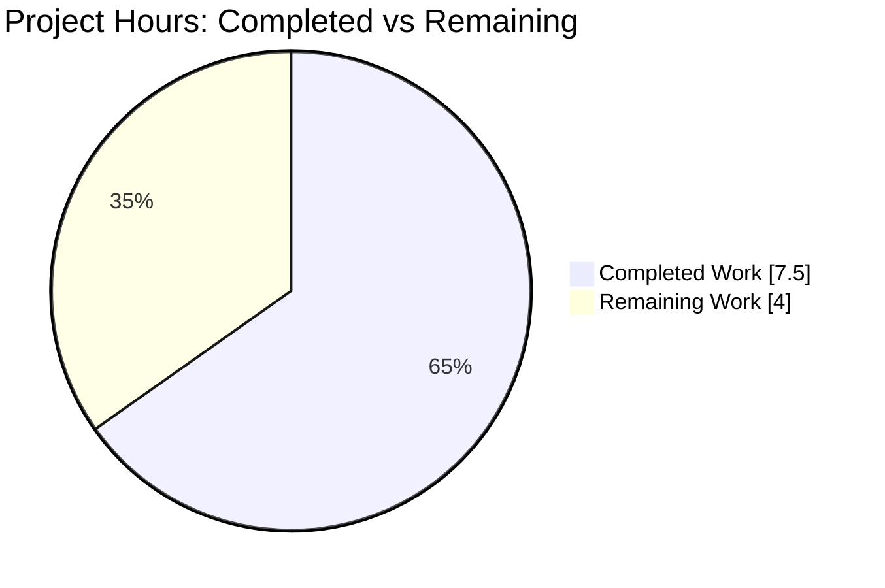
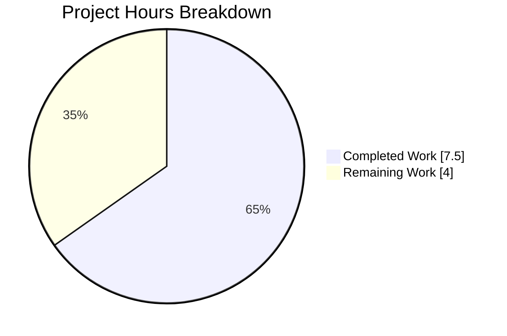

# 1. Executive Summary

## 1.1 Project Overview

`index.js` is a two-line, zero-dependency Node.js console program: one JSDoc summary line above a single `console.log` that writes `Welcome to Blitzy` twice to standard output, unformatted — 36 bytes, two identical lines. `README.md`, three lines, states what it prints and how to run it. Its users are a developer at a terminal or an automated step. Scope is deliberately minimal: no framework, dependency, manifest, build step, configuration, test suite or CI.

## 1.2 Completion Status

Every requirement of the delivered request is met and verified. The 65% measures the work delivered and exercised against the path-to-production confirmations that remain.



| Metric | Hours |
|---|---|
| Total Hours | 11.5 |
| Completed Hours (AI + Manual) | 7.5 |
| Remaining Hours | 4.0 |

Completion = 7.5 ÷ (7.5 + 4.0) = **65%**.

## 1.3 Key Accomplishments

- Two bare lines of `Welcome to Blitzy` per run: 36 bytes, exit 0, identical every time.
- No formatting — no colour, label, prefix, banner, indentation or separator.
- One tag-free JSDoc summary line above the only statement in a two-line file.
- A three-line README whose documented command reproduces the lines it claims.
- A zero-dependency run: no manifest, lockfile or install step, identical under an empty environment.
- Deterministic and side-effect free across repeats, ten simultaneous runs, pipes and a pty.
- Existing tracked source byte-identical; two files touched, no manifest, test, CI or configuration artefact.

## 1.4 Critical Unresolved Issues

Five open items remain across the 21 requirements assessed: 17 met outright, 3 partially met, 1 not started — two items come from that single unstarted requirement. None blocks release.

| Issue | Impact | Owner | ETA |
|---|---|---|---|
| The target host has never been confirmed to supply Node.js, and no manifest may pin a version | A host without Node fails with a shell error rather than a program message; another Node major is unproven | Repository owner | 1.0 h |
| The pre-existing `server (2).js` is undocumented in `README.md` | A README-only reader cannot discover that a second runnable program sits at the root | Repository owner | 1.0 h |
| That server binds fixed TCP port 3000 | A service co-scheduled on port 3000 fails with `EADDRINUSE` | Repository / host owner | 0.5 h |
| The tracked document under `blitzy/documentation/` still describes the earlier single-print program | A maintainer trusting it over the code may "correct" a compliant `index.js` | Repository owner | 1.0 h |
| `README.md` does not state that the command is run from the repository root | A relative run from another directory fails with a module-resolution error | Repository owner | 0.5 h |

Four conditions are accepted with no action: the Node.js prerequisite above, a silently discarded stdout write, the unguarded link between the occurrences and the README's "twice", and the pty's CRLF rendering.

## 1.5 Access Issues

No access issues identified. The program reads no credential, environment variable, endpoint or third-party API, and needs only a Node.js runtime.

## 1.6 Recommended Next Steps

1. **[High]** Confirm the target host supplies a supported Node.js and that the gate prints both lines there.
2. **[Medium]** Record the pre-existing `server (2).js` and its fixed port in a maintenance note.
3. **[Medium]** Assign ownership of TCP port 3000 before that server runs alongside another service.
4. **[Low]** Bring the tracked document under `blitzy/documentation/` in line with the twice-print behaviour.
5. **[Low]** State the repository-root premise in `README.md`, keeping it at three lines.

# 2. Project Hours Breakdown

## 2.1 Completed Work Detail

| Component | Hours | Description |
|---|---|---|
| `index.js` — the twice-printing program | 1.5 | The two-line file: one `/** ... */` summary naming the twice behaviour, then a single `console.log("Welcome to Blitzy\nWelcome to Blitzy")` emitting both occurrences. |
| `README.md` — the run instruction | 0.5 | Three lines: a heading, a blank line, and one sentence naming the printed string, the count, the command `node index.js` and the absence of any install step. |
| Scope containment and existing-code integrity | 0.5 | Two paths touched, zero paths added, no manifest, lockfile, test, CI or configuration artefact; the pre-existing `server (2).js` left byte-identical. |
| Static content and structure verification | 1.5 | Byte identity and shape of both files, the single tag-free JSDoc line, the README line cap and the absence of every excluded section. |
| Runtime behavioural verification | 2.0 | The 38 executed checks: parse-and-run gate, output bytes and formatting, stdio contract and output devices, environment and input independence, determinism and concurrency, portability and shell consumers. |
| Documentation-claim verification | 1.0 | Every README claim falsified against the code and the tree, then the documented command extracted from `README.md:3` and executed verbatim. |
| Commit message and change description | 0.5 | Concise and decision-only: the three changed lines stated plainly, with the file contents as the criterion, no rejected alternative and the file list given once. |
| **Total** | **7.5** | Completed effort across the whole delivery. |

## 2.2 Remaining Work Detail

| Category | Hours | Priority |
|---|---|---|
| Target-host runtime confirmation — confirm Node.js is on `PATH` at a supported version and that the documented command prints both lines there; no manifest may enforce either | 1.0 | High |
| Pre-existing `server (2).js` discoverability — decide where the second runnable file at the root is recorded, then record it | 1.0 | Medium |
| TCP port 3000 ownership — assign the fixed port the pre-existing server binds, or isolate its binding, before it runs alongside other services | 0.5 | Medium |
| Tracked document refresh — bring the document under `blitzy/documentation/` in line with the twice-print behaviour | 1.0 | Low |
| Run-premise wording — state in `README.md` that the command is run from the repository root, keeping the file at three lines | 0.5 | Low |
| **Total** | **4.0** | |

# 3. Test Results

The repository carries no test framework, runner, assertion library or coverage tool, and none may be added, so verification is the executable gate `node --check index.js && node index.js` plus behavioural probes run against the delivered files. **38 checks were executed, 38 passed, 0 failed.** Coverage is not instrumented anywhere, because no coverage tooling exists in the repository or is permitted in it.

| Area / Category | Framework | Tests | Passed | Failed | Coverage | What This Proves |
|---|---|---|---|---|---|---|
| Parse and run gate | Node.js v22.23.5 + POSIX shell | 2 | 2 | 0 | Not instrumented | `index.js` parses clean and runs to completion with exit status 0 |
| Output bytes, identity and formatting | shell with `od`/`cmp`/`sort`/`sha256sum` | 7 | 7 | 0 | — | The emitted stream is exactly two 17-byte lines of `Welcome to Blitzy` plus two LF terminators — 36 bytes, byte-identical to the reference stream, with no escape, carriage return or decoration |
| Stdio contract and output devices | shell with redirected descriptors and a pty | 5 | 5 | 0 | — | The lines reach stdout only, nothing reaches stderr, and an early-closing, closed or rejecting device leaves the exit status at 0 |
| Environment and input independence | shell environment variants | 4 | 4 | 0 | — | Output is byte-identical under an empty environment, forced colour, `TERM`/locale variation, a closed stdin and stray arguments |
| Determinism and concurrency | `sha256sum` with sequential and parallel runs | 3 | 3 | 0 | — | Every run emits one identical hash, the same hash ten simultaneous runs produce, equal to the reference stream's |
| Portability and shell consumers | shell (`sh -c`, absolute path, pipes) | 4 | 4 | 0 | — | The same 36 bytes come out from a foreign working directory and through `sh -c`; `head -c 4` gives `Welc` and an append adds exactly two lines |
| Documented run instruction | command extracted from `README.md:3` | 3 | 3 | 0 | — | The command the README prints runs verbatim with nothing installed and produces the two occurrences the README claims |
| Source shape, dependency hygiene and tree integrity | `wc`/`grep`/`git` | 10 | 10 | 0 | — | Two source lines and one tag-free JSDoc; no hardening, input or module construct; no manifest, lockfile, dependency or excluded artefact; the working tree stays clean and the pre-existing `server (2).js` blob is unchanged |

**Not Covered.** No automated suite, runner or CI exists in the repository and none may be added, so nothing above is re-runnable by a pipeline — the standing verification a human should run after any edit is `node --check index.js && node index.js`, compared against `printf 'Welcome to Blitzy\nWelcome to Blitzy\n'`. Also unexercised: `README.md` rendering through a Markdown parser (none installed, none permitted; its structure is one heading, one blank line and one paragraph); any Node.js version other than v22.23.5 and any non-Linux host, although the file uses no version-specific feature; Deno and Bun; the pre-existing `server (2).js` beyond its presence and unmodified blob, since it binds a fixed port and may not be started alongside other work; and any interface or browser surface, because the delivery serves no HTTP and renders no page. A human should additionally confirm, after any future edit, that the count still agrees across its five occurrences of the literal — `index.js:1`, twice on `index.js:2`, `README.md:1` and `README.md:3` — and the word "twice" in each file.

# 4. Runtime Validation & UI Verification

- ✅ **Start-up and run** — `node index.js` from the checkout root: exit 0, 36 bytes on stdout, 0 bytes on stderr, ~31 ms elapsed.
- ✅ **Primary journey** — the emitted stream is byte-identical to a reference built from the two-line literal: two lines, each byte-for-byte `Welcome to Blitzy`.
- ✅ **Formatting** — no escape byte, carriage return, BOM, indentation, line number, label, prefix or separator; `sort -u` collapses the output to one bare line.
- ✅ **Environment independence** — identical bytes under `env -i`, `FORCE_COLOR=3 CLICOLOR_FORCE=1`, `TERM=xterm-256color`, `LANG=C` and `NO_COLOR=1`.
- ✅ **Stream separation** — stderr carries 0 bytes; both lines reach stdout only.
- ✅ **Documented instruction** — `node index.js`, extracted from `README.md:3`, ran verbatim from the root with no install step: exit 0, identical bytes, no stderr.
- ✅ **Portability and consumers** — a foreign working directory, `/`, `sh -c`, `node ./index.js`, stray arguments, `| head -1`, `| head -c 4`, `| wc -l` and an append redirection all behave as documented.
- ✅ **Concurrency** — ten simultaneous runs produced identical output, exit 0 and zero bytes of stderr.
- ⚠ **Partial — output-device behaviour** — stdout to a rejecting device (`>/dev/full`) and to a closed descriptor (`>&-`) both exit 0 while the line is discarded; under a pty the terminal adds CR before each LF, so a terminal transcript reads 38 bytes where a redirected capture reads 36.
- ❌ **Never exercised at runtime** — the pre-existing `server (2).js` (it binds fixed TCP port 3000 and was not started), any Node.js major other than v22.23.5, any non-Linux host, Deno or Bun, a Markdown renderer for `README.md`, and any browser or HTTP surface of the delivered program, which has none.

# 5. Compliance & Quality Review

## 5.1 Compliance Matrix

| # | Deliverable / Requirement | Benchmark | Status | Evidence |
|---|---|---|---|---|
| 1 | `Welcome to Blitzy` written twice per run | Functional correctness | ✅ PASS | Exit 0, 36-byte capture, two occurrences, `cmp` clean against the reference stream (`index.js:2`) |
| 2 | No colour, label, line number, prefix, banner, box, indentation, quoting or separator | Output fidelity | ✅ PASS | Zero escape and carriage-return bytes; 17 characters per line; the output reduces to one bare line (`index.js:2`) |
| 3 | Two-line file: one JSDoc summary plus one statement | Code hygiene | ✅ PASS | 2 lines / 113 bytes; one comment line, one `console.log`, one semicolon (`index.js`) |
| 4 | Single `/** ... */` summary with no tag, second paragraph or example | Specification conformance | ✅ PASS | Opened and closed on line 1; zero `@` characters in the file (`index.js:1`) |
| 5 | `README.md` states what the program prints and the command that runs it | Documentation accuracy | ✅ PASS | 3 lines / 128 bytes; the stated command was executed verbatim and matched, and "twice" equals the observed count (`README.md:3`) |
| 6 | `README.md` under five lines with none of the excluded sections | Documentation scope | ✅ PASS | 3 lines, one heading, one sentence; no contributing, license, testing, deployment, architecture or table-of-contents content (`README.md`) |
| 7 | Smallest possible diff; no unrelated refactoring, reformatting or renaming | Change discipline | ✅ PASS | Commit `c6b1fd3`: `README.md` 1+/1−, `index.js` 2+/2−, status `M` only, no mode change, heading and blank line byte-identical |
| 8 | No file beyond the two in scope; no new path | Scope discipline | ✅ PASS | Zero added paths in the change; a 28-name artefact probe plus a recursive test/CI search find nothing |
| 9 | No test suite, test file, lockfile, dependency or manifest | Dependency hygiene | ✅ PASS | `package.json`, both lockfiles, `pnpm-lock.yaml`, `npm-shrinkwrap.json`, `node_modules` and any test/spec/coverage path all absent |
| 10 | No 404 handler, error handler, environment configuration, argument parsing or logging | Security baseline | ✅ PASS | Hardening and code-shape grep over `index.js` matches nothing; `env -i` run identical; stray arguments ignored |
| 11 | Pre-existing tracked source untouched | Existing-code integrity | ✅ PASS | `server (2).js` blob `2886290f…` identical to its base-commit blob; never executed |
| 12 | Deterministic, idempotent, side-effect free, with an executable gate | Operability and testability | ✅ PASS with caveat | Repeats, ten concurrent runs and every consumer form agree; the gate is `node --check index.js && node index.js`, with no automated suite and no error handler by instruction |

## 5.2 AAP & Rule Divergences and Gaps

Eight divergences were identified: five are sanctioned by the repository owner's change request, which outranks the plan, and three are gaps between the plan's statements and the repository it describes. No divergence from a separately supplied user rule exists, because the plan states none; the owner's fourteen constraints are themselves a divergence from that statement and are row 6.

| What the AAP/Rule Required | What Was Delivered Instead | Why It Diverged | Impact | Remediation |
|---|---|---|---|---|
| §0.1.1 FR1: the script writes the literal once per run; §0.1.2 preserves that single-print instruction | `index.js:2` writes it twice — two lines, 36 bytes | The owner's change request restated the requirement as twice printed, and their instruction outranks the plan | None on correctness; a check still comparing against one line reads a correct delivery as failing | **Sanctioned** — none; reverting would undo the requested behaviour |
| §0.5.1 fixes the exact `index.js` text as `/** Prints "Welcome to Blitzy" to standard output. */` plus `console.log("Welcome to Blitzy");` | Line 1 reads `/** Prints "Welcome to Blitzy" twice to standard output. */`; line 2 emits both occurrences from the one statement | Same request; the frozen sentence would have been false against the new statement, so the summary was reworded and nothing else moved | None; the two-line shape, the single statement and the single summary line are unchanged | **Sanctioned** — none |
| §0.5.1 fixes the README sentence as `Prints \`Welcome to Blitzy\` to standard output. Run with …` | `README.md:3` reads `Prints \`Welcome to Blitzy\` twice to standard output. Run with …`, still three lines, with the run command and the zero-dependency claim unchanged | Same request; leaving the sentence would have made the README false about what the program prints | None | **Sanctioned** — none |
| §0.6.1: a root listing found the checkout empty, so `index.js` and `README.md` are created and nothing else sits at the root | The checkout tracked `server (2).js` (142 bytes) from its base commit; the delivery added the two files and left that one byte-identical and unmentioned in `README.md` | The plan's listing was inaccurate. The existing-code clause forbids changing that file and the smallest-diff instruction forbids unrelated change, so leaving it untouched was the only compliant course | No effect on behaviour; a README-only reader cannot discover a second runnable program that binds a fixed port | Record the file and its port in a maintenance note (2.2 rows 2–3) |
| §0.5.1 describes the README body as "one sentence" | `README.md:3` carries two sentences — the print claim and the run instruction — which are the words §0.5.1 itself fixes as the content | The plan's prose and its own fixed content disagree; the fixed content is the acceptance criterion, so the file follows it | Editorial only; a later reader may mistake the compliant file for a defect and "fix" it, breaking the byte identity the delivery is accepted against | None in the repository — the description, not the file, is what needs correcting |
| §0.9: no user-specified rules were provided, so no rule constrains the work | Fourteen owner constraints bind the delivery: smallest diff, no new file, one-line JSDoc, README under five lines, no test or dependency, no hardening, concise prose, no wider reading, final decision only, no verification section, file list stated once | The owner supplied them with the change request, which outranks the plan | None; they are the quality criteria the delivery is held to and meets | **Sanctioned** — none |
| §0.11.1 and §0.11.2: write the two files exactly as specified, with those contents as the acceptance criterion and no coverage, performance, security or observability target | The acceptance criterion is the delivered contents plus the owner's constraints; no such non-functional target exists or is measured | Same request, which replaced the frozen text as the standard | No non-functional gate exists — by instruction, not by omission | **Sanctioned** — none |
| §0.7.2 admits no documentation beyond the README, and the owner's constraint forbids creating any other file | The branch tracks a 412-line status document under `blitzy/documentation/`, describing the earlier single-print program | That document arrived in a separate commit carrying the project's status document, not in the change, which added no path; altering it was outside the change's scope | A tracked document contradicting the code invites a maintainer to "correct" a file that is already right | Refresh it from the delivered behaviour (2.2 row 4) |

**The pre-existing program at the repository root.** The delivered tree carries three tracked root entries, not the two the plan describes: `server (2).js` predates the work, and its blob `2886290f…` is identical at the base commit and at `HEAD`. It is a one-line `http` server that answers every request with `Hello, World!` on fixed port 3000, and it was never opened for modification or executed, because starting it would bind that port. Leaving it byte-identical and undocumented was the only course consistent with the owner's smallest-diff constraint and the existing-code clause; the consequence is that the repository ships a second runnable program which `README.md` never mentions and which binds a non-partitionable resource. Nothing needs to change in either delivered file — the decision a human must make is where the file is documented, which carries 1.5 of the 4.0 remaining hours (2.2 rows 2 and 3).

**The plan's description of the README body.** §0.5.1 calls the README body "one sentence" and then fixes two sentences as its content; `README.md:3` carries exactly those two sentences, byte for byte, inside a three-line file that is under the five-line cap. Because the fixed content is what the delivery is accepted against, no edit to `README.md` is correct and none was made. The residual exposure is editorial: a later reader who compares the description against the file can mistake a compliant file for a defect and "fix" it, which would break the byte identity the delivery is judged against. Reconciling that description removes the trap. No repository change is needed, so this divergence funds no task in 2.2.

**The tracked status document.** `blitzy/documentation/` holds one tracked document of 412 lines that describes the program as writing a single line. It arrived in the branch's own status commit rather than in the change, which added no path, and the change was not permitted to touch it. The exposure is real but narrow: a maintainer who trusts the document over the code may try to restore a single print, which would contradict the delivered behaviour and the README. Refreshing the document from `index.js` and `README.md` closes it and carries 1.0 of the 4.0 remaining hours (2.2 row 4).

# 6. Risk Assessment

Risks below are forward-looking: what could still go wrong in production. Conditions accepted by instruction carry the reason in their mitigation rather than an action the delivery's constraints forbid.

| Risk | Category | Severity | Probability | Mitigation | Status |
|---|---|---|---|---|---|
| No automated consistency check or CI gate exists, and the literal sits in five places (`index.js:1`, twice on `index.js:2`, `README.md:1`, `README.md:3`) with the count "twice" in both files, so a partial edit drifts them apart silently | Technical | Medium | Medium | Apply any change to all occurrences in one edit and compare the emitted bytes with `printf 'Welcome to Blitzy\nWelcome to Blitzy\n'` | Accepted — a test suite is out of scope by instruction |
| Behaviour is proven only on Node.js v22.23.5 on Linux; another major version, another host, Deno or Bun is unexercised | Technical | Low | Medium | Run the gate once on the target runtime before release | Open — 2.2 row 1 |
| A future edit that introduced input handling would inherit no validation and no error path, by design | Security | Low | Low | Re-review the file if any input surface is ever introduced; today's single constant write has no sink | Accepted |
| A rejecting or closed stdout exits 0 while the line is discarded, so a caller cannot detect a lost line from the exit status | Operational | Medium | Low | Verify captured bytes rather than the exit status when emission must be proven | Accepted — an error handler may not be added |
| The run instruction depends on Node.js being on `PATH`, and no manifest or `engines` field may pin a version; a host without it fails with a shell error | Operational | Medium | Medium | Confirm the host supplies a supported Node.js before release | Open — 2.2 row 1 |
| The pre-existing `server (2).js` binds fixed TCP port 3000, a single non-partitionable resource; a co-scheduled service on that port fails | Operational | Medium | High | Assign port ownership and stop conflicting services before running it | Open — 2.2 row 3 |
| A reader of `README.md` alone never learns that a second runnable program sits at the root, inviting duplicate work or an accidental edit to out-of-scope source | Integration | Low | Medium | Record the file and its role in a maintenance note | Open — 2.2 row 2 |
| The tracked document under `blitzy/documentation/` still describes a single-print program, so a maintainer trusting it over the code may restore the old behaviour | Integration | Low | Medium | Refresh the document from the delivered behaviour | Open — 2.2 row 4 |

# 7. Visual Project Status

Completed work is shown in Dark Blue (#5B39F3) and remaining work in White (#FFFFFF); headings and accents use Violet-Black (#B23AF2).



**Remaining hours by category** (the five items funded in Section 2.2, totalling 4.0).

| Category | Hours | Priority |
|---|---|---|
| Target-host runtime confirmation | 1.0 | High |
| Pre-existing `server (2).js` discoverability | 1.0 | Medium |
| TCP port 3000 ownership | 0.5 | Medium |
| Tracked document refresh | 1.0 | Low |
| Run-premise wording | 0.5 | Low |
| **Total remaining** | **4.0** | |

**Priority distribution of remaining work**

| Priority | Hours | Share |
|---|---|---|
| High | 1.0 | 25.0% |
| Medium | 1.5 | 37.5% |
| Low | 1.5 | 37.5% |
| **Total** | **4.0** | **100%** |

**Delivered versus outstanding by requirement.** Of the 21 requirements assessed, 17 are met outright, 3 are partially met — the run premise stated in the README, confirmation on the target runtime, and the tracked document's currency — and 1 is not started: recording the pre-existing server and its fixed port. No requirement of the delivered request itself is outstanding; the five open items are path-to-production confirmations and documentation housekeeping, and none blocks release.

**Condition of the delivered capabilities.** Every capability the request asks for is present and exercised: the twice-printed unformatted output, the two-line source shape, the one-line summary, the three-line run instruction, the absent artefact classes and the untouched existing file. The four accepted conditions are stated in Section 6 with the instruction that forbids acting on each.

# 8. Summary & Recommendations

**What was delivered.** The repository carries a two-line console program, `index.js`, that writes `Welcome to Blitzy` twice to standard output as two bare, unformatted lines, and a three-line `README.md` that states that behaviour and the command that runs it. Both files are exactly the shape the request fixes: a single `/** ... */` summary line above one `console.log` that emits both occurrences, and a README of one heading and one sentence. There is no dependency, manifest, build step, configuration, test suite or CI workflow, and the change touched those two files and nothing else in a tree that also holds a pre-existing HTTP server.

**What was verified.** All 38 checks executed against the delivered files passed. The program prints exactly 36 bytes — two identical 17-byte lines plus the runtime's own terminators — exits 0 in about 31 ms, writes nothing to stderr and nothing to disk, and produces identical output under an empty environment, with forced colour, through pipes, from a foreign working directory, across ten simultaneous runs and from a closed or rejecting output device. The command printed in the README was extracted from it and executed verbatim, and reproduced the two lines the README claims. Every README claim was falsified against the code and the tree before that, and the pre-existing `server (2).js` is byte-identical to its base-commit blob.

**Completion and what remains.** Completion stands at **65%** — 7.5 hours of the 11.5 total, with 4.0 hours remaining. The remaining hours are not missing features: every requirement of the request is present and exercised. They are the path-to-production confirmations and the documentation decisions a human must record — confirming the target host supplies Node.js, deciding where the pre-existing server and its fixed port 3000 are recorded, bringing the tracked document under `blitzy/documentation/` in line with the code, and stating the repository-root premise in the README. The critical path to production is one command on the target host: `node --version` followed by `node index.js`, expecting exit 0 and the two lines.

**Production readiness.** The deliverable is ready for its stated purpose. It is a fixed-string console writer with no input, no state, no dependency and no failure branch; it is deterministic, idempotent, side-effect free and safe to run concurrently. Its residual risks all sit outside what an in-scope change may address: no automated gate can exist because a test suite is excluded, a rejecting stdout exits 0 silently because an error handler is excluded, and the run instruction's dependence on Node.js is unguarded because a manifest is excluded. Each is recorded in Section 6 with its mitigation, and each open item in Section 2.2 is small enough to close in a single working session.

| Success Metric | Result |
|---|---|
| Requirements met | 21 of 21 addressed: 17 outright, 3 partially, 1 not started |
| Project hours completed | 7.5 of 11.5 (65%) |
| Executable checks run | 38 executed, 38 passed, 0 failed |
| Output fidelity | 36 bytes, two byte-identical lines, matching the reference stream on every run |
| Side effects | None — no path, file or log created by any run |
| Release blockers | None |

# 9. Development Guide

## System Prerequisites

| Requirement | Detail |
|---|---|
| Node.js | A supported Node.js release on `PATH`. Verified on v22.23.5 at `/usr/bin/node`; the program uses no version-specific feature and imposes no module format. |
| Shell | Any POSIX shell for the run commands below; the byte-comparison examples use bash process substitution. |
| Build tools | None. There is no compiler, bundler, transpiler or package-manager step. |
| Disk | Two files, 241 bytes of delivered source in total. |
| Network | Not required at build or run time. |

Confirm the runtime before anything else:

```bash
node --version
command -v node
```

Expected: `v22.23.5` and `/usr/bin/node` — the exact output observed on the verified host.

## Environment Setup

There is no environment setup. The program reads no environment variable, flag or configuration file, so nothing needs to be exported, templated or seeded, and there is no `.env` file to create. It behaves identically under an entirely empty environment:

```bash
env -i /usr/bin/node index.js
```

Expected: `Welcome to Blitzy` on two consecutive lines.

## Dependency Installation

There is nothing to install. No manifest, lockfile or dependency exists, and no install step is required or possible:

```bash
ls package.json package-lock.json yarn.lock 2>&1 | head -3
```

Expected: three `No such file or directory` lines, one per file that correctly does not exist; the command's exit status is 2 for the same reason. Do not run `npm init` or `npm install` — a manifest is out of scope for this repository.

## Application Startup

The program is a single run-to-completion invocation; there is no server to keep alive and no service to bring up.

```bash
node index.js
```

Expected output, exactly two lines:

```text
Welcome to Blitzy
Welcome to Blitzy
```

To confirm the exit status alongside the output:

```bash
node index.js; echo "exit=$?"
```

Expected: the two lines, then `exit=0`.

## Verification Steps

Three checks cover the delivery: it parses, it prints the right bytes, and it leaves the tree untouched.

```bash
# 1. Parse gate plus run — the full verification gate for this repository
node --check index.js && node index.js

# 2. Byte-level identity against the expected two-line output (bash process substitution)
node index.js | cmp - <(printf 'Welcome to Blitzy\nWelcome to Blitzy\n') && echo "bytes identical"

# 3. Inspect the bytes directly
node index.js | od -c
```

Expected: no output from `node --check`; then the two lines; then `bytes identical`; and from `od -c` two 18-byte line images ending at octal offset `0000044` (36 bytes), with no third line:

```text
0000000   W   e   l   c   o   m   e       t   o       B   l   i   t   z
0000020   y  \n   W   e   l   c   o   m   e       t   o       B   l   i
0000040   t   z   y  \n
0000044
```

Confirm the source shape and that the working tree stays clean:

```bash
wc -l -c index.js README.md   # 2 lines / 113 bytes, 3 lines / 128 bytes
git status --porcelain -uall  # empty
```

The repository intentionally carries no test suite, runner or CI. `node --check index.js && node index.js` is the whole gate, and it is what to run after any edit.

## Example Usage

Read the lines from a script, feed them to another command, or append them to a file of your own:

```bash
GREETING="$(node index.js)"; echo "captured: $GREETING"   # two lines
node index.js | wc -l                                     # 2
node index.js | head -c 4                                 # Welc
node index.js | head -1                                   # Welcome to Blitzy
node index.js >> greeting.log && wc -l greeting.log       # 2
rm greeting.log                                           # leave the tree clean
```

Expected: `captured:` followed by both lines, then `2`, then `Welc`, then a single `Welcome to Blitzy`, then `2` for the appended file. The final `rm` keeps `git status` empty — the program itself never creates a file.

## Running the Pre-Existing Server

The repository also carries `server (2).js`, which predates this delivery. It is not part of the delivered program and is documented here only because it sits in the same tree. Its filename contains a space and parentheses, so it must be quoted, and it binds fixed TCP port 3000, which means it must not be started on a host where another service holds that port:

```bash
# Confirm the port is free first: prints 000, and curl exits non-zero when nothing listens
curl -s -o /dev/null -w '%{http_code}\n' --max-time 2 http://127.0.0.1:3000/

# Only if the port is free, run it for a bounded time and query it
timeout 8 node "server (2).js" &
sleep 1
curl -s http://127.0.0.1:3000/     # Hello, World!
wait
```

Its source is a single line, so its behaviour is read from that line: it answers every request with `Hello, World!` and logs `Server running at http://127.0.0.1:3000/` on start. The port is released when the process exits. This recipe is not part of the delivered program's verification, and it was deliberately not executed on the shared host used to verify the delivery.

## Troubleshooting

| Symptom | Cause | Resolution |
|---|---|---|
| `/bin/bash: line 1: node: command not found` (exit 127) | No Node.js on `PATH` | Install Node.js or add its directory to `PATH`; confirm with `command -v node` |
| `Error: Cannot find module` naming the path you passed | The command was run from outside the checkout, or the filename is mistyped | Run from the repository root, or pass a correct absolute path to `index.js` |
| `node --check` exits 1 and prints a caret under a line | A syntax error in the file | Fix the reported line; the check writes nothing and changes nothing |
| An assertion such as `test "$(node index.js)" = "Welcome to Blitzy"` fails | The program prints two lines; a single-line comparison no longer matches | Compare with the two-line value `$'Welcome to Blitzy\nWelcome to Blitzy'`, or compare captured bytes with `cmp` |
| `Error: listen EADDRINUSE: address already in use :::3000` | Another process holds port 3000, which `server (2).js` binds unconditionally | Stop the other listener or wait for it to finish; the port is not configurable in the file |
| A terminal capture shows `\r\n` while a redirected capture shows `\n` | The terminal's line discipline translates each LF on output | Compare redirected output (`> file`, pipes), not terminal transcripts, when asserting byte identity |
| `node index.js > /dev/full` exits 0 although nothing was written | `console.log` reports no error on a rejecting device, and no handler exists by design | Verify captured bytes rather than the exit status when emission must be proven |

# 10. Appendices

## A. Command Reference

| Purpose | Command |
|---|---|
| Show the runtime version | `node --version` |
| Locate the interpreter | `command -v node` |
| Parse-check the program without executing it | `node --check index.js` |
| Run the program | `node index.js` |
| Run the full verification gate | `node --check index.js && node index.js` |
| Prove byte identity of the output | `node index.js \| cmp - <(printf 'Welcome to Blitzy\nWelcome to Blitzy\n')` |
| Inspect the output bytes | `node index.js \| od -c` |
| Count the emitted lines | `node index.js \| wc -l` |
| Count lines and bytes of the delivery | `wc -l -c index.js README.md` |
| Confirm the working tree is clean | `git status --porcelain -uall` |
| Show the recent commits | `git log --oneline -4` |
| Show the branch's delivered change set | `git diff --name-status 8860b6a HEAD` |
| Show the change that introduced the second occurrence | `git show c6b1fd3 -- index.js README.md` |
| Check whether port 3000 is free | `curl -s -o /dev/null -w '%{http_code}\n' --max-time 2 http://127.0.0.1:3000/` |
| Run the pre-existing server for a bounded time | `timeout 8 node "server (2).js"` |

## B. Port Reference

| Port | Bound by | Behaviour | Notes |
|---|---|---|---|
| 3000 | `server (2).js` (pre-existing, not part of the delivery) | HTTP; every request answers `Hello, World!` | Hard-coded in the file and not configurable; a single non-partitionable resource, so a second listener fails with `EADDRINUSE`. The delivered program `index.js` opens no socket. |

## C. Key File Locations

| Path | Role | Size |
|---|---|---|
| `index.js` | The program and entry point: one JSDoc summary line, then `console.log("Welcome to Blitzy\nWelcome to Blitzy")` | 2 lines / 113 bytes |
| `README.md` | The run instruction: heading, blank line, and one sentence naming the output, the count and the command | 3 lines / 128 bytes |
| `server (2).js` | Pre-existing HTTP server, outside this delivery and deliberately unchanged | 1 line / 142 bytes |
| `blitzy/documentation/` | One tracked status document that still describes the earlier single-print behaviour (2.2 row 4) | 412 lines |

## D. Technology Versions

| Technology | Version | Role |
|---|---|---|
| Node.js | v22.23.5 (`/usr/bin/node`) | The runtime that executes `index.js`; no version is pinned anywhere because no manifest exists |
| JavaScript | ES2015-compatible source | The single statement is `console.log` on a string literal holding two occurrences; no build, transpile or module system involved |
| Git | Branch `blitzy-d5d06770-1a28-4fee-846a-27d98a6d7cc0`, 5 commits, 4 of them above the pre-existing base commit `8860b6a` | Version control |

## E. Environment Variable Reference

None. The program reads no environment variable, and none needs to be set for it to run. It produces identical output under `env -i`, and under colour-forcing variables such as `FORCE_COLOR` or `CLICOLOR_FORCE`, because it never inspects the environment.

## F. Developer Tools Guide

| Tool | Use in this repository |
|---|---|
| `node` | Runs and parse-checks the program; the only tool required to work on the delivery |
| `git` | Shows the change set (`git diff --name-status 8860b6a HEAD` → `A index.js`, `A README.md`, plus the tracked status document) and confirms the pre-existing file is untouched |
| `cmp`, `od`, `wc`, `sort`, `sha256sum` | Byte-level and structural checks — the closest thing this repository has to assertions, since no test framework may be added |
| `curl` | Queries the pre-existing server on port 3000, and probes whether that port is free |
| Not present by design | No package manager, bundler, linter, formatter, test runner or CI configuration exists, and adding one would break the delivery's stated scope |

## G. Glossary

| Term | Meaning |
|---|---|
| Acceptance criterion | The fixed contents of the two delivered files, which the request names as the standard the delivery is judged against |
| Byte-identical | Character-for-character equality of file contents or program output, checked with `cmp` or `sha256sum` |
| Gate | The single executable check this repository has: `node --check index.js && node index.js` |
| Idempotent | Producing the same output and leaving the same state on every run; verified across repeats and concurrent runs |
| Occurrence count | Two: the number of times the literal is written per run, stated in the JSDoc line and in the README sentence |
| Pre-existing source | `server (2).js`, which was tracked before this delivery and was left byte-identical and unmentioned in `README.md` |
| Side effect | Any file, path, log or state a run creates; this program creates none |
| Unformatted output | Output with no colour, label, line number, prefix, banner, box, indentation, quoting or separator |
