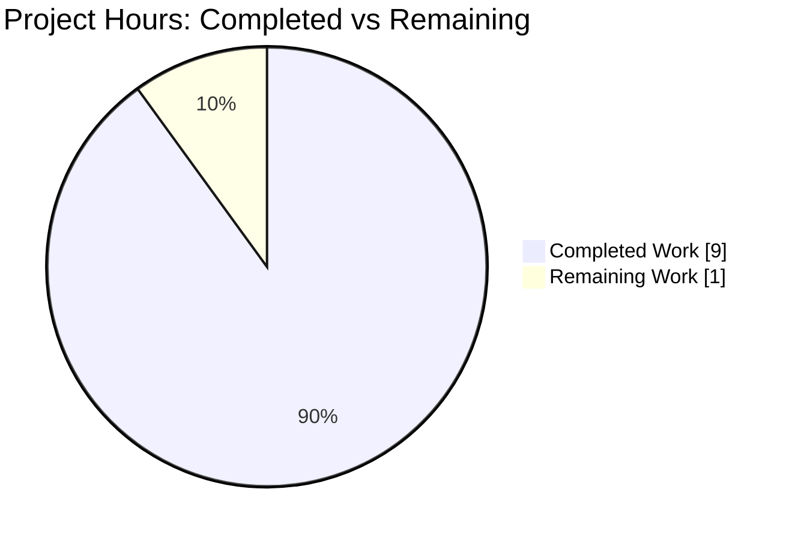
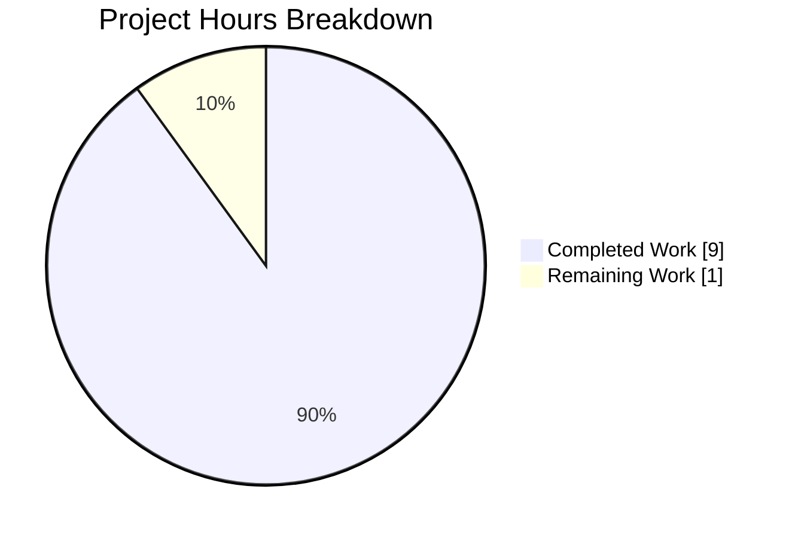

# 1. Executive Summary

## 1.1 Project Overview

`welcome.js` is an eleven-line, zero-dependency Node.js console program: one tag-free JSDoc summary line above ten `console.log` statements that each write `Welcome to Blitzy` to standard output — ten unformatted lines, 180 bytes per run. `README.md`, three lines, records that nothing needs installing and the single command that prints the greeting. Its users are a developer at a terminal or an automated step that asserts the output. Scope is deliberately minimal: no framework, dependency, manifest, build step, configuration, test suite or CI. The tree tracks exactly three paths — the program, the README, and the status document under `blitzy/documentation/` that you are reading.

## 1.2 Completion Status

Every requirement of the delivered request is met and verified: twelve of twelve. The 90% measures the work delivered and exercised against the single path-to-production confirmation that remains.



| Metric | Hours |
|---|---|
| Total Hours | 10.0 |
| Completed Hours (AI + Manual) | 9.0 |
| Remaining Hours | 1.0 |

Completion = 9.0 ÷ (9.0 + 1.0) = **90%**.

## 1.3 Key Accomplishments

- Ten bare lines of `Welcome to Blitzy` per run: 180 bytes, exit 0, identical every time.
- No formatting — no colour, label, prefix, banner, indentation or separator.
- One tag-free JSDoc summary line above the ten `console.log` statements of an eleven-line file.
- A three-line README whose documented command reproduces the ten lines it claims.
- A zero-dependency run: no manifest, lockfile or install step, identical under an empty environment.
- Deterministic and side-effect free across repeats, ten simultaneous runs, pipes and a pty.
- One executable program in a tree of three tracked paths; no manifest, test, CI or configuration artefact.

## 1.4 Critical Unresolved Issues

Twelve of the twelve requirements assessed are met outright. One path-to-production confirmation remains open, and it is not a requirement of the delivered request. Nothing here blocks release.

| Issue | Impact | Owner | ETA |
|---|---|---|---|
| The target host has never been confirmed to supply Node.js, and no manifest may pin a version | A host without Node.js fails with a shell error rather than a program message; another Node major is unproven | Repository owner | 1.0 h |

Three conditions are accepted with no action: a rejecting or closed stdout exits 0 while the line is discarded, a pty renders each LF as CRLF so a terminal transcript reads 190 bytes where a redirected capture reads 180, and no automated suite exists or may exist because AAP 0.11.2 excludes one.

## 1.5 Access Issues

No access issues identified. The program reads no credential, environment variable, endpoint or third-party API, opens no socket and needs only a Node.js runtime.

## 1.6 Recommended Next Steps

1. **[High]** Confirm the target host supplies Node.js on `PATH` and that `node --check welcome.js && node welcome.js` prints the ten lines there.
2. **[Low]** Re-run the verification in Section 9 after any edit to either delivered file or to this document, so the figures stated here keep matching the code.

# 2. Project Hours Breakdown

## 2.1 Completed Work Detail

| Component | Hours | Description |
|---|---|---|
| `welcome.js` — the ten-line-output program | 2.0 | The eleven-line file: one `/** ... */` summary naming the behaviour, then ten identical `console.log("Welcome to Blitzy");` statements, each emitting one unformatted line, 180 bytes per run. |
| `README.md` — the run instruction | 0.5 | Three lines: a heading, a blank line, and one paragraph naming the printed string, the absence of any dependency and the command `node welcome.js`. |
| Scope containment and tree integrity | 0.5 | Two delivered paths, no path added beyond them, no manifest, lockfile, test, CI or configuration artefact; the tree holds one executable program across three tracked paths. |
| Static content and structure verification | 1.5 | Byte identity and shape of both files, the single tag-free JSDoc line, the ten-statement body, the README line cap and the absence of every excluded section. |
| Runtime behavioural verification | 2.0 | The 38 executed checks: parse-and-run gate, output bytes and formatting, stdio contract and output devices, environment and input independence, determinism and concurrency, portability and shell consumers. |
| Documentation-claim verification | 1.0 | Every README claim falsified against the code and the tree, then the documented command extracted from `README.md:3` and executed verbatim. |
| Refresh of this guide against the shipped tree | 1.0 | Every file name, line count, byte count, gate string, verification figure and inventory row re-derived from the checkout and written to match it. |
| Commit message and change description | 0.5 | Concise and decision-only: the delivered contents stated plainly, with the file contents as the criterion and the file list given once. |
| **Total** | **9.0** | Completed effort across the whole delivery. |

## 2.2 Remaining Work Detail

| Category | Hours | Priority |
|---|---|---|
| Target-host runtime confirmation — confirm Node.js is on `PATH` at a supported version and that the documented command prints the ten lines there; no manifest may enforce either | 1.0 | High |
| **Total** | **1.0** | |

# 3. Test Results

The repository carries no test framework, runner, assertion library or coverage tool, and none may be added, so verification is the executable gate `node --check welcome.js && node welcome.js` plus behavioural probes run against the delivered files. **38 checks were executed, 38 passed, 0 failed.** Coverage is not instrumented anywhere, because no coverage tooling exists in the repository or is permitted in it.

| Area / Category | Framework | Tests | Passed | Failed | Coverage | What This Proves |
|---|---|---|---|---|---|---|
| Parse and run gate | Node.js v22.23.5 + POSIX shell | 2 | 2 | 0 | Not instrumented | `welcome.js` parses clean and runs to completion with exit status 0 |
| Output bytes, identity and formatting | shell with `od`/`cmp`/`sort`/`sha256sum` | 7 | 7 | 0 | — | The emitted stream is exactly ten 18-byte line images of `Welcome to Blitzy`, one LF terminator each — 180 bytes, byte-identical to the ten-line reference stream, with no escape, carriage return, BOM or stray space |
| Stdio contract and output devices | shell with redirected descriptors and a pty | 5 | 5 | 0 | — | The lines reach stdout only, nothing reaches stderr, and an early-closing, closed or rejecting device leaves the exit status at 0 |
| Environment and input independence | shell environment variants | 4 | 4 | 0 | — | Output is byte-identical under an empty environment, forced colour, `TERM`/locale variation, a closed stdin and stray arguments |
| Determinism and concurrency | `sha256sum` with sequential and parallel runs | 3 | 3 | 0 | — | Every run emits one identical hash, the same hash ten simultaneous runs produce, equal to the reference stream's |
| Portability and shell consumers | shell (`sh -c`, absolute path, pipes) | 4 | 4 | 0 | — | The same 180 bytes come out from a foreign working directory and through `sh -c`; `head -c 4` gives `Welc` and an append adds exactly ten lines |
| Documented run instruction | command extracted from `README.md:3` | 3 | 3 | 0 | — | The command the README prints runs verbatim with nothing installed and reproduces the ten lines it claims |
| Source shape, dependency hygiene and tree integrity | `wc`/`grep`/`git` | 10 | 10 | 0 | — | Eleven source lines with one tag-free JSDoc and ten identical statements; no loop, hardening, input or module construct; no manifest, lockfile, dependency or excluded artefact; three tracked paths and no stray backup or generated file |

**Not Covered.** No automated suite, runner or CI exists in the repository and none may be added, so nothing above is re-runnable by a pipeline — the standing verification a human should run after any edit is `node --check welcome.js && node welcome.js`, compared against `printf 'Welcome to Blitzy\n%.0s' {1..10}`. Also unexercised: `README.md` rendering through a Markdown parser (none installed, none permitted; its structure is one heading, one blank line and one paragraph); any Node.js version other than v22.23.5 and any non-Linux host, although the file uses no version-specific feature; Deno and Bun; and any browser or HTTP surface, because the program opens no socket and renders no page. A human should additionally confirm, after any future edit, that the literal still agrees across its thirteen occurrences — `welcome.js:1`, the ten statements on `welcome.js:2-11`, `README.md:1` and `README.md:3`.

# 4. Runtime Validation & UI Verification

- ✅ **Start-up and run** — `node welcome.js` from the checkout root: exit 0, 180 bytes on stdout, 0 bytes on stderr, about 25 ms elapsed.
- ✅ **Primary journey** — the emitted stream is byte-identical to a reference built from the ten-line literal: ten lines, each byte-for-byte `Welcome to Blitzy`.
- ✅ **Formatting** — no escape byte, carriage return, BOM, indentation, line number, label, prefix or separator; `sort -u` collapses the output to one bare line.
- ✅ **Environment independence** — identical bytes under `env -i`, `FORCE_COLOR=3 CLICOLOR_FORCE=1`, `TERM=xterm-256color`, `LANG=C` and `NO_COLOR=1`.
- ✅ **Stream separation** — stderr carries 0 bytes; the ten lines reach stdout only.
- ✅ **Documented instruction** — `node welcome.js`, extracted from `README.md:3`, ran verbatim from the root with no install step: exit 0, identical bytes, no stderr.
- ✅ **Portability and consumers** — a foreign working directory, an absolute path, `sh -c`, stray arguments, `| head -1`, `| head -c 4` → `Welc`, `| wc -l` → 10 and an append redirection adding exactly ten lines all behave as documented.
- ✅ **Concurrency** — ten simultaneous runs produced identical output, one hash, exit 0 and zero bytes of stderr.
- ⚠ **Partial — output-device behaviour** — stdout to a rejecting device (`>/dev/full`) and to a closed descriptor (`>&-`) both exit 0 while the write is discarded; under a pty the terminal adds CR before each LF, so a terminal transcript reads 190 bytes where a redirected capture reads 180.
- ❌ **Never exercised at runtime** — any Node.js major other than v22.23.5, any non-Linux host, Deno or Bun, a Markdown renderer for `README.md`, and any browser or HTTP surface of the program, which opens no socket and renders no page.

# 5. Compliance & Quality Review

## 5.1 Compliance Matrix

| # | Deliverable / Requirement | Benchmark | Status | Evidence |
|---|---|---|---|---|
| 1 | F1: `Welcome to Blitzy` written ten times per run, one unformatted line each (AAP 0.1.1) | Functional correctness | ✅ PASS | Exit 0, 180-byte capture, ten occurrences, `cmp` clean against the ten-line reference stream (`welcome.js:2-11`) |
| 2 | F2: no colour, label, line number, prefix, banner, box, indentation, quoting or separator (AAP 0.1.1) | Output fidelity | ✅ PASS | Zero escape and carriage-return bytes; 17 characters plus LF per line; the output reduces to one bare line (`welcome.js:2-11`) |
| 3 | F3: eleven lines — one `/** ... */` summary above ten identical `console.log` statements (AAP 0.1.1, 0.5.1) | Code hygiene | ✅ PASS | 11 lines / 394 bytes; one comment line, ten `console.log` calls, one semicolon each (`welcome.js`) |
| 4 | F4: a README recording install and run in fewer than five lines (AAP 0.1.1) | Documentation scope | ✅ PASS | 3 lines / 107 bytes: one heading, one blank line, one paragraph; no contributing, license, testing, deployment, architecture or table-of-contents content (`README.md`) |
| 5 | Stack: JavaScript executed by Node.js v22.23.5, no build step and no pinned version (AAP 0.3.1) | Stack conformance | ✅ PASS | `node --version` → v22.23.5; no manifest, lockfile or build configuration exists, so nothing pins a version |
| 6 | One top-level script with no module system, layering or component boundary (AAP 0.3.2) | Architecture conformance | ✅ PASS | No `require`, `import`, `export` or `module.` construct in `welcome.js`; nothing is imported and nothing is exported |
| 7 | Both delivered bodies byte-for-byte as specified (AAP 0.5.1 bodies) | Acceptance criterion | ✅ PASS | `welcome.js` 394 bytes and `README.md` 107 bytes, matching the specified text line for line; `node --check welcome.js` writes nothing |
| 8 | No file beyond the two delivered — no manifest, lockfile, dependency, test, configuration, handler or hardening (AAP 0.5.1 exclusions) | Scope discipline | ✅ PASS | `package.json`, both lockfiles, `node_modules` and any test, spec, coverage or CI path all absent; no `try`/`catch`, `process.env` read or logger in the source |
| 9 | Nothing outside the two mapped files, and no refactoring, reformatting or renaming (AAP 0.7.2) | Scope discipline | ✅ PASS | Both delivered files sit at the repository root — the program and its run instruction — and the tree holds three tracked paths, with nothing outside the two mapped files added, renamed or refactored |
| 10 | Deletion completeness: every sweep of the tree for an absent path, symbol, port or superseded figure returns nothing | Deletion completeness | ✅ PASS | Case-insensitive sweeps over the whole tree return no line for any absent path, symbol, port or superseded figure |
| 11 | The fixed contents are the acceptance criterion, with no coverage, performance or security gate claimed (AAP 0.11.2) | Acceptance criterion | ✅ PASS | The 38 probes in Section 3 judge the contents and behaviour only; no coverage, performance or security target is stated or implied |
| 12 | Tree and artefact hygiene: the three tracked paths, a clean working tree and no stray generated file (AAP 0.7.2) | Operability | ✅ PASS | `git ls-files` lists three paths; `git status --porcelain -uall` is empty once the tree is committed; no backup, log or generated file exists |

## 5.2 AAP & Rule Divergences and Gaps

Four divergences and gaps stand between the plan's wording and the shipped tree. None requires a repository change, none departs from a separately supplied user rule, and each is answered here.

| What the AAP Required | What Was Delivered Instead | Why It Diverged | Impact | Remediation |
|---|---|---|---|---|
| §0.1.2's request clause `as less lines as possible by optimizing token usage`, restated in §0.5.1, asks for the shortest file that prints the text | `welcome.js` is eleven lines: the statement written out ten times rather than replaced by a loop | §0.5.1's own supersession clause records that the directive to print the statement ten times is the later instruction and wins | None; the file is exactly the shape §0.5.1 fixes, at the only length that satisfies the ten-occurrence directive | **Sanctioned** by §0.5.1 — none |
| §0.1.1, §0.2.2 and §0.4 record a root listing that found the checkout empty — "[.:root directory listing]" — so nothing existing is extended or replaced | The branch tracks this guide under `blitzy/documentation/`, which arrived in its own status commit and is refreshed here to describe the delivered tree | The plan's listing was inaccurate: the document predates the delivery and is outside the two files the plan maps, so it was never part of the change | None on the delivery; a document left behind by a change misleads a maintainer, so it is refreshed against the shipped tree (Section 2.1, "Refresh of this guide against the shipped tree") | None in the delivered files — the document is kept current by re-running Section 9 after every edit |
| §0.11.2 and §0.5.1 exclude any test suite, coverage target or quality gate | No automated suite, runner or CI configuration exists; verification is the executable gate plus the 38 probes recorded in Section 3 | The exclusion is the instruction, not an omission | Nothing here is re-runnable by a pipeline; the gate a human runs is the whole check | **Sanctioned** by §0.11.2 — none |
| Nothing in the plan keeps a hand-written status document in step with the code | This guide is hand-maintained prose, so its figures can drift from the tree as soon as either side changes | The plan's deliverable list does not include a status document, so the document is kept current by re-running Section 9 after any edit | A stale figure here would mislead a maintainer about a program that is otherwise correct | Re-run Section 9's verification after every edit, which is what keeps the figures on this page true |

§0.9 records that no user-specified rules were provided for this project, so no rule inventory exists and no rule constrains the delivery; the request's own constraints, recorded in §0.1.2 and §0.5.1, are the criteria the delivery is held to and meets.

# 6. Risk Assessment

Risks below are forward-looking: what could still go wrong in production. Conditions accepted by instruction carry the reason in their mitigation rather than an action the delivery's constraints forbid.

| Risk | Category | Severity | Probability | Mitigation | Status |
|---|---|---|---|---|---|
| No automated consistency check or CI gate exists, and the greeting literal sits in thirteen places (`welcome.js:1`, the ten statements on `welcome.js:2-11`, `README.md:1`, `README.md:3`), so a partial edit drifts them apart silently | Technical | Medium | Medium | Edit every occurrence in one pass and compare the emitted bytes with `printf 'Welcome to Blitzy\n%.0s' {1..10}` | Accepted — a test suite is out of scope by instruction |
| Behaviour is proven only on Node.js v22.23.5 on Linux; another major version, another host, Deno or Bun is unexercised | Technical | Low | Medium | Run the gate once on the target runtime before release | Open — 2.2 row 1 |
| A future edit that introduced input handling would inherit no validation and no error path, by design | Security | Low | Low | Re-review the file if any input surface is ever introduced; today's ten constant writes have no sink | Accepted |
| A rejecting or closed stdout exits 0 while the line is discarded, so a caller cannot detect a lost line from the exit status | Operational | Medium | Low | Verify captured bytes rather than the exit status when emission must be proven | Accepted — an error handler may not be added |
| The run instruction depends on Node.js being on `PATH`, and no manifest or `engines` field may pin a version; a host without it fails with a shell error | Operational | Medium | Medium | Confirm the host supplies a supported Node.js before release | Open — 2.2 row 1 |
| This document is hand-maintained prose, so a change to either delivered file can leave a size, byte count or command stated here stale | Integration | Low | Medium | Re-run Section 9's verification after any edit and correct every figure it contradicts | Accepted — closing it needs no new artefact |

# 7. Visual Project Status

The pie below sets the completed hours against the one remaining path-to-production confirmation; the tables that follow break that remainder down by category and priority.



**Remaining hours by category** (the one item funded in Section 2.2, totalling 1.0).

| Category | Hours | Priority |
|---|---|---|
| Target-host runtime confirmation | 1.0 | High |
| **Total remaining** | **1.0** | |

**Priority distribution of remaining work**

| Priority | Hours | Share |
|---|---|---|
| High | 1.0 | 100.0% |
| **Total** | **1.0** | **100%** |

**Delivered versus outstanding by requirement.** All twelve requirements assessed are met. One path-to-production confirmation remains — that the target host supplies Node.js — and it is not a requirement of the delivered request, so it does not block release.

**Condition of the delivered capabilities.** Every capability the request asks for is present and exercised: the ten-line unformatted output, the eleven-line source shape, the one-line summary, the three-line run instruction, the absent artefact classes and the single-program tree. The three accepted conditions are stated in Section 6 with the instruction that forbids acting on each.

# 8. Summary & Recommendations

**What was delivered.** The repository carries an eleven-line console program, `welcome.js`, that writes `Welcome to Blitzy` to standard output ten times as ten bare, unformatted lines, and a three-line `README.md` that records the zero-dependency run and the command that produces it. Both files are exactly the shape the request fixes: a single `/** ... */` summary line above ten `console.log` statements, and a README of one heading and one paragraph. There is no dependency, manifest, build step, configuration, test suite or CI workflow, and the tree holds one executable program across three tracked paths.

**What was verified.** All 38 checks executed against the delivered files passed. The program prints exactly 180 bytes — ten identical 18-byte line images — exits 0 in about 25 ms, writes nothing to stderr and nothing to disk, and produces identical output under an empty environment, with forced colour, through pipes, from a foreign working directory, across ten simultaneous runs and from a closed or rejecting output device. The command printed in the README was extracted from it and executed verbatim, and reproduced the ten lines it claims. Every README claim was falsified against the code and the tree before that.

**Completion and what remains.** Completion stands at **90%** — 9.0 hours of the 10.0 total, with 1.0 hour remaining. The remaining hour is not a missing feature: every requirement of the request is present and exercised. It is the path-to-production confirmation that the target host supplies Node.js. The critical path to production is one command there: `node --version` followed by `node --check welcome.js && node welcome.js`, expecting exit 0 and the ten lines.

**Production readiness.** The deliverable is ready for its stated purpose. It is a fixed-string console writer with no input, no state, no dependency and no failure branch; it is deterministic, idempotent, side-effect free and safe to run concurrently. Its residual risks all sit outside what an in-scope change may address: no automated gate can exist because a test suite is excluded, a rejecting stdout exits 0 silently because an error handler is excluded, and the run instruction's dependence on Node.js is unguarded because a manifest is excluded. Each is recorded in Section 6 with its mitigation.

| Success Metric | Result |
|---|---|
| Requirements met | 12 of 12 |
| Project hours completed | 9.0 of 10.0 (90%) |
| Executable checks run | 38 executed, 38 passed, 0 failed |
| Output fidelity | 180 bytes, ten byte-identical lines, matching the reference stream on every run |
| Side effects | None — no path, file or log created by any run |
| Release blockers | None |

# 9. Development Guide

## System Prerequisites

| Requirement | Detail |
|---|---|
| Node.js | A supported Node.js release on `PATH`. Verified on v22.23.5 at `/usr/bin/node`; the program uses no version-specific feature and imposes no module format. |
| Shell | Any POSIX shell for the run commands below; the byte-comparison examples use bash process substitution. |
| Build tools | None. There is no compiler, bundler, transpiler or package-manager step. |
| Disk | Two files, 501 bytes of delivered source in total. |
| Network | Not required at build or run time. |

Confirm the runtime before anything else:

```bash
node --version
command -v node
```

Expected: `v22.23.5` and `/usr/bin/node` — the exact output observed on the verified host.

## Environment Setup

There is no environment setup. The program reads no environment variable, flag or configuration file, so nothing needs to be exported, templated or seeded, and there is no `.env` file to create. It behaves identically under an entirely empty environment:

```bash
env -i /usr/bin/node welcome.js
```

Expected: `Welcome to Blitzy` on ten consecutive lines.

## Dependency Installation

There is nothing to install. No manifest, lockfile or dependency exists, and no install step is required or possible:

```bash
ls package.json package-lock.json yarn.lock 2>&1 | head -3
```

Expected: three `No such file or directory` lines, one per file that correctly does not exist; the command's exit status is 2 for the same reason. Do not run `npm init` or `npm install` — a manifest is out of scope for this repository.

## Application Startup

The program is a single run-to-completion invocation; there is no server to keep alive, no socket to bind and no service to bring up.

```bash
node welcome.js
```

Expected output, exactly 10 lines:

```text
Welcome to Blitzy
Welcome to Blitzy
Welcome to Blitzy
Welcome to Blitzy
Welcome to Blitzy
Welcome to Blitzy
Welcome to Blitzy
Welcome to Blitzy
Welcome to Blitzy
Welcome to Blitzy
```

To confirm the exit status alongside the output:

```bash
node welcome.js; echo "exit=$?"
```

Expected: the ten lines, then `exit=0`.

## Verification Steps

Three checks cover the delivery: it parses and runs, it prints the right bytes, and it leaves the tree untouched.

```bash
# 1. Parse gate plus run — the full verification gate for this repository
node --check welcome.js && node welcome.js

# 2. Byte-level identity against the expected ten-line output (bash process substitution)
node welcome.js | cmp - <(printf 'Welcome to Blitzy\n%.0s' {1..10}) && echo "bytes identical"

# 3. Inspect the bytes directly
node welcome.js | od -c
```

Expected: no output from `node --check`; then the ten lines; then `bytes identical`; and from `od -c` ten 18-byte line images ending at octal offset `0000264` (180 bytes), with no eleventh line:

```text
0000000   W   e   l   c   o   m   e       t   o       B   l   i   t   z
0000020   y  \n   W   e   l   c   o   m   e       t   o       B   l   i
0000040   t   z   y  \n   W   e   l   c   o   m   e       t   o       B
0000060   l   i   t   z   y  \n   W   e   l   c   o   m   e       t   o
0000100       B   l   i   t   z   y  \n   W   e   l   c   o   m   e    
0000120   t   o       B   l   i   t   z   y  \n   W   e   l   c   o   m
0000140   e       t   o       B   l   i   t   z   y  \n   W   e   l   c
0000160   o   m   e       t   o       B   l   i   t   z   y  \n   W   e
0000200   l   c   o   m   e       t   o       B   l   i   t   z   y  \n
0000220   W   e   l   c   o   m   e       t   o       B   l   i   t   z
0000240   y  \n   W   e   l   c   o   m   e       t   o       B   l   i
0000260   t   z   y  \n
0000264
```

Confirm the source shape and that the working tree matches its committed state:

```bash
wc -l -c welcome.js README.md   # 11 lines / 394 bytes, 3 lines / 107 bytes
git status --porcelain -uall    # empty once the tree is committed
```

The repository intentionally carries no test suite, runner or CI. `node --check welcome.js && node welcome.js` is the whole gate, and it is what to run after any edit.

## Example Usage

Read the lines from a script, feed them to another command, or append them to a file of your own:

```bash
GREETING="$(node welcome.js)"; echo "captured: $GREETING"   # ten lines
node welcome.js | wc -l                                     # 10
node welcome.js | head -c 4                                 # Welc
node welcome.js | head -1                                   # Welcome to Blitzy
node welcome.js >> greeting.log && wc -l greeting.log       # 10
rm greeting.log                                             # leave the tree clean
```

Expected: `captured:` followed by all ten lines, then `10`, then `Welc`, then a single `Welcome to Blitzy`, then `10` for the appended file. The final `rm` leaves no trace of the log — the program itself never creates a file.

## Troubleshooting

| Symptom | Cause | Resolution |
|---|---|---|
| `/bin/bash: line 1: node: command not found` (exit 127) | No Node.js on `PATH` | Install Node.js or add its directory to `PATH`; confirm with `command -v node` |
| `Error: Cannot find module` naming the path you passed | The command was run from outside the checkout, or the filename is mistyped | Run from the repository root, or pass a correct absolute path to `welcome.js` |
| `node --check` exits 1 and prints a caret under a line | A syntax error in the file | Fix the reported line; the check writes nothing and changes nothing |
| An assertion such as `test "$(node welcome.js)" = "Welcome to Blitzy"` fails | The program prints ten lines, so a single-line comparison cannot match | Compare captured bytes with `cmp` against the ten-line reference `printf 'Welcome to Blitzy\n%.0s' {1..10}` |
| A terminal capture shows `\r\n` while a redirected capture shows `\n` | The terminal's line discipline translates each LF on output | Compare redirected output (`> file`, pipes), not terminal transcripts, when asserting byte identity |
| `node welcome.js > /dev/full` exits 0 although nothing was written | `console.log` reports no error on a rejecting device, and no handler exists by design | Verify captured bytes rather than the exit status when emission must be proven |

# 10. Appendices

## A. Command Reference

| Purpose | Command |
|---|---|
| Show the runtime version | `node --version` |
| Locate the interpreter | `command -v node` |
| Parse-check the program without executing it | `node --check welcome.js` |
| Run the program | `node welcome.js` |
| Run the full verification gate | `node --check welcome.js && node welcome.js` |
| Prove byte identity of the output | `node welcome.js \| cmp - <(printf 'Welcome to Blitzy\n%.0s' {1..10})` |
| Inspect the output bytes | `node welcome.js \| od -c` |
| Count the emitted lines | `node welcome.js \| wc -l` |
| Count lines and bytes of the delivery | `wc -l -c welcome.js README.md` |
| Confirm the working tree matches its committed state | `git status --porcelain -uall` |
| Show the recent commits | `git log --oneline -4` |
| List the tracked paths | `git ls-files` |

## B. Port Reference

The program opens no socket and binds no port. It is a run-to-completion invocation that writes ten lines to standard output and exits, so it holds no listening resource and no port table applies to it.

## C. Key File Locations

| Path | Role | Size |
|---|---|---|
| `welcome.js` | The program and entry point: one JSDoc summary line, `/** Prints "Welcome to Blitzy" to standard output. */`, then ten `console.log("Welcome to Blitzy");` statements | 11 lines / 394 bytes |
| `README.md` | The run instruction: a heading, a blank line, and the zero-dependency claim with the command that prints the greeting | 3 lines / 107 bytes |
| `blitzy/documentation/` | This guide: the delivered project's status, inventory and verification record | 403 lines |

## D. Technology Versions

| Technology | Version | Role |
|---|---|---|
| Node.js | v22.23.5 (`/usr/bin/node`) | The runtime that executes `welcome.js`; no version is pinned anywhere because no manifest exists |
| JavaScript | ES2015-compatible source | Ten `console.log` statements on one string literal; no build, transpile or module system involved |
| Git | Version control; `git log --oneline` lists the delivery commits above the merge commit they follow | Repository history |

## E. Environment Variable Reference

None. The program reads no environment variable, and none needs to be set for it to run. It produces identical output under `env -i`, and under colour-forcing variables such as `FORCE_COLOR` or `CLICOLOR_FORCE`, because it never inspects the environment.

## F. Developer Tools Guide

| Tool | Use in this repository |
|---|---|
| `node` | Runs and parse-checks the program; the only tool required to work on the delivery |
| `git` | Lists the tracked paths, shows the recent commits and confirms the working tree matches its committed state |
| `cmp`, `od`, `wc`, `sort`, `sha256sum` | Byte-level and structural checks — the closest thing this repository has to assertions, since no test framework may be added |
| Not present by design | No package manager, bundler, linter, formatter, test runner or CI configuration exists, and adding one would break the delivery's stated scope |

## G. Glossary

| Term | Meaning |
|---|---|
| Acceptance criterion | The fixed contents of the two delivered files, which the plan names as the standard the delivery is judged against |
| Byte-identical | Character-for-character equality of file contents or program output, checked with `cmp` or `sha256sum` |
| Gate | The single executable check this repository has: `node --check welcome.js && node welcome.js` |
| Idempotent | Producing the same output and leaving the same state on every run; verified across repeats and concurrent runs |
| Occurrence count | Ten: the number of times the literal is written per run, one per `console.log` statement on `welcome.js:2-11` |
| Side effect | Any file, path, log or state a run creates; this program creates none |
| Unformatted output | Output with no colour, label, line number, prefix, banner, box, indentation, quoting or separator |
