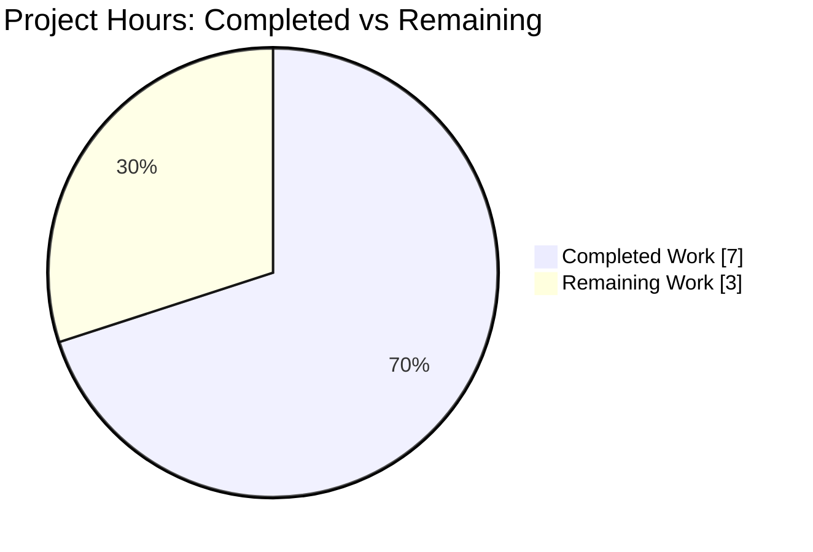
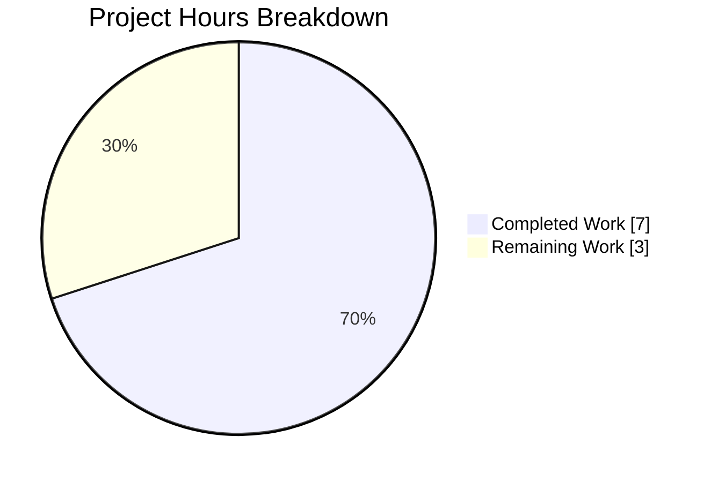

# 1. Executive Summary

## 1.1 Project Overview

`index.js` is a two-line, zero-dependency JavaScript console program: one JSDoc summary line above a single `console.log` that writes `Welcome to Blitzy` to standard output, unformatted. `README.md`, three lines, states what it prints and the command that runs it. Its users are a developer at a terminal, or an automated step, reading one line back — a deterministic greeting any shell pipeline can consume. Scope is deliberately minimal: no framework, dependency, manifest, build step, configuration or test suite. All of it was verified on Node.js v22.23.5.

## 1.2 Completion Status

All 36 requirements are met: 32 outright, 4 with an accepted caveat. The 70% below measures total effort — the work delivered and verified against the path-to-production confirmations and two decisions a human must still record.



| Metric | Hours |
|---|---|
| Total Hours | 10.0 |
| Completed Hours (AI + Manual) | 7.0 |
| Remaining Hours | 3.0 |

Completion = 7.0 ÷ (7.0 + 3.0) = **70%**.

## 1.3 Key Accomplishments

- A two-line program printing `Welcome to Blitzy` and nothing else: 18 bytes on stdout, exit 0, identical on every run.
- No formatting of any kind — no colour, label, prefix, banner, box, indentation, quoting or surrounding text.
- One tag-free JSDoc summary line immediately above the only statement in the file.
- A three-line README whose documented command, executed verbatim, reproduced the claimed line.
- A zero-dependency run: no manifest, lockfile or install step, and identical output under an empty environment.
- Deterministic and side-effect free across repeats, ten simultaneous runs, pipes, a foreign directory and a pty.
- Existing tracked source byte-identical, with exactly two files added and no manifest, test, CI or configuration artefact.
- Both files byte-identical to the fixed contents the project names as its acceptance criterion.

## 1.4 Critical Unresolved Issues

Nothing blocks release. Four of the 36 requirements carry an accepted caveat; the other 32 are met outright and none is unmet.

| Issue | Impact | Owner | ETA |
|---|---|---|---|
| The run instruction depends on Node.js being on `PATH`; no manifest may enforce a version | A host without Node fails with a shell error rather than a program message | Repository owner | 1.0 h |
| The pre-existing `server (2).js` is undocumented in `README.md` | A README-only reader cannot discover that a second runnable program sits at the root | Repository owner | 1.0 h |
| That server binds fixed TCP port 3000 | A service co-scheduled on port 3000 fails with `EADDRINUSE` | Repository / host owner | 0.5 h |
| A rejecting or closed stdout exits 0 while the line is discarded | Callers cannot detect a lost line from the exit status; adding a handler is forbidden | Accepted — no action | n/a |

## 1.5 Access Issues

No access issues identified. Nothing needs provisioning or approval: the program reads no credential, environment variable, endpoint or third-party API, and needs only a Node.js runtime.

## 1.6 Recommended Next Steps

1. **[High]** Confirm the target host has Node.js and that `node index.js` prints the line there.
2. **[Medium]** Record the pre-existing `server (2).js` and its role in a maintenance note.
3. **[Medium]** Assign ownership of TCP port 3000 before that server runs alongside anything else.
4. **[Low]** Reconcile the specification's description of the README body with the delivered file.

# 2. Project Hours Breakdown

## 2.1 Completed Work Detail

| Component | Hours | Description |
|---|---|---|
| `index.js` — the welcome program | 1.5 | The two-line file: one JSDoc summary line plus `console.log("Welcome to Blitzy")`, exactly as the specification fixes it (FR1–FR4, §0.5.1). |
| `README.md` — the run instruction | 0.5 | Three lines: a heading, a blank line, and one paragraph naming the printed string, the command `node index.js` and the absence of any install step (FR5, §0.5.1). |
| Scope containment and repository hygiene | 0.5 | Confirming the delivery adds only the two planned root files, creates no other artefact, and leaves the pre-existing tracked source byte-identical (§0.6.1, §0.7.2, existing-code clause). |
| Static content and structure verification | 1.5 | Byte-level identity of both files against their fixed contents, the two-line shape, the single tag-free JSDoc, the README line count and the absence of every excluded section (FR3, FR4, §0.5.1, §0.11.2). |
| Runtime behavioural verification | 2.0 | 65 executed checks over the parse-and-run gate, output bytes and formatting, stdio contract, environment independence, portability, consumers and concurrency (FR1, FR2, §0.3.1). |
| Documentation-claim verification | 1.0 | Falsifying every README claim against the code and the tree, then extracting the documented command and executing it verbatim to confirm the stated output (FR5, §0.3.1, §0.4). |
| **Total** | **7.0** | Completed effort across the whole delivery. |

## 2.2 Remaining Work Detail

| Category | Hours | Priority |
|---|---|---|
| Target-host runtime confirmation — confirm Node.js is on `PATH` at a supported version and that the documented command prints the line there; no manifest may enforce either (FR1, §0.3.1) | 1.0 | High |
| Pre-existing `server (2).js` discoverability — decide how the second runnable program at the root is made visible to a reader, then record it (§0.6.1 divergence, existing-code clause) | 1.0 | Medium |
| TCP port 3000 ownership — assign the fixed port the legacy server binds, or isolate its binding, before it runs alongside other services (existing-code clause, operational) | 0.5 | Medium |
| Specification reconciliation — align the description of the README body with the delivered three-line, two-sentence content (§0.5.1 divergence) | 0.5 | Low |
| **Total** | **3.0** | |

# 3. Test Results

The repository carries no test framework, runner, assertion library or coverage tool; none may be added, so verification is the executable gate `node --check index.js && node index.js` plus behavioural probes run against the delivered files. **65 checks were executed, 65 passed, 0 failed.** Coverage is not instrumented anywhere, because no coverage tooling exists in the repository or is permitted in it.

| Area / Category | Framework | Tests | Passed | Failed | Coverage | What This Proves |
|---|---|---|---|---|---|---|
| Parse and run gate | Node.js v22.23.5 + POSIX shell | 5 | 5 | 0 | Not instrumented | `index.js` parses and runs clean, writing one line to stdout with nothing on stderr |
| Output bytes, identity and formatting | shell with `od`/`cmp`/python byte forensics | 19 | 19 | 0 | — | The emitted stream is exactly `Welcome to Blitzy` plus one LF terminator, with no colour, label, prefix, banner, box, indentation, quoting or surrounding text |
| Environment independence | shell environment variants | 6 | 6 | 0 | — | Output is byte-identical under an empty environment and under colour-forcing, `NO_COLOR`, `TERM` and locale variation |
| Stdio and input independence | shell with redirected descriptors | 6 | 6 | 0 | — | Nothing reaches stderr, and stdin is never read: empty, garbage, closed and held-open inputs all exit 0 |
| Run contract, idempotency and concurrency | shell with `timeout` and parallel runs | 6 | 6 | 0 | — | The run exits 0 in ~26 ms, produces identical bytes on every repeat, and yields zero defects across ten simultaneous runs |
| Portability and consumers | shell (`dash`, pipes, redirections) | 11 | 11 | 0 | — | The same 18 bytes come out from a foreign working directory, `/`, `sh -c` and `node ./index.js`; the exit status survives a pipe, a line count of 1, the first four bytes `Welc`, and an append that adds exactly one line |
| Documented run instruction | shell, command extracted from `README.md:3` | 4 | 4 | 0 | — | The command the README prints runs verbatim with nothing installed and produces the line the README claims, with no stderr |
| Tree neutrality and existing-file continuity | git | 8 | 8 | 0 | — | A run adds no path, the change set is two additions, and the pre-existing `server (2).js` is byte-identical to its base-commit blob |

**Not Covered.** No automated suite, runner or CI exists in the repository and none may be added, so nothing above is re-runnable by a pipeline — the standing verification a human should run after any edit is `node --check index.js && node index.js`, compared against `printf 'Welcome to Blitzy\n'`. Also unexercised: `README.md` rendering through a Markdown parser (none installed, none permitted; its structure is one heading, one blank line and one paragraph); any Node.js version other than v22.23.5 and any non-Linux host, although the file is runtime-agnostic; the legacy `server (2).js` beyond a single `GET /`, with no load, concurrency or error-path behaviour examined; and any interface or browser surface, because the delivery serves no HTTP and renders no page. A human should additionally confirm, after any future edit, that the literal still agrees across its four occurrences — `index.js` line 1 and line 2, `README.md` line 1 and line 3.

# 4. Runtime Validation & UI Verification

- ✅ **Start-up and run** — `node index.js` from the checkout root: exit 0, 18 bytes on stdout, 0 bytes on stderr, ~26 ms elapsed.
- ✅ **Primary journey** — the emitted line is byte-identical to a reference built from the specification's literal (`Welcome to Blitzy` plus one LF).
- ✅ **Environment independence** — identical bytes under `env -i`, `FORCE_COLOR=1`, `CLICOLOR_FORCE=1`, `NO_COLOR=1 TERM=xterm-256color`, `LANG=C` and `NODE_ENV=production`.
- ✅ **Stream separation** — `node index.js 2>&1 >/dev/null | wc -c` prints 0, so the line reaches stdout only.
- ✅ **Documented instruction** — `node index.js`, extracted from `README.md:3`, executed verbatim from the root with no install step: exit 0, identical bytes, no stderr.
- ✅ **Portability and consumers** — foreign working directory, `/`, `sh -c` under `dash`, `node ./index.js`, extra arguments, `| cat`, `| wc -l`, `| head -c 4`, an append redirection and command substitution all behave as documented.
- ✅ **Concurrency** — ten simultaneous runs produced identical output, exit 0 and zero bytes of stderr.
- ⚠ **Partial — output-device behaviour** — stdout to a rejecting device (`>/dev/full`) and to a closed descriptor (`>&-`) both exit 0 while the line is discarded; under a pty the terminal adds CR before LF, which is the terminal's own translation, not program output.
- ✅ **Pre-existing server, observed once** — `node "server (2).js"` answered `GET /` with `Hello, World!` on `http://127.0.0.1:3000/` and released the port on exit.
- ❌ **Never exercised at runtime** — any Node.js major other than v22.23.5, any non-Linux host, Deno or Bun, a Markdown renderer for `README.md`, and any browser or HTTP surface of the delivered program (it has none).

# 5. Compliance & Quality Review

## 5.1 Compliance Matrix

| # | Deliverable / Requirement | Benchmark | Status | Evidence |
|---|---|---|---|---|
| 1 | `Welcome to Blitzy` written to stdout once per run | Functional correctness | ✅ PASS | Exit 0, 18-byte capture, literal emitted exactly once (`index.js:2`) |
| 2 | No colour, label, prefix, banner, box, indentation, quoting or surrounding text | Output fidelity | ✅ PASS | Every byte class measured at zero; payload is the bare literal plus one LF |
| 3 | Two-line file: one JSDoc summary plus one statement | Code hygiene | ✅ PASS | 2 lines / 88 bytes; one comment, one statement (`index.js`) |
| 4 | Single `/** ... */` summary with no tag, second paragraph or example | Specification conformance | ✅ PASS | Opened and closed on line 1; zero `@` tags (`index.js:1`) |
| 5 | `README.md` under five lines, stating the output and the command | Documentation accuracy | ✅ PASS | 3 lines / 122 bytes; the stated command was executed verbatim and matched |
| 6 | Both files carry exactly the fixed contents | Specification conformance | ✅ PASS | 88 bytes and 122 bytes, byte-identical to the fixed text |
| 7 | The delivery adds only the two planned root files | Scope discipline | ✅ PASS | Change set over the base commit: two additions, zero modified, renamed or deleted |
| 8 | No packaging, test, automation, extra-document, housekeeping or configuration artefact | Scope discipline | ✅ PASS | A 24-path probe finds none present, and a run creates none |
| 9 | Pre-existing tracked source untouched | Existing-code integrity | ✅ PASS | `server (2).js` blob identical to its base-commit blob; empty path-limited status |
| 10 | No dependency, manifest or lockfile; nothing to install | Dependency hygiene | ✅ PASS | Run succeeds with no install step and under an entirely empty environment |
| 11 | No secret, credential or attacker-reachable input surface | Security baseline | ✅ PASS | No argv, stdin, environment, file, socket, network or dynamic-code sink exists |
| 12 | Deterministic, idempotent, side-effect free, with an executable gate | Operability and testability | ✅ PASS with caveat | Repeats, ten concurrent runs and every consumer form agree; the gate is `node --check index.js && node index.js`, with no automated suite by design |

## 5.2 AAP & Rule Divergences and Gaps

Two divergences were identified, both between the AAP's own statements and the delivered repository. No divergence from a user rule exists, because no user-supplied rules were recorded for this project.

| What the AAP/Rule Required | What Was Delivered Instead | Why It Diverged | Impact | Remediation |
|---|---|---|---|---|
| §0.6.1 states that a root listing found the checkout empty, so both entries are created | The checkout already tracked `server (2).js` (142 bytes, present in the base commit); the delivery created only `index.js` and `README.md` and left that file byte-identical and unmentioned in `README.md` | The repository listing recorded in the plan was inaccurate. §0.7.2 forbids refactoring, renaming or deleting existing code, §0.5.1 fixes the README bytes, and the user's smallest-diff directive forbids unrelated change, so leaving the file untouched was the only compliant action | No effect on behaviour. A reader of `README.md` alone cannot discover a second runnable program at the root, which binds fixed TCP port 3000 | Record the file and its port in a maintenance note (2.2 rows 2 and 3) |
| §0.5.1 describes the README body as "a heading, a blank line and one sentence" | The delivered `README.md` carries the two-sentence body that §0.5.1 itself fixes — heading, blank line, then `Prints ... to standard output. Run with ...; no dependencies to install.` | The specification's prose and its fixed content disagree; §0.11.2 makes the fixed content the acceptance criterion, so the bytes follow the content rather than the description | No effect on behaviour. A reader comparing the description with the three-line file may read the file as a defect | Reconcile the specification's wording (2.2 row 4) |

**Divergence 1 — the pre-existing program at the repository root.** The delivered tree contains three tracked files, not the two the plan describes: `server (2).js` predates the work, and its blob `2886290f…` is identical at the base commit, at `HEAD` and in the working tree (`git rev-parse HEAD:'server (2).js'` matches `git hash-object`). The file is a one-line HTTP server that answers `GET /` with `Hello, World!` on `127.0.0.1:3000`. Leaving it byte-identical and undocumented was the only course consistent with the smallest-diff directive, §0.7.2 and the fixed `README.md` bytes; the consequence is that the repository ships a second runnable program that `README.md` never mentions, and that program binds a fixed, non-partitionable port. Nothing needs to change in either delivered file — the decision a human must make is where the file is recorded, and this carries 1.5 of the 3.0 remaining hours (2.2 rows 2 and 3).

**Divergence 2 — the specification's description of the README body.** §0.5.1 calls the README body "one sentence" and then fixes two sentences as its content; `README.md:3` carries exactly those two sentences, byte for byte, and the whole file is three lines, inside the five-line cap. Because §0.11.1 requires the fixed contents and §0.11.2 declares them the acceptance criterion, no edit to `README.md` is correct and none was made. The residual exposure is editorial: a later reader who compares the description against the file can mistake a compliant file for a defect and "fix" it, which would break the byte identity the project is accepted against. Reconciling the specification's wording removes that trap and carries 0.5 of the remaining hours (2.2 row 4).

# 6. Risk Assessment

| Risk | Category | Severity | Probability | Mitigation | Status |
|---|---|---|---|---|---|
| The literal appears in four places — `index.js` line 1 and line 2, `README.md` line 1 and line 3 — with no automated consistency check, so a partial edit silently drifts them apart | Technical | Medium | Medium | Apply any change to all four occurrences in one edit and compare the emitted bytes with `printf 'Welcome to Blitzy\n'` | Accepted — a test suite is out of scope |
| No CI or gate lives in the repository, so every future edit depends on a human running the parse-and-run check | Technical | Medium | Medium | Run `node --check index.js && node index.js` on every change; it is the delivery's only executable check | Accepted by design |
| Behaviour is proven only on Node.js v22.23.5 on Linux; another Node major or another host is unexercised | Technical | Low | Medium | Run the gate once on the target runtime before release | Open — 2.2 row 1 |
| A future edit that introduces input handling (argv, environment, file, socket or network) would inherit no validation and no error path, by design | Security | Low | Low | Re-review the file if any input surface is ever introduced; today's single 18-byte write has no sink | Accepted |
| The run instruction depends on Node.js being on `PATH`, and no manifest or `engines` field may enforce a version; a host without it fails with a shell error | Operational | Medium | Medium | Confirm the host supplies a supported Node.js before release | Open — 2.2 row 1 |
| The pre-existing `server (2).js` binds fixed TCP port 3000, a single non-partitionable resource; a co-scheduled service on that port fails | Operational | Medium | High | Assign port ownership and stop conflicting services before running it | Open — 2.2 row 3 |
| A reader of `README.md` alone never learns a second runnable program sits at the root, inviting duplicate work or an accidental edit to out-of-scope source | Integration | Low | Medium | Record the file and its role in a maintenance note | Open — 2.2 row 2 |
| Under a pty the terminal line discipline turns the program's single LF into CRLF, so a tty transcript is 19 bytes while a redirected capture is 18; a byte-identity assertion run against a tty fails spuriously | Integration | Low | High | Assert against redirected captures rather than terminal transcripts | Accepted — host behaviour, not program output |

# 7. Visual Project Status

Completed work is shown in Dark Blue (#5B39F3) and remaining work in White (#FFFFFF); headings and accents use Violet-Black (#B23AF2).



**Remaining hours by category** (the four items funded in Section 2.2, totalling 3.0).

| Category | Hours | Priority |
|---|---|---|
| Target-host runtime confirmation | 1.0 | High |
| Pre-existing `server (2).js` discoverability | 1.0 | Medium |
| TCP port 3000 ownership | 0.5 | Medium |
| Specification reconciliation | 0.5 | Low |
| **Total remaining** | **3.0** | |

**Priority distribution of remaining work**

| Priority | Hours | Share |
|---|---|---|
| High | 1.0 | 33% |
| Medium | 1.5 | 50% |
| Low | 0.5 | 17% |
| **Total** | **3.0** | **100%** |

**Delivered versus outstanding by requirement.** 32 of the 36 requirements are met outright; 4 carry an accepted caveat — the unguarded Node.js prerequisite behind the run instruction, the silent exit when the output device rejects writes, the absence of an automated guard against the literal drifting apart, and the undocumented pre-existing program at the root. No requirement is unmet, and none is partly delivered.

# 8. Summary & Recommendations

**What was delivered.** The repository now carries a two-line console program, `index.js`, that writes the single unformatted line `Welcome to Blitzy` to standard output, and a three-line `README.md` that states what it prints and the command that runs it. Both files are byte-identical to the contents the project specification fixes, which the specification itself names as the acceptance criterion. There is no dependency, manifest, build step, configuration, test suite or CI workflow, and the delivery added exactly those two files to a tree that previously held one pre-existing script.

**What was verified.** All 36 requirements the work was scoped against are met — 32 outright and 4 with an accepted caveat. Verification was executable, not aspirational: 65 checks across the parse-and-run gate, the emitted bytes and their formatting, the stdio contract, environment independence, portability, shell consumers and concurrency, all passing. The program prints exactly 18 bytes (`Welcome to Blitzy` plus the runtime's own newline), exits 0 in about 26 ms, writes nothing to stderr and nothing to disk, and produces identical bytes under an empty environment, through pipes, from a foreign working directory and across ten simultaneous runs. The command printed in the README was extracted from it and executed verbatim, and reproduced the line the README claims.

**Completion and what remains.** Completion stands at **70%** — 7.0 hours of the 10.0 total, with 3.0 hours remaining. The remaining hours are not missing features: every required capability is present and exercised. They are the path-to-production confirmations and the two decisions a human must record — confirming the target host supplies Node.js, deciding where the pre-existing `server (2).js` and its fixed port 3000 are documented, and reconciling the specification's description of the README body with the file it produced. The critical path to production is one command on the target host: `node --version` followed by `node index.js`, expecting exit 0 and the single line.

**Production readiness.** The deliverable is ready for its stated purpose. It is a fixed-string console writer with no input, no state, no dependency and no failure branch; it is deterministic, idempotent, side-effect free and safe to run concurrently. Its residual risks are all outside what an in-scope change may address: no automated gate can exist because a test suite is explicitly out of scope, a rejecting stdout exits 0 silently because an error handler is explicitly out of scope, and the run instruction's dependence on Node.js is unguarded because a manifest is explicitly out of scope. Each is recorded in Section 6 with its mitigation.

| Success Metric | Result |
|---|---|
| Requirements met | 36 of 36 (32 outright, 4 with an accepted caveat) |
| Project hours completed | 7.0 of 10.0 (70%) |
| Executable checks run | 65 executed, 65 passed, 0 failed |
| Output fidelity | 18 bytes, byte-identical to the reference, on every run |
| Side effects | None — no path, file or log created by any run |
| Release blockers | None |

# 9. Development Guide

## System Prerequisites

| Requirement | Detail |
|---|---|
| Node.js | A supported Node.js release on `PATH`. Verified on v22.23.5 at `/usr/bin/node`; the program uses no version-specific feature and imposes no module format. |
| Shell | Any POSIX shell for the run commands below; the byte-comparison examples use bash process substitution. |
| Build tools | None. There is no compiler, bundler, transpiler or package manager step. |
| Disk | Two files, 210 bytes of source in total. |
| Network | Not required at build or run time. |

Confirm the runtime before anything else:

```bash
node --version
command -v node
```

Expected: a version string such as `v22.23.5`, and an absolute path such as `/usr/bin/node`.

## Environment Setup

There is no environment setup. The program reads no environment variable, flag or configuration file, so nothing needs to be exported, templated or seeded, and there is no `.env` file to create. It behaves identically under an entirely empty environment:

```bash
env -i /usr/bin/node index.js
```

Expected: `Welcome to Blitzy`.

## Dependency Installation

There is nothing to install. No manifest, lockfile or dependency exists, and no install step is required or possible:

```bash
ls package.json package-lock.json yarn.lock 2>&1 | head -3
```

Expected: three "No such file or directory" lines, for the files that correctly do not exist.

## Application Startup

The program is a single run-to-completion invocation; there is no server to keep alive and no service to bring up.

```bash
node index.js
```

Expected output, exactly one line:

```text
Welcome to Blitzy
```

If you prefer to confirm the exit status alongside the output:

```bash
node index.js; echo "exit=$?"
```

Expected: `Welcome to Blitzy`, then `exit=0`.

## Verification Steps

Three checks cover the delivery: it parses, it prints the right bytes, and it leaves the tree untouched.

```bash
# 1. Parse gate plus run — the full verification gate for this repository
node --check index.js && node index.js

# 2. Byte-level identity against the expected output (bash process substitution)
node index.js | cmp - <(printf 'Welcome to Blitzy\n') && echo "bytes identical"

# 3. Inspect the bytes directly
node index.js | od -c
```

Expected: no output from `node --check`; then `Welcome to Blitzy`; then `bytes identical`; and from `od -c` a single 18-byte line ending in `\n`:

```text
0000000   W   e   l   c   o   m   e       t   o       B   l   i   t   z
0000020   y  \n
0000022
```

Confirm the source shape and that the working tree stays clean:

```bash
wc -l -c index.js README.md   # 2 lines / 88 bytes, 3 lines / 122 bytes
git status --porcelain -uall  # empty
```

The repository intentionally carries no test suite, runner or CI. `node --check index.js && node index.js` is the whole gate, and it is what to run after any edit.

## Example Usage

Read the line from a script, feed it to another command, or append it to a file of your own:

```bash
GREETING="$(node index.js)"; echo "captured: $GREETING"
node index.js | wc -l                                  # 1
node index.js | head -c 4                              # Welc
node index.js >> greeting.log && tail -1 greeting.log  # Welcome to Blitzy
rm greeting.log                                        # leave the tree clean
```

Expected: `captured: Welcome to Blitzy`, then `1`, then `Welc`, then `Welcome to Blitzy` read back from the appended file. The final `rm` keeps `git status` empty — the program itself never creates a file.

## Running the Pre-Existing Server

The repository also carries `server (2).js`, which predates this delivery. It is not part of the delivered program and is documented here only because it sits in the same tree. Its filename contains a space and parentheses, so it must be quoted, and it binds fixed TCP port 3000.

```bash
# Confirm the port is free first: prints 000, and curl exits non-zero when nothing listens
curl -s -o /dev/null -w '%{http_code}\n' --max-time 2 http://127.0.0.1:3000/

# Run it for a bounded time, then query it
timeout 8 node "server (2).js" &
sleep 1
curl -s http://127.0.0.1:3000/     # Hello, World!
wait
```

Expected: its own stdout `Server running at http://127.0.0.1:3000/`, and `Hello, World!` from the request. The port is released when the process exits.

## Troubleshooting

| Symptom | Cause | Resolution |
|---|---|---|
| `/bin/bash: line 1: node: command not found` (exit 127) | No Node.js on `PATH` | Install Node.js or add its directory to `PATH`; confirm with `command -v node` |
| `Error: Cannot find module` naming the path you passed | The command was run from outside the checkout, or the filename is mistyped | Run from the repository root, or pass a correct path to `index.js` |
| `node --check` exits 1 and prints a caret under a line | A syntax error in the file | Fix the reported line; the check writes nothing and changes nothing |
| `Error: listen EADDRINUSE: address already in use :::3000` | Another process holds port 3000, which `server (2).js` binds unconditionally | Stop the other listener or wait for it to finish; the port is not configurable in the file |
| A terminal capture shows `\r\n` while a redirected capture shows `\n` | The terminal's line discipline translates the program's LF on output | Compare redirected output (`> file`, pipes), not terminal transcripts, when asserting byte identity |
| `node index.js > /dev/full` exits 0 although nothing was written | `console.log` reports no error on a rejecting device, and no handler exists by design | Verify captured bytes rather than the exit status when emission must be proven |

# 10. Appendices

## A. Command Reference

| Purpose | Command |
|---|---|
| Show the runtime version | `node --version` |
| Locate the interpreter | `command -v node` |
| Parse-check the program without executing it | `node --check index.js` |
| Run the program | `node index.js` |
| Run the full verification gate | `node --check index.js && node index.js` |
| Prove byte identity of the output | `node index.js \| cmp - <(printf 'Welcome to Blitzy\n')` |
| Inspect the output bytes | `node index.js \| od -c` |
| Count lines and bytes of the delivery | `wc -l -c index.js README.md` |
| Confirm the working tree is clean | `git status --porcelain -uall` |
| Show the two delivery commits | `git log --oneline -2` |
| Check whether port 3000 is free | `curl -s -o /dev/null -w '%{http_code}\n' --max-time 2 http://127.0.0.1:3000/` |
| Run the pre-existing server for a bounded time | `timeout 8 node "server (2).js"` |

## B. Port Reference

| Port | Bound by | Behaviour | Notes |
|---|---|---|---|
| 3000 | `server (2).js` (pre-existing, not part of the delivery) | HTTP; `GET /` returns `Hello, World!` | Hard-coded in the file and not configurable; a single non-partitionable resource, so a second listener fails with `EADDRINUSE`. The delivered program `index.js` opens no socket. |

## C. Key File Locations

| Path | Role | Size |
|---|---|---|
| `index.js` | The program and entry point: one JSDoc summary line, then `console.log("Welcome to Blitzy")` | 2 lines / 88 bytes |
| `README.md` | The run instruction: heading, blank line, and the paragraph naming the output and the command | 3 lines / 122 bytes |
| `server (2).js` | Pre-existing HTTP server, outside this delivery and deliberately unchanged | 1 line / 142 bytes |

## D. Technology Versions

| Technology | Version | Role |
|---|---|---|
| Node.js | v22.23.5 (`/usr/bin/node`) | The runtime that executes `index.js`; no version is pinned anywhere because no manifest exists |
| JavaScript | ES2015-compatible source | The single statement is `console.log` on a string literal; no build, transpile or module system involved |
| Git | Repository at branch `blitzy-d5d06770-1a28-4fee-846a-27d98a6d7cc0`, two delivery commits over the base commit | Version control |
| git-lfs | 3.7.1 | Available on the host; the delivery tracks no LFS object |

## E. Environment Variable Reference

None. The program reads no environment variable, and none needs to be set for it to run. It produces identical output under `env -i`, and under colour-forcing variables such as `FORCE_COLOR` or `CLICOLOR_FORCE`, because it never inspects the environment.

## F. Developer Tools Guide

| Tool | Use in this repository |
|---|---|
| `node` | Runs and parse-checks the program; the only tool required to work on the delivery |
| `git` | Shows the change set (`git diff --name-status <base>...HEAD`, expected: `A README.md`, `A index.js`) and confirms the pre-existing file is untouched |
| `cmp`, `od`, `wc` | Byte-level and structural checks — the closest thing this repository has to assertions, since no test framework may be added |
| `curl` | Queries the pre-existing server on port 3000, and probes whether that port is free |
| Not present by design | No package manager, bundler, linter, formatter, test runner or CI configuration exists, and adding one would break the delivery's stated scope |

## G. Glossary

| Term | Meaning |
|---|---|
| Acceptance criterion | The fixed contents of the two delivered files, which the project specification names as the standard the delivery is judged against |
| Byte-identical | Character-for-character equality of file contents or program output, checked with `cmp` or `sha256sum` |
| Gate | The single executable check this repository has: `node --check index.js && node index.js` |
| Idempotent | Producing the same output and leaving the same state on every run; verified across repeats and concurrent runs |
| Pre-existing source | `server (2).js`, which was tracked before this delivery and was left byte-identical and unmentioned in `README.md` |
| Side effect | Any file, path, log or state a run creates; this program creates none |
| Unformatted output | Output with no colour, label, prefix, banner, box, indentation, quoting or surrounding text |
