# Technical Specification

# 1. Introduction

## 1.1 Executive Summary

The repository `Simple_JS_1` is a deliberately minimal Node.js delivery. Two lines of source in `index.js` write the fixed string `Welcome to Blitzy` twice to standard output and exit; the three lines of `README.md` state that behaviour and the command that runs it. There is no manifest, dependency, build step, configuration, test suite, or CI workflow anywhere in the tree. A fourth tracked artefact, `blitzy/documentation/Project Guide - d5d06770-1a28-4fee-846a-27d98a6d7cc0.md`, is a generated status report that records the delivery's requirements, verification results, and open items.

Execution was verified in this checkout: `node index.js` emits exactly 36 bytes — two 17-byte lines of `Welcome to Blitzy`, each terminated by LF — exits with status 0, writes 0 bytes to standard error, and creates no file or other side effect.

| Attribute | Value |
|---|---|
| Repository / delivery unit | `Simple_JS_1`, remote `https://github.com/rjhonsi-blitzy/Simple_JS_1.git` |
| Delivery branch | `blitzy-d5d06770-1a28-4fee-846a-27d98a6d7cc0`, content-identical to `main`, merged by PR #1 |
| Delivered artefacts | `index.js` (2 lines, 113 bytes), `README.md` (3 lines, 128 bytes) |
| Runtime | Node.js; no version is pinned because no manifest or `engines` field exists |

### Core Business Problem

The system addresses no commercial or market problem. The problem it solves is the verifiability of a delivery: it produces output whose acceptance criterion is its exact emitted bytes, using no dependency, no install step, and no configuration, so a delivery pipeline and its reviewers can be exercised and judged end to end. The criterion is fixed by the artefacts themselves — the JSDoc line states the exact behaviour, `README.md:3` states it again with the run command, and the tracked Project Guide names "the fixed contents of the two delivered files" as the standard the delivery is judged against.

### Key Stakeholders and Users

| Stakeholder | Interest | Evidence |
|---|---|---|
| Repository owner (`rjhonsi-blitzy`) | Owns the acceptance decision and every open item in the delivery | Project Guide §1.4 names "Repository owner" as owner of four of five open items |
| Developer or maintainer at a terminal | Runs the program, edits the source, applies the parse-and-run gate | `README.md:3`; Project Guide §1.1 |
| Automated verification step | Captures standard output and compares bytes; consumes the exit status | Project Guide §1.1 ("a developer at a terminal or an automated step"), §3 |
| Host / port owner | Must own TCP port 3000, which the pre-existing `server (2).js` binds unconditionally | `server (2).js:1`; Project Guide §1.4, Appendix B |
| Blitzy delivery platform | Publishes the generated Project Guide under `blitzy/documentation/` and the `blitzy-<project id>` branch | `blitzy/documentation/` tree; `origin/blitzy-d5d06770-1a28-4fee-846a-27d98a6d7cc0` |

### Expected Business Impact and Value Proposition

The delivered value is verification economy rather than end-user function:

- **No installation cost** — there is nothing to install, configure, seed, or migrate; the program reads no environment variable, credential, endpoint, or file (Project Guide §1.5, Appendix E).
- **A single, complete gate** — `node --check index.js && node index.js` is the whole verification of the delivery, because no test framework, runner, or coverage tool exists or is permitted (Project Guide §3, §9).
- **Deterministic, side-effect-free behaviour** — identical bytes across repeats, ten simultaneous runs, an empty environment, pipes, and a foreign working directory (Project Guide §3, §4).
- **Minimal artefact surface** — three root files totalling 383 bytes and 6 lines; the working tree stays clean after every run.

The business impact is correspondingly bounded: the repository functions as a reference baseline and pipeline smoke test for a fixed-string console writer. It delivers no customer-facing capability, integrates with no enterprise system, and carries no input, state, persistence, or failure branch to operate.


## 1.2 System Overview

### 1.2.1 Project Context

**Business context and market positioning.** The repository is an internal reference delivery, not a product. Its name (`Simple_JS_1`), its generated `blitzy-<project id>` branch, and the Project Guide filed under `blitzy/documentation/` all indicate that it exists to exercise a delivery workflow whose output is judged byte-for-byte. Nothing in the tree positions it in a market: there is no licence file, release artifact, version number, distribution channel, pricing, or user-facing documentation beyond a three-line README.

**Current system limitations.** The delivered program is complete for its own scope; the limitations recorded for it are documentation, environment, and operational in nature. Those still open are:

| Limitation | Consequence | Evidence |
|---|---|---|
| No manifest or `engines` field may pin a Node.js version, and the target host has never been confirmed to supply one | A host without Node.js fails with a shell error (exit 127) rather than a program message; another Node.js major is unproven | Project Guide §1.4, §2.2 row 1, §6 |
| `README.md` does not mention the pre-existing `server (2).js` | A reader of the README alone cannot discover a second runnable program at the repository root | Project Guide §1.4, §5.2, §6 |
| `server (2).js` binds fixed TCP port 3000 and takes no configuration | A second listener on the port fails with `EADDRINUSE` | `server (2).js:1`; Project Guide Appendix B |
| `README.md` does not state that the command is run from the repository root | A relative invocation from another directory fails with a module-resolution error | Project Guide §1.4, §2.2 row 5 |
| No automated consistency check exists in the repository | A partial edit to any of the five occurrences of the literal drifts the code and the README apart silently | Project Guide §6 row 1 |

The Project Guide additionally asserts one limitation that the tree no longer shows: it states that the tracked document under `blitzy/documentation/` "still describes the earlier single-print program" and gives its size as 412 lines (sections 1.4, 5.2, 6, Appendix C). The tracked document is in fact 439 lines and describes the twice-print behaviour, having been rewritten in commit `02fcaa1` after the twice-print change `c6b1fd3`. That open item is therefore reported as stale by the document that lists it, and no work is outstanding against it on the evidence of the file itself.

**Integration with the existing enterprise landscape.** None exists. The delivered program makes no network call, opens no socket, reads no credential, variable, or file, and exposes no interface other than standard output, standard error, and the process exit status; the Project Guide records "No access issues identified" (its §1.5). The only external touchpoints are:

| Touchpoint | Relationship | Evidence |
|---|---|---|
| Node.js runtime on `PATH` | Hosts and executes `index.js`; supplies the `console` global | `index.js:2`; `README.md:3` |
| POSIX shell and stdout (fd 1) | Invokes the program; captures, pipes, or redirects its output | `README.md:3`; Project Guide §3, §4 |
| Git remote on GitHub | Holds the repository and the merged delivery branch | `git remote -v`; PR #1 merge `ee7cf7b` |

The pre-existing `server (2).js` is the only network-facing code in the tree, it uses only the Node.js built-in `http` module, and the Project Guide treats it as outside the delivery and deliberately unmodified.

### 1.2.2 High-Level Description

**Primary system capabilities.** The delivered system has one capability, executed once per invocation: write the fixed string `Welcome to Blitzy` twice, as two bare lines with no colour, label, line number, prefix, banner, box, indentation, quoting, or separator, to standard output, then exit successfully. The capability is realised by a single `console.log` call whose argument is one string literal containing two occurrences and an escaped newline (`index.js:2`), so the two lines are produced by the runtime, not by two statements.

**Major system components.**

| Component | Path | Role in the system |
|---|---|---|
| Program and entry point | `index.js` | One tag-free JSDoc summary line plus the single statement that emits both lines; run to completion, no exports, no imports |
| Run instruction | `README.md` | Heading and one sentence: what is printed, how many times, the command `node index.js`, and the absence of an install step |
| Pre-existing HTTP server | `server (2).js` | One-line CommonJS script: a Node.js built-in `http` server answering every request with `Hello, World!` on fixed port 3000; outside the delivery, byte-identical to its base commit `8860b6a` |
| Generated status record | `blitzy/documentation/Project Guide - d5d06770-1a28-4fee-846a-27d98a6d7cc0.md` | Requirements, completion accounting, verification results, risks, development guide, and appendices for the delivery |

**Core technical approach.** A zero-dependency, zero-build, zero-configuration console program:

- No module system is involved in `index.js`: it has no `require`, no `import`, no `exports`, and no `module.exports`, so it is consumed only for the side effect of one write (`index.js`).
- The only dependency anywhere in the tree is the Node.js built-in `http` module, used solely by `server (2).js` through CommonJS `require`; no third-party package, lockfile, or `node_modules` directory exists.
- There is no compiler, bundler, transpiler, linter, formatter, or package-manager step; the source is executed directly by the interpreter.
- Verification is a manual gate, `node --check index.js && node index.js`, because a test suite is excluded from the delivery's scope.

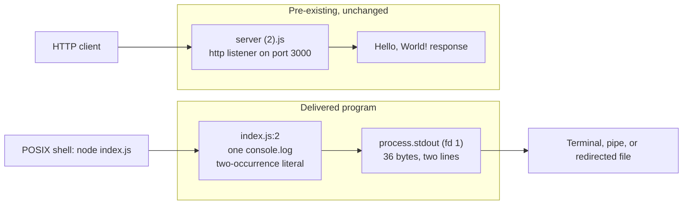

The runtime data path is a single hop: the constant in the source is handed to `console.log`, written once to file descriptor 1, and the process exits with status 0. Nothing is read, mutated, persisted, or networked, and the exit status remains 0 even when the output device rejects or discards the write (Project Guide §4, "Partial — output-device behaviour").

### 1.2.3 Success Criteria

**Measurable objectives.** The delivery is judged on the exact contents of its files and the exact bytes its program emits. No non-functional target for coverage, performance, security, or observability exists or is measured (Project Guide §5.2 row 7).

| Objective | Target | How it is measured |
|---|---|---|
| Correct output content | `Welcome to Blitzy` printed twice per run | `node index.js | wc -l` = 2; two occurrences in the capture |
| Correct output size and encoding | 36 bytes: two 17-byte lines plus two LF terminators, no escape or carriage-return byte | `node index.js | od -c` ends at octal offset `0000044`; `cmp` against `printf 'Welcome to Blitzy\nWelcome to Blitzy\n'` |
| Output fidelity | No colour, label, prefix, banner, indentation, separator, or quoting | `od -c`; `sort -u` collapses the stream to one bare line |
| Clean process contract | Exit status 0, 0 bytes on standard error, no file created | `node index.js; echo "exit=$?"`; `git status --porcelain` stays empty |
| Determinism and concurrency | Byte-identical output on repeats and on ten simultaneous runs | `sha256sum` over sequential and parallel runs (Project Guide §3) |
| Environment independence | Identical bytes under `env -i`, forced-colour variables, varied `TERM`/`LANG`, closed stdin, and stray arguments | Environment-variant checks in Project Guide §3, §4 |
| Dependency and artefact hygiene | No `package.json`, lockfile, `node_modules`, test path, or CI configuration anywhere | Filesystem probe; Project Guide §5.1 row 9 |
| Scope containment | Two files changed, zero paths added, `server (2).js` byte-identical to its base commit | `git diff --name-status 8860b6a HEAD` reports only additions of `index.js`, `README.md`, and the guide |

**Critical success factors.**

- **Literal consistency across five occurrences.** The greeting appears at `index.js:1` (JSDoc), twice on `index.js:2`, at `README.md:1` (heading), and at `README.md:3`; the word "twice" appears in both source files. No automated check guards these, so any change must touch all of them in one edit and be compared against the reference stream.
- **A Node.js runtime on `PATH`.** Nothing pins or enforces a version, so the run premise is unverified on the target host.
- **An untouched pre-existing server and an unclaimed port 3000.** `server (2).js` must stay byte-identical, and the port it binds must be free before it is started.
- **A truthful run premise.** `README.md:3` supplies the command but not the working directory, so the repository-root premise remains a documented, not an enforced, requirement.

**Key performance indicators.** No metric is instrumented: there is no CI pipeline, telemetry, or coverage tool, so every indicator below is obtained by running commands against the checkout. The recorded figures are those the tracked Project Guide reports from its own verification host, alongside the values reproduced in this checkout.

| Indicator | Recorded value | Status |
|---|---|---|
| Emitted bytes per run | 36 (two 17-byte lines plus LF terminators), matching the reference stream on every run | Verified in this checkout |
| Executable checks passed | 38 executed, 38 passed, 0 failed | Recorded in Project Guide §3 |
| Requirements addressed | 21 of 21: 17 met outright, 3 partially, 1 not started | Recorded in Project Guide §7, §8 |
| Completion and hours | 65% complete: 7.5 of 11.5 hours, 4.0 remaining | Recorded in Project Guide §1.2, §2.2 |
| Side effects per run | None: no path, file, log, or state created | Verified in this checkout (`git status` clean) |
| Release blockers | None identified | Recorded in Project Guide §8 |


## 1.3 Scope

### 1.3.1 In-Scope

**Core Features and Functionalities — must-have capabilities.** Each capability below is delivered and was exercised during verification.

| ID | Must-have capability | Delivered state | Evidence |
|---|---|---|---|
| IS-1 | One invocation writes the fixed greeting twice to standard output | Delivered: 36 bytes, two 17-byte lines | `index.js:2`; verified in this checkout |
| IS-2 | Output is plain and unformatted, with no colour, label, line number, prefix, banner, box, indentation, quoting, or separator | Delivered: no escape or carriage-return byte | `index.js:2`; Project Guide §5.1 row 2 |
| IS-3 | The program runs with no install step and no dependencies | Delivered: no manifest, lockfile, or `node_modules` in the tree | `README.md:3`; filesystem probe |
| IS-4 | The documented behaviour matches the code, and the documented command reproduces it | Delivered: `node index.js` extracted from `README.md:3` runs verbatim and matches | Project Guide §3, §5.1 row 5 |
| IS-5 | The source keeps the fixed shape: two lines, one tag-free JSDoc summary above one statement | Delivered: 2 lines, 113 bytes, zero `@` tags | `index.js` |
| IS-6 | The program terminates with status 0 and writes nothing to standard error | Delivered: exit 0, 0 bytes on stderr | Verified in this checkout |

**Primary user workflows.**

1. **Run and observe.** From the repository root, `node index.js` prints the two lines to the terminal and exits 0. This is the only documented workflow (`README.md:3`).
2. **Capture and consume.** A caller captures or pipes standard output — `head -1` for a single line, `head -c 4` for `Welc`, `wc -l` for a count of 2, or an append redirection to add exactly two lines to a file — because the program's only output channel is standard output (Project Guide §9, "Example Usage").
3. **Verify byte identity.** A maintainer compares the emitted stream against `printf 'Welcome to Blitzy\nWelcome to Blitzy\n'` with `cmp`, or inspects it with `od -c`, because no automated suite exists.
4. **Gate an edit.** After any change, the maintainer runs `node --check index.js && node index.js` and confirms the working tree stays clean (Project Guide §3, §9).

**Essential integrations.** Only three, none of them third-party or enterprise:

| Integration | Required for | Evidence |
|---|---|---|
| Node.js runtime on `PATH` | Executing `index.js` and supplying the `console` global | `index.js:2`; `README.md:3` |
| POSIX shell and standard output (fd 1) | Invocation, capture, piping, and redirection | Project Guide §3, §9 |
| Git repository on GitHub | Version control of the delivery and its merged branch | `git remote -v`; PR #1 merge `ee7cf7b` |

**Key technical requirements.** The delivery is bound by the shape of its artefacts, not by non-functional targets:

- `index.js` is two lines: a single `/** ... */` summary with no tags, a second paragraph, or an example, above exactly one statement.
- `README.md` stays under five lines — currently three — with no contributing, licence, testing, deployment, architecture, or table-of-contents content.
- No manifest, lockfile, dependency, test file, test suite, CI workflow, or configuration artefact may exist or be added.
- No argument parsing, environment read, error handler, retry, logging, or observability hook exists in the program.
- Changes stay minimal: no unrelated refactoring, reformatting, or renaming, and the pre-existing `server (2).js` remains byte-identical.

These requirements are recorded as the owner's constraints and the compliance matrix that measures them (Project Guide §5.1, §5.2 row 6).

**Implementation Boundaries.**

| Boundary | Included | Excluded | Evidence |
|---|---|---|---|
| Runtime surface of `index.js` | One write to standard output; process exit | Sockets, filesystem writes, subprocesses, timers, network calls | `index.js` (no `require`, `import`, or `process` reference) |
| Input surface | None | Arguments, stdin, environment variables, configuration files | `index.js`; Project Guide §3 ("stray arguments"), Appendix E |
| Fault handling | Implicit exit 0 | Error handlers, retries, fallbacks, diagnostics | Project Guide §4 (partial), §6 row 4 |
| Data | One in-source string constant | Persistence, schemas, records, external data sources | `index.js:2`; `git status` clean after a run |
| Consumers | Terminal, pipe, redirected file, exit status | HTTP or browser clients, library importers (no exports) | `index.js`; the HTTP surface belongs to `server (2).js` alone |

**User groups covered.** The repository owner (acceptance and open items), the developer or maintainer working at a terminal, and an automated verification step that captures standard output and compares bytes (Project Guide §1.1, §1.4). No end user, external API consumer, tenant, or localised audience is addressed by any artefact.

**Geographic and market coverage.** None. The program emits one hard-coded English string, reads no locale, and has no market segment, distribution, or deployment target; the Project Guide's environment checks confirm identical bytes under a varied `LANG` and `TERM` (its §4). The runtime host is described only as "the target host", unconfirmed (its §1.4).

**Data domains included.** A single domain: the fixed greeting literal held in source. There is no personal data, classification, retention rule, or schema; the program creates no file, log, or record, and the working tree remains clean after every run.

### 1.3.2 Out-of-Scope

**Explicitly excluded features and capabilities.** Each exclusion is either stated in the delivered artefacts or follows directly from the code; none is an omission.

| Excluded capability | Basis for exclusion | Evidence |
|---|---|---|
| HTTP, network, or server surface in the delivered program | The delivery's scope is console output; `index.js` references no module | `index.js`; Project Guide §5.1 row 10 |
| Input handling and validation | No input surface exists and hardening constructs are excluded by instruction | Project Guide §5.1 row 10, §6 row 3 |
| Error handling and observability | No handler by instruction; a rejecting or closed stdout still exits 0 | Project Guide §4, §6 row 4 |
| Automated tests, test runner, coverage, CI | Explicitly excluded; the gate is the manual `node --check index.js && node index.js` | Project Guide §3, §5.1 row 9 |
| Manifest, lockfile, dependencies, build step | Explicitly excluded; `npm init` and `npm install` are forbidden | Project Guide §9 ("Dependency Installation") |
| Configuration, environment variables, flags | The program reads none and needs none | Project Guide Appendix E |
| Persistence, database, logging to disk | The program writes nothing to disk | `git status` clean after a run |
| Authentication, authorisation, multi-user support, UI | No interface exists beyond standard output | `index.js` |
| Packaging, containerisation, deployment, or release pipeline | No Dockerfile, IaC, or workflow file exists in the tree | Filesystem probe |
| The behaviour of `server (2).js` | Pre-existing source, deliberately left byte-identical and undocumented in `README.md` | `git diff --name-status 8860b6a HEAD`; Project Guide §5.2 |

**Future phase considerations.** The only forward work the delivery records is the Project Guide's five remaining items (its §2.2), none of which is a feature. The fourth is reported here with its current state, because the tree contradicts the record:

| Item | Hours | Priority | State on the evidence |
|---|---|---|---|
| Confirm the target host supplies a supported Node.js and prints both lines there | 1.0 | High | Open: no manifest may pin a version and no host confirmation exists in the tree |
| Record the pre-existing `server (2).js` and its fixed port in a maintenance note | 1.0 | Medium | Open: `README.md` still never mentions the file |
| Assign ownership of TCP port 3000, or isolate the binding, before the server runs alongside other services | 0.5 | Medium | Open: the port is hard-coded and non-configurable (`server (2).js:1`) |
| Refresh the tracked document under `blitzy/documentation/` to match the twice-print behaviour | 1.0 | Low | Closed: commit `02fcaa1` rewrote the document, which now describes twice-print at 439 lines |
| State in `README.md` that the command is run from the repository root | 0.5 | Low | Open: `README.md:3` names the command but not the working directory |

**Integration points not covered.** No third-party API, enterprise system (identity provider, monitoring, ticketing, data warehouse), HTTP client, message broker, or CI hook is integrated or planned. The delivered program's entire external contract is standard output, standard error, and the exit status; the only other network binding in the tree, port 3000, belongs to the out-of-scope `server (2).js`.

**Unsupported use cases.**

- Running the program where Node.js is absent from `PATH` fails with a shell error and exit status 127, not a program message (Project Guide §9, "Troubleshooting").
- Running the program from a directory other than the repository root requires an explicit path; the README does not state the premise.
- Changing the greeting text or its occurrence count requires editing all five occurrences of the literal plus the word "twice", with no automated check to catch a partial edit.
- Reusing `index.js` as a module is impossible: it exports nothing.
- Producing anything other than the fixed two lines — parameterised output, a different locale, structured or decorated output, a single-line variant — is unsupported by design.
- Detecting a discarded write from the exit status is unsupported: `node index.js > /dev/full` and a closed descriptor both exit 0 while the line is lost (Project Guide §4).
- Asserting output from a terminal transcript is unreliable: a pty inserts CR before each LF, yielding a 38-byte capture where a redirected one yields 36 (Project Guide §4).
- Starting `server (2).js` on a host where port 3000 is already held fails with `EADDRINUSE`, and its filename requires quoting because it contains a space and parentheses (`server (2).js`).
- Claiming verified support for any Node.js major other than the v22.x family used for verification is unsupported; no other version, host, runtime (Deno, Bun), or non-Linux platform was exercised (Project Guide §3, §4).


## 1.4 References

- `README.md` — the project's title, the exact output claim ("`Welcome to Blitzy` twice to standard output"), the run command `node index.js`, and the zero-install claim.
- `index.js` — the delivered program: the tag-free JSDoc summary on line 1 and the single `console.log("Welcome to Blitzy\nWelcome to Blitzy")` on line 2 that produces the two 36-byte output lines.
- `server (2).js` — the pre-existing one-line CommonJS HTTP server answering `Hello, World!` on fixed port 3000; the basis for excluding that capability from scope and for the port-ownership limitation.
- `blitzy/documentation/Project Guide - d5d06770-1a28-4fee-846a-27d98a6d7cc0.md` — the generated status record supplying the requirement set, the 38-check verification results, environment and stdio findings, the risk register, the remaining-work items, and the development guide this section cites for behaviour not directly re-executed here.
- `blitzy/` — repository-level container for the platform's generated deliverables; carries no runtime behaviour.
- `blitzy/documentation/` — documentation-only folder holding the single Project Guide.
- Repository Git history (`8860b6a` base commit adding `server (2).js`, `5f49734` adding `index.js`, `1237471` adding `README.md`, `824480e` adding the guide, `c6b1fd3` making the output twice-printed, `02fcaa1` rewriting the guide, `ee7cf7b` merging PR #1) and remote `https://github.com/rjhonsi-blitzy/Simple_JS_1.git` — establishes the delivered change set, the byte-identical status of the pre-existing server, and the refresh that closed the guide's stale-document item.

No external web sources were consulted; every statement in this section derives from the repository files, the Git history, and commands executed against the checkout.


# 2. Product Requirements

## 2.1 Feature Catalog

The catalog enumerates the seven features the repository itself evidences. Six (F-001 to F-006) are the delivered program and its documentation: `index.js` and `README.md`. The seventh (F-007) is the pre-existing HTTP server that sits at the repository root, which this delivery neither authored nor modified. No feature is proposed speculatively; each is traceable to source text, to the tracked Project Guide under `blitzy/documentation/`, and to behaviour reproduced in this checkout.

| ID | Feature | Category | Priority / Status |
|---|---|---|---|
| F-001 | Twice-Print Greeting Emission | Core Output | Critical / Completed |
| F-002 | Plain, Undecorated Output Rendering | Output Fidelity | Critical / Completed |
| F-003 | Zero-Dependency, Install-Free Execution | Execution Model | High / Completed |
| F-004 | Deterministic, Input-Agnostic Invocation | Runtime Behaviour | High / Completed |
| F-005 | Canonical Two-Line Source with Inline Summary | Source Artefact | Medium / Completed |
| F-006 | Run-Instruction Documentation | Documentation | High / Completed |
| F-007 | Pre-existing HTTP Greeting Server | Ancillary Service | Low / Completed (pre-existing, unchanged) |

Priority is assigned from the acceptance weight the tracked record gives each capability: the Project Guide's in-scope list marks the twice-print, the unformatted output and the zero-install run as must-haves (Project Guide §1.3 of this specification, IS-1 to IS-3), while the source shape and the README's line cap are owner constraints on the same delivery (§5.1 rows 3 to 6). F-007 is Low because it lies outside the delivery, yet it is catalogued rather than omitted: it is a runnable program in the tree, it binds a non-partitionable resource, and the Project Guide records its undiscoverability as an open item.

### 2.1.1 F-001 Twice-Print Greeting Emission

| Attribute | Value |
|---|---|
| Unique ID | F-001 |
| Feature name | Twice-Print Greeting Emission |
| Feature category | Core Output |
| Priority level | Critical |
| Status | Completed |

**Overview.** A single invocation of `node index.js` writes the fixed string `Welcome to Blitzy` exactly twice, as two consecutive lines, to standard output, and then exits. Both occurrences come from one statement, `console.log("Welcome to Blitzy\nWelcome to Blitzy")` at `index.js:2`, whose argument is a lone string literal holding two occurrences and an escaped newline; the runtime, not a second statement, produces the second line. The observed stream is 36 bytes: two 17-byte lines, each terminated by LF.

**Business value.** This feature is the deliverable's acceptance criterion. The Project Guide fixes "the fixed contents of the two delivered files" as the standard the delivery is judged against (§5.2 row 7, Appendix G), and the emitted bytes are the only observable proof of that criterion. It also carries the repository's value as a verification baseline: byte-for-byte output from a program with no input, dependency or failure branch lets a pipeline and its reviewers be exercised end to end for the cost of one command.

**User benefits.** A developer at a terminal sees the two lines immediately, with no installation step. A shell consumer gets a stable two-line stream that `wc -l` counts as 2, `head -1` reduces to one line, `head -c 4` truncates to `Welc`, and an append redirection adds exactly two lines to a file (Project Guide §9, "Example Usage"). An automated verification step gets one hash, `c4a4d23e786cb46a42ad44baf6953b7d5421c2832d4767de6ecbc3d73c546963`, on every run, which it can compare against `printf 'Welcome to Blitzy\nWelcome to Blitzy\n'`.

**Technical context.** The program declares no module system: no `require`, `import`, `exports` or `module.exports` appears in `index.js`, so the file is consumed only for the side effect of one write. The write goes to file descriptor 1 and the process terminates with status 0. Nothing is read, mutated, persisted or networked, and the exit status stays 0 even when the output device rejects the write (`node index.js > /dev/full`), an accepted condition the Project Guide records in §4 and §6.

| Dependency type | Detail |
|---|---|
| Prerequisite features | F-003 (a Node.js runtime reachable with no install step), F-004 (a stable, repeatable emission) |
| System dependencies | Node.js runtime on `PATH`; standard output (fd 1); process exit status |
| External dependencies | None: no third-party package, network call, credential, file or environment variable |
| Integration requirements | A POSIX shell invocation from the repository root (`node index.js`); capture by pipe, redirection or terminal |

### 2.1.2 F-002 Plain, Undecorated Output Rendering

| Attribute | Value |
|---|---|
| Unique ID | F-002 |
| Feature name | Plain, Undecorated Output Rendering |
| Feature category | Output Fidelity |
| Priority level | Critical |
| Status | Completed |

**Overview.** The two emitted lines carry the literal and nothing else: no colour, escape sequence, label, line number, prefix, banner, box, indentation, quoting or separator. `od -c` over a capture shows exactly the 17 characters of each line and one LF after each, ending at octal offset `0000044`; each line measures 17 characters, and `sort -u` collapses the stream to one bare line.

**Business value.** Fidelity is the point of the delivery as much as the text is: the Project Guide's compliance matrix treats decoration as a failure, not a cosmetic preference (§5.1 row 2, benchmarked as "Output fidelity"). Undecorated output keeps the byte stream directly comparable to a `printf` reference and to the reference export, so acceptance does not depend on parsing or normalisation.

**User benefits.** A consumer can compare bytes with `cmp` instead of stripping formatting. A terminal reader sees clean lines, and a caller piping into another command receives no control sequences to escape. Because the program never inspects `TERM`, `LANG`, `FORCE_COLOR`, `CLICOLOR_FORCE` or `NO_COLOR`, the output is identical whether or not it is attached to a terminal.

**Technical context.** Decoration would require either a formatting library or manual escape sequences; neither exists in the file, which contains one `console.log` and zero `@` characters. The one rendering artefact outside the program's control is the terminal's line discipline, which translates each LF to CRLF in a pty transcript, so a terminal capture reads 38 bytes where a redirected capture reads 36 (Project Guide §4).

| Dependency type | Detail |
|---|---|
| Prerequisite features | F-001 (there must be output to render plainly) |
| System dependencies | Standard output (fd 1); no terminal-capability lookup |
| External dependencies | None: no colour or formatting package |
| Integration requirements | Byte-level comparison tooling (`cmp`, `od`, `sha256sum`, `sort`) for acceptance |

### 2.1.3 F-003 Zero-Dependency, Install-Free Execution

| Attribute | Value |
|---|---|
| Unique ID | F-003 |
| Feature name | Zero-Dependency, Install-Free Execution |
| Feature category | Execution Model |
| Priority level | High |
| Status | Completed |

**Overview.** `node index.js` runs from a fresh checkout with nothing installed. The tree holds no `package.json`, no `package-lock.json`, `yarn.lock` or `pnpm-lock.yaml`, no `node_modules`, and no build, transpile, bundle or package-manager configuration; the four tracked paths are `index.js`, `README.md`, `server (2).js` and the Project Guide. `index.js` requires no module at all, built-in or third-party.

**Business value.** Removing the install step removes the largest class of environmental failure from a delivery whose whole value is reproducibility: no lockfile drift, no registry availability dependency, no `postinstall` surface. `README.md:3` states the property explicitly ("no dependencies to install"), so the claim and the tree agree, and the Project Guide's dependency-hygiene row closes on that agreement (§5.1 row 9).

**User benefits.** A developer runs one command and does not wait for a download. A CI job needs only a Node.js image, no cache or restore step. A reviewer can confirm the claim in seconds with a filesystem probe rather than by auditing a dependency graph.

**Technical context.** The only `require` anywhere in the tree is `require('http')` in `server (2).js`, a Node.js built-in belonging to F-007. `index.js` uses one runtime global, `console`, and no version-specific feature, so no `engines` field is needed — and none may be added, which leaves the runtime version unpinned by design (Project Guide §1.4, §6 row 6).

| Dependency type | Detail |
|---|---|
| Prerequisite features | None: this is the base execution premise |
| System dependencies | A Node.js runtime on `PATH`; no package manager, compiler or bundler |
| External dependencies | None: no registry, no network access at build or run time |
| Integration requirements | `README.md:3` must keep naming the command and the absence of an install step |

### 2.1.4 F-004 Deterministic, Input-Agnostic Invocation

| Attribute | Value |
|---|---|
| Unique ID | F-004 |
| Feature name | Deterministic, Input-Agnostic Invocation |
| Feature category | Runtime Behaviour |
| Priority level | High |
| Status | Completed |

**Overview.** Every invocation emits the same bytes and leaves no trace. Single runs, three repeats, a foreign working directory, an empty environment (`env -i`), colour-forcing variables, a varied `TERM` and `LANG`, a closed stdin and stray arguments all produce the identical 36 bytes and hash `c4a4d23e…`; ten concatenated runs hash `9891a6ce…`, which is exactly ten copies of the same stream. `git status --porcelain` stays empty after every run.

**Business value.** Determinism is what allows the delivery to be verified at all without a test suite: the Project Guide's gate is a manual comparison against a fixed reference stream (its §3, §9), and that comparison is only meaningful if the program cannot vary. Side-effect freedom likewise keeps the checkout clean, so verification cannot contaminate the artefact it measures.

**User benefits.** A caller may run the program concurrently without coordination, re-run it freely, and pipe it into `head` or `wc` without handling early termination. No cleanup step is required, and no state has to be reset between runs.

**Technical context.** The program reads nothing: no `process.argv`, no `stdin`, no `process.env`, no file. Its only state is a compile-time constant, so the output is a pure function of the source text. Concurrency is safe because the process holds no shared resource — no lock, socket or file handle beyond fd 1.

| Dependency type | Detail |
|---|---|
| Prerequisite features | F-001 (the emission being repeated), F-003 (no dependency that could introduce state) |
| System dependencies | Node.js runtime; process isolation per invocation |
| External dependencies | None: no clock, randomness, network or locale input |
| Integration requirements | Acceptance tooling able to hash or diff a capture (`sha256sum`, `cmp`) |

### 2.1.5 F-005 Canonical Two-Line Source with Inline Summary

| Attribute | Value |
|---|---|
| Unique ID | F-005 |
| Feature name | Canonical Two-Line Source with Inline Summary |
| Feature category | Source Artefact |
| Priority level | Medium |
| Status | Completed |

**Overview.** `index.js` is two lines and 113 bytes: a single tag-free JSDoc block, `/** Prints "Welcome to Blitzy" twice to standard output. */`, above exactly one statement. The file contains no `@` tag, no second paragraph, no example, no variable, no function and no export.

**Business value.** The shape keeps the artefact auditable in one glance and keeps the documented behaviour next to the code that implements it: the summary names the twice-print behaviour, and the statement below it is the reason that claim is true. The Project Guide ties this to the delivery's code-hygiene and specification-conformance benchmarks (§5.1 rows 3 and 4).

**User benefits.** A maintainer reading the file sees intent and implementation together without scrolling. A reviewer checking a diff sees any behavioural change on the same line as the claim about it, which makes an undisclosed change hard to hide.

**Technical context.** The three constraints — two lines, one JSDoc block, no tags — are owner constraints, and the summary itself was reworded when the behaviour changed from a single print to a double print in commit `c6b1fd3`, precisely so the comment would not state something false (Project Guide §5.2 row 2). Because no automated check guards the shape, `wc -l` and a tag grep over `index.js` are the only enforcement.

| Dependency type | Detail |
|---|---|
| Prerequisite features | F-001 (the statement the summary describes) |
| System dependencies | None beyond a text editor and `wc`/`grep` for verification |
| External dependencies | None |
| Integration requirements | The JSDoc text must stay consistent with the emission behaviour and with `README.md:3` |

### 2.1.6 F-006 Run-Instruction Documentation

| Attribute | Value |
|---|---|
| Unique ID | F-006 |
| Feature name | Run-Instruction Documentation |
| Feature category | Documentation |
| Priority level | High |
| Status | Completed |

**Overview.** `README.md` is three lines and 128 bytes: the heading `# Welcome to Blitzy`, a blank line, and one sentence stating that the program prints `` `Welcome to Blitzy` `` twice to standard output, that it runs with `node index.js`, and that there is nothing to install. The command the sentence names was extracted from `README.md:3` and executed verbatim from the repository root; it reproduced the two lines the sentence claims.

**Business value.** The README is the only discovery surface for the delivered program. Its accuracy is a distinct benchmark in the Project Guide (§5.1 row 5, "Documentation accuracy"), and its scope is bounded by an owner constraint: under five lines, with no contributing, licence, testing, deployment, architecture or table-of-contents content (§5.1 row 6).

**User benefits.** A reader learns what the program does, how many times, and how to run it without opening the source. Because the sentence carries the command and the zero-install claim, a first-time user needs no further documentation to execute the primary workflow.

**Technical context.** The file states the same count — twice — that `index.js:1` states and that the program emits, so the literal appears at four places outside the Project Guide and the word "twice" at two. Nothing enforces that agreement, and the README does not state that the command is run from the repository root, which the Project Guide records as the remaining wording gap (§2.2 row 5).

| Dependency type | Detail |
|---|---|
| Prerequisite features | F-001 and F-003 (the behaviour and the install-free premise being described) |
| System dependencies | None: plain Markdown, no renderer installed or required |
| External dependencies | None |
| Integration requirements | The literal and the count must match `index.js:1`, `index.js:2` and the observed output |

### 2.1.7 F-007 Pre-existing HTTP Greeting Server

| Attribute | Value |
|---|---|
| Unique ID | F-007 |
| Feature name | Pre-existing HTTP Greeting Server |
| Feature category | Ancillary Service |
| Priority level | Low |
| Status | Completed (pre-existing, unchanged) |

**Overview.** `server (2).js`, one line and 142 bytes, starts a Node.js built-in `http` server that answers every request with `Hello, World!` and logs `Server running at http://127.0.0.1:3000/` on start, binding fixed TCP port 3000. It predates this delivery — commit `8860b6a` added it before any delivered file existed — and its blob `2886290f56dfe2483a8f29f7dfcb89796a6fca00` is identical at that base commit and at `HEAD`.

**Business value.** None to the delivery itself; its value in the record is contextual. It is the only network-facing code in the tree, so it marks the boundary of the delivered scope and accounts for the single non-partitionable resource the repository consumes (Project Guide Appendix B).

**User benefits.** For a reader of the whole tree, it explains the port-3000 reference and gives a repeatable smoke endpoint (`curl http://127.0.0.1:3000/` returns `Hello, World!`) when the port is free. Its filename contains a space and parentheses, so it must be quoted on the command line.

**Technical context.** The handler ignores the request entirely — method, path, headers and body have no effect — and replies with an implicit HTTP 200 and a 13-byte plain-text body; the listener stays up until the process is stopped. It has no routing, validation, logging beyond the one banner, graceful shutdown, or error handling, so a bound port surfaces as an uncaught `EADDRINUSE` exception. It was deliberately never started during verification, because starting it would bind the port; everything stated about its behaviour is read from its single line.

| Dependency type | Detail |
|---|---|
| Prerequisite features | None: it shares no code with F-001 to F-006 |
| System dependencies | Node.js runtime; built-in `http` module; free TCP port 3000 |
| External dependencies | An HTTP client such as `curl` to exercise it |
| Integration requirements | Port 3000 must be owned or free before it runs; the file must stay byte-identical to `8860b6a` |


## 2.2 Functional Requirements Table

Every requirement below is derived from the code, the README, or a constraint the tracked Project Guide records, and each acceptance criterion is a command a reviewer can run against the checkout. No requirement introduces behaviour the repository does not already exhibit.

### 2.2.1 Requirement Conventions and Verification Path

**Identifier scheme.** A requirement is `F-XXX-RQ-YYY`, where `F-XXX` is the owning feature from the catalog (§2.1) and `RQ-YYY` is sequential within that feature. Twenty-two requirements are recorded: F-001 and F-004 hold four each, F-002, F-003, F-006 and F-007 three each, F-005 two.

**Priority scale.** Priority is the MoSCoW rating of the requirement against the delivered acceptance criterion, not an estimate of effort.

| Priority | Meaning in this repository |
|---|---|
| Must-Have | Stated in `index.js`, `README.md` or the Project Guide as part of the accepted contents; failing it fails the delivery |
| Should-Have | An owner constraint or a recorded claim that carries weight but whose breach would not change the emitted bytes |
| Could-Have | A desirable property the tree exhibits without being required to |

**Complexity scale.** Complexity reflects the number of interacting parts a change would have to satisfy, given a two-line program with no dependency.

| Complexity | Meaning in this repository |
|---|---|
| Low | Sited in one line of one file, with no state, branch or external interaction |
| Medium | Spans two or more artefacts, or depends on an environment condition outside the repository |
| High | Requires a runtime resource, a host condition and a repository-wide invariant at once |

**Requirement-set version.** The set is versioned against the Git history because the behaviour changed once, in commit `c6b1fd3`.

| Version | Basis | Content change | State |
|---|---|---|---|
| v0.9 | Commit `5f49734` | Single print of the literal; no README | Superseded |
| v1.0 | Commits `1237471` to `ee7cf7b` (HEAD) | Twice-print behaviour; JSDoc and README reworded; run instruction added | Current |

**Verification path.** The repository has no automated suite and none may be added (Project Guide §3), so each acceptance criterion is a step on this manual path; the same path is the reference process flow for every requirement table below.

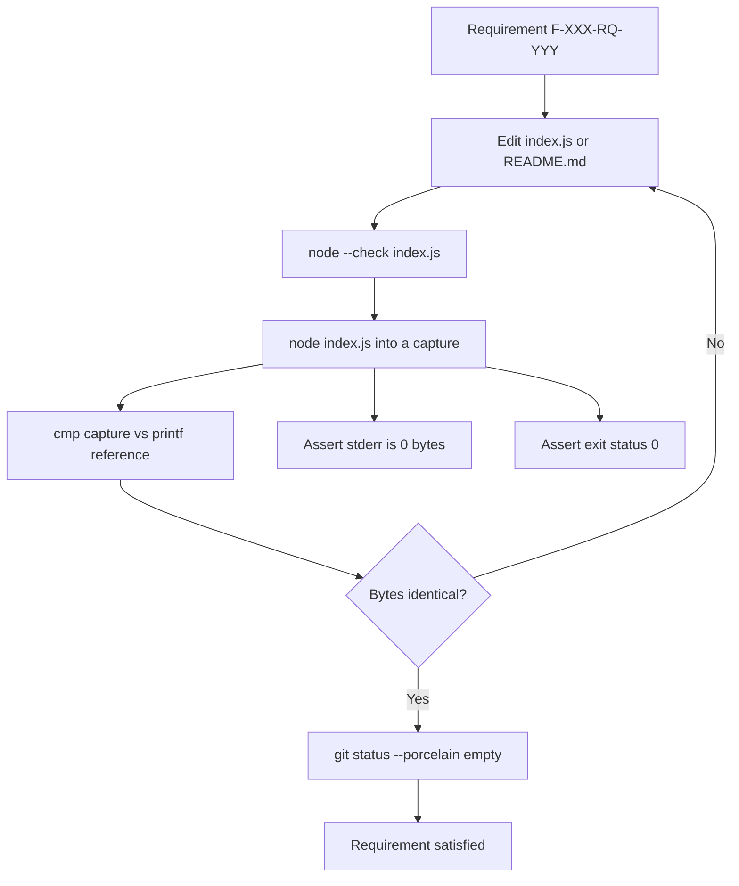

### 2.2.2 F-001 Twice-Print Greeting Emission

| Requirement ID | Requirement | Acceptance criteria | Priority |
|---|---|---|---|
| F-001-RQ-001 | One invocation writes the fixed greeting exactly twice, as two consecutive lines on standard output | 36-byte capture; `wc -l` returns 2; both lines byte-equal to `Welcome to Blitzy`; sha256 = `c4a4d23e…` | Must-Have |
| F-001-RQ-002 | Both occurrences come from a single output statement, so the count cannot diverge within the program | `grep -c console.log index.js` returns 1; the argument is one literal containing both occurrences and an escaped newline | Must-Have |
| F-001-RQ-003 | The lines reach standard output only | Redirect stdout and stderr separately: 36 bytes and 0 bytes respectively | Must-Have |
| F-001-RQ-004 | The process terminates successfully after emission | `node index.js; echo $?` prints `0` | Must-Have |

| Requirement ID | Complexity | Inputs, outputs and data | Performance criterion |
|---|---|---|---|
| F-001-RQ-001 | Low | No input; output is 36 bytes on fd 1; data is one in-source string constant | No target exists (Project Guide §5.2 row 7); the guide records ~31 ms per run (§4) |
| F-001-RQ-002 | Low | No input; output unchanged; data is the same single literal | No target; the statement count is static, so the check is a text search |
| F-001-RQ-003 | Low | No input; fd 1 carries both lines, fd 2 stays empty | No target; stderr volume is 0 bytes by observation |
| F-001-RQ-004 | Low | No input; output is the numeric exit status | Exit 0 on every normal run; the status also stays 0 when the device rejects the write |

| Requirement ID | Business and data rule | Security requirement | Compliance requirement |
|---|---|---|---|
| F-001-RQ-001 | The greeting text and its count are fixed constants; changing either requires editing all five occurrences of the literal plus the word "twice" | No credential, no user data and no untrusted input reaches the write | The emitted bytes are the acceptance criterion (Project Guide §5.1 row 1) |
| F-001-RQ-002 | One statement owns both occurrences; a second statement would be a scope breach of the two-line shape | None: the call carries no interpolated value | Owner constraint on the delivered source (Project Guide §5.1 row 3) |
| F-001-RQ-003 | Diagnostics must not pollute the stream a caller captures | A clean stream prevents accidental disclosure of runtime warnings into a captured artefact | Stdio contract recorded in Project Guide §3, §4 |
| F-001-RQ-004 | Success is signalled by the exit status, not by the presence of output | None | Process contract per Project Guide §4; a rejected write still exits 0, an accepted condition |

### 2.2.3 F-002 Plain, Undecorated Output Rendering

| Requirement ID | Requirement | Acceptance criteria | Priority |
|---|---|---|---|
| F-002-RQ-001 | No colour, escape sequence, label, line number, prefix, banner, box, indentation, quoting or separator is emitted | `od -c` shows only the literal's characters and the LF terminators, ending at octal `0000044`; `sort -u` collapses the stream to one bare line | Must-Have |
| F-002-RQ-002 | Each line is exactly the 17-character literal followed by one LF, with no padding or trailing space | Both lines measure 17 characters; total 36 bytes | Must-Have |
| F-002-RQ-003 | Rendering does not vary with terminal capability or colour-control variables | Identical sha256 under `FORCE_COLOR=3`, `CLICOLOR_FORCE=1`, `NO_COLOR=1`, `TERM=xterm-256color`, `LANG=C`, and when piped | Must-Have |

| Requirement ID | Complexity | Inputs, outputs and data | Performance criterion |
|---|---|---|---|
| F-002-RQ-001 | Low | No input; output is printable ASCII plus LF only; no formatting data exists | No target; the check is a byte-level inspection of one capture |
| F-002-RQ-002 | Low | No input; output is two 17-byte lines; no padding is generated | No target; byte identity with the `printf` reference proves it |
| F-002-RQ-003 | Medium | Environment variables are present in the process but never read; output is invariant | No target; invariance is measured by hash equality across environments |

| Requirement ID | Business and data rule | Security requirement | Compliance requirement |
|---|---|---|---|
| F-002-RQ-001 | Presentation is fixed; no formatting decision is delegated to the runtime or the terminal | No escape sequence can be injected into a downstream consumer's stream | Output-fidelity benchmark, Project Guide §5.1 row 2 |
| F-002-RQ-002 | Line length is a property of the constant, not of the environment | None | Byte identity against the reference stream (Project Guide §9) |
| F-002-RQ-003 | The program must not consult `TERM`, `LANG`, `NO_COLOR` or `FORCE_COLOR` | A colour-forcing variable must not be able to alter a captured artefact | Environment-independence checks, Project Guide §3, §4 |

### 2.2.4 F-003 Zero-Dependency, Install-Free Execution

| Requirement ID | Requirement | Acceptance criteria | Priority |
|---|---|---|---|
| F-003-RQ-001 | The program runs from a fresh checkout with no install step | Probes for `package.json`, `package-lock.json`, `yarn.lock`, `pnpm-lock.yaml` and `node_modules` all report the path absent; `node index.js` succeeds regardless | Must-Have |
| F-003-RQ-002 | The entry point references no module, built-in or third-party | `index.js` contains zero `require`, `import`, `exports` or `module.exports`; the tree's only `require` is `http` in `server (2).js` | Must-Have |
| F-003-RQ-003 | No build, transpile, bundle or package-manager step is required or configured | Source is executed directly by the interpreter; no build or package-manager configuration exists in the tree | Must-Have |

| Requirement ID | Complexity | Inputs, outputs and data | Performance criterion |
|---|---|---|---|
| F-003-RQ-001 | Low | No input; output unchanged; no manifest data exists to resolve | No target; the install step's absence is static and probeable |
| F-003-RQ-002 | Low | No input; no module graph is loaded beyond the runtime itself | No target; startup cost is the interpreter's alone |
| F-003-RQ-003 | Low | No input; source bytes are the executed artefact | No target; there is no build artefact to produce or cache |

| Requirement ID | Business and data rule | Security requirement | Compliance requirement |
|---|---|---|---|
| F-003-RQ-001 | `README.md:3` must keep claiming the absence of an install step, and the tree must keep proving it | No registry, download or post-install script can execute | Dependency-hygiene benchmark, Project Guide §5.1 row 9 |
| F-003-RQ-002 | The delivery's only imports are runtime globals such as `console` | No third-party code enters the process, so no supply-chain surface exists | Scope rule forbidding dependencies (Project Guide §9, "Dependency Installation") |
| F-003-RQ-003 | Adding a manifest, lockfile or build tool is out of scope and forbidden | No build toolchain to compromise or keep current | Owner constraints recorded in Project Guide §5.2 row 6 |

### 2.2.5 F-004 Deterministic, Input-Agnostic Invocation

| Requirement ID | Requirement | Acceptance criteria | Priority |
|---|---|---|---|
| F-004-RQ-001 | Repeated runs emit byte-identical output | Three consecutive runs and every environment variant share hash `c4a4d23e…`, equal to `printf 'Welcome to Blitzy\nWelcome to Blitzy\n'` | Must-Have |
| F-004-RQ-002 | Concurrent invocations are safe and individually correct | Ten simultaneous runs concatenate to 360 bytes hashing `9891a6ce…`, exactly ten copies of the single-run stream | Should-Have |
| F-004-RQ-003 | A run creates no file, path, log or persisted state | `git status --porcelain` is empty after every run; no artefact is written | Must-Have |
| F-004-RQ-004 | No input is read: not argv, stdin, environment variable or configuration | Identical output under `env -i`, with stdin closed, with stray arguments, and from a foreign working directory | Must-Have |

| Requirement ID | Complexity | Inputs, outputs and data | Performance criterion |
|---|---|---|---|
| F-004-RQ-001 | Low | No input; output is a pure function of the source constant | No target; determinism is shown by hash equality |
| F-004-RQ-002 | Low | No input; each process owns its own fd 1; no shared resource is taken | No target; ten parallel runs complete without interleaving or failure |
| F-004-RQ-003 | Low | No input; no filesystem sink exists in the program | No target; the absence of side effects is shown by a clean tree |
| F-004-RQ-004 | Medium | Process-level inputs exist but are never consulted; output is invariant | No target; invariance is measured across environment and argument variants |

| Requirement ID | Business and data rule | Security requirement | Compliance requirement |
|---|---|---|---|
| F-004-RQ-001 | The acceptance comparison is valid only if output cannot vary | None: no clock, randomness or locale participates | Operability benchmark with caveat, Project Guide §5.1 row 12 |
| F-004-RQ-002 | The program holds no lock, socket or file handle beyond fd 1 | Concurrency cannot leak one invocation's data into another | Determinism and concurrency checks, Project Guide §3 |
| F-004-RQ-003 | Verification must not contaminate the artefact it measures | No file is written, so no permission or retention exposure arises | Side-effect freedom, Project Guide §3 |
| F-004-RQ-004 | Arguments and environment are accepted by the shell but ignored by the program | Stray arguments cannot change behaviour or reach a sink | No hardening or argument parsing exists, by instruction (Project Guide §5.1 row 10) |

### 2.2.6 F-005 Canonical Two-Line Source with Inline Summary

| Requirement ID | Requirement | Acceptance criteria | Priority |
|---|---|---|---|
| F-005-RQ-001 | `index.js` stays two lines: one tag-free JSDoc block above exactly one statement | `wc -l` returns 2 (113 bytes); one `/** */` pair; zero `@` characters; no declaration or export | Must-Have |
| F-005-RQ-002 | The summary states the twice-print behaviour truthfully | Line 1 contains "twice"; the stated behaviour matches the observed two-line output | Must-Have |

| Requirement ID | Complexity | Inputs, outputs and data | Performance criterion |
|---|---|---|---|
| F-005-RQ-001 | Low | No input; the file's shape is a static byte property | No target; the shape is measured with `wc` and a tag grep |
| F-005-RQ-002 | Medium | No input; the claim sits in a comment and must track the statement below it | No target; accuracy is a review judgement against the emitted bytes |

| Requirement ID | Business and data rule | Security requirement | Compliance requirement |
|---|---|---|---|
| F-005-RQ-001 | No second statement, no helper, no export may be added | A comment-only file surface leaves no executable path to audit beyond one call | Code-hygiene benchmark, Project Guide §5.1 row 3 |
| F-005-RQ-002 | The summary must be reworded whenever the count changes, as happened in `c6b1fd3` | None | Specification conformance, Project Guide §5.1 row 4 |

### 2.2.7 F-006 Run-Instruction Documentation

| Requirement ID | Requirement | Acceptance criteria | Priority |
|---|---|---|---|
| F-006-RQ-001 | `README.md` states what is printed and that it is printed twice | Line 3 names the literal and the count; the count matches the observed two lines | Must-Have |
| F-006-RQ-002 | `README.md` states the command that runs the program and the absence of an install step | The command extracted from `README.md:3` runs verbatim from the repository root and reproduces both lines with no install | Must-Have |
| F-006-RQ-003 | `README.md` stays under five lines and carries no excluded section | `wc -l` returns 3 (128 bytes); one heading and one sentence; no contributing, licence, testing, deployment, architecture or table-of-contents content | Should-Have |

| Requirement ID | Complexity | Inputs, outputs and data | Performance criterion |
|---|---|---|---|
| F-006-RQ-001 | Low | No input; three lines of Markdown as output | No target; the claim is compared with a capture |
| F-006-RQ-002 | Medium | The documented command is an input to the reader and must execute as written | No target; the command reproduces 36 bytes with nothing installed |
| F-006-RQ-003 | Low | No input; the file's line count is a static property | No target; measured with `wc -l` |

| Requirement ID | Business and data rule | Security requirement | Compliance requirement |
|---|---|---|---|
| F-006-RQ-001 | The literal and the count must agree with `index.js:1`, `index.js:2` and the output | None: no credential, endpoint or configuration is documented | Documentation-accuracy benchmark, Project Guide §5.1 row 5 |
| F-006-RQ-002 | No `npm install`, clone or environment step may be implied or required | The documented path requires only a Node.js runtime | Documentation-scope benchmark, Project Guide §5.1 row 6 |
| F-006-RQ-003 | The README must not grow into a project handbook | None | Owner constraint: under five lines, no excluded sections |

### 2.2.8 F-007 Pre-existing HTTP Greeting Server

| Requirement ID | Requirement | Acceptance criteria | Priority |
|---|---|---|---|
| F-007-RQ-001 | Every HTTP request is answered with the fixed body `Hello, World!` and an implicit 200 | Source inspection: one `res.end('Hello, World!\n')` handler that never reads method, path, header or body; not executed during verification | Must-Have |
| F-007-RQ-002 | The server listens on fixed TCP port 3000 and logs a startup line | Source inspection: `.listen(3000, …)` with the banner `Server running at http://127.0.0.1:3000/` | Should-Have |
| F-007-RQ-003 | The file remains byte-identical to its base commit | Blob `2886290f56dfe2483a8f29f7dfcb89796a6fca00` at `8860b6a` and at `HEAD`; `git diff` shows no change | Must-Have |

| Requirement ID | Complexity | Inputs, outputs and data | Performance criterion |
|---|---|---|---|
| F-007-RQ-001 | Low | Input is any HTTP request, all fields ignored; output is a 13-byte plain-text body | No target exists; the response is constant, so no latency figure is recorded |
| F-007-RQ-002 | Medium | Input is a free TCP port binding; output is the listening socket plus one log line | Binding succeeds only while port 3000 is unowned; a conflict raises `EADDRINUSE` |
| F-007-RQ-003 | Low | No input; the file's bytes are the acceptance artefact | No target; equality is a blob-hash comparison |

| Requirement ID | Business and data rule | Security requirement | Compliance requirement |
|---|---|---|---|
| F-007-RQ-001 | The handler is unconditional; no routing or validation may be introduced | An unauthenticated, unencrypted endpoint that answers every request identically; it must not be exposed beyond a trusted host | Out-of-scope for the delivery; recorded as such in Project Guide §5.2, Appendix B |
| F-007-RQ-002 | The port is hard-coded and non-configurable; ownership of port 3000 must be assigned before it runs alongside another service | A single non-partitionable resource: a second listener on the port fails | Open item, Project Guide §2.2 row 3, §6 row 7 |
| F-007-RQ-003 | Existing-code integrity: the delivery may not alter or refactor the file | An unmodified blob keeps the audit surface of the delivery bounded to two files | Compliance-matrix row 11, Project Guide §5.1 |

### 2.2.9 Cross-Feature Validation and Compliance Baseline

**Data validation.** No requirement validates input, because no requirement has input: F-001 to F-006 read no argument, stdin, environment variable or file, and F-007 ignores every request field. The complete data surface is one string constant in `index.js:2` and one in `server (2).js:1`. Consequently there is no schema, no parser, no boundary check and no rejection path anywhere in the tree.

**Security requirements.** The delivered program has no network, no credential, no persistence and no sink for untrusted data, so its exposure is limited to what a caller does with the stream. The one network-facing artefact is F-007, which answers every request with a fixed body and has no authentication, no TLS, no request logging and no error handling; the Project Guide records both the absence of access issues for the delivery (§1.5) and the absence of any 404 or error handler as an owner constraint (§5.1 row 10).

**Compliance requirements.** No external regulatory regime is engaged: there is no personal data, no retention period, no audit trail to preserve and no third-party licence in the tree. The compliance regime that does bind the delivery is the owner's constraint set — smallest diff, no new file, one-line tag-free JSDoc, README under five lines, no test or dependency, no hardening, concise prose, final decision only, no verification section, file list stated once — which the Project Guide records as fourteen constraints binding the work and evaluates row by row in its §5.1 matrix and §5.2 gap list.

**Traceability of acceptance.** Each requirement's acceptance criterion names a command or a static property that the repository's manual gate reproduces: `node --check index.js && node index.js`, a byte comparison against `printf 'Welcome to Blitzy\nWelcome to Blitzy\n'`, `wc -l` and `grep` over the two delivered files, and `git status --porcelain` for side-effect freedom (Project Guide §3, §9).


## 2.3 Feature Relationships

Feature relationships in this repository are semantic and documentary rather than call-graph edges. No feature invokes another: `index.js` exports nothing and calls nothing outside the runtime, so a dependency below means "cannot hold its acceptance criterion unless the other holds its own", not "calls at run time". Only relationships visible in the source, the README, the Git history or the tracked record are listed.

### 2.3.1 Feature Dependency Map

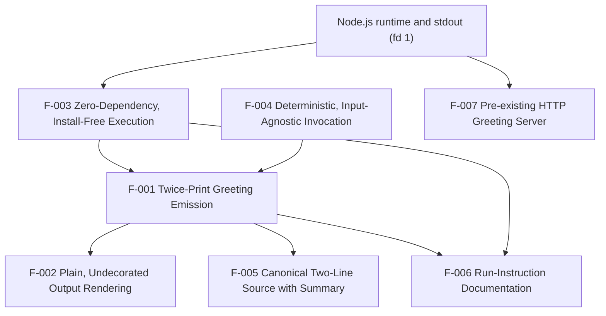

| From | To | Relationship | Evidence |
|---|---|---|---|
| F-003 | F-001 | Enabling: the emission cannot be reproduced without a runtime reachable with no install step | `index.js` (no module reference); `README.md:3` |
| F-004 | F-001 | Enabling: the byte-for-byte acceptance criterion depends on output that does not vary | `index.js:2`; repeat and environment hashes |
| F-001 | F-002 | Structural: there must be output before its plainness can be a property | `index.js:2`; `od -c` capture |
| F-001 | F-005 | Documentary: the JSDoc summary describes the statement's behaviour and was reworded with it | `index.js:1`; commit `c6b1fd3` |
| F-001 | F-006 | Documentary: the README restates the behaviour and names the command that produces it | `README.md:3` |
| F-003 | F-006 | Constraint: the README's zero-install claim is true only while the tree holds no dependency | `README.md:3`; filesystem probe |
| — | F-007 | Independent: no dependency edge to F-001 to F-006 exists in either direction | `server (2).js:1`; `git diff --name-status 8860b6a HEAD` |

### 2.3.2 The Greeting Literal as a Coupled Constant

The strongest relationship in the system is a shared data constant rather than a shared module. The string `Welcome to Blitzy` and its count of two recur across two artefacts and four locations outside the Project Guide, and no automated check guards their agreement — a partial edit drifts them apart silently, which the Project Guide records as the repository's first risk (§6 row 1).

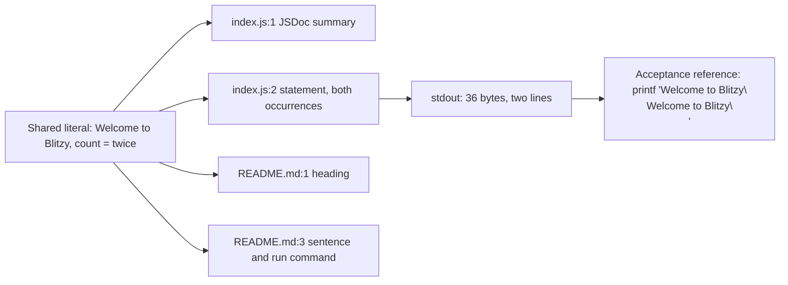

| Location | Carries | Agreement required with |
|---|---|---|
| `index.js:1` | The literal once and the word "twice" | The emitted line count |
| `index.js:2` | The literal twice inside one statement | `index.js:1` and `README.md:3` |
| `README.md:1` | The literal once, as the heading | The literal's spelling |
| `README.md:3` | The literal once, the word "twice", the run command | The emitted output |

A related coupling is the run command: `README.md:3` names `node index.js`, while the file it names is `index.js`. Renaming or moving the entry point would make the only documented instruction false, and nothing in the tree would detect it.

### 2.3.3 Integration Points

| Integration | Direction | Features | Evidence |
|---|---|---|---|
| Node.js runtime on `PATH` | Inbound: hosts and executes the programs | F-001 to F-007 | `index.js:2`; `server (2).js:1`; `README.md:3` |
| Standard output, fd 1 | Outbound: sole output channel of the delivered program | F-001, F-002, F-004 | `index.js:2`; capture and redirection checks |
| Process exit status | Outbound: only success signal | F-001, F-004 | `node index.js; echo $?` returns 0 |
| Standard error, fd 2 | Outbound: must stay empty | F-001 | 0-byte stderr on every run |
| POSIX shell invocation | Inbound: the documented way to run the program | F-001, F-003, F-006 | `README.md:3`; Project Guide §9 |
| TCP port 3000 | Inbound: fixed listener resource of the ancillary server | F-007 | `server (2).js:1`; Project Guide Appendix B |
| Git repository on GitHub | Outbound: version control of the delivery | F-005, F-007 (integrity), provenance of all | Remote `https://github.com/rjhonsi-blitzy/Simple_JS_1.git`; merge `ee7cf7b` |

No third-party API, identity provider, message broker, database, filing system or CI hook is integrated or planned. The delivered program's entire external contract is standard output, standard error and the exit status.

### 2.3.4 Shared Components

| Component | Shared by | Nature of the sharing | Evidence |
|---|---|---|---|
| Node.js runtime and the `console` global | F-001 to F-007 | Process-host facility; the only dependency of the delivered program and the sole reason it needs no manifest | `index.js:2`; `server (2).js:1` |
| The greeting literal and its count | F-001, F-002, F-005, F-006 | Duplicated constant across two files; agreement is by convention only | `index.js:1`, `index.js:2`, `README.md:1`, `README.md:3` |
| Standard output stream | F-001, F-002, F-004 | Single sink; its byte content is the acceptance criterion | `index.js:2` |
| Repository root as working directory | F-001, F-003, F-006 | Run premise the README states implicitly and the Project Guide lists as an open wording gap | `README.md:3`; Project Guide §2.2 row 5 |
| Node.js built-in `http` module | F-007 only | Not shared: the delivered program requires no module at all | `server (2).js:1` |

There is no shared library, helper module, configuration file or generated artefact in the tree, and no code is reused between F-007 and F-001 to F-006: neither file exports anything, so neither can be imported by the other.

### 2.3.5 Common Services

| Service | Provider | Consumed by | Availability requirement |
|---|---|---|---|
| JavaScript parse and execution | `node` on `PATH` | Every feature except F-006 | A supported Node.js release; no version is pinned because no manifest exists |
| Output stream and line termination | The runtime's `console.log` | F-001, F-002, F-004 | Writable fd 1; the write is silent and exits 0 even when rejected |
| Process lifecycle and exit status | The operating system, via the runtime | F-001, F-004, F-006 | Exit status observable by the invoking shell |
| Byte-level comparison tooling | `cmp`, `od`, `wc`, `sort`, `sha256sum` on the host | Acceptance of F-001 to F-004 | Present on the verification host; they stand in for the test suite the scope forbids |
| Version control | Git and the GitHub remote | Provenance of F-005 and integrity of F-007 | Remote reachable for history inspection only; not required to run the program |
| Manual verification gate | `node --check index.js && node index.js` | The whole delivery | Performed by a human after every edit; no CI exists or may be added |

No message queue, scheduler, cache, secret store, logging service, monitoring agent or authentication service participates in any feature.


## 2.4 Implementation Considerations

The considerations below apply the constraints the repository actually carries. Where a conventional category has nothing to constrain — there is no database, no cache, no concurrency-sensitive state — it is stated as absent rather than filled with generic advice.

### 2.4.1 Technical Constraints

| Constraint | Applies to | Consequence for implementation | Evidence |
|---|---|---|---|
| No manifest, lockfile or `engines` field may exist | F-001, F-003, F-004 | The Node.js version is unpinned and unenforced; the host must supply a supported runtime | `README.md:3`; Project Guide §1.4, §6 row 6 |
| The entry point stays two lines: one tag-free JSDoc above one statement | F-001, F-005 | No guard clause, logging, validation or second statement may be added; any new behaviour breaks the shape | `index.js`; Project Guide §5.1 rows 3 and 4 |
| No error handler, retry or hardening construct may be added | F-001, F-004 | A rejected or closed fd 1 discards the write while the exit status stays 0 | Project Guide §4, §6 row 4 |
| No test suite, runner or CI may exist | All features | Acceptance rests on the manual gate and on byte comparison by hand | Project Guide §3, §5.2 row 7 |
| `README.md` stays under five lines with no excluded section | F-006 | Usage examples and operational depth live only in the tracked Project Guide, not in the README | `README.md`; Project Guide §5.1 row 6 |
| The greeting text and its count are fixed | F-001, F-002, F-005, F-006 | Any change must edit five occurrences of the literal plus the word "twice" in one pass | `index.js:1`, `index.js:2`, `README.md:1`, `README.md:3` |
| Pre-existing source is immutable | F-007 | `server (2).js` may not be refactored, renamed or documented in `README.md` | Blob `2886290f…` at `8860b6a` and `HEAD`; Project Guide §5.2 row 4 |
| TCP port 3000 is hard-coded in the ancillary server | F-007 | One instance per host at most; a co-scheduled listener on the port fails with `EADDRINUSE` | `server (2).js:1`; Project Guide Appendix B |

### 2.4.2 Performance Requirements

No performance objective exists for any feature: the Project Guide records that no coverage, performance, security or observability target was set (§5.2 row 7). The figures below are observations, not budgets.

| Feature | Recorded performance | Target | Measurement |
|---|---|---|---|
| F-001 | 36 bytes per run; approximately 31 ms elapsed on the verification host | None | Wall-clock observation and byte count (Project Guide §4) |
| F-002 | 0 decoration bytes; two 17-character lines | None | `od -c` and line-length measurement |
| F-003 | No install time, because there is nothing to install; startup cost is the interpreter's alone | None | Filesystem probe plus one run |
| F-004 | Ten simultaneous runs complete with identical output and exit 0 | None | Parallel `sha256sum` comparison (Project Guide §3) |
| F-005, F-006 | Static artefacts; no run-time cost | None | `wc -l -c` over both files |
| F-007 | Constant 13-byte response body; never measured, because starting it would bind the port | None | Source inspection only (Project Guide §4) |

### 2.4.3 Scalability Considerations

- **F-001, F-003, F-004 scale by process.** Each invocation is independent: no lock, socket, cache or file handle beyond fd 1 is taken, and no state outlives the process. Concurrency was exercised at ten simultaneous runs with identical output, so horizontal repetition is the supported scaling axis and no configuration change is needed to reach it.
- **There is no data to grow.** The only data is a string constant, so there is no storage tier, retention policy, batch window or capacity plan to scale.
- **F-007 does not scale on a single host.** The listener binds one fixed port with no clustering, no `cluster` module use and no configurable address; a second instance on the same host cannot start. Scaling that server would require code change, which its immutability constraint forbids.
- **F-005 and F-006 are size-bounded by constraint, not by capacity.** The two-line source and the sub-five-line README are deliberate ceilings, so neither can grow with usage.

### 2.4.4 Security Implications

| Area | State in the repository | Implication | Evidence |
|---|---|---|---|
| Input surface | None: no argv, stdin, environment variable or file is read by the delivered program | No validation, injection, deserialisation or path-traversal exposure exists | `index.js`; environment-variant checks |
| Dependency surface | None: no third-party package and no module reference in the entry point | No supply-chain exposure; the corollary is an unpinned, unenforced runtime version | `index.js`; filesystem probe; Project Guide §5.1 row 9 |
| Output sink | One constant write to fd 1 | Escape-sequence injection is impossible because no variable reaches the stream | `index.js:2`; `od -c` |
| Data protection | No personal data, credential, secret or record is handled, and nothing is persisted | No encryption, masking or retention control is required | Project Guide Appendix E; clean tree after runs |
| Network exposure | F-007 answers every request unauthenticated over plain HTTP on port 3000, with no TLS, routing or request logging | The endpoint must not be exposed beyond a trusted host; any method and path receive the same body | `server (2).js:1`; Project Guide Appendix B |
| Failure handling | No handler: a bind failure surfaces as an uncaught exception, and a missing runtime yields exit 127 from the shell | Callers cannot distinguish a discarded write from a successful one by exit status | Project Guide §4, §6 row 4, §9 |
| Logging and audit | The delivered program logs nothing; F-007 logs one startup banner | No audit trail exists, and none is required | `index.js`, `server (2).js:1` |

### 2.4.5 Maintenance Requirements

| Maintenance task | Trigger | Procedure | Risk if skipped |
|---|---|---|---|
| Keep the literal and its count consistent | Any change to the greeting or its count | Edit all five occurrences and the word "twice" in one pass, then compare the capture with `printf 'Welcome to Blitzy\nWelcome to Blitzy\n'` | Code and README drift apart silently; the Project Guide records this as the top risk (§6 row 1) |
| Run the manual gate after every edit | Any commit touching `index.js` or `README.md` | `node --check index.js && node index.js`, then `git status --porcelain` | A syntax error or a side effect reaches the repository undetected |
| Preserve the source shape | Any edit to `index.js` | Re-check `wc -l` (2) and the absence of `@` tags | The code-hygiene and conformance benchmarks fail (Project Guide §5.1 rows 3 and 4) |
| Preserve the README ceiling | Any edit to `README.md` | Re-check `wc -l` (3) and the absence of excluded sections | The documentation-scope benchmark fails (Project Guide §5.1 row 6) |
| Confirm the runtime on the target host | Before release, and after any host change | `node --version` and `command -v node`, then run the program there | A host without Node.js fails with exit 127 and no program message |
| Keep `server (2).js` byte-identical | Any change to the tree | Compare `git hash-object "server (2).js"` with `2886290f56dfe2483a8f29f7dfcb89796a6fca00` | Existing-code integrity is lost and the delivery's scope claim becomes false |
| Own or free TCP port 3000 | Before starting the ancillary server | Probe the port with `curl --max-time 2` on `http://127.0.0.1:3000/` before launch | A co-scheduled service fails with `EADDRINUSE`, or the server fails to bind |
| Treat the tracked Project Guide as a record, not as authority | When its claims are cited | Verify against the files; the guide's §1.4, §5.2, §6 and Appendix C still describe the tracked document as 412 lines covering a single print, while the file is 439 lines and describes the twice-print behaviour | A maintainer may "correct" a compliant `index.js`, or trust a stale size and status |

The maintenance posture is deliberately manual. Because the delivery's owner constraints forbid a test suite, a CI workflow and any manifest, the recurring cost of every change is a human running one command and one byte comparison, and the recurring risk is that the five-occurrence literal is edited partially.

### 2.4.6 Traceability Matrix

**Feature to requirement to evidence.**

| Feature | Requirement IDs | Source evidence | Acceptance verification |
|---|---|---|---|
| F-001 | F-001-RQ-001 to 004 | `index.js:2` | 36-byte capture, 2 lines, hash `c4a4d23e…`, exit 0, empty stderr |
| F-002 | F-002-RQ-001 to 003 | `index.js:2` | `od -c` shows only the literal plus LF; 17-character lines; identical hash across environment variants |
| F-003 | F-003-RQ-001 to 003 | `index.js` (no module reference); `README.md:3` | Manifest, lockfile and `node_modules` probes absent; run succeeds from a fresh checkout |
| F-004 | F-004-RQ-001 to 004 | `index.js:2` | Repeat, concurrency, `env -i`, closed stdin, stray-argument and clean-tree checks |
| F-005 | F-005-RQ-001 to 002 | `index.js:1` | `wc -l` = 2, one JSDoc pair, zero `@`, "twice" present |
| F-006 | F-006-RQ-001 to 003 | `README.md:1`, `README.md:3` | Command extracted from line 3 executed verbatim; `wc -l` = 3; claim matches capture |
| F-007 | F-007-RQ-001 to 003 | `server (2).js:1` | Source read only (not started); blob `2886290f…` equal at `8860b6a` and `HEAD` |

**Feature to specification and record.**

| Feature | In-scope capability (§1.3.1) | Related specification section | Recorded evidence |
|---|---|---|---|
| F-001 | IS-1 twice-written greeting | §1.2.2 capabilities; §2.2.2 | Project Guide §5.1 row 1 |
| F-002 | IS-2 unformatted output | §1.2.3 success criteria; §2.2.3 | Project Guide §5.1 row 2 |
| F-003 | IS-3 no install step, no dependencies | §1.3.1 technical requirements; §2.2.4 | Project Guide §5.1 row 9 |
| F-004 | IS-6 exit 0 and empty stderr; determinism | §1.2.3; §2.2.5 | Project Guide §3, §4, §5.1 rows 11 and 12 |
| F-005 | IS-5 two-line source with tag-free JSDoc | §1.3.1 technical requirements; §2.2.6 | Project Guide §5.1 rows 3 and 4 |
| F-006 | IS-4 documented behaviour matches the code | §1.3.1 workflows; §2.2.7 | Project Guide §5.1 rows 5 and 6 |
| F-007 | Out of scope (§1.3.2) | §2.2.8; §2.3.4 | Project Guide §5.2 row 4, Appendix B |

**In-scope capability coverage.** Every capability listed in §1.3.1 is carried by at least one requirement, and none is carried by a feature outside the delivery except where noted.

| In-scope ID | Capability | Requirement(s) |
|---|---|---|
| IS-1 | One invocation writes the greeting twice | F-001-RQ-001, F-001-RQ-002 |
| IS-2 | Plain output with no decoration | F-002-RQ-001, F-002-RQ-002, F-002-RQ-003 |
| IS-3 | No install step, no dependencies | F-003-RQ-001, F-003-RQ-002, F-003-RQ-003 |
| IS-4 | Documented behaviour matches the code | F-006-RQ-001, F-006-RQ-002 |
| IS-5 | Two-line source, one tag-free JSDoc | F-005-RQ-001, F-005-RQ-002 |
| IS-6 | Exit 0 and nothing on stderr | F-001-RQ-003, F-001-RQ-004, F-004-RQ-003 |

### 2.4.7 Assumptions and Open Constraints

| ID | Assumption or constraint | Impact if it fails | Source |
|---|---|---|---|
| A-1 | The target host supplies a supported Node.js on `PATH` | The run fails with a shell error and exit 127, with no program message | Project Guide §1.4, §6 row 6 |
| A-2 | The program is invoked from the repository root, or with an explicit path | A relative invocation elsewhere fails with a module-resolution error | Project Guide §2.2 row 5 |
| A-3 | A POSIX shell is available for the documented command and for byte comparison | Acceptance cannot be reproduced as documented | `README.md:3`; Project Guide §9 |
| A-4 | TCP port 3000 is free and its ownership is assigned before F-007 runs | The listener fails with `EADDRINUSE`, or blocks a co-scheduled service | `server (2).js:1`; Project Guide §2.2 row 3 |
| A-5 | Only Node.js v22.x on Linux has been exercised; another major, host, Deno or Bun is unproven | Behaviour elsewhere is unverified, though nothing version-specific is used | Project Guide §3, §4 |
| A-6 | Verification of emission must compare captured bytes, not exit status | A rejected or closed fd 1 exits 0 while discarding the line | Project Guide §4, §6 row 4 |
| A-7 | The tracked Project Guide's own claims about its currency are stale | A maintainer may distrust a compliant `index.js` | Its §1.4, §5.2, §6, Appendix C versus the 439-line file |

### 2.4.8 Related Process Flows and Specifications

- The verification path every acceptance criterion follows is diagrammed in §2.2.1.
- The feature dependency graph is diagrammed in §2.3.1, and the literal-coupling data flow in §2.3.2.
- The runtime data path — constant handed to `console.log`, written to fd 1, process exit — is diagrammed in §1.2.2, where the four repository components and their paths are also tabulated.
- The scope boundaries that exclude input handling, persistence, tests, packaging and the ancillary server are tabulated in §1.3.2.
- The command reference, port reference and technology versions used by these acceptance criteria are recorded in the Project Guide's Appendices A to D.


## 2.5 References

- `index.js` — the two-line, 113-byte entry point: the tag-free JSDoc summary stating the twice-print behaviour (`index.js:1`) and the single `console.log` emitting both occurrences (`index.js:2`); evidence for F-001, F-002, F-004 and F-005, and for the absence of any module reference.
- `README.md` — the three-line, 128-byte run instruction: heading, the behaviour and count claim, the command `node index.js`, and the zero-install claim; evidence for F-003 and F-006 and for the shared literal at `README.md:1` and `README.md:3`.
- `server (2).js` — the one-line, 142-byte pre-existing HTTP server answering `Hello, World!` on fixed port 3000; evidence for F-007 and for the port-ownership constraint.
- `blitzy/documentation/Project Guide - d5d06770-1a28-4fee-846a-27d98a6d7cc0.md` — the 439-line tracked record supplying the requirement set, the 12-row compliance matrix (§5.1), the 38-check verification table (§3), the runtime findings (§4), the risk register (§6), the five remaining items (§2.2), the manual gate and command reference (§9, Appendix A), the port reference (Appendix B) and the environment-variable reference (Appendix E).
- `blitzy/documentation/` — documentation-only folder holding that single guide; establishes that no source, manifest or configuration sits outside the repository root.
- Repository Git history and remote `https://github.com/rjhonsi-blitzy/Simple_JS_1.git` — commits `8860b6a` (base, adding only `server (2).js`), `5f49734` (`index.js`), `1237471` (`README.md`), `824480e` (guide), `c6b1fd3` (twice-print change to both delivered files), `02fcaa1` (guide rewrite), `ee7cf7b` (merge of PR #1); establishes the requirement-set versions, the delivered change set, and the byte-identical blob `2886290f56dfe2483a8f29f7dfcb89796a6fca00` for the ancillary server.
- Commands executed against this checkout — `node --check index.js`, `node index.js` with stdout and stderr captured, `od -c`, `wc -l -c`, `sha256sum` over repeats, an `env -i` run, colour-variable runs (`FORCE_COLOR`, `NO_COLOR`, `CLICOLOR_FORCE`, `TERM`, `LANG`), a foreign-directory run, a closed-stdin run, a stray-argument run, `node index.js > /dev/full`, `sort -u`, `grep` counts of `console.log` and `@`, `git ls-files`, `git log`, `git diff --name-status 8860b6a HEAD` and `git hash-object`; every acceptance value quoted in §2.1 to §2.4 was reproduced by one of these.

No external web sources were consulted; every statement in this section derives from the repository files, its Git history, and commands executed against the checkout.


# 3. Technology Stack

## 3.1 Programming Languages

The repository is written in one executable language, JavaScript, executed directly by a Node.js runtime. No second language, no compiled artefact and no transpiled source exists anywhere in the tree: `git ls-files -co --exclude-standard` returns exactly four paths (`index.js`, `server (2).js`, `README.md`, `blitzy/documentation/Project Guide - d5d06770-1a28-4fee-846a-27d98a6d7cc0.md`) and no other source of any kind.

### 3.1.1 Languages by Platform and Component

| Component | Path | Language | Version / standard | Module system | Evidence |
|---|---|---|---|---|---|
| Delivered program (the entry point) | `index.js` | JavaScript | ECMAScript 2015-compatible source (Project Guide Appendix D); run as-is by Node.js v22.x — v22.23.5 recorded on the verification host, v22.23.4 observed in this checkout | None: no `require`, `import`, `export`, or `module.exports` appears in the file | `index.js:1-2` |
| Ancillary HTTP server (pre-existing, outside the delivery) | `server (2).js` | JavaScript | Same source level: one chained expression using ES2015 arrow functions | CommonJS: `require('http')` — the only module-system construct in the tree | `server (2).js:1` |
| Run instruction | `README.md` | Markdown (documentation, not executable) | 3 lines / 128 bytes | n/a | `README.md:1-3` |
| Generated status record | `blitzy/documentation/Project Guide - d5d06770-1a28-4fee-846a-27d98a6d7cc0.md` | Markdown with Mermaid diagrams and fenced shell snippets (documentation, not executable) | 439 lines | n/a | The tracked file under `blitzy/documentation/` |

Both JavaScript files are plain ASCII with no byte-order mark, no shebang line and LF terminators — confirmed by inspecting `index.js` byte by byte (`od -c` begins `/*  Prints ...` and ends at octal offset `0000161`, 113 bytes) and by a locale-aware scan for non-ASCII bytes, which returns nothing in either file. Only ES2015-level syntax appears: `console.log` on a string literal in `index.js`, and arrow-function callbacks in `server (2).js`. No class, generator, `async`/`await`, destructuring, spread, template literal, optional chaining, or private field occurs anywhere, so the source imposes no minimum language version beyond that level.

### 3.1.2 Selection Criteria

| Criterion | How JavaScript and Node.js satisfy it here | Evidence |
|---|---|---|
| The documented run command fixes the runtime | `README.md:3` states the program is run with `node index.js`, so the language and interpreter are fixed by the delivered documentation rather than chosen freely | `README.md:3` |
| Zero-install premise | IS-3 and F-003 forbid a manifest, lockfile and dependencies; an interpreted language supplied on `PATH` needs no install step, and the only output primitive used (`console.log`) is a Node.js host global requiring no import | `index.js:2`; §1.3.1 |
| Smallest possible artefact shape | The source must stay two lines: one tag-free JSDoc summary above exactly one statement. A scripting language needs no boilerplate, declaration file, or entry-point registration to satisfy that shape | `index.js`; §2.4.1 |
| No build or transpile gate | A language whose source executes unmodified means the whole toolchain is the interpreter plus the manual gate `node --check index.js && node index.js`; the Project Guide records "Build tools: None" | Project Guide §9 |
| Determinism and side-effect freedom | The one construct used is a synchronous write of a compile-time constant; no language feature in use introduces state, scheduling, or I/O beyond file descriptor 1 | `index.js:2`; §1.2.2 |
| Preserving the pre-existing file | The ancillary server's ES2015 arrow functions and CommonJS `require` must remain byte-identical, which any runtime replacement would jeopardise | `server (2).js:1`; §2.4.1 |

### 3.1.3 Constraints and Dependencies

| Constraint | Effect on the language surface | Evidence |
|---|---|---|
| No manifest may exist, so there is no `engines` field | The runtime version is unpinned and unenforced anywhere in the tree; the host must supply Node.js on `PATH` | Manifest probe; §2.4.1 |
| No manifest means no `type` field | No module format is declared for any `.js` file in the repository; `index.js` sidesteps the question entirely by using no module system, while `server (2).js` uses CommonJS `require` | `index.js`; `server (2).js:1` |
| Only the v22.x line has been exercised | Behaviour is proven on Node.js v22.23.5 (verification host, Project Guide Appendix D) and observed on v22.23.4 (this checkout); another major, an alternative runtime, or a non-Linux host is unverified, though the source uses no version-specific feature | Project Guide §3, §4, Appendix D; `node --version` in this checkout |
| No transpiler, linter, or formatter may exist | Source must be correct as written; there is no static-analysis safety net beyond `node --check` | Project Guide Appendix F |
| The program may not acquire an input surface | No `process.argv`, `process.env`, stdin read, or file read may be introduced; the language features in use stay limited to a stdout writer | `index.js`; §2.4.4 |
| `server (2).js` is immutable | Its two ES2015 arrow functions and its CommonJS `require` cannot be modernised, converted, or renamed | §2.4.1 |

### 3.1.4 Languages Considered and Not Present

The default technology stack supplied for this document names Python, TypeScript, Swift, Kotlin and Objective-C. None of them occurs in this repository, and no supporting manifest for any of them exists:

| Language | Present | Evidence of absence |
|---|---|---|
| JavaScript | **Yes — the only executable language** | `index.js`, `server (2).js` |
| Python | No | No `.py` file; no `requirements.txt`, `Pipfile`, or `pyproject.toml` |
| TypeScript | No | No `.ts`/`.tsx` file; no `tsconfig.json`; no `package.json` to declare a build |
| Swift, Kotlin, Objective-C | No | No `.swift`, `.kt`, `.m`, or `.mm` file; no Xcode project or Gradle build |
| Shell | Not as delivered source — only in documentation snippets | `README.md:3` names a command; the Project Guide's fenced snippets are illustrative, not tracked scripts |


## 3.2 Frameworks &amp; Libraries

There is no application framework in this repository. No framework, library, or helper package is installed, imported, or vendored, because no package manifest exists and none may be added (§1.3.2, §2.4.1). The entire library surface is the Node.js standard library, whose members ship inside the runtime rather than being fetched from a registry.

### 3.2.1 Frameworks

| Framework category | Used | Evidence |
|---|---|---|
| Web or API framework | No | `index.js` opens no socket and imports nothing; no `package.json` exists to declare one |
| Frontend framework or component library | No | No HTML, CSS, JSX, or template file exists in the tree; the only extensions present are `.js` and `.md` |
| AI or agent framework | No | No LLM client, prompt, or model reference appears in either script |
| Test framework, assertion library, coverage tool | No | Excluded by instruction; the only gate is `node --check index.js && node index.js` (Project Guide §3, §5.1 row 9) |
| Build, bundling, or transpilation tool | No | No `webpack`/`vite`/`babel`/`tsconfig` configuration file, no manifest, no build step |

### 3.2.2 Core Runtime Libraries in Use

The delivered program and the ancillary server together touch exactly two members of the Node.js standard library. Versions below are those of the runtime that supplies them: v22.23.5 on the verification host recorded in Project Guide Appendix D, and v22.23.4 (`/usr/bin/node`, V8 12.4.254.21-node.57, linux x64) observed in this checkout.

| Library surface | Kind | How it is obtained | Version | Consumer | Evidence |
|---|---|---|---|---|---|
| `console` | Node.js host global (no import) | Provided by the runtime to every script | Ships with the runtime: Node.js v22.x | `index.js:2` — the single statement | `index.js:2`; `README.md:3` for the `node` invocation |
| `http` | Node.js built-in module | CommonJS `require('http')` | Ships with the runtime: Node.js v22.x | `server (2).js:1` — `createServer().listen(3000)` | `server (2).js:1` |
| V8 engine | JavaScript engine | Embedded in Node.js | 12.4.254.21-node.57 in this checkout | Executes both scripts | `node -p "process.versions.v8"` |

Nothing else from the standard library is referenced: no `fs`, `path`, `process`, `child_process`, `net`, `https`, `crypto`, `util`, `os`, or `timers` call appears in either file.

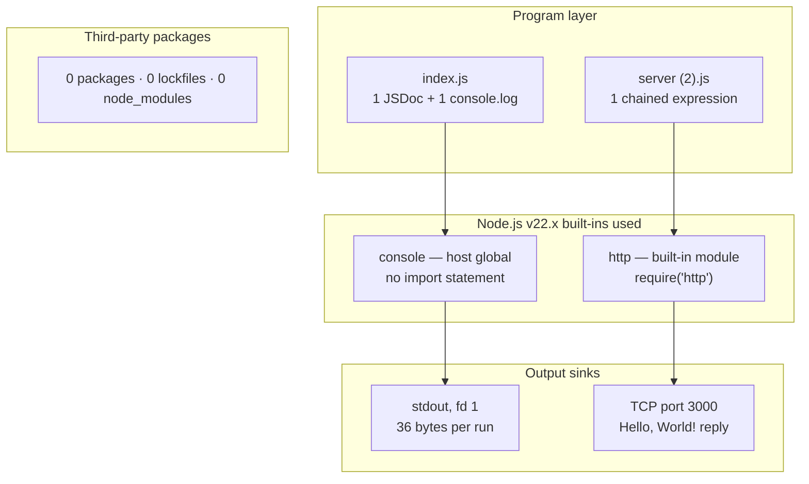

### 3.2.3 Compatibility Requirements

| Requirement | State in the repository | Evidence |
|---|---|---|
| An ECMAScript 2015-capable runtime | The only syntax used beyond ES5 is the arrow function in the ancillary server; `node --check` passes for both files on Node.js v22.23.4 | `index.js`; `server (2).js:1`; parse check in this checkout |
| A CommonJS loader for `server (2).js` | The file calls `require('http')`; with no `package.json` `type` field there is no declared module format anywhere, so the CommonJS form used is the only module construct present | `server (2).js:1`; manifest probe |
| No module-loader requirement for `index.js` | The delivered program neither imports nor exports, so it runs identically under any module configuration | `index.js` |
| A `console` implementation on stdout | `console.log` writes to file descriptor 1, which the README's documented command exposes to the terminal, a pipe, or a redirect | `index.js:2`; `README.md:3` |
| No native addon, binary, or peer dependency | Neither file loads a compiled module; there is nothing to build or link | `index.js`, `server (2).js` |
| Verified platform scope | Only the Node.js v22.x line on Linux has been exercised; other majors, Deno, Bun, and non-Linux hosts are unproven, though no version-specific feature is used | Project Guide §3, §4, Appendix D |

### 3.2.4 Justification

- **Standard library over packages.** The two behaviours required — one write to standard output and, in the pre-existing file, one trivial HTTP listener — are fully covered by `console` and `http`. Adding a package would introduce a manifest, a lockfile, an install step and a supply-chain surface, all of which the delivery's constraints exclude (IS-3, F-003 in §1.3.1 and §2.4.1).
- **No framework, because there is no application to structure.** With one statement and no input, routing, persistence, or lifecycle, a framework would add configuration files and bootstrapping that break the two-line source shape (`index.js`; §2.4.1).
- **Runtime-bundled versions eliminate drift.** Because the two library surfaces ship inside Node.js, their version is exactly the runtime's version; there is no second version axis to reconcile and no lockfile to keep current.
- **No monitoring, formatting, or validation libraries.** The program emits a constant, so no logger, schema validator, or argument parser has anything to act on (§2.4.4).


## 3.3 Open Source Dependencies

The repository has no third-party or open-source package dependency. It contains no manifest, no lockfile, no `node_modules` directory, no vendored library source, no Git submodule, and no build-time download step. Nothing was ever tracked that could hold one: across every commit reachable in the repository, `git log --all --diff-filter=AD --name-only` lists no path matching a manifest, lockfile, container, pipeline, or infrastructure file.

### 3.3.1 Dependency Inventory

| Dependency | Classification | Declared where | Version pin | Evidence |
|---|---|---|---|---|
| `console` | Node.js host global (runtime-provided, not a package) | Nowhere — a global of the runtime | Follows the runtime; no pin exists in the tree | `index.js:2` |
| `http` | Node.js built-in module (runtime-provided, not a package) | `require('http')` inside the script | Follows the runtime; no pin exists in the tree | `server (2).js:1` |
| Third-party packages | **None** | n/a | n/a | Manifest and `node_modules` probes; Project Guide §5.1 row 9 |

Because both library surfaces ship inside Node.js, they are not registry artefacts: there is no package name, version range, integrity hash, or transitive tree to record.

### 3.3.2 Package Manifests, Lockfiles and Registries

| Artefact or registry | Present | Evidence |
|---|---|---|
| `package.json` | No | Filesystem probe in the current tree; absent in every historical commit |
| `package-lock.json`, `yarn.lock`, `pnpm-lock.yaml`, `npm-shrinkwrap.json` | No | Same probe and history check |
| `node_modules/` | No | Not present in the working tree or tracked in history |
| `.npmrc`, `.yarnrc`, or any registry configuration | No | Configuration probe |
| Non-Node registries (PyPI, Maven Central, NuGet, RubyGems) | No | No `requirements.txt`, `Pipfile`, `pyproject.toml`, `pom.xml`, `build.gradle`, or `Gemfile` |
| Vendored or copied third-party source | No | The only `.js` files are `index.js` (113 bytes, 2 lines) and `server (2).js` (142 bytes, 1 line), both self-contained |

The practical consequence is that no package manager can run against this repository: `npm install` has nothing to resolve, and the Project Guide instructs maintainers not to run `npm init` or `npm install` because a manifest is out of scope (Project Guide §9, "Dependency Installation").

### 3.3.3 Version Exposure and Risk

| Aspect | State | Consequence |
|---|---|---|
| Registry dependency count | 0 direct, 0 transitive | No supply-chain exposure through packages, and no third-party licence text, attribution file, or vulnerability feed to monitor |
| Runtime version pin | None — no `engines` field can exist | The dependency that does matter, Node.js itself, is unpinned: the host must supply a supported release or the run fails with exit 127 (§2.4.7, assumption A-1) |
| Verified runtime | v22.23.5 recorded (Project Guide Appendix D); v22.23.4 observed in this checkout | No automated check compares the host's version against either figure |
| Licence metadata in the tree | No `LICENSE` file, no `NOTICE`, no `package.json` `license` field | The repository declares no licence of its own; because nothing is bundled or vendored, it introduces no third-party attribution obligation beyond the runtime the caller installs |
| Update cadence | None required by the repository | Patches to Node.js are applied by the host operator, not by any artefact in this tree |


## 3.4 Third-Party Services

No third-party service is called at build time or at run time by the delivered program. `index.js` performs no network operation of any kind — it references no client module, URL, endpoint, host name, credential, or environment variable — and there is no package through which such a call could arrive. This matches the Project Guide's statement that the program "reads no credential, environment variable, endpoint or third-party API, and needs only a Node.js runtime" (§1.5).

### 3.4.1 Runtime Integrations

| Service category | Integrated | Evidence |
|---|---|---|
| External or partner API | No | `index.js` has one statement and no import; no URL or host name appears in it |
| Authentication or identity provider | No | No login, token, session, or identity-provider reference in either script; no configuration file exists to hold credentials |
| Monitoring, telemetry, APM, or error tracking | No | The delivered program logs nothing; no DSN, API key, or SDK reference exists |
| Analytics or feature-flag service | No | Only `console.log` on a constant string is called |
| Cloud provider SDK or managed platform service | No | No SDK import and no manifest from which to resolve one |
| Message broker, cache service, or queue | No | No client, connection string, or socket other than the ancillary server's listener |
| Object or file storage service | No | The program writes nothing to disk or to a remote store |

### 3.4.2 Network Endpoints in the Tree

| Endpoint | Nature | Evidence |
|---|---|---|
| `http://127.0.0.1:3000/` | A hard-coded string in the ancillary server's startup banner — a console message about the local listener, not an outbound integration | `server (2).js:1` |
| TCP port 3000 | An inbound listener on the default host, answering every request with `Hello, World!`; no TLS, no authentication, no routing, no outbound call | `server (2).js:1`; Project Guide Appendix B |

Both belong to the pre-existing, out-of-scope `server (2).js`; the delivery itself exposes nothing on the network (§1.3.2).

### 3.4.3 Development-Time Services

| Service | Role | Evidence |
|---|---|---|
| GitHub (repository host) | Stores the repository and hosted the merged pull request; the remote is `https://github.com/rjhonsi-blitzy/Simple_JS_1.git` | `git remote -v`; merge commit `ee7cf7b` ("Merge pull request #1") |
| GitHub web interface | Used to add the pre-existing server file, whose commit `8860b6a` is titled "Add files via upload" | Git history |
| Blitzy delivery platform | Produced the generated status record under `blitzy/documentation/` for project `d5d06770-1a28-4fee-846a-27d98a6d7cc0`; it is a documentation artefact, not a runtime dependency | `blitzy/documentation/Project Guide - d5d06770-1a28-4fee-846a-27d98a6d7cc0.md` |
| CI or code-scanning service | None — the repository carries no workflow, pipeline, or scanning configuration, and no automated check runs on a push | No `.github/`, `.gitlab-ci.yml`, `Jenkinsfile`, or equivalent in the tree or in history |
| Verification host | A Linux host with Node.js v22.23.5 at `/usr/bin/node`, used for the 38 manual checks recorded in Project Guide §3 | Project Guide §3, §4, Appendix D |

### 3.4.4 Security and Integration Implications

- **No credential or secret surface.** Nothing in the tree reads a token, key, certificate, or environment variable, so there is no secret to rotate, leak, or scope (§2.4.4; Project Guide Appendix E).
- **No data egress.** No outbound request exists, so the delivered program cannot transmit data to a third party.
- **The one inbound surface needs operational ownership.** `server (2).js` binds fixed TCP port 3000 with no authentication or TLS; it must not be exposed beyond a trusted host, and the port must be free and assigned before it starts, otherwise a second listener fails with `EADDRINUSE` (Project Guide Appendix B; §2.4.7 assumption A-4).
- **No integration contract to maintain.** With no external service, there is no API version, quota, SLA, retry policy, or webhook to reconcile; the program's entire external contract is standard output, standard error, and the exit status (§1.3.2).


## 3.5 Databases &amp; Storage

The repository has no database, no data store, no cache tier, and no persistence layer. The delivered program holds no state and writes nothing to disk: running it produces 36 bytes on standard output and leaves the working tree byte-identical (`git status --porcelain -uall` reports nothing after a run).

### 3.5.1 Data Stores

| Store type | Present | Evidence |
|---|---|---|
| Relational database and driver/ORM | No | No dependency of any kind exists; no connection string, schema, or migration appears anywhere |
| Document database (for example MongoDB from the default stack) | No | No client module, URI, or configuration file; the only `.js` files contain one `console.log` and one `http` listener |
| Key-value store or cache (Redis, Memcached) | No | No cache client, socket, or in-process cache; each run re-reads nothing and stores nothing |
| Object or blob storage | No | No SDK, bucket, or path reference |
| Message queue or event log | No | No producer, consumer, or broker configuration |
| Local file or log persistence | No | `index.js` performs one write to file descriptor 1 and no filesystem call; there is no logger and no log file in the tree |

### 3.5.2 Data Inventory and Persistence Strategy

| Item | Where it lives | Mutability | Evidence |
|---|---|---|---|
| The greeting literal `Welcome to Blitzy` | Source code, as a compile-time constant inside one string literal | Changes only by editing source; five occurrences of the literal must be kept in step manually | `index.js:1-2`; `README.md:1`, `README.md:3` |
| The emitted output | File descriptor 1, consumed by a terminal, a pipe, or a redirect | Never stored by the program | `index.js:2`; `README.md:3` |
| The HTTP reply `Hello, World!\n` | A constant in the ancillary server, sent per request | Stateless; nothing is retained between requests | `server (2).js:1` |
| Source of record | The Git repository on GitHub (`origin` = `https://github.com/rjhonsi-blitzy/Simple_JS_1.git`) | Versioned by commits | `git remote -v`; merge commit `ee7cf7b` |
| Generated status record | `blitzy/documentation/Project Guide - d5d06770-1a28-4fee-846a-27d98a6d7cc0.md` (40,686 bytes), tracked in Git | Rewritten by the delivery platform, not by the program | The tracked file |

The persistence strategy is therefore *no persistence in the program and Git as the only store of record*. Any durable copy of the output is caller-owned: `node index.js >> greeting.log`, documented as an example usage in Project Guide §9, appends two lines to a file the caller creates and manages; the program itself never opens that file.

### 3.5.3 Caching

No caching solution exists at any layer. There is no cache client, no memoisation, no build cache, no content-delivery layer, and no state that survives a process exit. The behaviour that a cache would normally protect — repeated reads of a value — is absent, because the value is a source constant resolved once per process; determinism across repeated and concurrent runs follows from that rather than from caching (§2.4.2, §2.4.3).

### 3.5.4 Storage Footprint

| Measurement | Value | Evidence |
|---|---|---|
| Delivered source | 241 bytes over two files: `index.js` 113 bytes, `README.md` 128 bytes | `wc -c`; Project Guide §9 ("Two files, 241 bytes of delivered source in total") |
| Ancillary pre-existing server | 142 bytes, one line | `wc -c "server (2).js"` |
| Documentation | 40,686 bytes in one Markdown file under `blitzy/documentation/` | `wc -c` |
| Growth with usage | Zero — the program stores nothing, so no data volume, retention window, index, backup, or capacity plan applies | Clean working tree after every run |

Because no store exists, there is also no data-protection obligation: no personal data, classification, encryption, masking, retention rule, or backup is handled anywhere in the tree (§2.4.4; Project Guide Appendix E).


## 3.6 Development & Deployment

Development on this repository needs an interpreter and a shell, and nothing more. There is no build system, no container image, no pipeline, and no packaging step: the source files are the deployable artefact, and the only automated check is the manual gate the Project Guide prescribes (`node --check index.js && node index.js`).

### 3.6.1 Development Tools

| Tool | Version / source | Purpose here | Evidence |
|---|---|---|---|
| `node` | v22.23.5 on the verification host (`/usr/bin/node`); v22.23.4 observed in this checkout | Runs the program and parse-checks it without executing | Project Guide Appendix D; `node --version` |
| `git` | Repository client; branch `blitzy-d5d06770-1a28-4fee-846a-27d98a6d7cc0`, remote on GitHub | Version control, change-set inspection, and integrity checks on the pre-existing file | `git remote -v`; Project Guide Appendix D |
| POSIX shell (`bash` in the verification environment) | Host-provided | Invokes the runtime and the byte-comparison commands | `README.md:3`; Project Guide §9 |
| Coreutils: `cmp`, `od`, `wc`, `sort`, `sha256sum`, `head` | Host-provided | The byte-level and structural comparisons that stand in for assertions | Project Guide Appendix F |
| `curl` | Host-provided | Probes whether TCP port 3000 is free before the ancillary server is started | Project Guide Appendix A, Appendix F |
| GitHub web interface | github.com | Added the pre-existing server file (commit `8860b6a`, "Add files via upload") and merged pull request #1 | Git history |
| Package manager (`npm`, `yarn`, `pnpm`) | Not used | No manifest exists, so no install step is possible; the Project Guide forbids `npm init` and `npm install` | Project Guide Appendix F, §9 |
| Linter, formatter, bundler, transpiler, test runner, debugger configuration | None present | No `.eslintrc`, `.prettierrc`, `.babelrc`, `webpack`/`vite`/`jest` configuration, `.editorconfig`, or `.nvmrc` file exists | Configuration probe |

### 3.6.2 Build System

There is no build system in any form: no compiler, bundler, transpiler, minifier, task runner, `Makefile`, or `package.json` script. The source is executed directly by the interpreter, so the interval between a saved edit and a run is zero build steps. The complete quality gate is two commands:

```bash
node --check index.js        # parse check, executes nothing
node index.js                # the run: expect two lines, exit 0, empty stderr
```

Byte-level acceptance adds a comparison against a reference stream (`node index.js | cmp - <(printf 'Welcome to Blitzy\nWelcome to Blitzy\n')`) or an inspection with `od -c` (Project Guide Appendix A). Verification is deliberately manual and not re-runnable by a pipeline, because a test suite and CI are excluded from the delivery's scope (§1.3.2, §2.4.1).

### 3.6.3 Containerization

No container technology is used. There is no `Dockerfile`, `docker-compose.yml`, Kubernetes manifest, Helm chart, or image reference anywhere in the tree or in any historical commit, and no container registry is involved in delivery. The deployment unit is the pair of source files themselves.

### 3.6.4 CI/CD

| Pipeline element | State | Evidence |
|---|---|---|
| CI workflow files | None: no `.github/` directory, no `.gitlab-ci.yml`, `Jenkinsfile`, or `.circleci/` configuration | Filesystem probe; absence in all commits |
| Automated tests or coverage | None, and none permitted | Project Guide §3, §5.1 row 9 |
| Artifact publishing | None: no build output, package, or release artefact is produced | No manifest and no build step |
| Automated deployment | None: delivery is a copy of the tracked files onto a host that has Node.js | `README.md:3`; Project Guide §9 |
| Change review | A hosted pull request (#1, merge commit `ee7cf7b`) — a manual review step, not an automated pipeline | Git history |

The default stack's core infrastructure choices are therefore not applicable to this repository, and their absence is verifiable rather than assumed:

| Default-stack item | Applicable | Evidence |
|---|---|---|
| AWS | No | No SDK dependency, no IaC file, no credential or region reference in the tree |
| Docker | No | No container definition or image reference exists |
| Terraform | No | No `.tf` file or state configuration; the probe for `main.tf` and equivalents found nothing |
| GitHub Actions | No | The repository is hosted on GitHub, but no workflow directory or workflow file exists, so no action ever runs |

### 3.6.5 Runtime and Deployment Requirements

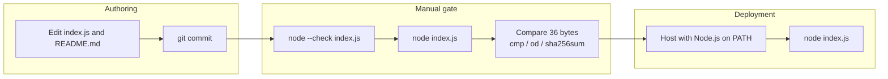

| Requirement | Detail | Evidence |
|---|---|---|
| Runtime on `PATH` | A Node.js release of the v22.x line as exercised; nothing pins or enforces it, so an absent runtime fails with a shell error and exit 127 | `README.md:3`; Project Guide §9, §2.4.7 assumption A-1 |
| Working directory | The documented command is run from the repository root, or with an explicit path; the README does not state the premise | `README.md:3`; §2.4.7 assumption A-2 |
| Files to deploy | `index.js` (113 bytes) and, if the run instruction ships with the code, `README.md` (128 bytes) | `wc -c`; Project Guide Appendix C |
| Configuration and secrets | None: no environment variable is read, and none needs to be set | Project Guide Appendix E |
| Network | Not required at build or run time by the delivered program; the pre-existing `server (2).js` needs TCP port 3000 free and unshared | Project Guide §9, Appendix B |
| Process model | A short-lived foreground process that exits 0; no daemon, service manager, supervisor, or restart policy applies | `index.js:2`; Project Guide §4 |
| Verified environment | Node.js v22.23.5 on Linux (verification host); v22.23.4 on Linux x64 in this checkout; Deno, Bun, and non-Linux hosts are unexercised | Project Guide §3, §4, Appendix D; `node --version` |


## 3.7 References

Every statement in this section derives from the repository's own files and from runtime inspection of the checkout. No external web source was consulted, so no claim about Node.js release-line status or support windows is made; the Node.js version is reported only as observed and recorded.

**Repository files**

- `index.js` — the two-line, 113-byte delivered program: one tag-free JSDoc line and one `console.log` call on a two-occurrence string literal; establishes JavaScript as the sole executable language, the absence of any module system, the use of the `console` host global, and the ES2015-level syntax ceiling.
- `server (2).js` — the one-line, 142-byte pre-existing HTTP server; establishes CommonJS `require('http')` as the only module construct in the tree, the ES2015 arrow-function usage, the built-in `http` dependency, the hard-coded port 3000, the `http://127.0.0.1:3000/` banner literal, and the fact that the file parses under Node.js v22.x.
- `README.md` — the three-line, 128-byte run instruction; establishes `node index.js` as the documented invocation that fixes the runtime and language, and the zero-install premise.
- `blitzy/documentation/Project Guide - d5d06770-1a28-4fee-846a-27d98a6d7cc0.md` — the tracked, 40,686-byte status record; source of the recorded versions and constraints cited here: Node.js v22.23.5 at `/usr/bin/node` (Appendix D), "Build tools: None" and "Network: Not required at build or run time" (§9), the tool inventory and its "Not present by design" row (Appendix F), the port reference for TCP 3000 (Appendix B), the environment-variable reference stating none exist (Appendix E), the 38 executed checks (§3), and the manual gate `node --check index.js && node index.js`. Its Appendix C size claim of 412 lines is stale against the 439-line file, as noted in §1.2.1.

**Repository folders**

- `blitzy/` — contains only the documentation subtree; establishes that nothing else is generated or deployed from the repository.
- `blitzy/documentation/` — holds the single tracked Markdown record; confirms the repository's documentation is prose only, with no executable artefact.

**Repository inspection results cited as evidence**

- `git ls-files -co --exclude-standard` — the complete path set (four paths), establishing that no other source, manifest, or configuration file exists.
- Manifest, lockfile, `node_modules`, container, IaC, and pipeline probes (`package.json`, `package-lock.json`, `yarn.lock`, `pnpm-lock.yaml`, `npm-shrinkwrap.json`, `tsconfig.json`, `.nvmrc`, `.npmrc`, `Dockerfile`, `docker-compose.yml`, `.github/`, `.gitlab-ci.yml`, `Makefile`, `Jenkinsfile`, `main.tf`, `requirements.txt`, `Pipfile`, `pyproject.toml`, `Gemfile`, `pom.xml`, `build.gradle`) — every one absent in the current tree.
- `git log --all --diff-filter=AD --name-only` — no manifest, lockfile, container, pipeline, or infrastructure path was ever tracked in any commit.
- `git remote -v` and `git log --name-status` — `origin` at `https://github.com/rjhonsi-blitzy/Simple_JS_1.git`, commit `8860b6a` "Add files via upload" (GitHub web interface), and merge commit `ee7cf7b` "Merge pull request #1".
- `node --version`, `command -v node`, `node -p "process.versions.v8"` — Node.js v22.23.4 at `/usr/bin/node`, V8 12.4.254.21-node.57, linux x64 in this checkout.
- `node --check index.js` and `node --check "server (2).js"` — both parse clean under Node.js v22.23.4.
- `wc -l -c` over the tracked files — 2 lines/113 bytes, 1 line/142 bytes, 3 lines/128 bytes, and 40,686 bytes for the tracked guide.
- `od -c index.js` and a locale-aware non-ASCII scan — pure ASCII with no BOM, no shebang, and LF terminators.
- A scan for `fs`, `path`, `process`, `child_process`, `net`, `https`, `crypto`, `util`, `os`, and `timers` in both scripts — no occurrence, supporting the claim that only `console` and `http` from the standard library are used.
- `node index.js` followed by `git status --porcelain -uall` — 36 bytes emitted and a clean working tree, establishing that the program persists nothing.
- `mermaid-cli` rendering of both diagrams in §3.2 and §3.6 — both compile successfully.

**Internal cross-references**

- §1.2 System Overview — component table, runtime data path, and the Node.js-on-`PATH` premise this section's language and runtime statements rest on.
- §1.3 Scope — the in-scope capability set (IS-1 to IS-6) and the out-of-scope list that excludes manifests, dependencies, CI, containers, and persistence.
- §2.4 Implementation Considerations — the technical constraints, security implications, maintenance tasks, and assumptions A-1 to A-7 cited throughout §3.1 to §3.6.


# 4. Process Flowchart

## 4.1 System Workflows

The repository contains two runnable programs and one documented human procedure. `index.js` is a run-to-completion console program (feature F-001 to F-006); `server (2).js` is a long-lived HTTP listener (feature F-007); the acceptance procedure is the manual gate the tracked Project Guide records in its §9, because no CI exists to run it. Nothing else executes: a text search over the three tracked non-documentation files for `setTimeout`, `setInterval`, `cron`, `queue`, `batch`, `EventEmitter`, `emit(`, `async`, `await`, `fetch`, `readFile`, `writeFile`, `process.env`, `try`, `catch`, `retry`, `validate`, `auth` and `token` returns zero matches, so no scheduled, queued, event-driven or background workflow exists in the tree.

Every workflow below is therefore one of three shapes: a single process from invocation to exit (`index.js`), a single request/response cycle inside a process that never exits on its own (`server (2).js`), or a sequence of shell commands a human runs against the checkout. Diagrams for each workflow are collected in §4.4; this sub-section states their process content.

### 4.1.1 Workflow Inventory and Actors

| ID | Workflow | Trigger | Terminal state | Evidence |
|---|---|---|---|---|
| WF-01 | Greeting emission — one `index.js` run from invocation to exit | `node index.js` typed in a shell | 36 bytes on fd 1, exit 0 (or a start-up failure, exit 1/126/127) | `index.js:2`; `README.md:3` |
| WF-02 | Parse gate — syntax check without execution | `node --check index.js` | Exit 0 and no output, or exit 1 with a caret and `SyntaxError` | Project Guide §9, "Verification Steps" |
| WF-03 | Acceptance gate — manual verification of the delivery | A human after any edit | Every check passes and `git status` stays empty, or the edit is redone | Project Guide §3 (38 checks), §9 |
| WF-04 | HTTP greeting request/response — one request cycle | Any TCP connection carrying an HTTP request to port 3000 | One `200 OK` response with a fixed body, then keep-alive or close | `server (2).js:1` |
| WF-05 | HTTP server lifecycle — process start, bind, serve, terminate | `node "server (2).js"` | Listening until signalled (SIGTERM exit 143, SIGINT exit 130), or a fail-fast exit 1 on a bind conflict | `server (2).js:1`; observed `EADDRINUSE` |
| WF-06 | Change-control and provenance | A commit pushed to the GitHub remote | Merged change on the tracked branch (`ee7cf7b`, PR #1) with no automated gate run | `git log`; absence of any CI configuration in the tree |

**Actors and system boundaries.** The swim lanes that appear in §4.4 correspond to these actors, each with a distinct authority over the outcome:

| Actor | Type | Authority in the workflows | Interface to the next actor |
|---|---|---|---|
| Operator / developer | Human | Chooses the command, the working directory and the runtime | POSIX shell |
| Reviewer | Human | Judges WF-03; runs the byte comparison by hand | Shell plus `cmp`, `od`, `wc`, `grep`, `git` |
| POSIX shell | Host process | Resolves `node` on `PATH`, propagates the child's exit status | `execve` of the interpreter; exit status |
| Node.js runtime (v22.23.4 here) | Host platform | Parses and executes both files, owns `console`, `http`, fd 1 and fd 2 | File descriptors; TCP sockets |
| `index.js` | Delivered program | Emits one constant; reads nothing, branches nowhere | fd 1 (write), exit status |
| `server (2).js` | Pre-existing program | Binds port 3000 and answers every request with one constant | TCP port 3000, stdout banner |
| Output consumer | Terminal, pipe or file | Receives the 36-byte stream; may truncate, close early or reject it | Bytes on the receiving end |
| HTTP client | Remote process (`curl` in the recorded recipe) | Supplies the request that starts WF-04; its fields have no effect | TCP connection to port 3000 |
| Git / GitHub remote | Version control | Holds provenance for every file; runs no automation | `git` objects, `origin` |

The system boundary is narrow and asymmetric: `index.js` writes to fd 1 and never reads anything, while `server (2).js` reads a TCP connection it never inspects and writes one constant. Neither file imports the other, and neither exports a symbol, so no workflow crosses between them (`§2.3.4`).

### 4.1.2 Core Business Processes

#### 4.1.2.1 WF-01 — End-to-End Greeting Emission Journey

This is the delivered program's only user journey: a person (or a script) invokes the program once, receives two lines, and the process ends. The program itself contains no branch — `index.js` has two lines, one comment and one `console.log` — so every decision point in the journey belongs to the host: the shell, the CommonJS loader, the parser, or the output device.

| # | Step | Performed by | Failure branch | Evidence |
|---|---|---|---|---|
| 1 | A shell is opened in the repository root and `node index.js` is typed | Operator | The README does not state the working-directory premise, so a run from elsewhere is a documented, not an enforced, requirement | `README.md:3`; Project Guide §2.2 row 5 |
| 2 | The shell looks up `node` on `PATH` | Shell | `command not found`, exit 127, no program output | Project Guide §9, "Troubleshooting" row 1 |
| 3 | Node resolves `index.js` against the working directory | CommonJS loader | `Cannot find module`, exit 1 — reproduced by running `node index.js` from `/tmp` | Observed; Project Guide §9 row 2 |
| 4 | The file is parsed: line 1 is a comment with no runtime effect, line 2 is one call expression | V8 | A syntax error gives `SyntaxError` with a caret on stderr and exit 1 — reproduced with a malformed copy outside the repository | Observed; Project Guide §9 row 3 |
| 5 | The literal `"Welcome to Blitzy\nWelcome to Blitzy"` is formatted and written once to fd 1 | Runtime `console.log` | A rejecting or closed device discards the bytes and the process still exits 0 | `index.js:2`; observed with `>/dev/full` and `>&-` |
| 6 | The event loop drains with no pending work and the process exits | Runtime | Exit status is the only success signal | Observed `exit=0` |
| 7 | The consumer receives two 17-byte lines | Output consumer | A terminal transcript shows 38 bytes because the pty adds CR before each LF; `head -c 4` truncates to `Welc` and node still exits 0 | Project Guide §4; observed |

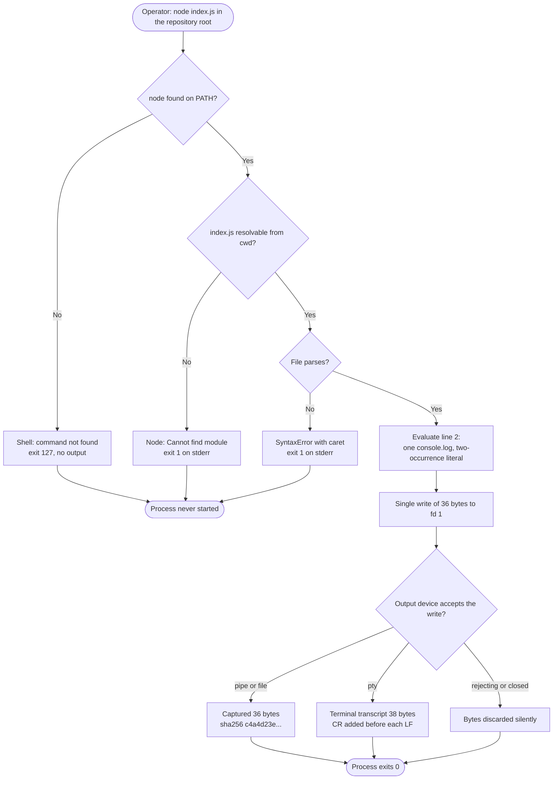

**Decision points.** Four, none of them inside the program: `node` availability (shell), path resolution (loader), parse success (parser), and whether fd 1 accepts the write (operating system). The program cannot detect the fourth: `node index.js > /dev/full` exits 0 with the line lost, so a caller that needs proof of emission must compare captured bytes rather than trust the exit status (Project Guide §6, "Operational — Medium").

**Error states and recovery paths.** All four failures are recovered outside the repository: install Node.js or fix `PATH` for exit 127; run from the repository root or pass the absolute path for `MODULE_NOT_FOUND`; correct the reported line for a syntax error; verify captured bytes when a device rejects output. The Project Guide's troubleshooting table is the de facto recovery runbook for all four (its §9).

#### 4.1.2.2 WF-04 — HTTP Greeting Request/Response Journey

`server (2).js` is one chained expression: `require('http').createServer(handler).listen(3000, callback)`. Its journey begins at process start and repeats once per request; the handler `(req, res) => res.end('Hello, World!\n')` never reads a field of `req`, so every request traverses the same path.

| # | Step | Performed by | Failure branch | Evidence |
|---|---|---|---|---|
| 1 | The built-in `http` module is loaded and a server object created with the one handler | CommonJS loader, `createServer` | None: module is built in, handler is a literal | `server (2).js:1` |
| 2 | `listen(3000)` binds TCP port 3000 on all interfaces (`::`) | Operating system | `EADDRINUSE` when the port is taken: uncaught `error` event, stack trace on stderr, exit 1, banner never printed | Observed with a second instance |
| 3 | On successful bind, the listen callback logs the startup banner | Runtime | None | Observed banner `Server running at http://127.0.0.1:3000/` |
| 4 | A connection arrives and the HTTP parser reads the request line and headers | Runtime | Malformed requests are answered or dropped by the runtime; the program adds no handling | Absence of any request access in source |
| 5 | The handler runs for any method and any path, ignoring the request entirely | Handler | None: no routing, no 404 path, no method check | `server (2).js:1`; observed `POST /deep/random/path?q=2` → 200 |
| 6 | `res.end('Hello, World!\n')` writes status line, headers and body in one call | Runtime | A client that disconnects early aborts the write; the process keeps running | Observed response bytes |
| 7 | The socket persists under keep-alive or closes, per the client's request | Runtime | Idle keep-alive connections expire after 5 seconds (`Keep-Alive: timeout=5`) | Observed headers |

**Response contract as measured.** A request to `GET /` returned exactly: `HTTP/1.1 200 OK`, `Date`, `Connection: keep-alive`, `Keep-Alive: timeout=5`, `Content-Length: 14`, a blank line, then `Hello, World!` followed by LF. No `Content-Type`, `Server`, `ETag` or `Cache-Control` header is set, and no status other than 200 is ever produced by the handler. The body is 14 bytes: 13 characters of greeting plus the LF inside the literal. The Project Guide describes the same response as a "13-byte plain-text body" (its §5.2 and the F-007 row of this specification); the 13 characters are the greeting and the 14th byte is the newline the literal carries, which the measured `Content-Length: 14` reports.

**Decision points.** Two: whether the bind succeeds (the only failure the file can hit, because no `error` listener is registered), and whether the client keeps the connection alive — a client-side decision the program never overrides. Method, path, headers and body are not decision inputs anywhere in the file.

#### 4.1.2.3 WF-03 — Manual Acceptance Gate

With no test runner and no CI, acceptance is the process the Project Guide defines and the repository's own history illustrates: edit, parse-check, run, compare bytes, confirm the tree is unmodified.

| # | Step | Command / check | Decision | Recovery |
|---|---|---|---|---|
| 1 | Parse without executing | `node --check index.js` | Clean? | Fix the reported line; the check changes nothing |
| 2 | Run and observe | `node index.js` | Two lines, each `Welcome to Blitzy`? | Re-edit the literal, keeping all five occurrences in step |
| 3 | Compare bytes with the reference stream | `node index.js \| cmp - <(printf 'Welcome to Blitzy\nWelcome to Blitzy\n')` | "bytes identical"? | Correct the literal or count; compare only redirected captures, never terminal transcripts |
| 4 | Inspect the bytes | `node index.js \| od -c` | Two 18-byte line images ending at octal `0000044`? | As above |
| 5 | Assert the stdio contract | Separate redirection of fd 1 and fd 2 | 36 bytes out, 0 bytes of diagnostics? | Investigate any stderr output before accepting |
| 6 | Confirm source shape | `wc -l -c index.js README.md`, tag grep | 2/113 and 3/128, no `@` tag? | Restore the two-line shape |
| 7 | Confirm the tree is untouched | `git status --porcelain -uall` | Empty? | Delete any stray artefact; the program itself writes none |

The gate's own decision outcomes are binary and human-judged; the Project Guide records 38 such checks executed and passed (`Project Guide` §3), and its "Not Covered" paragraph names what the gate cannot reach — any runtime other than Node.js v22.x on Linux, any Markdown renderer, and the HTTP server, which was deliberately left unstarted during the recorded verification.

### 4.1.3 Integration Workflows

#### 4.1.3.1 Data Flow Between Systems

| Source | Channel | Destination | Payload | Evidence |
|---|---|---|---|---|
| `index.js` | fd 1 (stdout) | Terminal, pipe or file | 36 bytes, two 17-byte lines plus LF; sha256 `c4a4d23e…` | Observed; `od -c` capture |
| `index.js` | fd 2 (stderr) | Any caller | 0 bytes on every run | Observed |
| `index.js` | Process exit status | Invoking shell | `0` on success, `0` even when the write is discarded | Observed with `>/dev/full` |
| Shell / loader | Exit status and stderr | Operator | `127` (no `node`), `1` (`MODULE_NOT_FOUND`, `SyntaxError`), `126` (`./index.js` without the execute bit) | Observed |
| HTTP client | TCP :3000 | `server (2).js` | Any request; all fields ignored | `server (2).js:1` |
| `server (2).js` | TCP :3000 | HTTP client | `200 OK`, `Content-Length: 14`, `Hello, World!\n` | Observed response bytes |
| `server (2).js` | fd 1 (stdout) | Operator's console | One banner line at startup | Observed |
| Git working tree | Commit / push | GitHub remote | The four tracked files and their history | `git remote -v`; `git log` |

No workflow reads from a system it writes to: the delivered program never consumes its own output, and the server never consumes the request it answers. There is no database, message broker, credential store, cache or third-party API anywhere in either path.

#### 4.1.3.2 API Interactions

The tree exposes exactly one API: the fixed HTTP greeting served by `server (2).js` on port 3000.

| Contract element | Behaviour | Evidence |
|---|---|---|
| Endpoint | Any path, any method — there is no routing table | One handler on the server object; observed `GET /`, `HEAD /`, `POST /deep/random/path?q=2` all answered |
| Request consumption | None: path, query, method, headers and body have no effect | Handler is `(req, res) => res.end(...)`, `req` unused |
| Response status | `200 OK` always; no error or not-found path exists | Observed status code 200 on every request |
| Response body | `Hello, World!` plus LF, 14 bytes | Observed `Content-Length: 14` |
| Response metadata | `Date`, `Connection`, `Keep-Alive`, `Content-Length` only | Observed header block |
| Authentication / authorization | None: the endpoint is unauthenticated and unencrypted, and answers every caller identically | Source has no credential, header or token reference |
| Versioning, pagination, rate limiting | Absent | Source; Project Guide §5.1 row 10 |

The delivered program exposes no API at all: its entire contract is stdout, stderr and exit status (§2.3.3).

#### 4.1.3.3 Event Processing Flows

None exist. There is no `EventEmitter` in either file, no `emit(`, no listener registration beyond the two inline arrow callbacks in `server (2).js` (the request handler and the listen callback), no `async`/`await`, no `setTimeout`/`setInterval`, and no `process.on` handler for signals or uncaught errors. The only asynchrony in the tree is the runtime's own: the HTTP server's accept loop. A grep for those identifiers across `README.md`, `index.js` and `server (2).js` returns zero matches for every one of them.

#### 4.1.3.4 Batch Processing Sequences

None exist. There is no scheduler, cron entry, queue consumer, worker pool or migration step, and no manifest from which such a step could be configured. The only repetition in the system is a caller-driven one, exercised during verification rather than by the code: ten simultaneous `node index.js` runs each emitted the same 36 bytes, concatenating to 360 bytes with hash `9891a6ce…`, and every process exited 0 with empty stderr (Project Guide §3, "Determinism and concurrency").

#### 4.1.3.5 Timing in the Integration Path

| Segment | Observed or recorded duration | Source |
|---|---|---|
| Single `node index.js` run, start to exit | 28 ms measured in this checkout; approximately 31 ms recorded on the verification host | Observation; Project Guide §4 |
| `node --check index.js` | Sub-second; no output on success | Observation |
| Port 3000 bind and startup banner | Immediate after bind; no queue or warm-up phase | Observation |
| Per-request response | Immediate, since the handler performs no work beyond one write | Observation |
| Keep-alive idle window | 5 seconds, as advertised in `Keep-Alive: timeout=5` | Observed header |
| Time to recovery from the failures in WF-01 | Outside the program: an operator action | Project Guide §9 |

No latency, throughput or availability target is defined or measured; the Project Guide records explicitly that no performance objective exists for the delivery (§5.2 row 7). The figures above are observations, not commitments.


## 4.2 Flowchart Requirements

A faithful flowchart of this system is short and has few diamonds, because the code it describes has no branch in it. The material below fixes, for each workflow, the nodes a diagram must and must not contain, so that a reader can tell an observed path from an invented one.

### 4.2.1 Start and End Points

| Workflow | Start point | Terminal points | Exit signal |
|---|---|---|---|
| WF-01 Greeting emission | Operator types `node index.js` in the repository root | Success: 36 bytes on fd 1 then process end | `0` |
| WF-01 (failure) | Same | `node` absent; module unresolved; syntax error; non-executable direct invocation | `127`, `1`, `1`, `126` respectively |
| WF-02 Parse gate | `node --check index.js` | Silent success, or caret plus `SyntaxError` on stderr | `0` / `1` |
| WF-03 Acceptance gate | A reviewer decides to verify after an edit | Accepted (all checks pass, tree clean) or rejected (edit redone) | Reviewer's judgement, not an exit code |
| WF-04 HTTP request/response | A client connection carrying an HTTP request | Response written; connection kept alive or closed | HTTP `200` |
| WF-05 Server lifecycle | `node "server (2).js"` | Listening indefinitely; terminated by signal; or fail-fast on bind conflict | `143` (SIGTERM), `130` (SIGINT), `1` (EADDRINUSE) |
| WF-06 Change control | A commit on the working branch | Merge commit `ee7cf7b` on the tracked branch | Merge recorded in `git log` |

`index.js` has exactly one entry point and four observable exit statuses; the program contains no `process.exit` call and no field of `process`, so the status is always the runtime's default — `0` when evaluation completes, `1` when the loader or parser throws.

### 4.2.2 Process Steps and Decision Diamonds

**Decisions a faithful diagram must show.**

| ID | Decision diamond | Condition evaluated | Outcomes | Evaluated by | Evidence |
|---|---|---|---|---|---|
| D1 | `node` on `PATH`? | Shell lookup of the interpreter | Yes → WF-01 step 3; No → exit 127 | POSIX shell | Project Guide §9 |
| D2 | `index.js` resolvable from cwd? | CommonJS resolution against the working directory | Yes → parse; No → `MODULE_NOT_FOUND`, exit 1 | Node.js loader | Observed from `/tmp` |
| D3 | File parses? | V8 parse of two lines | Yes → evaluate; No → `SyntaxError`, exit 1 | V8 | Observed with a malformed copy |
| D4 | Output device accepts the write? | `write(2)` on fd 1 | Yes → 36 bytes delivered; No → bytes dropped, exit still `0` | Operating system | Observed with `>/dev/full`, `>&-` |
| D5 | Port 3000 free? | Bind on all interfaces | Yes → listening plus banner; No → uncaught `EADDRINUSE`, exit 1 | Operating system | Observed with a second instance |
| D6 | Client keeps the connection alive? | `Connection` header of the request | Yes → `Keep-Alive: timeout=5`; No → `Connection: close` | HTTP client, honoured by the runtime | Observed both forms |
| D7 | Each WF-03 check passes? | Parse, byte identity, stdio, shape, tree cleanliness | Yes → next check; No → edit redone | Human reviewer | Project Guide §9 |

**Decisions a diagram must not show**, because no such code exists: path or method routing (the handler ignores both), authentication or authorization, request-body parsing or validation, cache hit/miss, retry or backoff, error handler or fallback branch, database or file transaction, and any loop inside either file. A diagram containing one of these describes an intended future system rather than this repository. The single loop in the whole system is the HTTP runtime's accept loop in WF-05, and it lives in the runtime, not in `server (2).js`.

### 4.2.3 System Boundaries and User Touchpoints

| Boundary | Inside | Outside | Crossing mechanism | Evidence |
|---|---|---|---|---|
| Process boundary of WF-01 | One comment line and one call expression | Shell, runtime, output device | `execve`, fd 1 write, exit status | `index.js` |
| Process boundary of WF-05 | One chained expression | Kernel network stack, HTTP clients | TCP socket on port 3000 | `server (2).js` |
| Network boundary | The listening socket | Every network peer | Bind address reported by the runtime as `::`, i.e. all interfaces | Observed `EADDRINUSE` detail (`address: '::'`), which shows the bind scope |
| Repository boundary | The four tracked paths | Host toolchain: `node`, `cmp`, `od`, `git`, `curl` | Manual commands only; nothing in the tree invokes them | `git ls-files` |
| Trust boundary | Nothing | Everything | Absent: no credential, TLS, token or identity check exists anywhere | Source search for `auth`, `token`, `password`, `setHeader` returns zero matches |

The banner text `Server running at http://127.0.0.1:3000/` names the loopback host, but the socket is bound to `::` (all interfaces), so the banner understates the listener's reach — a fact a diagram's boundary annotation should record rather than reproduce from the banner.

| User touchpoint | User | What the user perceives | Evidence |
|---|---|---|---|
| Shell invocation | Operator | A command with no arguments and no configuration | `README.md:3` |
| Terminal output | Operator, script consumer | Two bare lines of `Welcome to Blitzy` | Observed capture |
| Exit status | Script consumer | `0`, or `1`/`126`/`127` on start-up failure | Observed |
| `README.md` | First-time reader | One heading and one sentence naming the output, the count and the command | `README.md:1,3` |
| `index.js:1` summary | Maintainer | A one-line statement of twice-print behaviour, no tags | `index.js:1` |
| Startup banner | Operator of the server | One line naming host and port after a successful bind | Observed |
| HTTP response | HTTP client | `200 OK` with `Hello, World!` for every request | Observed |
| Runtime diagnostics | Operator, on failure | Shell or Node.js messages on stderr; the program writes none of its own | Observed |

### 4.2.4 Error States, Recovery Paths and Timing Constraints

| ID | Error state | Detected by | Visible as | Recovery path | Timing |
|---|---|---|---|---|---|
| E1 | Interpreter missing | Shell | `node: command not found` | Install Node.js or extend `PATH` (Project Guide §9 row 1) | Immediate, before any program code runs |
| E2 | Entry file not found | CommonJS loader | `Error: Cannot find module` on stderr | Run from the repository root or pass an absolute path (§9 row 2) | Immediate |
| E3 | Syntax error | V8 | Caret and `SyntaxError` on stderr | Correct the reported line (§9 row 3) | Immediate |
| E4 | Output device rejects the write | Nobody: status stays `0` | Silent loss; `node index.js > /dev/full` exits 0 | Compare captured bytes rather than the exit status (§9 row 7) | Immediate; no retry |
| E5 | fd 1 closed before the write | Nobody: status stays `0` | Bytes dropped | Ensure stdout is open when emission must be proven | Immediate |
| E6 | Consumer closes early (EPIPE) | Runtime, non-fatally | Truncated stream (`head -c 4` yields `Welc`), node still exits `0` | Consume the full stream when completeness matters | Immediate |
| E7 | Port 3000 already bound | Runtime, uncaught `error` event | Stack trace, `EADDRINUSE`, exit `1`, no banner | Stop the other listener or wait for it to release the port (§9 row 5) | Fail-fast at bind; no retry attempt |
| E8 | Process signalled | Operating system | Exit `143` (SIGTERM) or `130` (SIGINT) | Restart if the endpoint is still needed; no graceful shutdown exists | Immediate; in-flight requests are dropped |
| E9 | Terminal shows `\r\n` | Terminal line discipline | 38-byte transcript instead of 36 | Compare redirected output, not a transcript (§9 row 6) | Not an error state; a display artefact |

**Timing constraints and SLA considerations.** No service-level objective exists: the Project Guide records that the delivery carries no coverage, performance, security or observability target (§5.2 row 7), and no CI, telemetry or monitoring agent is present. The observable timing facts a diagram may annotate are: a whole `node index.js` run completes in about 28 ms here (about 31 ms recorded on the verification host); both programs start with no warm-up, queue or dependency resolution step; the HTTP handler replies in a single write; an idle keep-alive socket waits 5 seconds before closing; and the only timeout in the workflow is the operator's own `--max-time` / `timeout` wrapper in the documented server recipe (Project Guide §9, "Running the Pre-Existing Server"). A diagram should therefore annotate one binding constraint — "single write, no queue, no retry window" — rather than a target latency.

### 4.2.5 Validation Rules at Each Step

**Data validation.** None is performed anywhere, because no workflow has input to validate. The complete input surface is enumerated below; each row is a channel the runtime or the operating system exposes and that the code never reads.

| Input channel | Exists in the process? | Read by the code? | Validated? | Evidence |
|---|---|---|---|---|
| Command-line arguments | Yes | No | No — stray arguments `a b c` produce identical bytes | Observed with `env -i` and stray arguments |
| Standard input | Yes | No | No — never referenced | Absence of any stdin reference |
| Environment variables | Yes | No | No — `env -i` run is byte-identical | Observed; Project Guide §4 |
| Files or configuration | Reachable | No | No — no `readFile`, no `process.env`, no config path | Source search returns zero matches |
| HTTP request fields | Yes, in WF-04 | No — `req` is unused | No — method, path, headers and body have no effect | `server (2).js:1`; observed on four request forms |

**Business rules that do exist, and what enforces them.** These are invariants the delivery must keep, not checks the code performs; every one is enforced by human review, which is why the Project Guide's risk register opens with literal drift (its §6 row 1).

| Rule | Applies at | Enforced by | Consequence if broken | Evidence |
|---|---|---|---|---|
| The literal appears in exactly five places with the count "twice" in both files | WF-01 step 5, WF-03 step 2 | Manual comparison against the reference stream | Code and documentation drift apart silently | `index.js:1`, `index.js:2` (twice), `README.md:1`, `README.md:3` |
| Both occurrences come from one statement | WF-01 step 5 | `grep -c console.log index.js` returns 1 | A second statement would breach the two-line shape | `index.js:2` |
| The source stays two lines, one tag-free JSDoc | WF-03 step 6 | `wc -l -c` and a tag grep | The code-hygiene benchmark fails (§5.1 row 3) | `index.js` |
| `README.md` stays under five lines with no extra sections | WF-03 step 6 | `wc -l` | The documentation-scope constraint fails (§5.1 row 6) | `README.md` |
| No manifest, lockfile, dependency or test path may be added | WF-03 step 7 | Filesystem probe plus `git status` | The install-free premise becomes false | Tree inventory |
| `server (2).js` stays byte-identical to commit `8860b6a` | WF-06 | Blob comparison `2886290f…` | The existing-code integrity row fails (§5.1 row 11) | `git diff --name-status 8860b6a HEAD` |
| The HTTP body stays exactly `Hello, World!` | WF-04 step 6 | Observation of `Content-Length: 14` and the body bytes | Callers depending on the smoke reply break | `server (2).js:1` |

### 4.2.6 Authorization Checkpoints and Compliance Checks

**Authorization.** No workflow contains an authorization checkpoint. WF-01 and WF-02 run with the invoking user's own file permissions and require nothing else; WF-03 is gated only by a human's decision to verify; WF-04 and WF-05 accept any peer that can reach port 3000, with no credential, token, TLS terminator or IP restriction; WF-06 is gated by the GitHub remote's own access control, which is outside the repository. A source search for `auth`, `token`, `password`, `setHeader` and `statusCode` across the three tracked non-documentation files returns zero matches, and the observed response carries no `WWW-Authenticate`, `Set-Cookie` or security header.

The consequence, recorded by the Project Guide as an accepted condition rather than a defect, is that `server (2).js` is an unauthenticated, unencrypted endpoint answering every request identically and bound to all interfaces; it must not be exposed on an untrusted host (Project Guide §5.2, Appendix B). A flowchart must show this step as unconditional, with no guard diamond in front of the handler.

**Regulatory and compliance checks.** No regulatory regime is engaged by either workflow: there is no personal data, no retention period, no audit trail, no payment path and no third-party licence in the tree. The compliance regime that does bind the delivery is the owner's constraint set — smallest diff, no new file, one-line tag-free JSDoc, README under five lines, no test or dependency, no hardening, no 404 or error handler, no logging — which the Project Guide evaluates row by row in its §5.1 matrix and lists as divergences in §5.2. Any flowchart annotation for "compliance checkpoint" therefore belongs on WF-03 and WF-06 only, not inside either program's execution path.


## 4.3 Technical Implementation

Both programs are stateless in the sense that matters operationally: neither holds a value that a later workflow reads. What state exists is the runtime's own — a module record, a socket, a writing file descriptor — and it is destroyed when the process ends, which is why repeated runs are byte-identical and why the checkout stays clean.

### 4.3.1 State Management

#### 4.3.1.1 State Transitions

`index.js` moves through five states and holds no variable at any of them; the only data in the process is the string constant inside line 2.

| State | Occupied by | Entered when | Exits to | Observable evidence |
|---|---|---|---|---|
| Created | Runtime process | The shell has resolved `node` and the module path | Parsed | No output yet; `timeout`-wrapped runs have not printed |
| Parsed | V8 | The two lines are accepted as a program (line 1 is a comment and produces nothing) | Evaluated | `node --check index.js` exits 0, proving this state alone |
| Evaluated | Runtime | The single call expression is executed | Written | The literal is formatted with `console.log`'s own trailing LF |
| Written | fd 1 | One write of 36 bytes completes, or is discarded | Exited | `od -c` capture ends at octal `0000044` |
| Exited | Kernel | The event loop is empty | — | Exit status `0` |

Two details of this sequence matter to a diagram. First, the 36 bytes are produced by one write: the literal supplies 35 bytes (`Welcome to Blitzy`, LF, `Welcome to Blitzy`) and `console.log` appends the final LF, so the two lines are not two operations that could partially diverge. Second, the transition into *Exited* does not depend on the write succeeding — a rejecting device (`>/dev/full`) or a closed descriptor leaves the process in the same terminal state with status `0`.

`server (2).js` has a parallel but non-terminating life cycle: Created → Bind pending → Listening → Handling (repeated per connection) → Terminated, where *Terminated* is reached only by a signal or by a failed bind. Its per-connection state — socket, parser buffers, keep-alive timer — belongs to the runtime, not to the file, which declares no variable, no counter and no collection. §4.4.5 renders both life cycles as state diagrams.

#### 4.3.1.2 Data Persistence Points

There are none in either program. The table below is the complete list of persistence channels a program could use, each checked against the source.

| Persistence channel | Used? | Evidence |
|---|---|---|
| File write or append | No | No `writeFile`, `appendFile`, `createWriteStream` or `fs` reference in either file |
| Database or embedded store | No | No client library, connection string or SQL anywhere in the tree |
| Key-value or cache store | No | No dependency, manifest or configuration exists to address one |
| Log file | No | The only writes are `console.log` to fd 1 in both files |
| Environment mutation or config write | No | No `process.env` assignment; `env -i` runs are byte-identical |
| Git working tree | Unchanged by execution | `git status --porcelain -uall` is empty after every run, including ten concurrent runs |

The only artefact a *user* can create is external to the program: `node index.js >> greeting.log` appends two lines to a caller-owned file (Project Guide §9, "Example Usage"), and the caller removes it to keep the tree clean.

#### 4.3.1.3 Caching Requirements

The code configures no cache, and the runtime's caches are incidental and single-use in these flows:

| Cache | Present | Configured by the code? | Consequence for a workflow |
|---|---|---|---|
| CommonJS module cache | Yes, runtime-level | No — `require('http')` runs once per process, and `index.js` requires nothing | A second require in the same process would reuse the module record; no such second require exists |
| HTTP response cache | Absent | No `Cache-Control`, `Expires` or `ETag` header is emitted | A client or intermediary may apply heuristic caching to `200` responses; the server offers no freshness signal either way |
| Socket reuse | Yes, keep-alive | Not configured — the runtime's default, advertised as `Keep-Alive: timeout=5` | A client can send several requests over one connection; each is answered identically |
| Application-level memoisation or precomputation | Absent | — | There is nothing to memoise: the output is a constant |

No cache invalidation or warm-up step exists in any workflow, and no workflow's correctness depends on cache state.

#### 4.3.1.4 Transaction Boundaries

Neither program has a transaction, a commit point, a rollback or an idempotency key, because neither performs a multi-step side effect. The boundaries a diagram should mark are these:

| Boundary | Extent | Atomicity | Evidence |
|---|---|---|---|
| The emission | One `console.log` call producing a single 36-byte stream | Not atomic against the consumer: `head -c 4` truncates it to `Welc` and the process still exits 0 | `index.js:2`; observed EPIPE |
| The HTTP response | One `res.end(...)` call writing status line, headers and body | Complete for a connected client; a client that disconnects aborts it with no compensating action | Observed response bytes |
| The acceptance gate | Steps 1–7 of WF-03, with no intermediate commit | Reversible only by re-editing; `git status` is the arbiter of whether execution left a trace | Project Guide §9 |
| Concurrency isolation | One process per invocation | Total: ten simultaneous runs each own their fd 1, produce the same 36 bytes and exit 0 | Project Guide §3 |

Because the emission is a single write with no follow-up state, a failure to deliver has no rollback path — the bytes are either received or lost, and the exit status is `0` in both cases.

### 4.3.2 Error Handling

#### 4.3.2.1 Mechanisms Present

| Mechanism | Present | What happens instead | Evidence |
|---|---|---|---|
| `try` / `catch` | No — zero occurrences in either file | Every error is uncaught and handled by the runtime's default policy | Source search |
| `error` event listener on the server | No | A bind failure raises an unhandled `'error'` event, prints a stack trace and exits `1` | Observed `EADDRINUSE`, `errno: -98` |
| `uncaughtException` / `process.on` handler | No | Default crash behaviour with a non-zero exit status | Source search |
| Signal handler (`SIGTERM`/`SIGINT`) | No | Default termination: `143` and `130`; no drain, no cleanup, no goodbye line | Observed |
| Validation or guard clause | No | No input is examined, so no rejection path is needed | Source search |
| Logging, metrics or alerting | No | The program emits nothing on stderr; only the runtime and the shell speak | Observed 0-byte stderr |

#### 4.3.2.2 Retry Mechanisms

No retry exists in the system. A text search for `retry` and `setTimeout` across the tracked non-documentation files returns zero matches, so there is no backoff, no attempt counter and no re-execution of the write or the bind. Retry is performed only by a human or a wrapper, and only for the two failures where it helps: the documented server recipe deliberately wraps the process in `timeout 8` and checks the port first (Project Guide §9, "Running the Pre-Existing Server"), and an operator re-runs `node index.js` after correcting a start-up failure. Because the program is deterministic and side-effect free, re-running costs nothing and cannot duplicate state.

#### 4.3.2.3 Fallback Processes

There is no fallback value, alternate output path, secondary runtime or degraded mode. A failure at any point in WF-01 produces no output rather than partial or substitute output, and a failure in WF-04 produces no response at all rather than an error document: the handler has no branch that could return anything other than `Hello, World!`. This is deliberate — the Project Guide records "no 404 handler, error handler, environment configuration, argument parsing or logging" as an owner constraint and closes the security-baseline row on it (§5.1 row 10).

#### 4.3.2.4 Error Notification Flows

| Flow | Originator | Channel | Content | Detectable by a caller? |
|---|---|---|---|---|
| Start-up failure | Shell or Node.js runtime | stderr | `command not found`, `Cannot find module`, `SyntaxError` with caret | Yes, together with a non-zero exit status |
| Bind failure | Node.js runtime | stderr | Unhandled `'error'` event, `EADDRINUSE`, stack trace | Yes: exit `1`, no banner |
| Output loss | Nobody | — | Nothing | No: exit status stays `0` |
| Termination | Operating system | Exit status only | `143` / `130` | Yes, but only after the fact |
| Successful run | The program | fd 1 | The two greeting lines | Yes, by content |

The asymmetry is the single most important fact for a monitoring design: the delivered program reports every failure to *start* loudly and every failure to *deliver output* silently (Project Guide §6, "Operational — Medium"). It has no notification flow of its own in either direction — no log line, no metrics endpoint, no exit-code differentiation beyond what the loader and parser produce.

#### 4.3.2.5 Recovery Procedures

Each recovery below is an operator action outside the repository; the Project Guide's troubleshooting table is the canonical form (§9).

| Failure | Recovery procedure | Verification that recovery worked |
|---|---|---|
| E1 interpreter missing | Install Node.js or extend `PATH` | `command -v node` resolves; `node --version` prints a v22.x value |
| E2 module not found | Run from the repository root, or pass an absolute path to `index.js` | Exit `0` and 36 bytes captured |
| E3 syntax error | Correct the line the caret points at | `node --check index.js` exits 0 |
| E4/E5 output lost | Re-run with a writable, open stdout; compare bytes rather than status | `node index.js \| cmp - <(printf 'Welcome to Blitzy\nWelcome to Blitzy\n')` reports identity |
| E7 port 3000 taken | Stop the other listener or wait for it to finish; the port is not configurable | The documented pre-check `curl -s -o /dev/null -w '%{http_code}\n' --max-time 2 http://127.0.0.1:3000/` returns `000` |
| E8 server terminated | Start it again once the port is free; the operating system released the socket at process exit | A fresh instance binds and prints the banner — observed after earlier instances were terminated |
| E9 CRLF in a transcript | Re-capture through a pipe or redirection | The redirected capture measures 36 bytes |

Recovery never involves a data repair or a state reconciliation step: there is no state to repair, and the sole durable artefacts are the four files under version control.


## 4.4 Required Diagrams

Every diagram below is derived from behaviour reproduced in this checkout, not from intent. Swim lanes correspond to the actors in §4.1.1, decision diamonds correspond to the D-IDs in §4.2.2, and no diagram contains a branch the code does not take. Where a label names `server (2).js`, the diagram calls it the pre-existing server to avoid a parenthesis inside a node label.

### 4.4.1 High-Level System Workflow

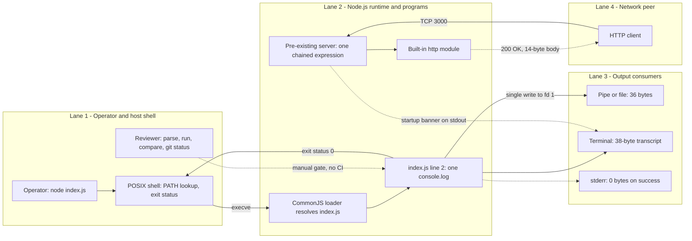

The two programs never meet: no edge joins `index.js` to the pre-existing server, because neither file imports the other and neither exports a symbol. The only actors that touch both are the runtime and the operator.

### 4.4.2 Detailed Process Flows for Each Core Feature

#### 4.4.2.1 F-001 and F-002 — Emission and Rendering

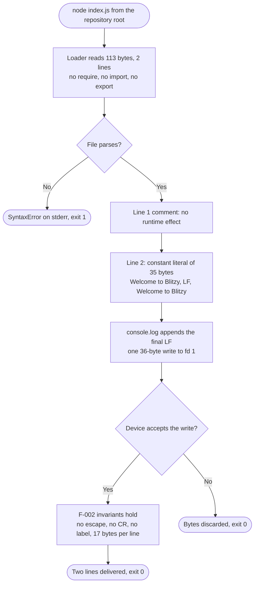

The F-002 check sits after the write because rendering is a property of the bytes already produced: the literal contains no escape sequence, the stream carries no `0x1b` or `0x0d`, and both lines measure 17 characters. A diagram that placed a formatting step before the write would imply code that does not exist.

#### 4.4.2.2 F-007 — HTTP Greeting Service

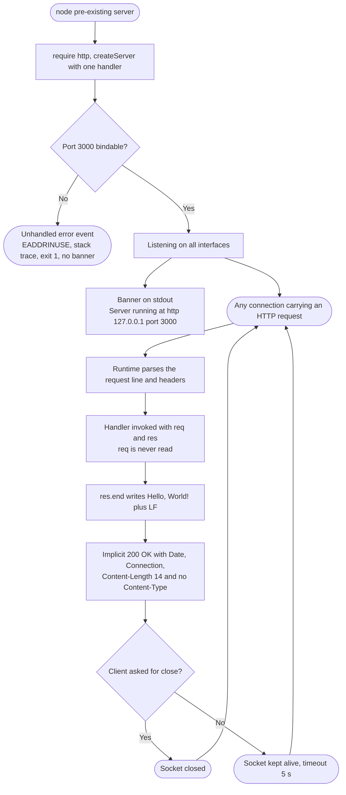

The loop back to the connection node is the runtime's accept loop, not a loop in the file. No routing diamond exists in front of the handler: `POST /deep/random/path?q=2` returned the same `200` and the same 14-byte body as `GET /`.

#### 4.4.2.3 F-003 and F-006 — Documented Run Path and Acceptance Gate

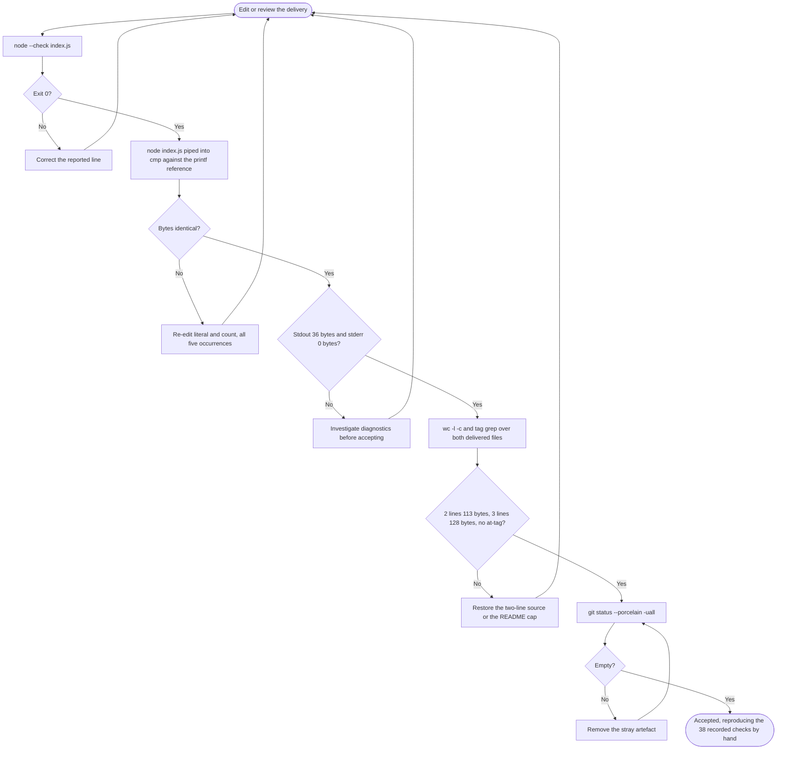

F-003 appears here as the absence of any install branch: the flow goes from the edit straight to the parse gate, because no dependency step exists to draw. F-006 appears as the shape and claim checks (steps G and H), which is the only place the README participates in a process.

### 4.4.3 Error Handling Flowchart

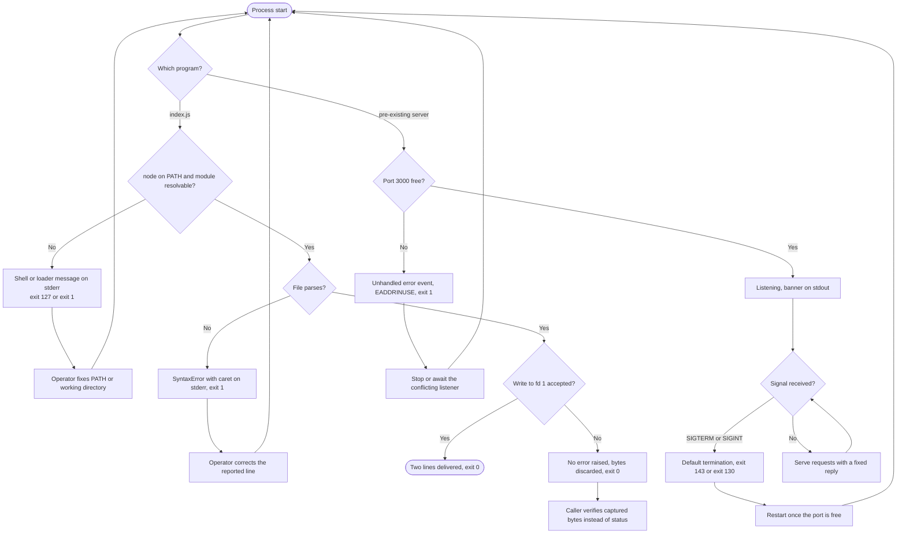

The diagram's most consequential edge is `WRITE -->|No| SILENT`: there is no recovery branch, no retry, and no notification, so the failure terminates in a state that looks identical to success from the caller's point of view. The two loud failure paths (`A1`, `B1`, `C1`) all originate in the shell or the runtime, never in the delivered code.

### 4.4.4 Integration Sequence Diagrams

#### 4.4.4.1 Console Invocation Sequence

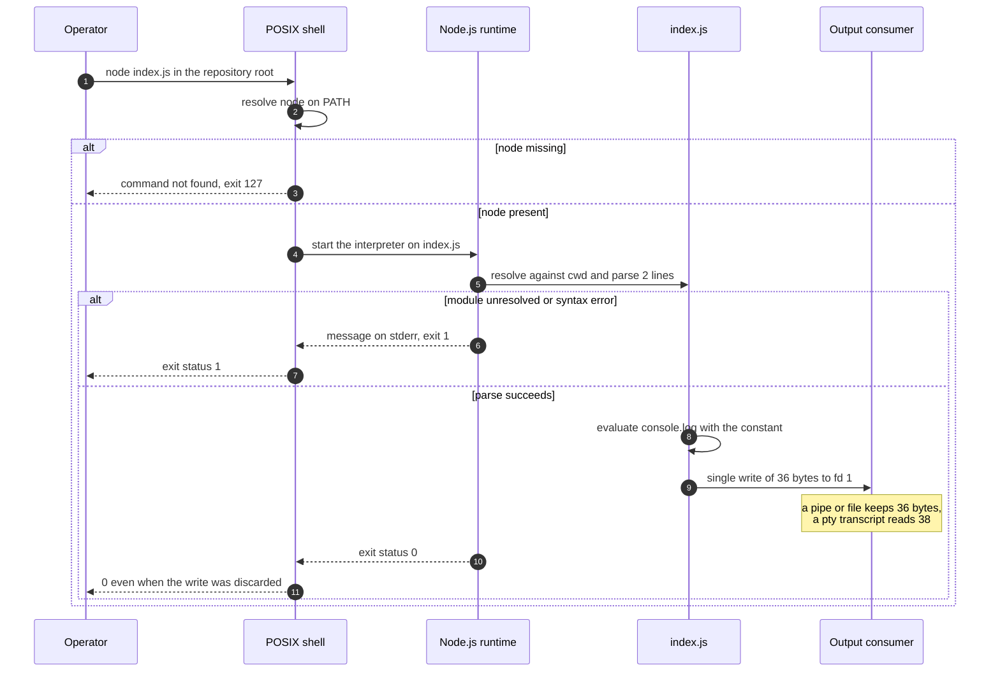

#### 4.4.4.2 HTTP Request and Response Sequence

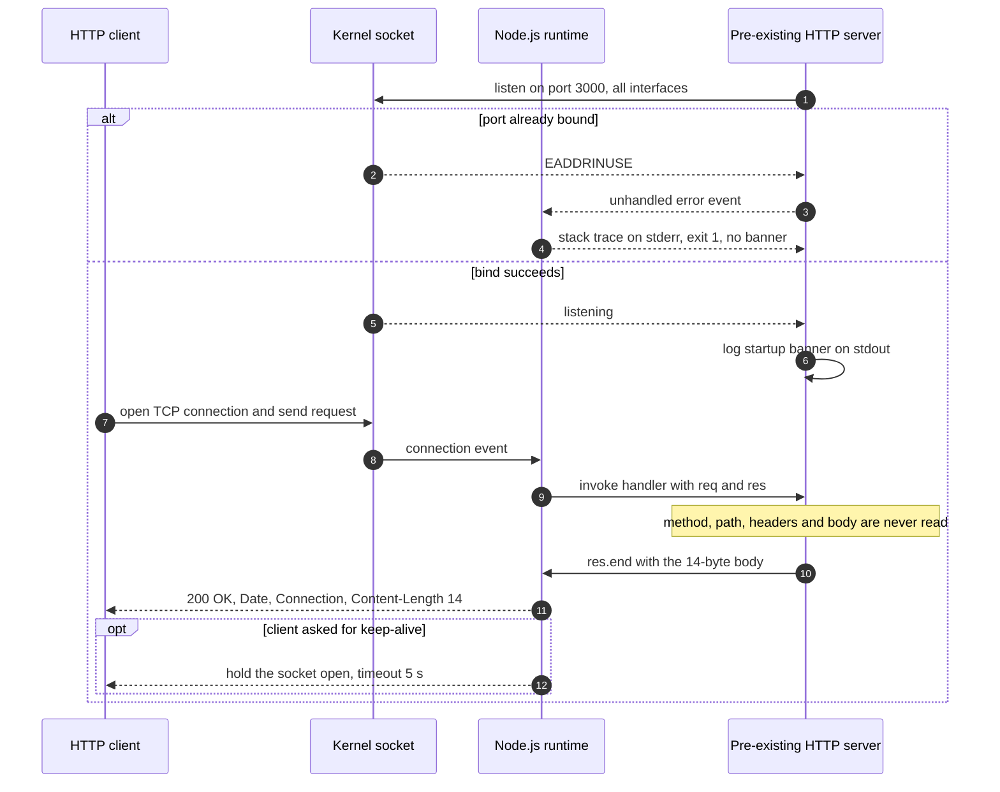

Both sequences show a single request/response turn and no callback beyond it: there is no webhook, no queue publish, no downstream call and therefore no compensating action if a peer disappears.

### 4.4.5 State Transition Diagrams

#### 4.4.5.1 Console Program Life Cycle

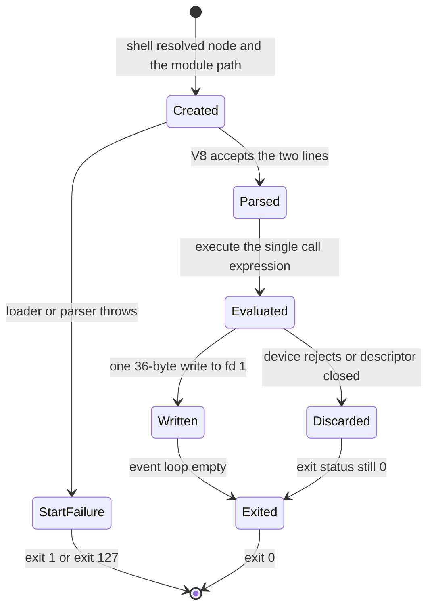

`Written` and `Discarded` converge on the same terminal state, which is why the process contract cannot distinguish delivery from loss. No state carries a variable: the transition into `Evaluated` reads a compile-time constant, so the diagram has no data flow to draw.

#### 4.4.5.2 HTTP Server Life Cycle

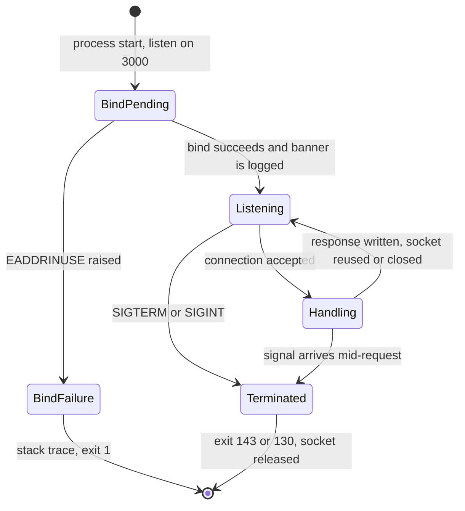

`Handling` returns to `Listening` for every request, so the state machine is a cycle driven by clients rather than by the program. `Terminated` is reachable only from outside — from a signal — since the file registers no shutdown path and no idle timeout; the operating system releases the socket when the process exits, which is why a fresh instance binds successfully afterwards.


## 4.5 References

Every claim in this section rests on one of the sources below, all of them read or executed in this checkout. No external web source was used.

**Repository files**

- `index.js` — the entire delivered program: line 1 the tag-free JSDoc summary, line 2 the single `console.log` whose argument holds both occurrences of the literal. Establishes the WF-01 journey, the absence of any branch, the 36-byte single write, and the reason the process cannot detect a rejected write.
- `README.md` — the run instruction `node index.js` and the zero-install claim on line 3, the literal in the heading on line 1. Establishes WF-03's documented command, the missing working-directory premise, and the documentation invariants in §4.2.5.
- `server (2).js` — the one-line HTTP listener: `require('http').createServer(...).listen(3000, ...)`. Establishes WF-04 and WF-05, the fixed port, the unread `req` object, and the absence of routing, authorization and error handling.
- `blitzy/documentation/Project Guide - d5d06770-1a28-4fee-846a-27d98a6d7cc0.md` — §3 Test Results (38 checks, determinism and concurrency, "Not Covered"), §4 Runtime Validation (about 31 ms per run, `/dev/full` and closed-descriptor behaviour, pty CR), §5.1 Compliance Matrix and §5.2 Divergences (owner constraints, the 13-byte body wording), §6 Risk Assessment (literal drift, port 3000 contention, silent output loss), §9 Development Guide (Application Startup, Verification Steps, Example Usage, Running the Pre-Existing Server, Troubleshooting), Appendix B Port Reference.
- `blitzy/documentation/` — the folder holding that guide, and proof that the tree's only non-code content is documentation.
- `blitzy/` — the repository-level container for generated deliverables; contains no executable content, which bounds the workflows in §4.1.

**Repository folders and metadata**

- repository root (`""`) — the four tracked paths, and the absence of any manifest, lockfile, test, CI workflow or configuration that could add an install, build or deployment step to a workflow.
- `.git/` — provenance for WF-06: seven commits (`8860b6a` base, `5f49734` `index.js`, `1237471` `README.md`, `824480e` and `02fcaa1` Project Guide, `c6b1fd3` twice-print change, `ee7cf7b` merge of PR #1), the blob identity of `server (2).js` across commits, and the remote `https://github.com/rjhonsi-blitzy/Simple_JS_1.git`.

**Executed verification in this checkout (Node.js v22.23.4, Linux)**

- `node --check index.js` and `node index.js` with separate redirection — 36 bytes on stdout, 0 bytes on stderr, exit 0, about 28 ms per run, `sha256` `c4a4d23e…` matching the `printf` reference.
- Failure probes — `node index.js` from `/tmp` (`MODULE_NOT_FOUND`, exit 1), a malformed copy outside the repository (`SyntaxError`, exit 1), `./index.js` (exit 126), `>/dev/full` and `>&-` (exit 0), `| head -c 4` (`Welc`, node exit 0), `env -i` with stray arguments (identical bytes).
- Server probes — startup banner, `GET /`, `HEAD /`, `POST /deep/random/path?q=2`, a raw `Connection: close` request (headers `Date`, `Connection`, `Keep-Alive: timeout=5`, `Content-Length: 14`, no `Content-Type`), a second instance on the busy port (`EADDRINUSE`, exit 1), and SIGTERM/SIGINT termination (exit 143 / 130).
- Absence searches — `grep` over `README.md`, `index.js` and `server (2).js` for 25 constructs including `setTimeout`, `cron`, `queue`, `batch`, `EventEmitter`, `async`, `await`, `try`, `catch`, `retry`, `validate`, `auth`, `token`, `process.env`, `readFile`, `setHeader` and `Content-Type`: zero matches for every one.


# 5. System Architecture

## 5.1 High-Level Architecture

### 5.1.1 System Overview

**Architecture style.** The repository holds no composed application. It holds two independent, single-file, run-to-completion Node.js processes that share no code, no state and no configuration, plus two Markdown documents that describe them. The accurate label is a **flat, single-tier script collection**: every artefact sits at one structural level — the repository root, plus one documentation folder — and the only layering present is inside the Node.js runtime. Layered, client-server, modular-monolith and microservice descriptions would all overstate the tree, because no component imports, instantiates or calls another: `index.js` contains no `require` or `import` of any kind, and `server (2).js` requires only the built-in `http` module (`server (2).js:1`).

| Process | Source | Life cycle | Interface |
|---|---|---|---|
| Console greeting program (the delivery) | `index.js` — 2 lines / 113 bytes | Start → parse → evaluate → single write → exit `0`, ~25–30 ms | `stdout` 36 bytes, `stderr` 0 bytes, exit status |
| HTTP greeting server (pre-existing, unchanged) | `server (2).js` — 1 line / 142 bytes | Start → bind `:3000` → listen indefinitely → answer every request | TCP port 3000, HTTP/1.1 |

**Rationale.** The architecture is the direct consequence of a scope fixed to two source files under owner constraints that forbid a manifest, lockfile, dependency, test suite, CI workflow, environment configuration, argument parsing and error handler (Project Guide §5.1 rows 9–10, §5.2 row 6). With no manifest present and none permitted, a dependency graph, a module resolution map, a bundler step and version pinning are all structurally impossible; what remains is whatever one file executed directly by the interpreter can provide. The second process predates the delivery — its blob `2886290f56dfe2483a8f29f7dfcb89796a6fca00` is identical at base commit `8860b6a` and at `HEAD` — so it is present in the tree without being part of the architecture of the delivery.

**Architectural principles observed in the source.**

- **One responsibility per file.** `index.js` performs exactly one write (`index.js:2`); `server (2).js` performs exactly one bind (`server (2).js:1`).
- **No abstraction layers.** Neither file declares a variable, constant, class, function name or export; both use anonymous inline arrow callbacks in `server (2).js`, and `index.js` has no declaration at all.
- **Zero dependencies, zero build.** Source is executed directly by the interpreter; the only import anywhere in the tree is the Node.js built-in `http`.
- **Statelessness and determinism.** Output is a compile-time constant; `node index.js` produces the identical SHA-256 `c4a4d23e…546963` under a normal environment and under `env -i`.
- **One-way, fire-and-forget interfaces.** `index.js` exposes only `stdout`, `stderr` and the exit status, and consumes no input: stray arguments (`node index.js foo bar`) are ignored and a closed stdin changes nothing.
- **Documentation as a peer artefact.** `README.md` and the Project Guide are hand-maintained versioned files, not build products; no documentation generator exists in the tree.

**System boundaries.**

| Inside the delivered boundary | Present in the tree but outside the delivery | Outside the repository |
|---|---|---|
| `index.js` — the entire delivered capability | `server (2).js` — pre-existing, byte-identical, never executed during the change | Node.js runtime (`/usr/bin/node`, v22.23.4 in this checkout) |
| `README.md` — the run instruction | `blitzy/documentation/Project Guide …md` — generated status record | POSIX shell and whoever consumes `stdout` |
| Source control metadata (`.git`, `main`, `origin`) | — | Git remote `origin`; HTTP clients of port 3000 |

**Major interfaces.** There are exactly three, all of them narrow:

- **Process invocation** — `node index.js`, run from the repository root as `README.md:3` states; no arguments, flags, environment variables or stdin are read.
- **Process output contract** — 36 bytes on file descriptor 1 (two 17-byte lines plus two LF terminators, verified by `od -c` ending at octal offset `0000044`), 0 bytes on file descriptor 2, exit status `0`.
- **Inbound HTTP** — `server (2).js` binds TCP port 3000 on the wildcard address and answers every request identically; this interface belongs to the pre-existing program, not to the delivery.

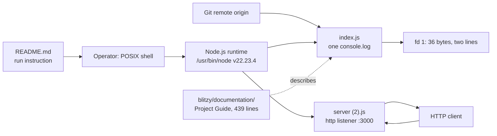

### 5.1.2 Core Components Table

Five components account for the whole system. Only the first two execute; the remaining three are documents and the host runtime the code depends on.

| Component Name | Primary Responsibility | Key Dependencies & Integration Points | Critical Considerations |
|---|---|---|---|
| Console greeting program — `index.js` | Emit `Welcome to Blitzy` twice, as two bare lines, then exit `0`. The complete delivered capability. | Node.js runtime (`console` global); no module, package or file dependency. Integrates only with the caller's file descriptor 1, 2 and the exit status. | Behaviour is a constant in one literal, so the printed count and the Printed claim in `index.js:1` and `README.md:3` must be edited together; output loss on a rejecting or closed `stdout` still exits `0`. |
| Pre-existing HTTP server — `server (2).js` | Answer every inbound HTTP request with `Hello, World!` and log one startup banner. Outside the delivery and unmodified. | Node.js built-in `http`; no other module. Integrates with TCP port 3000 and inbound HTTP clients. | Hard-coded, non-configurable port 3000 is a single non-partitionable resource: a second listener fails with `EADDRINUSE` (exit `1`). No routing, authentication, logging or shutdown. |
| Run instruction — `README.md` | State what the program prints, how many times, the command that runs it, and that nothing must be installed. | Read by a human or a script; no build step consumes it. | The only human-facing contract for the delivery; it does not mention `server (2).js` and does not state the repository-root premise. |
| Generated status record — `blitzy/documentation/Project Guide …md` | Record requirements, completion accounting, verification results, risks and a development guide for the delivery. | Versioned Markdown; produced outside the change (`824480e`, `02fcaa1`). No tool reads it at run time. | Drifts against the code: it still says the tree holds a *single-print* program in 412 lines, while the file is 439 lines and documents the twice-print behaviour. |
| Node.js runtime (host-provided) | Load, parse and execute both programs; supply `console`, the event loop and the `http` module. | Installed on the host; not vendored, pinned or declared in the repository. | No manifest or `engines` field may pin a version, so the run premise is unenforced; verified only on v22.23.4 in this checkout and v22.23.5 per the Project Guide. |

### 5.1.3 Data Flow Description

**Delivered flow (`index.js`).** Data flow is a single hop with no transformation of user data. The shell resolves `node` and the module path, the runtime loads the file, discards line 1 as a comment, evaluates the one call expression on line 2, and writes the argument to file descriptor 1. The single literal supplies 35 bytes — `Welcome to Blitzy` (17), LF, `Welcome to Blitzy` (17) — and `console.log` appends the final LF, producing one 36-byte write. That the two lines come from *one* argument rather than two statements is the significant architectural detail: there is no intermediate state in which only one line exists, and the identical SHA-256 on every run reflects it. The process then exits `0` with an empty event loop and no follow-up action.

**Verification flow.** The only other supported flow is a human or script comparison: `node --check index.js` (parse gate, no output, no side effect) then `node index.js | cmp - <(printf 'Welcome to Blitzy\nWelcome to Blitzy\n')`. It reads the same 36 bytes and writes nothing; it is the closest thing to an automated check because a test framework is excluded.

**Pre-existing flow (`server (2).js`).** A TCP connection reaches the runtime, the built-in HTTP parser decodes the request, and the handler discards every inbound field — method, path, headers and body — then calls `res.end('Hello, World!\n')`. Observed response: `HTTP/1.1 200 OK`, `Date`, `Connection: keep-alive`, `Keep-Alive: timeout=5`, `Content-Length: 14`, body `Hello, World!\n`; a `POST` to `/anything` receives the same bytes. The transformation point here is total data loss by design: nothing inbound reaches any store or variable, and no outbound state survives the connection. The startup banner `Server running at http://127.0.0.1:3000/` is hard-coded text on `stdout`, not derived from the bound address.

**Data stores and caches.** There are none in either program. The table below is the complete list of places data can reside.

| Store or cache | Role in the system | Configured or used by the code? | Evidence |
|---|---|---|---|
| Filesystem | Holds the four tracked files; changed only by a human or `git` | No — no `fs`, write or append call exists | Grep for `fs`/`writeFile` in both `.js` files returns nothing |
| Git repository (`origin`, `main`) | Durable record of source and documentation | No — no program touches version control | `git status --porcelain` empty after every run |
| Node.js CommonJS module cache | Would hold `http` for the process lifetime | Not by `index.js` (requires nothing); incidentally by `server (2).js` | `require('http')` appears once, `server (2).js:1` |
| HTTP keep-alive state | Reuses one TCP connection for successive requests | Runtime default only; no header is set by the code | `Keep-Alive: timeout=5` observed in the response |
| Application cache, database, queue | Absent | No dependency, manifest or connection string exists to address one | Repository-wide search finds no such artefact |

### 5.1.4 External Integration Points

The system integrates with four external parties and with no third-party service. There is no database, message broker, identity provider, telemetry endpoint, package registry at run time, or outbound HTTP call anywhere in the tree.

| System Name | Integration Type | Data Exchange Pattern & Protocol | SLA Requirements |
|---|---|---|---|
| Node.js runtime (`/usr/bin/node`) | Execution host, in-process | Synchronous load-and-run of a single file; `console` global writes to file descriptors | None declared and none enforceable — no manifest or `engines` field may pin a version; a host without Node.js fails with shell exit `127` |
| POSIX shell / `stdout` consumer | Outbound one-way stream | 36 bytes of ASCII plus LF on file descriptor 1; `stderr` stays empty; exit status `0` on success | None; delivery is unacknowledged — a rejecting (`>/dev/full`) or closed descriptor still exits `0`, so the consumer must compare bytes |
| Git remote `origin` | Source control and delivery channel | Commit, branch and merge of the four tracked files; transport handled by `git` | None; the delivery branch was merged in PR #1 (`ee7cf7b`) |
| HTTP client of `server (2).js` | Inbound TCP listener | HTTP/1.1 request on port 3000 → `200 OK` with `Content-Length: 14` and `Hello, World!\n`, keep-alive `timeout=5`; all methods and paths answered identically | None; unauthenticated, unencrypted, unlogged, and bound to a port no one owns — a co-scheduled listener on 3000 fails with `EADDRINUSE` |


## 5.2 Component Details

### 5.2.1 Console Greeting Program — `index.js`

**Purpose and responsibilities.** `index.js` is the delivered system: it embodies one capability, executed once per invocation. It writes the fixed string `Welcome to Blitzy` twice as two bare lines to standard output and exits successfully. It owns four responsibilities and nothing else: emit exactly two unformatted lines, keep the file at two lines with one tag-free JSDoc summary, require no installation step, and remain deterministic and side-effect free. It reads no file, environment variable, argument or stream, so there is no input to validate, correlate or store.

**Technologies and frameworks.** Plain JavaScript executed directly by Node.js, using no framework, library, module system, transpiler or bundler. The complete syntax surface is one block comment and one call expression whose argument is a string literal containing an escaped newline (`index.js:2`); `console` is a host global supplied by the runtime, not an imported module. The file declares no variable, constant, class, named function or export, so it is consumed only for the side effect of one write.

**Key interfaces and APIs.**

| Interface | Contract | Evidence |
|---|---|---|
| Invocation | `node index.js` from the repository root; no flags, arguments or environment variables | `README.md:3`; stray arguments ignored in test |
| Standard output (fd 1) | Exactly 36 bytes: two 17-byte lines plus two LF terminators, no escape or carriage-return byte | `od -c` ends at octal `0000044`; `wc -c` = 36 |
| Standard error (fd 2) | Always empty | 0 bytes measured |
| Exit status | `0` on every run that starts, including when the write is discarded | `node index.js; echo $?` → `0` |
| Documentation contract | The word "twice" and the printed string appear in `index.js:1`, twice on `index.js:2`, `README.md:1` and `README.md:3` | `git grep` over tracked files |

There is no API in the network or library sense: no exported symbol, no listener, no callback, no protocol. The interface is the POSIX process contract.

**Data persistence requirements.** None. The program opens no path, creates no file, writes no database, mutates no environment and leaves `git status --porcelain` empty after every run, including ten concurrent runs. The only filesystem effect available to a user is external to the program: `node index.js >> greeting.log` appends two lines to a caller-owned file that the caller must remove. Source of truth for the constant is the file itself, which is why the count is duplicated in five places across two files with no automated consistency check.

**Scaling considerations.** Scaling is process-level replication and is effectively unconstrained, because the program holds no shared resource: ten simultaneous runs produced identical output, exit `0` and empty `stderr`. Measured cost in this checkout is 25–30 ms of wall time per run across ten sequential runs on Node.js v22.23.4, with the output fixed at 36 bytes and peak resident memory indistinguishable from the bare runtime. The only scalability limit is the consumer of fd 1 — a pipe reader that closes early (`| head -c 4`) truncates the emission to `Welc` while the process still exits `0`. Throughput scales with host CPU as long as processes are independent; nothing coordinates them.

**Failure behaviour.** Failures are partitioned by phase, and only the start-up phase is loud (the full failure catalog is in §4.3.2).

| Failure | Observable result | Evidence |
|---|---|---|
| No Node.js on `PATH` | Shell error `node: command not found`, exit `127`, before the program runs | Project Guide §9; §6 row 5 |
| Wrong working directory or mistyped path | Runtime `Cannot find module`, non-zero exit | Project Guide §9 |
| Syntax error in the file | `node --check index.js` exits `1` with a caret under the offending line | Verification gate |
| Output device rejects or is closed | Exit `0` with the bytes discarded — indetectable from the status | Verified with `>/dev/full` and `>&-` |

### 5.2.2 Pre-Existing HTTP Server — `server (2).js`

**Purpose and responsibilities.** A one-line CommonJS script that starts an HTTP listener and answers every request with `Hello, World!`. It predates the delivery — commit `8860b6a` ("Add files via upload") adds it as the repository's only file — and it sits outside the delivery's scope: its blob `2886290f56dfe2483a8f29f7dfcb89796a6fca00` is identical at `8860b6a` and at `HEAD`, and `README.md` never mentions it. Its architectural significance is not its function but its presence: the tree ships a second runnable program, a second output channel and the only network-facing surface in the repository.

**Technologies and frameworks.** Node.js built-in `http` loaded with CommonJS `require` (`server (2).js:1`), consumed only for `createServer`. Two anonymous inline arrow callbacks — the `(req, res)` request handler and the listen callback — and no other construct. No routing library, middleware, template engine, static-file handler, TLS module or third-party package is involved.

**Key interfaces and APIs.**

| Interface | Contract | Evidence |
|---|---|---|
| Listening socket | TCP port 3000, hard-coded, no host argument, no configuration or environment override | `listen(3000, …)` in `server (2).js:1` |
| HTTP request handling | Every method, path, header set and body receives the same reply; request data is parsed by the runtime and discarded | `POST /anything` returned the identical body |
| HTTP response | `HTTP/1.1 200 OK` with `Date`, `Connection: keep-alive`, `Keep-Alive: timeout=5`, `Content-Length: 14`, body `Hello, World!\n` | Response headers observed |
| Startup diagnostic | One banner line on `stdout`: `Server running at http://127.0.0.1:3000/`, hard-coded and not derived from the bound address | `server (2).js:1` |
| Termination | No signal handler: `SIGTERM` exits `143`, `SIGINT` exits `130`, with no drain and no closing message | Observed `SIGTERM` exit |

The file name itself is an interface constraint: it contains a space and parentheses, so every shell reference must be quoted (`node "server (2).js"`), and tooling that splits paths on whitespace will mis-handle it.

**Data persistence requirements.** None. The handler keeps no counter, no session, no log file and no state between requests; the only per-connection state is the runtime's socket, parser buffers and keep-alive timer, discarded when the connection closes.

**Scaling considerations.** The listener is single-process and binds a single non-partitionable resource. No `cluster` module, worker thread, connection limit or backlog configuration exists, so concurrency is whatever one Node.js event loop accepts, and horizontal scaling requires distinct hosts or distinct ports — the port cannot be changed without editing the file. Two instances on one host collide: the second fails with an unhandled `'error'` event — `Error: listen EADDRINUSE: address already in use :::3000`, `code: 'EADDRINUSE'`, `errno: -98`, `address: '::'`, `port: 3000` — and exits `1`. The wildcard bind address in that diagnostic confirms the server listens on all interfaces, not on loopback only, which widens the exposure that §5.4.4 discusses.

### 5.2.3 Documentation Components — `README.md` and the Project Guide

**Purpose and responsibilities.** Two versioned Markdown files carry every human-facing statement about the system. `README.md` (3 lines / 128 bytes) is the run instruction: a level-1 heading, a blank line, and one sentence naming the output, the count, the command `node index.js` and the absence of an install step. The Project Guide under `blitzy/documentation/` (439 lines) is the status record: ten top-level sections covering the executive summary, project hours, test results, runtime validation, compliance, risk, visual status, recommendations, a development guide and appendices.

**Technologies and frameworks.** None beyond Markdown and, in the guide's case, GitHub-flavoured tables and Mermaid `pie showData` charts. No documentation generator, site builder, linter or renderer exists in the tree, so neither file is validated by any tool, and the guide's own verification section records that Markdown rendering is unexercised.

**Key interfaces and APIs.** Both files are read by humans and by nothing else at run time. `README.md:3` is the only source of the invocation contract, and the command it states was executed verbatim during verification and reproduced the two lines it claims. The guide is a management interface — requirements, hours, risks, open items — and carries measurements this specification cites, such as the 38 executed checks and the recorded runtime `v22.23.5`.

**Data persistence requirements.** Both are stored only in the Git repository; nothing writes them at run time, and no program reads them. Their durability is the durability of the repository.

**Scaling considerations.** Not applicable — the cost of a document is the reader's time, and the relevant limit is drift. Two divergences are recorded rather than resolved: `README.md` does not mention `server (2).js` or the repository-root premise, so a README-only reader cannot discover the second program or the working-directory requirement; and the guide states in its §1.4, §5.2 and §6, and in its Appendix C, that the tracked document describes a *single-print* program in 412 lines, while the file is 439 lines and was rewritten in `02fcaa1` to describe the twice-print behaviour. The document is therefore a component whose content disagrees with itself, and neither claim in it is enforceable by tooling.

### 5.2.4 Component Interaction, State Transition and Sequence Diagrams

**Component interaction.** Only the runtime is shared. `index.js` and `server (2).js` never call each other, never share a module record and never share a socket; the documentation set observes both from outside.

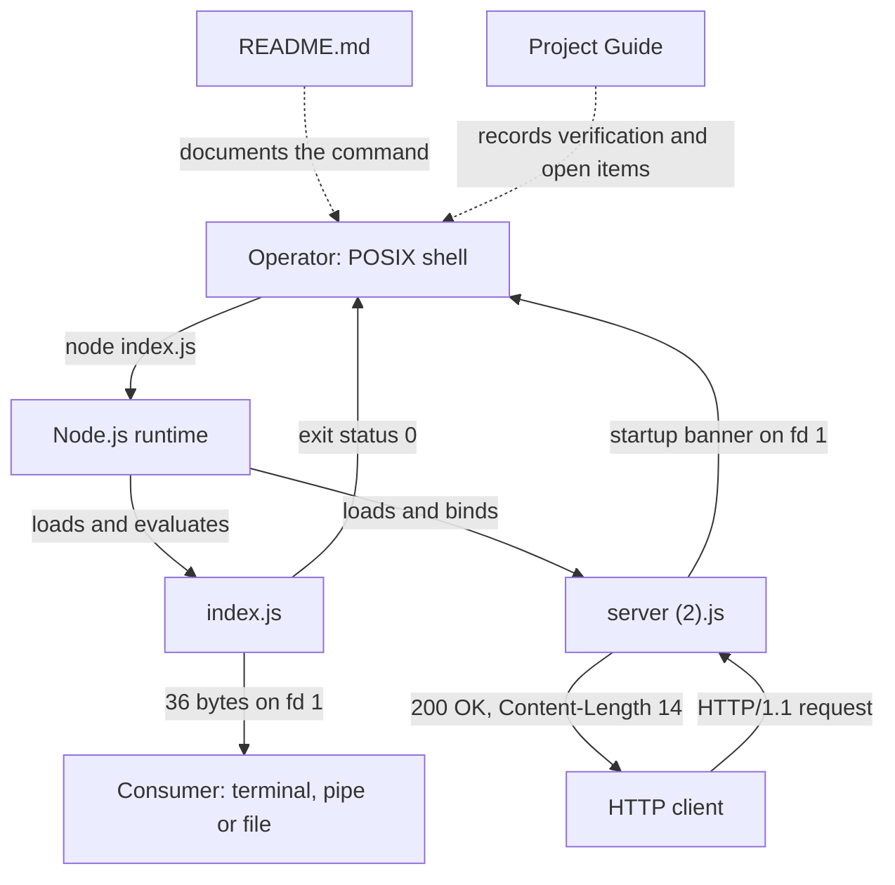

**State transitions — the delivered program.** The program passes through four states and holds no data at any of them; the only value in the process is the string constant on line 2.

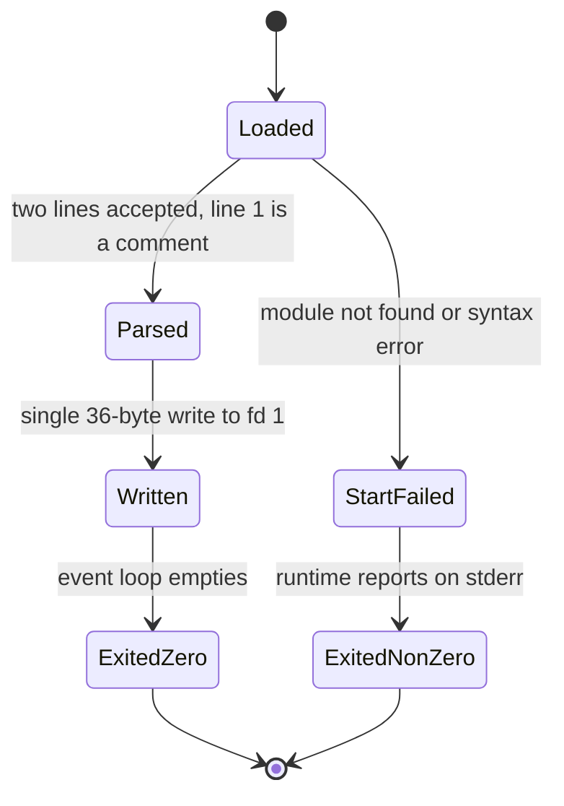

The transition into *ExitedZero* does not depend on the write succeeding: a rejecting device, a closed descriptor and a truncated pipe all reach the same terminal state with status `0`.

**State transitions — the pre-existing server.** This life cycle does not terminate on its own; it leaves *Listening* only through a signal or a failed bind.

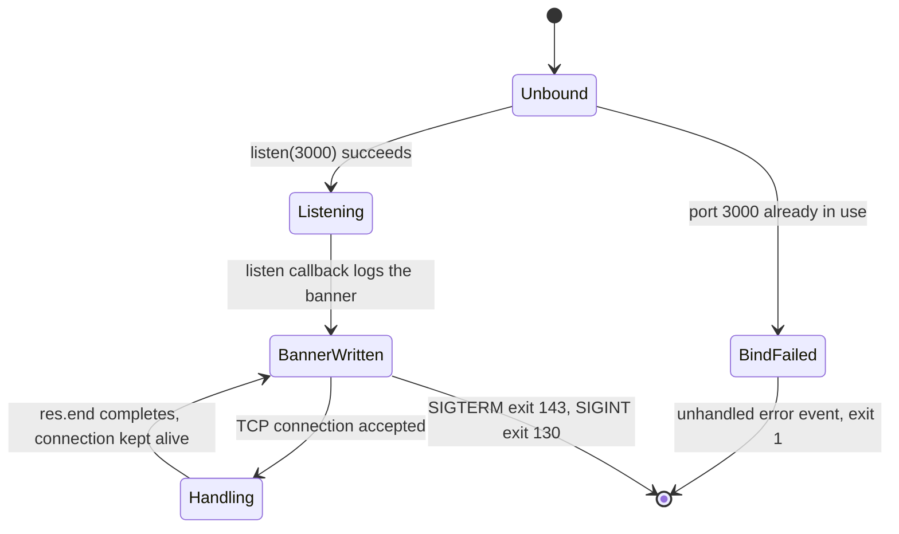

**Sequence — the documented run.** The interaction is one write with no acknowledgement at any layer.

```mermaid
sequenceDiagram
    actor Op as Operator
    participant Sh as POSIX shell
    participant N as Node.js runtime
    participant P as index.js
    participant C as Consumer
    Op->>Sh: node index.js
    Sh->>N: exec /usr/bin/node index.js
    N->>P: load and parse, discarding line 1
    N->>P: evaluate line 2
    P->>C: one 36-byte write to fd 1
    Note over P,C: no acknowledgement, no retry; a rejecting device still exits 0
    N-->>Sh: exit status 0, stderr empty
    Sh-->>Op: prompt returns
```

**Sequence — a request to the pre-existing server.** Inbound data is discarded before any decision is made.

```mermaid
sequenceDiagram
    participant Cl as HTTP client
    participant N as Node.js runtime
    participant S as server (2).js
    Cl->>N: TCP connect, port 3000
    N->>S: parsed request: method, path, headers, body
    S->>S: discard every inbound field, take no branch
    S->>Cl: HTTP/1.1 200 OK, Content-Length 14, Hello, World!
    Note over Cl,S: connection kept alive (timeout=5) and reused for further requests
```


## 5.3 Technical Decisions

### 5.3.1 Architecture Style Decisions and Tradeoffs

The style question for this system is narrow. There is no deployment topology to choose, no service boundary to draw and no data ownership to partition, because the delivered program makes no network call and holds no state: monolith, microservice and event-driven framings describe distinctions the tree does not contain. The decisions that were actually made concern how little structure to admit.

**What was chosen.** A flat collection of standalone scripts executed directly by Node.js, with a constant output, no configuration, no dependency and no build. Every further decision below follows from two owner constraints recorded in the Project Guide: no manifest, lockfile, dependency, test suite or CI artefact may exist (§5.1 row 9, §5.2 row 6), and no 404 handler, error handler, environment configuration, argument parsing or logging may be added (§5.1 row 10).

| Decision | What it buys | What it costs | Evidence |
|---|---|---|---|
| No framework, module system or composition layer | The program is two lines; it runs on any Node.js with nothing installed | No reusable units, no injection seam, no unit-testable boundary; the file is only observable as a process | `index.js` has no `require`, `import`, class or declaration |
| Two unrelated entry points kept side by side | The pre-existing server stays byte-identical, honouring the smallest-diff and existing-code constraints | The tree ships an undocumented second program and its port hazard | `server (2).js` blob `2886290f…` identical at `8860b6a` and `HEAD` |
| A shell gate instead of a test suite or CI | No toolchain, no runner, no pipeline to maintain | No re-runnable automated check; the five literal occurrences can drift silently | Project Guide §3 "Not Covered"; §9 gate `node --check index.js && node index.js` |
| A constant literal instead of configuration | Byte-identical output under `env -i` and every environment variant | The greeting and the count live in four places across two files plus the word "twice" | `index.js:1`, `index.js:2` (twice), `README.md:1`, `README.md:3` |
| An unacknowledged write instead of a checked one | The shortest possible data path: one call, one write, exit | Output can be lost with exit status `0`; no caller can detect it from the status | `>/dev/full` and `>&-` both exit `0` |

### 5.3.2 Architecture Decision Records

All ten records are accepted; the status of each is "accepted with the tradeoff stated", and none has been superseded.

| ID and decision | Rationale | Tradeoff accepted |
|---|---|---|
| **ADR-01** No application framework or composition layer; each program is a standalone script | Scope was two source files, and no manifest may exist, so a module graph, dependency injection or build step is structurally impossible | No reuse, no abstraction boundary, no test seam; both files are exercised only end-to-end as processes |
| **ADR-02** Zero third-party dependencies; the Node.js built-in `http` is the only import in the tree | The run premise is `node index.js` with nothing to install (`README.md:3`) | No routing, logging, validation or configuration libraries; every such capability must be hand-written if it is ever needed |
| **ADR-03** No build, transpile, lint or package step; source is executed as written | A zero-install, zero-toolchain delivery, byte-identical on repeats | No minification, no static analysis gate, no down-level compatibility target; `node --check` is the only syntax gate |
| **ADR-04** Both greeting lines are produced by one `console.log` of a two-occurrence literal, not two statements | One write, one formatting step, no partial-emission state (`index.js:2`) | The count is embedded in the string; changing the number of lines means editing the literal |
| **ADR-05** Stateless design: no persistence, no configuration file, no environment reads | Deterministic and idempotent output; concurrency-safe by construction; empty `git status` after every run | No memory between runs, nothing to tune per host, and no runtime switch to change behaviour |
| **ADR-06** No error handling, validation, retry or fallback; the runtime's default policy only | There is no input to validate and no failure branch to design | Start-up failures are loud (exit `127`/`1`, stderr trace) while output loss is silent (exit `0`) |
| **ADR-07** No observability stack; the verification gate is `node --check index.js && node index.js` plus byte comparison | A 36-byte constant needs no metrics, traces or health endpoint | Nothing is re-runnable by a pipeline, and a lost emission cannot be detected from the exit status |
| **ADR-08** The pre-existing `server (2).js` is left byte-identical and outside the delivery rather than refactored or removed | The existing-code clause and the smallest-diff instruction forbid touching it | A second runnable program exists that `README.md` never mentions, inviting duplicate work or an accidental edit |
| **ADR-09** The server's fixed port 3000 is accepted as-is; no configurability is added | Changing the file is out of scope and would break its blob identity | The port is a single non-partitionable resource: a co-scheduled listener fails with `EADDRINUSE` |
| **ADR-10** Documentation is hand-maintained Markdown in the tree, not a generated artefact | No build pipeline may exist, so no generator can produce or check it | The Project Guide has drifted: it claims a 412-line single-print document while the file is 439 lines and documents the twice-print behaviour |

### 5.3.3 Communication Pattern Choices

Three patterns exist in the system, and the sum of them is smaller than a typical single integration. None is asynchronous, queued, retried or acknowledged; the delivered program's pattern does not even include a response.

| Pattern | Where it is used | Why it was chosen | Limitation it imposes |
|---|---|---|---|
| One-way stream write to `stdout`, no acknowledgement | `index.js:2` | The output *is* the product, and fd 1 is the only channel that ordinary shell consumers (pipe, redirect, substitution) read without setup | Loss is undetectable from the exit status; a truncated consumer (`head -c 4` → `Welc`) still exits `0` |
| In-process formatting call (`console.log`) | `index.js:2` | The only transformation needed is appending a terminator to a constant string | No alternative sink exists: writing to a file, socket or log would require code the constraints exclude |
| HTTP/1.1 request-response with keep-alive | `server (2).js:1` | The built-in `http` module supplies it in one expression | No routing or status differentiation — every request returns `200` with the same 14-byte body — and no request logging, correlation identifier or backoff |

Deliberately absent: message brokers, queues, webhooks, gRPC, event buses, publish/subscribe, retries with backoff, circuit breakers, idempotency keys and batch jobs. A text search of both `.js` files for `setTimeout`, `setInterval`, `fetch`, `WebSocket`, `net`, `dns`, `https` and `child_process` returns no match; the sole module reference in the tree is `require('http')` in `server (2).js:1`.

The architectural consequence worth stating explicitly is a channel separation rule: because `stdout` carries the product and must stay at exactly 36 bytes, it is a data channel and not a diagnostic channel. Any future diagnostic output would have to go to `stderr`, which is empty by design and verified at 0 bytes.

### 5.3.4 Data Storage and Caching Rationale

No storage solution and no cache were selected, and each rejection follows from the same fact: the system's only value is a compile-time constant, and nothing a run produces is read by a later run.

| Option | Used | Rationale and evidence |
|---|---|---|
| Relational or document database | No | Nothing to model: no entity, schema, migration, query or connection string exists anywhere in the tree |
| File write or append inside the program | No | A write would create a side effect and a cleanup obligation; `git status --porcelain` is empty after every run, including ten concurrent runs |
| Configuration file or environment store | No | Configuration would break environment independence; `node index.js` under `env -i` produces the identical SHA-256 `c4a4d23e…546963` |
| Application cache, memoisation or precomputation | No | There is nothing to cache: the 36 bytes are a constant, and a cache would add invalidation cost with no benefit |
| Version control repository | Yes, the only durable store | The four tracked files are the entire persistent state of the system; recovery consists of checking them out again |

Two caches exist incidentally in the runtime and neither is configured by the code. The CommonJS module cache holds `http` for the lifetime of the server process (a single `require`, so no second lookup can occur). The HTTP keep-alive socket cache, advertised as `Keep-Alive: timeout=5`, lets a client reuse one TCP connection for successive identical requests. No cache invalidation, warm-up or coherence step exists in any flow, and no flow's correctness depends on cache state.

### 5.3.5 Security Mechanism Selection

No security mechanism was selected, and that is a recorded owner decision rather than an omission: the Project Guide's compliance matrix closes its security-baseline row on the absence of a 404 handler, error handler, environment configuration, argument parsing and logging (§5.1 row 10).

| Concern | Implemented | Consequence for the system |
|---|---|---|
| Authentication | No — no identity, token, session or credential is read anywhere | Any client that reaches port 3000 receives the greeting; the delivered program has no input, so it has no authentication surface |
| Authorization | No | No protected resource and no per-user capability exist; there is nothing to authorize |
| Transport encryption | No — the listener speaks plaintext HTTP | Traffic on port 3000, on the wildcard address confirmed by `address: '::'` in the bind diagnostic, is readable by anything on the host network |
| Secret management | No | No secret exists; the program reads no environment variable, and `env -i` output is byte-identical |
| Input validation | No | The delivery parses no input; the server parses requests and discards every field, so nothing a client sends is interpreted |
| Dependency supply-chain control | Not needed | Zero third-party packages, no lockfile and no registry access at build or run time |
| Audit trail | No | The only operational message is the startup banner on `stdout`; no request is recorded, so exposure cannot be reconstructed after the fact |

The selection rationale is proportionate rather than negligent: the delivered artefact is a public constant written to a stream the invoking user already owns, so there is no asset to protect and no untrusted input to bound. The residual exposure belongs entirely to the pre-existing server — unauthenticated, unencrypted, unlogged and bound to all interfaces — and the mitigation available without editing a frozen file is procedural: assign port 3000, do not run it beside another service, and bound its lifetime (`timeout 8 node "server (2).js"`, per the Project Guide's recipe).

### 5.3.6 Decision Tree

The tree below records the operating decisions the architecture leaves to a human: which program to run, and what to do when a precondition fails. Every branch terminates in an action that exists in the repository's own documented procedures.

```mermaid
flowchart TD
    Start(["Operator needs to run the repository"]) --> Q1{"Console greeting required?"}
    Q1 -->|yes| Q2{"node resolvable on PATH?"}
    Q2 -->|no| Fix1["Install Node.js or extend PATH, then retry"]
    Q2 -->|yes| Run1["Run node index.js from the repository root"]
    Run1 --> Q3{"Emitted bytes must be proven?"}
    Q3 -->|yes| Cmp["Compare with cmp against the printf reference stream"]
    Q3 -->|no| Done1["Exit status 0 accepted"]
    Q1 -->|no: HTTP reply required| Q4{"Port 3000 free?"}
    Q4 -->|no| Fix2["Stop the other listener: the port is not configurable"]
    Q4 -->|yes| Run2["Run node 'server (2).js' quoted"]
    Run2 --> Done2["Banner on stdout, every request answered with Hello, World!"]
```

### 5.3.7 Architectural Assumptions and Constraints

Every assumption below is load-bearing for at least one documented behaviour, and each carries the observable consequence of its failure.

| Assumption | Consequence if it fails | Evidence |
|---|---|---|
| A supported Node.js release is on `PATH` | The run never starts: shell error `node: command not found`, exit `127`; behaviour on any major other than v22 is unproven | `README.md:3`; Node v22.23.4 in this checkout, v22.23.5 recorded in Project Guide §3 |
| The command is run from the repository root | Relative module resolution fails with `Cannot find module` | Project Guide §1.4 row 5; `README.md:3` states the command but not the premise |
| The consumer's fd 1 is open and accepting writes | Bytes are discarded with exit status `0`; only a byte comparison detects the loss | `>/dev/full` and `>&-` both exit `0` |
| Port 3000 is free and owned by this workload | The server dies at start with an unhandled `EADDRINUSE` event and exit `1` | Bind-conflict test; Project Guide Appendix B |
| No manifest, lockfile, test suite, CI workflow or configuration may be added | A structural assumption of the delivery, not a runtime one: adding any would break the stated scope and the acceptance criterion | Project Guide §5.1 row 9, §5.2 row 6 |
| The four tracked files are the complete system state | Any undetected external state would make the deterministic-output claim false; none has been found | `git ls-files` lists exactly four paths; no deleted file in history |
| The Project Guide is a truthful record of the tree | Readers may act on claims that contradict the code — the guide's own §1.4, §5.2, §6 and Appendix C still describe a 412-line single-print document | Guide text compared against the 439-line file it describes |


## 5.4 Cross-Cutting Concerns

### 5.4.1 Monitoring and Observability Approach

Nothing is instrumented. The repository contains no metrics library, counter, health or readiness endpoint, dashboard, alert rule, synthetic probe, crash reporter or telemetry exporter, and no CI job that could aggregate any of them (ADR-07). The approach is therefore the one available without adding a component: observe the process contract from outside — the exit status, the bytes on `stdout`, the emptiness of `stderr` — and record the result by hand.

| Signal | How an operator obtains it | What it proves | What it cannot prove |
|---|---|---|---|
| Exit status | `node index.js; echo $?` | The program started and the event loop emptied | Whether the output reached its destination |
| Emitted bytes | `node index.js \| wc -c`, `od -c`, `sha256sum` | The full 36-byte, two-line payload was produced, byte for byte | Whether a downstream reader consumed it intact |
| Standard error | `node index.js 2>err.txt; wc -c err.txt` | Whether the runtime reported a failure | Anything about a successful run, which writes 0 bytes |
| HTTP reply | `curl -s -o /dev/null -w '%{http_code}' --max-time 2 http://127.0.0.1:3000/` | That the pre-existing listener exists and answers | That the workload is healthy — every request returns `200` regardless of state |

**Blind spots that matter operationally.** A rejected or closed `stdout` exits `0` with the bytes discarded, so no exit-status check can detect a lost emission; only a byte comparison can. No history exists — nothing is logged over time, so an intermittent failure leaves no trace. Nothing reports drift: the greeting and the count live in four places across two files plus the word "twice", and a partial edit leaves the README and the code disagreeing with no signal. The pre-existing server cannot report its own failure either, because its only branch returns `200`.

**The only reliable check.** The monitoring primitive the tree supports is the comparison gate itself: `node index.js | cmp - <(printf 'Welcome to Blitzy\nWelcome to Blitzy\n')`, where the exit status of `cmp` — not of `node` — is the real signal. For the server, a TCP connect plus a `200` proves a listener is bound; because every method and path returns the same reply, no response can distinguish a healthy instance from a degraded one.

### 5.4.2 Logging and Tracing Strategy

There is no logging framework, no severity level, no structured or JSON format, no log file, no rotation, no retention policy, no request log and no tracing: no span, trace identifier, correlation identifier or propagation header exists anywhere in the tree. Both programs write only to file descriptors the caller owns, and the delivered program's own output is the product rather than a record of activity.

| Channel | Content | Volume | Trustworthiness |
|---|---|---|---|
| `stdout` of `index.js` | The two greeting lines — the product, not a log | Exactly 36 bytes per run | Authoritative: its bytes are the acceptance criterion |
| `stderr` of `index.js` | Nothing; no diagnostic is ever written | 0 bytes per run | Silent by design, so its emptiness proves nothing about delivery |
| `stdout` of `server (2).js` | One startup banner, `Server running at http://127.0.0.1:3000/` | One line per process start | Misleading: the text is hard-coded while the bind is the wildcard address, so the banner names a narrower address than the socket actually uses |
| Runtime `stderr` on crash | Node.js unhandled-error trace, e.g. `EADDRINUSE` with `errno: -98` | Several lines, only on failure | Accurate but only for start-up failures; nothing is emitted for output loss |

Two architectural rules follow. First, **`stdout` is a data channel**: a diagnostic written there would break the 36-byte contract, so any future diagnostic must go to `stderr`, which is empty today. Second, **tracing has no purpose in this topology**: each invocation is a single process, single hop and single write, so a trace would contain exactly one unit of work and nothing to propagate into.

### 5.4.3 Error Handling Patterns

The pattern is a two-phase asymmetry: the system fails loudly while starting and silently while delivering. There is no `try`/`catch`, no `error` listener, no `uncaughtException` handler, no validation, guard clause, retry, backoff, circuit breaker, fallback value, dead-letter path or idempotency key in either file; every error is handled by the runtime's default policy.

| Layer | Pattern | Observable result | Evidence |
|---|---|---|---|
| Interpreter resolution | Shell reports before the program starts | `node: command not found`, exit `127` | Project Guide §9 troubleshooting table |
| Load and parse | Runtime reports and aborts | `SyntaxError` with caret, or `Cannot find module`, non-zero exit | `node --check index.js` gate |
| Evaluate and write | No handler at all | Exit `0` whether the write succeeds, is rejected or the descriptor is closed | `>/dev/full` and `>&-` both exit `0` |
| Termination | Default signal handling, no drain or cleanup | `SIGTERM` exit `143` on the server; socket released by the OS at exit | Observed |
| HTTP bind | Unhandled `'error'` event | `EADDRINUSE`, `errno: -98`, stack trace on stderr, exit `1` | Bind-conflict test |
| Request handling | No branch exists | Always `200`; no error document, no 404, no 500 | `POST /anything` answered identically |

The failure catalog, its retry analysis and its per-failure recovery table are in §4.3.2. Architecturally, the important consequences are that retries are always safe — a deterministic, stateless program cannot duplicate state — and that recovery is always an operator action outside the program, never an in-process mechanism.

### 5.4.4 Authentication and Authorization Framework

No authentication or authorization framework exists at any layer. No identity, credential, token, session, cookie, API key or signature is read, issued or validated; the delivered program reads no input at all, and the pre-existing server performs no check before answering.

| Control | Present | Consequence |
|---|---|---|
| Authentication | No | Any client that reaches port 3000 receives the greeting; the delivered program has no authenticated or unauthenticated distinction |
| Authorization | No | Nothing is protected and no capability is per-user, so there is nothing to authorize |
| Transport security (TLS) | No | Requests and responses cross the network in plaintext on the wildcard address confirmed by `address: '::'` in the bind diagnostic |
| Session or cookie handling | No | No `Set-Cookie` or `WWW-Authenticate` header is emitted; no client state is retained |
| Rate limiting or abuse control | No | A client may issue unlimited requests; no quota, throttle or ban list exists |
| Secret management | No | No secret exists; no environment variable is read, and `env -i` output is byte-identical |
| OS-level boundary | Implicit only | The three tracked files are mode `644` and carry no execute bit, so the effective authorization is the host's filesystem permission to read the file plus the ability to run `node` |

The selection rationale is in §5.3.5 and rests on the absence of an asset and of untrusted input in the delivered component. The exposure that remains is entirely the pre-existing server's, and it cannot be closed without editing a file the delivery is required to leave byte-identical; the available mitigation is procedural — assign port 3000, bound the process lifetime, and do not expose the host interface to untrusted networks.

### 5.4.5 Performance Characteristics and Service Levels

No service-level objective, SLA, RTO, throughput target, latency budget or availability target exists anywhere in the repository: there is no manifest, no operational document and no monitoring to assert one, and the Project Guide records that no coverage, performance, security or observability target was set (§5.2 row 7). The figures below are measured in this checkout and are properties of the implementation, not commitments.

| Dimension | Observed value | Declared requirement |
|---|---|---|
| Run latency (`index.js`) | 0.025–0.030 s wall per run across ten sequential runs, Node.js v22.23.4 | None; the Project Guide records ~31 ms on its own host |
| Output volume | 36 bytes on `stdout`, 0 bytes on `stderr`, constant | Byte identity with `printf 'Welcome to Blitzy\nWelcome to Blitzy\n'` |
| Concurrency (`index.js`) | Ten simultaneous runs produced one identical SHA-256, exit `0`, empty `stderr` | None; no shared resource exists to contend for |
| HTTP reply (`server (2).js`) | 0.0007–0.0043 s locally over five requests; `200` with `Content-Length: 14`; 20 concurrent requests all `200` | None; the reply is a constant |
| Capacity | `index.js` scales by process replication without limit beyond host CPU; the server is one process on one non-partitionable port | None; the port is not configurable |

**Scalability implications.** The delivered program has no vertical dimension to grow — there is no allocation, buffer or cache to tune — and its horizontal dimension is process count, bounded only by the host and by the throughput of whatever reads fd 1. The pre-existing server is bounded by a single-threaded event loop, a single listening socket and the absence of any `cluster` or worker configuration, so concurrency beyond adding hosts or ports is not available. The practical performance risk is not load but contention: because port 3000 is hard-coded, a co-scheduled service on that port fails at start with `EADDRINUSE` rather than degrading gracefully.

### 5.4.6 Resilience and Disaster Recovery

The resilience strategy is the stateless design itself. Nothing a run produces is read by a later run, so there is no state to replicate, back up or reconcile; recovery is re-execution from version control. The Git remote `origin` is the only durable store, and the four tracked files are the complete persistent state of the system.

| Failure scenario | Recovery procedure | Residual data loss |
|---|---|---|
| Host or checkout lost | Clone `origin` and run `node index.js`; nothing else is required | None — the four files are the whole system |
| Working tree damaged or edited by mistake | `git checkout -- <path>` (or `git revert` the offending commit), then re-run the byte comparison | Only uncommitted edits |
| Emitted bytes suspected wrong | Re-run and compare against `printf 'Welcome to Blitzy\nWelcome to Blitzy\n'` with `cmp` | None — output is a constant |
| Port 3000 occupied | Stop the other listener; the port cannot be changed without editing the frozen file | None to the delivered program, which opens no socket |
| Server terminated or crashed | Restart once the port is free; the OS released the socket at process exit | None — no state was held |
| Node.js absent on the host | Install a supported Node.js or extend `PATH`; verify with `command -v node` | None |
| Documentation contradicts the code | Treat `index.js` and `README.md` as canonical; the Project Guide's §1.4, §5.2, §6 and Appendix C still describe a 412-line single-print document | Trust, not data |

Not present, and therefore not available as a recovery mechanism: backups, snapshots, replication, failover or standby instances, health checks, graceful shutdown or connection draining, blue/green or canary deployment, and any runbook held inside the repository. No RPO or RTO is defined; on this design the achievable RTO is a clone plus one command, and the achievable RPO is zero because no data is ever written.

### 5.4.7 Error Handling Flow

The diagram traces both programs from invocation to terminal state, showing where a failure is loud and where it is invisible. It reflects the behaviour verified in this checkout: shell exit `127` for a missing interpreter, non-zero exit with a runtime trace for a parse or load failure, exit `0` for a lost write, and exit `1` with an `EADDRINUSE` trace for a bind conflict.

```mermaid
flowchart TD
    A(["Invocation: node index.js"]) --> B{"node found on PATH?"}
    B -->|no| B1["Shell: command not found, exit 127"]
    B -->|yes| C{"File loads and parses?"}
    C -->|no| C1["Runtime: SyntaxError or Cannot find module on stderr, non-zero exit"]
    C -->|yes| D["Evaluate line 2: one console.log"]
    D --> E{"Write to fd 1 accepted?"}
    E -->|"no - rejecting or closed device"| E1["No handler: bytes lost, exit 0"]
    E -->|yes| F["36 bytes emitted, exit 0"]
    G(["Invocation: node 'server (2).js'"]) --> H{"Port 3000 bindable?"}
    H -->|no| H1["Unhandled error event: EADDRINUSE errno -98, exit 1"]
    H -->|yes| I["Banner on stdout, listening on all interfaces"]
    I --> J["Any request: 200 with Hello, World!"]
    I --> K["SIGTERM: exit 143, socket released by the OS"]
```


## 5.5 References

- `index.js` — The entire delivered program: one tag-free JSDoc line plus the single `console.log` whose two-occurrence literal produces the 36-byte, two-line output; established the component's responsibilities, its interface (fd 1, fd 2, exit status), the absence of any import or input surface, and the 35-byte literal plus appended LF byte accounting.
- `server (2).js` — The pre-existing one-line HTTP listener: `require('http')`, `createServer`, `res.end('Hello, World!\n')` and the hard-coded `listen(3000)` bind; established its technology surface, its fixed non-configurable port, its startup banner text, and its lack of routing, authentication, error handling and shutdown.
- `README.md` — The three-line run instruction; established the documented invocation `node index.js`, the "twice" print claim, the no-install premise, and the fact that neither the pre-existing server nor the repository-root working directory is mentioned.
- `blitzy/documentation/Project Guide - d5d06770-1a28-4fee-846a-27d98a6d7cc0.md` — The 439-line generated status record; supplied the owner constraints (no manifest, test suite, dependency or hardening; Project Guide §5.1 rows 9–10, §5.2 row 6), the recorded runtime `v22.23.5`, the 38 executed checks, the troubleshooting and port references, and the source of the documented drift it still asserts about itself (§1.4, §5.2, §6, Appendix C).
- `blitzy/documentation/` — Documentation-only folder holding the single guide above; established that no source, manifest, configuration or CI artefact exists in that subtree.
- Repository root (`""`) — The complete tracked set: `README.md`, `index.js`, `server (2).js` and the documentation folder, with no `package.json`, lockfile, `node_modules`, CI workflow, container definition, `.env` or configuration file of any kind; established the flat single-tier structure and the system boundary.
- Web sources: none consulted. No claim in this section depends on an external fact; every figure, path, version and behaviour was observed in the checkout described above.


# 6. SYSTEM COMPONENTS DESIGN

## 6.1 Core Services Architecture

### 6.1.1 Applicability Assessment

#### 6.1.1.1 Statement of Non-Applicability

**Core Services Architecture is not applicable for this system.** The repository contains no service in the architectural sense: no component that another component calls, no boundary crossed by a network protocol between components, no shared runtime state, no registry, no deployment descriptor and no orchestration definition. It holds four tracked paths — `index.js` (2 lines / 113 bytes), `README.md` (3 lines / 128 bytes), `server (2).js` (1 line / 142 bytes) and `blitzy/documentation/Project Guide …md` (439 lines) — of which exactly two are executable, and those two never interact. `index.js` contains no `require` or `import` of any kind, and `server (2).js:1` requires only the Node.js built-in `http`. The architectural framing this section would normally carry — service boundaries, registries, balancing tiers, breaker-wrapped calls, replicas behind a supervisor — has nothing in the tree to describe.

| Criterion for a core services architecture | Observed in this repository | Consequence |
|---|---|---|
| Two or more cooperating services | Two independent single-file processes; neither imports, spawns or calls the other; no shared module record, socket, file or memory | No service boundary exists to document |
| Inter-service communication | Only process-level contracts: `stdout`/`stderr`/exit status of `index.js`, and TCP :3000 for external HTTP clients | No protocol, message schema, broker or bus to specify |
| Service discovery | No registry client, DNS record, configuration file, environment read or manifest | No discovery mechanism to describe or tune |
| Deployment topology and orchestration | No `package.json`, lockfile, `Dockerfile`, compose file, Kubernetes/Helm manifest, `Procfile`, service unit, CI workflow or infrastructure definition anywhere in the tree | No topology to scale, route or fail over |

The determination is therefore structural rather than a judgment about the code's quality. Section 5.1.1 reaches the same conclusion from the architecture side, labelling the system a **flat, single-tier script collection**, and ADR-01 in §5.3.2 records the decision that no application framework or composition layer exists.

#### 6.1.1.2 Process-Level Topology Adopted Instead

The only legitimate decomposition of this system is by operating-system process. Each boundary below is enforced by the OS, not by a module interface, because neither file declares a variable, class, named function or export that another file could consume.

| Boundary | Executable artefact | Responsibility | Life cycle |
|---|---|---|---|
| Process 1 — console writer | `index.js` (`index.js:2`) | One `console.log` emits 36 bytes; the program then exits `0` | Run-to-completion, ~27 ms wall, event loop empties immediately |
| Process 2 — HTTP listener | `server (2).js` (`server (2).js:1`) | Bind TCP :3000 on the wildcard address; answer every request with a constant `200` | Long-lived until a signal (SIGTERM → exit 143) or a failed bind (exit 1) |
| Host runtime (not in repository) | `/usr/bin/node` v22.23.4 at this checkout | Parses and executes both files; owns `console`, `http`, file descriptors and the event loop | Outlives both processes |

Neither process holds a resource the other needs, so the scaling unit, the failure unit and the recovery unit are all the single process. §5.2.1 and §5.2.2 document the two components; §4.1 records their workflows as WF-01 through WF-06; §4.3.2 holds the per-failure catalogue that this section references rather than repeats.

#### 6.1.1.3 Scope Map for the Remaining Sub-Sections

Each area the Core Services Architecture mandate enumerates is addressed below, either by naming the mechanism present at process granularity or by stating its absence with the evidence that establishes it.

| Mandated area | Addressed in | Shape of the finding |
|---|---|---|
| Service boundaries, communication, discovery, balancing, breakers, retries | §6.1.2.1 – §6.1.2.6 | One process boundary per program; no inter-process channel; hard-coded port as the only address convention; no balancing tier, breaker or retry |
| Horizontal/vertical scaling, auto-scaling, resource allocation, optimization, capacity | §6.1.3.1 – §6.1.3.5 | Replication is manual process spawning; the listener cannot be replicated on one host; no autoscaler input exists |
| Fault tolerance, disaster recovery, redundancy, failover, degradation | §6.1.4.1 – §6.1.4.5 | Isolation and statelessness are the only tolerance mechanisms; recovery is re-execution from Git; no standby, replication or degradation mode |
| Service interaction, scalability and resilience diagrams | §6.1.5.1 – §6.1.5.4 | Three labelled figures plus an inventory mapping each to the sections it illustrates |


### 6.1.2 Service Components

#### 6.1.2.1 Service Boundaries and Responsibilities

Two executable boundaries exist, both process boundaries. No module boundary exists, because `index.js` declares nothing and `server (2).js` exports nothing; its only callables are two anonymous inline arrow callbacks — the `(req, res)` handler and the listen callback — neither of which is named, exported or reusable.

| Boundary | Owns | Excludes by construction | Evidence |
|---|---|---|---|
| `index.js` process | Exactly one responsibility: emit two bare lines of `Welcome to Blitzy` and exit `0`. Owns the 36-byte `stdout` contract, empty `stderr` and the exit status | No input handling, no state, no sink other than fd 1, no failure branch | `index.js:2`; 36 bytes, 0 bytes stderr, exit 0 observed |
| `server (2).js` process | Bind TCP :3000 and reply `200` with a 14-byte constant body to every request; log one startup banner | No routing, no request inspection, no authentication, no shutdown hook, no configuration | `server (2).js:1`; `/` and `/health` both returned `200` / `Hello, World!\n` |
| Host runtime (external) | Parsing, the event loop, file descriptors, sockets | Not version-pinned or declared anywhere in the tree | No manifest or `engines` field exists |

The delivered repository holds the first boundary alone; the second predates it — blob `2886290f56dfe2483a8f29f7dfcb89796a6fca00` is identical at base commit `8860b6a` and at `HEAD`, and `README.md` never mentions it. Per §4.1.1 the delivered capability is F-001 to F-006 and the listener is F-007, so the two boundaries are separate features in separate files rather than tiers of one service.

#### 6.1.2.2 Inter-Service Communication Patterns

No inter-service communication exists. Every channel in the system terminates at an external actor — an operator shell, an output consumer, or an HTTP client — and no channel connects the two programs.

| Channel | Participants | Pattern | Evidence |
|---|---|---|---|
| Invocation | Shell → `index.js` | Synchronous `execve`; arguments and stdin ignored; exit status returned to the shell | `node index.js foo bar` behaved identically; closed stdin changed nothing |
| Output | `index.js` → fd 1 consumer | One-way 36-byte write, unacknowledged; no response channel other than exit `0` | `od -c` ends at octal `0000044` |
| Request/response | HTTP client ↔ `server (2).js` | HTTP/1.1 keep-alive (`timeout=5`), constant reply, request fully discarded | `server (2).js:1`; `Keep-Alive: timeout=5` observed |
| Diagnostics | Runtime → fd 2 | Empty on success; a stack trace only on a start-up failure | 0 bytes of stderr on `index.js`; `EADDRINUSE` trace on the server's failed bind |

The absence is verifiable rather than inferred. A text search of both `.js` files for `child_process`, `worker_threads`, `cluster`, `dgram`, `net.`, `process.send`, `SharedArrayBuffer` and `Atomics` returns no match, and the sole module reference in the whole tree is `require('http')` at `server (2).js:1`. The two processes could not communicate even if they wished to: `index.js` opens no socket and writes no file, and the server never reads a field of `req`. §5.3.3 records the three patterns above as the complete communication surface of the system.

#### 6.1.2.3 Service Discovery Mechanisms

There is none. No environment variable is read (`process.env` appears nowhere in either file), no configuration file exists, no registry or DNS-based lookup is implemented, and no manifest could carry a service address. What substitutes for discovery is a hard-coded convention.

| Discovery concern | Mechanism present | Consequence |
|---|---|---|
| How a client learns the endpoint | Literal port `3000` in `listen(3000, …)`; the banner text `http://127.0.0.1:3000/` repeats it | Clients must be configured with port 3000 out of band; nothing publishes it |
| Whether the advertised address is the bound address | No — the banner text is a constant, while the bind uses the wildcard address (`address: '::'` in the `EADDRINUSE` diagnostic) and takes no host argument | The advertised address is narrower than the real one, so even the process's own description is not authoritative |
| How a replica is distinguished from its peers | Not possible — every replica would claim the same port and the same banner | A second instance fails at bind (exit 1) instead of registering as a peer |

#### 6.1.2.4 Load Balancing Strategy

No load balancer, proxy, `cluster` module, worker thread or connection-distribution mechanism exists in the tree, and no reverse-proxy configuration file is tracked. Requests reach the single listener directly, so distribution is whatever one Node.js event loop accepts; §5.4.5 records twenty concurrent requests all answered `200` with the constant body, which measures the loop's capacity rather than a balancing policy.

For `index.js` the question reduces to how concurrent invocations share the host, and the answer is that they share nothing. Twenty concurrent runs completed in 0.059 s wall against 0.550 s for twenty sequential runs (≈9× compression), each emitting the identical 36 bytes, so parallelism is granted by the OS scheduler and requires no balancing tier. The one contention point is the consumer of fd 1, not the programs: a reader that closes early truncates the emission (`| head -c 4` → `Welc`) while the process still exits `0`.

The single non-partitionable resource in the system is port 3000. Two listener instances on one host cannot share it — the second exits `1` with an unhandled `EADDRINUSE` — so spreading listener load horizontally requires distinct hosts and therefore a balancer that the repository does not contain.

#### 6.1.2.5 Circuit Breaker Patterns

No circuit breaker exists and none is applicable: neither program makes an outbound call, so there is no dependency for a breaker to wrap. `index.js` imports nothing and touches no network API; `server (2).js` answers from a compile-time constant and holds no client to any upstream. A search of both files for `circuit`, `backoff`, `fallback` and `retry` returns no match, and with zero third-party dependencies (ADR-02, §5.3.2) no breaker library could be present.

The two failures the system can experience are local process events, not remote-dependency failures, and each is handled by the runtime's default policy rather than by a guard:

| Failure | Breaker-style handling | Actual behaviour | Evidence |
|---|---|---|---|
| Port 3000 already bound | None; a breaker would open the circuit after repeated failure | Unhandled `'error'` event, `errno: -98`, exit `1` — fails fast on the first attempt | Second-instance probe |
| fd 1 rejects or is closed | None | Bytes discarded, exit `0`; the caller sees success | `>/dev/full` and `>&-` exit `0` |

#### 6.1.2.6 Retry and Fallback Mechanisms

No retry, backoff, alternate-endpoint or fallback-value logic exists in either file; ADR-06 (§5.3.2) records the decision explicitly. Every recovery path is an operator action taken outside the process.

| Failure | In-process retry or fallback | Recovery available | Evidence |
|---|---|---|---|
| Port 3000 in use | None — process exits `1` | Free the port or stop the conflicting listener, then rerun; the port is not configurable (ADR-09) | Second-instance probe; `server (2).js:1` |
| `stdout` rejects or is closed | None — no alternate sink, no default value | Compare captured bytes instead of trusting exit `0` | §5.2.1 failure table |
| `node` absent from `PATH` | None — the program never starts | Install Node.js or extend `PATH`; shell exit `127` | Project Guide §9 troubleshooting table |
| Module path or syntax error | None | Correct the working directory or the reported line; non-zero exit with a trace | §4.1.2.1 step table |
| Server terminated by signal | None — no restart, no drain | Restart once the OS releases the socket | SIGTERM exit 143 observed |

What the design does provide is *retry safety without retry automation*: a run reads nothing, writes nothing and holds no state, so re-executing is always idempotent and cannot duplicate an effect. The same property makes a fallback unnecessary — there is no degraded result to substitute, only bytes that either reach the consumer or are lost while the exit status still reports success.


### 6.1.3 Scalability Design

#### 6.1.3.1 Horizontal and Vertical Scaling Approach

The two processes scale in opposite ways, and the difference follows entirely from the resources each holds.

| Dimension | `index.js` | `server (2).js` |
|---|---|---|
| Horizontal unit | The OS process; any number of concurrent invocations, coordinated by nothing | One process per host; a second instance on the same host exits `1` with `EADDRINUSE` |
| Constraint on replicas | None in the code — no shared file, socket, lock, cache or counter exists | Port 3000 is a single non-partitionable resource and is not configurable (ADR-09, §5.3.2) |
| Vertical unit | Nothing to tune: one `console.log` of a constant, no allocation, buffer, pool or thread setting | Nothing exposed: no backlog, connection limit, timeout or keep-alive configuration in the file |
| Who performs the scaling | An operator or shell loop; no supervisor, unit file or orchestrator exists in the tree | An operator, plus additional hosts and a balancer that the repository does not contain |

Measured behaviour supports the shared-nothing claim: twenty concurrent `node index.js` runs finished in 0.059 s wall versus 0.550 s for twenty sequential runs, each emitting the identical 36 bytes and exiting `0`, and the Project Guide records ten simultaneous runs producing one identical SHA-256 (§3, "Determinism and concurrency"). Statelessness (ADR-05, §5.3.2) is what makes replication free; nothing has to be partitioned or rebalanced.

#### 6.1.3.2 Auto-Scaling Triggers and Rules

No auto-scaling exists and no trigger input is available to an external autoscaler. The repository holds no orchestration manifest, no metrics exporter, no log format a collector could parse, and no probe endpoint that could serve as a liveness or readiness signal.

| Trigger an autoscaler would consume | Available | Evidence |
|---|---|---|
| CPU, latency or queue metrics | No | No metrics library, endpoint or exporter; grep for `metrics` returns no match |
| Health, readiness or liveness probe | No usable one | `GET /health` returns `200` with `Hello, World!\n`, byte-identical to every other path, so no probe distinguishes running, degraded or broken |
| Structured event stream | No | One hard-coded startup banner on `stdout`; no request log, severity level or correlation identifier (§5.4.2) |
| Process exit status | Yes, but only after the process has ended | `index.js` exits in ~27 ms and the listener exits only on signal or bind failure |

Because `index.js` has no steady state — it lives for roughly 27 ms and holds no work in progress — there is nothing to scale up or down; concurrency is decided per invocation by whoever spawns it. Because the listener reports `200` regardless of condition, a policy could only scale on process existence, which is what a plain supervisor outside the repository would do. §6.1.4.1 states what the repository does not supply for that supervision.

#### 6.1.3.3 Resource Allocation Strategy

Nothing is declared. No cgroup limit, `ulimit` setting, container spec, memory flag or CPU quota exists in the tree, so each process receives the host defaults. The measured footprint is therefore the whole of the allocation policy that can be stated.

| Measurement | `index.js` | `server (2).js` | Notes |
|---|---|---|---|
| Peak resident set | 44,744 kB | 47,152 kB | `index.js` equals the bare-runtime baseline (`node -e ''` = 44,744 kB), so the program adds no measurable resident memory |
| Virtual size | Not sampled | 750,244 kB | Node.js reserves address space eagerly; not a physical commitment |
| Wall time per unit of work | ≈27.5 ms per run (20 sequential runs = 0.550 s) | Immediate per request; handler performs one write | Figures from this checkout, Node.js v22.23.4 |
| CPU consumed | ≈18 ms user per run (0.055 s over 3 runs) | Not measured separately | Runtime start-up dominates |
| Output volume | 36 bytes on fd 1, 0 bytes on fd 2 | 14-byte constant body plus headers | Constant in both cases |

The practical allocation rule is that concurrency costs about 44 MiB per simultaneous `index.js` invocation and about 46 MiB for the single listener, with no per-process tuning available to reduce either.

#### 6.1.3.4 Performance Optimization Techniques

| Technique | Present | Effect and evidence |
|---|---|---|
| Zero dependencies, zero build | Yes | Nothing is resolved or installed at run time; the only module anywhere in the tree is the built-in `http` (`server (2).js:1`) |
| Single write per run | Yes | One `console.log` of a two-occurrence literal, so there is no partial-emission state and no formatting loop (`index.js:2`) |
| Constant folding of the payload | Yes | The argument is a compile-time constant with an escaped newline; no interpolation, concatenation or template expression |
| Absence of I/O, network and filesystem work | Yes | `index.js` reads no file, opens no socket and writes no path; `git status --porcelain` stays empty after every run |
| Connection reuse | Runtime default only | `Keep-Alive: timeout=5` lets an HTTP client reuse one socket; the code sets no header |
| Caching, pooling, memoisation, warm-up | No | Nothing to cache and no cold-start mitigation: every `index.js` run pays the full ~27 ms runtime start-up |
| Clustering, worker threads, connection limits | No | The listener uses one event loop with default socket handling |

Almost all of the measured 27.5 ms per run is interpreter start-up rather than program work, so the optimisation ceiling on the delivered program is the runtime's own boot time; the only lever left to an operator is the number of concurrent processes.

#### 6.1.3.5 Capacity Planning Guidelines

No capacity target, SLA or throughput commitment exists (§5.4.5 records that none was set), so the figures below are derived arithmetic from the measurements in §6.1.3.3, not guarantees. They are stated so a host can be sized rather than guessed at.

| Capacity dimension | Measured basis | Planning implication |
|---|---|---|
| Serial invocation rate | 27.5 ms wall / ~18 ms user CPU per run | A single core sustains roughly 36 serial runs/s wall-bound, or about 55 runs/s CPU-bound; start-up, not the write, is the cost |
| Concurrent invocation rate | 20 concurrent runs in 0.059 s wall (~339/s in that burst) | Throughput rises with available cores because no resource is shared; provision cores rather than per-process tuning |
| Memory per concurrent invocation | 44,744 kB peak RSS, equal to the bare runtime | Size hosts at roughly 45 MiB per simultaneous `index.js` process plus host overhead |
| Listener footprint and concurrency | 47,152 kB RSS; one event loop; constant reply; keep-alive idle 5 s | One listener per host; concurrency is bounded by open sockets and default backlog, neither configured in the file |
| Listener replica capacity | Any second instance on the same host exits `1` (`EADDRINUSE`) | Additional listener capacity requires additional hosts, or an edited source that ADR-09 forbids |
| Consumer capacity | A pipe reader that closes early truncates output while exit stays `0` | Size the fd 1 consumer for the full 36 bytes per run; do not infer delivery from exit status |

Two negative guidelines matter as much as the positive ones: capacity cannot be validated through the listener's status code, because every path returns `200`; and capacity growth for the listener cannot be achieved on one host, because the port is hard-coded.


### 6.1.4 Resilience Patterns

#### 6.1.4.1 Fault Tolerance Mechanisms

The system's fault tolerance is entirely inherited, not implemented: it comes from OS process isolation and from the absence of state. No mechanism a service architecture would normally supply is present in the tree.

| Mechanism | Present | Evidence and consequence |
|---|---|---|
| Replica set or standby capacity | No | The running set is whatever an operator starts; nothing in the repository defines it |
| Health, readiness or liveness checking | No | `GET /health` returns the same `200` as every other path, so no probe separates healthy from broken |
| Supervision or automatic restart | No | No service unit, `Procfile`, PM2 config, compose file or orchestrator manifest is tracked; the repository root holds only `.git`, `README.md`, `blitzy`, `index.js` and `server (2).js` |
| Graceful shutdown or connection draining | No | `SIGTERM` exits `143` with no handler; the OS releases the socket at exit |
| Error containment | No | No `try`/`catch`, no `'error'` listener, no `uncaughtException` handler; a bind conflict becomes an unhandled `EADDRINUSE` and exit `1` |
| Bulkhead or isolation unit | Yes, by construction | Each invocation is its own process with no shared resource, so a crash cannot damage another invocation or corrupt state |
| Idempotent recovery | Yes, by construction | A run reads and writes nothing persistent, so re-execution reproduces the same 36 bytes and cannot duplicate an effect |

The resulting tolerance profile is asymmetric: the delivered console program is effectively failure-free because it has no dependency and no failure branch (its only silent risk is a discarded write with exit `0`), while the listener's availability depends entirely on supervision that lives outside the repository. §5.4.3 records the error-handling patterns and §4.3.2 the per-failure catalogue.

#### 6.1.4.2 Disaster Recovery Procedures

Recovery is re-execution from version control, because the four tracked files are the complete persistent state of the system. No backup job, snapshot schedule, standby instance, replication link or automated runbook exists in the tree; the Project Guide's troubleshooting table (§9) is the de facto runbook, and `README.md:3` supplies the restart command.

| Scenario | Recovery procedure | Loss | Recovery time basis |
|---|---|---|---|
| Host or checkout lost | Clone `origin`, then `node index.js`; for the listener, run `node "server (2).js"` once port 3000 is free | None — nothing was persisted | One clone plus one command (~27 ms program run) |
| Working tree damaged or mis-edited | `git checkout -- <path>` or `git revert`, then re-compare emitted bytes against the `printf` reference | Only uncommitted edits | One command plus a byte comparison |
| Listener lost (crash or signal) | Restart after confirming the port is free; the OS released the socket at exit | None — the handler holds no state between requests | One command, contingent on port ownership |
| Listener cannot rebind | Stop the process holding port 3000; the port cannot be changed without editing a frozen file | Listener availability for the interval | Depends on the conflicting workload's owner — the open item the Project Guide records in §1.4 and §2.2 |
| Emitted bytes suspect | Rerun and compare with `cmp` against the reference stream; ignore the exit status as proof | None — output is a constant | One run plus comparison |

Achievable targets on this design are RPO zero (nothing is ever written, so nothing can be lost) and an RTO of a clone plus one command; neither is declared anywhere in the repository, and no mechanism exists to shorten either.

#### 6.1.4.3 Data Redundancy Approach

| Data class | Store | Redundancy | Evidence |
|---|---|---|---|
| Source and documentation | Git working tree, remote `origin`, branches `main` and `blitzy-d5d06770-…` | Copies exist only as Git repositories and their remote history; no replication or backup job is defined | `git ls-files` lists the four paths; no backup artefact in the tree |
| Per-run output | The 36-byte write in flight to fd 1 | None; nothing is persisted | No `fs` call, no database, no queue, no cache in either file |
| Per-request state | Runtime socket buffers and keep-alive timer | None; discarded when the connection closes | Handler keeps no counter, session or log |
| Configuration and secrets | No such store | Not applicable; no environment variable is read | `process.env` absent from both files; `env -i` output byte-identical |

There is no application data, so no replication topology, consistency model or backup window exists to describe. The only redundancy the system depends on is Git's own — the working tree plus the remote — and losing both would lose the system with no in-repository copy to restore from.

#### 6.1.4.4 Failover Configurations

No failover configuration exists in any form: no active-passive pair, no hot standby, no health-checked peer set, no leader election, no DNS or virtual-address front end, and no client-side alternate endpoint. The listener's failure mode is the opposite of failover — it fails fast and stays down.

| Failover requirement | Present | Evidence |
|---|---|---|
| Standby instance that can take over | No | A second instance on the host cannot bind: `EADDRINUSE`, `errno: -98`, exit `1` |
| Health check to drive promotion | No | Every response is `200`, so no check can detect a dead peer other than a refused connection |
| Client-side retry to an alternate address | No | The address is a hard-coded convention (`3000`, banner text `127.0.0.1`); clients hold no peer list |
| Automated restart or rescheduling | No | No supervisor, unit file or orchestrator in the tree |
| Human-driven takeover | Yes | Restart the process once the port is free; this is the only available failover procedure |

Because port 3000 is neither configurable nor shareable (ADR-09), failover across hosts would require the replacement instance to be reached at a different address by clients that have no mechanism to learn it.

#### 6.1.4.5 Service Degradation Policies

No degradation policy exists, and the system has no degraded mode to enter. The listener answers `200` with the same 14-byte body under all conditions, so a partially working instance is indistinguishable from a healthy one; there is no `503`, no load shedding, no rate limit, no timeout configuration and no partial-content path. The console program's degradation is total and silent: if the write fails, the bytes are gone while the exit status still reports success.

| Degradation scenario | Declared policy | Observable signal |
|---|---|---|
| Listener overloaded by concurrent requests | None — requests queue in the event loop; no limit, throttle or reject path exists | None; every response remains `200` |
| Listener cannot bind at start | Fail fast — unhandled error, exit `1` | Stack trace on `stderr` with `EADDRINUSE` |
| Output consumer refuses the write | Silent continue — exit `0` with bytes discarded | None; only a byte comparison reveals it |
| Runtime or file missing | Fail fast — shell exit `127` or non-zero exit with a trace | Shell error or runtime stack trace |
| Host degradation (CPU, memory pressure) | No policy; the process competes for host resources like any other | None from within the system |

The effective policy, nowhere written in the repository but fixed by ADR-06, is fail-fast at start-up and silent-continue on output loss — with the corollary that an operator must verify bytes rather than status codes (§5.4.1, §5.4.5).


### 6.1.5 Required Diagrams

#### 6.1.5.1 Figure 6.1-1 — Service Interaction Diagram

The figure shows the complete interaction surface: two process boundaries that never touch, and external actors that own every channel. The dotted edge is the finding, not an omission — no inter-process channel exists in the code.

```mermaid
flowchart LR
    subgraph OpBoundary["Operator and consumer boundary"]
        Shell["POSIX shell<br/>node index.js"]
        Sink["fd 1 consumer<br/>terminal, pipe or file"]
    end
    subgraph ProcA["Process 1 - index.js, run to completion"]
        Eval["Evaluate line 2<br/>one console.log"]
    end
    subgraph ProcB["Process 2 - server file, long lived"]
        Bind["listen on port 3000<br/>wildcard address"]
        Handle["Handler<br/>res.end constant"]
    end
    subgraph ExtBoundary["External clients"]
        HttpClient["HTTP client"]
    end
    Shell -->|"execve, arguments ignored"| Eval
    Eval -->|"36 bytes, no acknowledgement"| Sink
    Eval -->|"exit status to shell"| Shell
    HttpClient -->|"HTTP/1.1 request, fields discarded"| Handle
    Handle -->|"200 OK, 14-byte body"| HttpClient
    Bind --> Handle
    Eval -.->|"no channel exists between the processes"| Handle
```

**Reading the figure.** Solid edges are the only paths that carry data; each terminates at an actor outside the repository. The delivered program appears on the left and the pre-existing listener on the right with no edge between them, matching the searches in §6.1.2.2. Sequence-level detail for each path is in §5.2.4, and the feature split (F-001 to F-006 versus F-007) is in §4.1.1.

#### 6.1.5.2 Figure 6.1-2 — Scalability Architecture

The figure shows the two scaling regimes side by side: unbounded manual process replication for `index.js`, and a single non-partitionable listener per host.

```mermaid
flowchart TD
    subgraph Invoke["Invocation layer - outside the repository"]
        Loop["Operator or shell loop<br/>N concurrent invocations"]
        NoSup["No supervisor, unit file or orchestrator<br/>in the repository"]
    end
    subgraph Repl["index.js replica set - shared nothing"]
        R1["Replica 1<br/>about 27 ms, 44 MiB RSS"]
        R2["Replica 2<br/>about 27 ms, 44 MiB RSS"]
        RN["Replica N<br/>about 27 ms, 44 MiB RSS"]
    end
    subgraph Listen["Listener - one instance per host"]
        L1["Bound on port 3000<br/>wildcard address"]
        L2["Second instance<br/>EADDRINUSE, exit 1"]
    end
    subgraph Consumers["Consumer boundary"]
        Out["fd 1 consumers<br/>pipe, file, terminal"]
        Hc["HTTP clients"]
    end
    Loop -->|"spawn"| R1
    Loop --> R2
    Loop --> RN
    R1 --> Out
    R2 --> Out
    RN --> Out
    Hc -->|"request"| L1
    L1 -->|"constant 200 reply"| Hc
    L1 -.->|"port already held"| L2
    NoSup -.->|"not provided anywhere in the tree"| Listen
```

**Reading the figure.** Replica count on the left is set only by whoever spawns the processes, and the measured figures behind each node are in §6.1.3.3. The right side has no fan-out: the second instance in the same subgraph is a failure path, not a peer, which is the binding constraint ADR-09 accepts (§5.3.2). The absent supervisor is drawn as a dotted edge because nothing in the repository supplies it.

#### 6.1.5.3 Figure 6.1-3 — Resilience Pattern Implementations

The figure traces each program's failure branches and marks where a resilience mechanism would sit if one existed. None does: the only mechanisms are fail-fast at start-up and silent continuation on output loss.

```mermaid
flowchart TD
    A(["node index.js"]) --> B{"Interpreter and module resolve?"}
    B -->|"no"| B1["Loud failure<br/>exit 127 or 1, trace on stderr"]
    B -->|"yes"| C["One 36-byte write to fd 1"]
    C --> D{"Device accepts the write?"}
    D -->|"no"| D1["Silent loss<br/>bytes discarded, exit 0, no retry"]
    D -->|"yes"| D2["Delivered<br/>36 bytes, exit 0"]
    E(["node quoted server file"]) --> F{"Port 3000 free?"}
    F -->|"no"| F1["Fail fast<br/>unhandled EADDRINUSE, exit 1, no breaker"]
    F -->|"yes"| G["Listening on wildcard address"]
    G --> H["Any request<br/>200 with constant body"]
    H --> I["No health, readiness or degradation signal"]
    G --> J["SIGTERM<br/>exit 143, no drain, socket released by OS"]
```

**Reading the figure.** Both decision diamonds lie outside the program source: interpreter resolution and device acceptance are host facts, and the port bind is the only condition the listener's code can fail. No node represents a retry, breaker or fallback because none exists (§6.1.2.5, §6.1.2.6); the failure catalogue behind each branch is in §4.3.2, and the corresponding error-handling table is in §5.4.3.

#### 6.1.5.4 Figure 6.1-4 — Disaster Recovery Sequence

The figure shows the complete recovery procedure for both programs after a host or checkout loss. Every step is a human action; nothing is automated and nothing is restored from a backup.

```mermaid
sequenceDiagram
    actor Op as Operator
    participant Git as Git remote origin
    participant Host as Host filesystem
    participant P1 as Restarted console program
    participant P2 as Restarted listener
    Op->>Git: clone or checkout the four tracked files
    Git-->>Host: README.md, index.js, server file, Project Guide
    Op->>Op: confirm port 3000 is free
    Op->>P1: node index.js
    P1-->>Op: 36 bytes on stdout, exit 0
    Op->>P2: node quoted server file
    P2-->>Op: startup banner, listening on wildcard address
    Note over Op,P2: no backup, no standby, no automation; RPO is zero, RTO is a clone plus one command
```

**Reading the figure.** The Git remote is the only durable source (§6.1.4.3), the port check is a precondition rather than a step the system enforces, and the two restarts are independent — neither depends on the other's success. The scenario-to-procedure table this diagram illustrates is §6.1.4.2; the general recovery matrix is §5.4.6.

#### 6.1.5.5 Diagram Inventory

| Figure | Diagram type | Subject | Detailed in |
|---|---|---|---|
| 6.1-1 | `flowchart LR` | Service interaction: two isolated process boundaries and every external channel | §6.1.2.1, §6.1.2.2 |
| 6.1-2 | `flowchart TD` | Scalability architecture: manual replica fan-out versus a single listener per host | §6.1.3.1, §6.1.3.2 |
| 6.1-3 | `flowchart TD` | Resilience patterns: fail-fast start-up and silent output-loss branches | §6.1.4.1, §6.1.4.5 |
| 6.1-4 | `sequenceDiagram` | Disaster recovery: restore from Git and restart both programs | §6.1.4.2, §6.1.4.4 |


## 6.2 References

- `index.js` — the two-line delivered program: one JSDoc line plus `console.log("Welcome to Blitzy\nWelcome to Blitzy")`; establishes the single write, the 36-byte `stdout` contract, the absence of any `require`/`import`, and the absence of listeners, timers and environment reads.
- `server (2).js` — the one-line pre-existing listener: `require('http').createServer((req,res)=>res.end('Hello, World!\n')).listen(3000,…)`; establishes the single fixed port, the constant reply, the absence of routing, health checking, shutdown hook and error handling.
- `README.md` — the three-line run instruction (`node index.js`, no install step); establishes the invocation contract and that `server (2).js` is never documented.
- `blitzy/documentation/Project Guide - d5d06770-1a28-4fee-846a-27d98a6d7cc0.md` — the tracked status record: 38 verification checks, ten-simultaneous-run determinism, the `EADDRINUSE` and exit-code observations, the troubleshooting table in its §9, and the recorded absence of any performance, coverage or observability target.
- `blitzy/documentation/` — folder holding that single generated document; confirms no tooling, manifest or operational artefact accompanies it.
- `blitzy/` — folder whose only child is `documentation`; confirms the tree has no source or deployment branch beyond the repository root.
- `.git` (repository metadata) — commit history and blob identity: `server (2).js` added in `8860b6a` with blob `2886290f56dfe2483a8f29f7dfcb89796a6fca00`, unchanged at `HEAD` `ee7cf7b`; branches `main` and `origin/blitzy-d5d06770-1a28-4fee-846a-27d98a6d7cc0`; the four tracked paths listed by `git ls-files`.
- Repository root working tree — artefact scan result: no `package.json`, lockfile, `Dockerfile`, compose file, `Procfile`, `.github` workflow, Kubernetes/Helm manifest, `serverless.yml`, `tsconfig.json`, `node_modules`, `.env`, service unit or PM2 config exists; a grep of both `.js` files for `child_process`, `worker_threads`, `cluster`, `dgram`, `net.`, `process.send`, `SharedArrayBuffer`, `Atomics`, `circuit`, `backoff`, `retry`, `fallback`, `health` and `metrics` returns no match, and the only module reference in the tree is `require('http')`.
- Runtime measurements taken in this checkout (Node.js v22.23.4) — `index.js`: 36 bytes on fd 1, 0 bytes on fd 2, exit `0`, 20 sequential runs in 0.550 s, 20 concurrent runs in 0.059 s, peak RSS 44,744 kB (equal to the bare `node -e ''` baseline), ≈18 ms user CPU per run; `server (2).js`: banner `Server running at http://127.0.0.1:3000/`, `/` and `/health` both `200` with body `Hello, World!\n` and no `Content-Type`, second instance `EADDRINUSE` (`errno: -98`, `address: '::'`) exit `1`, `SIGTERM` exit `143`, RSS 47,152 kB.
- No web sources were used; every statement in this section is derived from the repository files and the runtime observations listed above.


## 6.2 Database Design

### 6.2.1 Applicability Determination

#### 6.2.1.1 Statement of Non-Applicability

**Database Design is not applicable to this system.** No database, database driver, ORM, schema, migration, query, connection string, cache, queue or file-based store exists anywhere in the repository, and neither executable file performs a storage call of any kind. The system holds four tracked paths, two of which execute, and both operate entirely on compile-time constants and process-local file descriptors.

| Tracked path | Role | Storage interaction | Evidence |
|---|---|---|---|
| `index.js` | The delivered console program, 2 lines / 113 bytes | One write to file descriptor 1; reads nothing | `index.js:2` |
| `README.md` | Run instruction, 3 lines / 128 bytes | None; documentation only | `README.md:3` |
| `server (2).js` | Pre-existing HTTP listener, 1 line / 142 bytes | Answers from a constant; retains nothing | `server (2).js:1` |
| `blitzy/documentation/Project Guide …md` | Generated status record, 40,686 bytes | None; read only by a human | The tracked file |

The absence is structural rather than a matter of unfinished work. A database would need a declaration naming it, and the repository has no artefact capable of holding one: there is no `package.json`, no lockfile, no `Dockerfile`, no compose or orchestration manifest, no CI workflow, no environment file and no configuration file — `git ls-files` lists exactly the four paths above. The one module reference in the whole tree is `require('http')`, a Node.js built-in that touches no storage (`server (2).js:1`). Section §3.5 reaches the same finding from the technology side and §5.1.1 from the architecture side, labelling the system a flat, single-tier script collection with no data stores and no caches.

#### 6.2.1.2 Evidence of Absence

Each probe below was executed against this checkout (Node.js v22.23.4) and is reproducible from the repository alone.

| Probe | Result | What it establishes |
|---|---|---|
| `git ls-files` | Four paths; none a data-definition, seed, fixture or migration artefact | No schema is declared or tracked |
| Search of both `.js` files for `fs`, `database`, `sql`, `mongo`, `redis`, `cache`, `pool`, `schema`, `migrat`, `backup`, `retention`, `audit` | No match; the only hits in the combined pattern are the `console.log` call names | No storage client, DDL, query or policy appears in any executable file |
| Occurrences of `require(` | One: `require('http')` | No driver or ORM is loaded at run time |
| `package.json`, lockfile | Absent | No dependency declaration could name a driver, even indirectly |
| `process.env` | Absent from both files | No connection string, DSN or credential could be supplied at run time |
| `git status --porcelain -uall` after `node index.js` | Empty | A run leaves the working tree byte-identical |
| `git status --porcelain -uall` after nine HTTP requests | Empty | Requests create no file, log or spool |
| `GET /` versus `GET /other` versus `POST /anything` | Byte-identical 14-byte bodies, SHA-256 `c98c24b6…ff2ad31` | The listener holds no per-path, per-request or per-session state |
| Repeated `node index.js` runs | Identical 36 bytes, SHA-256 `c4a4d23e…c546963`, `od -c` ending at octal `0000044` | Nothing a run produces is read by a later run |

Two negative findings carry as much weight as the positive ones. Because no file is opened for writing, there is no log-based, spool-based or blob-based persistence standing in for a database; and because the request object's fields are never read, no request-borne data can reach a store even if one were added, unless the handler were rewritten.

#### 6.2.1.3 How the Mandated Areas Map to This System

Every area the database-design mandate enumerates is addressed below. Where a mechanism is absent, the shape of the finding is that absence together with the evidence that establishes it.

| Mandated area | Addressed in | Shape of the finding |
|---|---|---|
| Entity relationships, data models, indexing, partitioning, replication, backup | §6.2.2.1 – §6.2.2.6 | No persisted entity or key exists; the only relationships are Git-to-file versioning and file-to-output production |
| Migrations, versioning, archival, storage and retrieval, caching | §6.2.3.1 – §6.2.3.5 | Git commit history is the only versioning and archival mechanism; the only storage write is one descriptor write per run |
| Retention, fault tolerance, privacy, audit, access control | §6.2.4.1 – §6.2.4.5 | No personal data is handled, so no retention rule or privacy control applies; the commit log is the only audit trail |
| Query optimization, caching, pooling, read/write splitting, batching | §6.2.5.1 – §6.2.5.5 | No query, connection or batch exists; performance is the runtime's start-up cost plus one constant write |
| Schema, data-flow and replication diagrams | §6.2.6.1 – §6.2.6.4 | Three figures: a conceptual model of the only data present, the two runtime data paths, and the Git-only copy topology |


### 6.2.2 Schema Design

#### 6.2.2.1 Entity Relationships

There are no persisted entities. No table, collection, document, key space or record type is declared anywhere in the tree, so the entity-relationship layer a database design would normally open with has no members. What the system does have is three relationships, none of them mediated by a database, and each is worth naming because together they are the complete data topology.

| Relationship | Direction | Durability | Evidence |
|---|---|---|---|
| Git repository → tracked file | One-to-many; commits version each file | Durable; survives process exit and host loss | `origin` = `https://github.com/rjhonsi-blitzy/Simple_JS_1.git`; HEAD `ee7cf7b` |
| Source file → output stream | One-to-one per run: `index.js` emits 36 bytes to file descriptor 1 | Ephemeral; nothing is stored | `index.js:2`; `od -c` ends at octal `0000044` |
| HTTP client → listener → reply | One-to-one per request; the reply is a constant | Ephemeral; no state survives the connection | `server (2).js:1`; identical replies for `/`, `/other`, `POST /anything` |

The cardinalities are the finding. A relational design would record many-to-many or one-to-many relationships between persisted rows; here every relationship is either Git's own versioning or a single ephemeral emission, and no relationship joins two stored records because no stored records exist.

#### 6.2.2.2 Data Models and Structures

Two values constitute the entire data model of the system, and both are compile-time constants rather than modelled structures.

| Data item | Structure | Size | Mutability |
|---|---|---|---|
| Greeting payload, `index.js` | One string literal with an escaped newline inside a single call expression | 35 bytes of literal text; 36 bytes emitted after the trailing LF | Fixed at parse time; changes only by editing source |
| HTTP reply body, `server (2).js` | One string literal passed to `res.end` inside an anonymous handler | 14 bytes (`Content-Length: 14`) | Fixed at parse time; identical for every method and path |

```javascript
console.log("Welcome to Blitzy\nWelcome to Blitzy");
```

Neither file declares a variable, constant binding, class, interface, enum, named function or export that could hold a record. `index.js` has no declaration at all; `server (2).js` has three anonymous inline arrow callbacks — the `(req, res)` handler, the listen callback — none named, exported or reusable. The consequence for data modelling is that there is no field, no type, no optionality rule and no default value to specify: the payload is a literal that the runtime folds once and writes once.

**Inbound data.** The listener receives an HTTP request object and discards it entirely: method, path, headers and body are never inspected, and no variable retains them. The request therefore has no schema because nothing reads a field of it. This is the total-data-loss characteristic recorded in §5.1.3, and it is why no validation, coercion or normalisation layer exists.

**Runtime-resident data.** Three items live only inside a process and vanish at exit: the CommonJS module cache entry for `http` (loaded once at `server (2).js:1`), the kernel socket buffers of the listening connection, and Node.js's keep-alive timer, observed as `Keep-Alive: timeout=5` on each response. None is a program structure, none is addressable by the code, and none is persisted.

#### 6.2.2.3 Indexes, Keys, and Constraints

No index, key or constraint is declared, because nothing persisted exists to index or constrain. The table records each class the mandate names, the finding against it, and the nearest artefact the system actually relies on.

| Database construct | Declared | Nearest artefact in this system |
|---|---|---|
| Primary key | No | Filesystem path within the Git tree is unique by construction (`README.md`, `index.js`, `server (2).js`, the guide) |
| Foreign key / referential integrity | No | No two artefacts reference each other by identifier; the only cross-file reference is prose (`README.md:3` naming `node index.js`) |
| Secondary or covering index | No | None; no lookup path exists because no lookup is performed |
| Unique constraint | No | Git's own rule that two blobs may not occupy one tree path, enforced by `git`, not by the program |
| Check constraint or validation rule | No | Byte identity with `printf 'Welcome to Blitzy\nWelcome to Blitzy\n'`, enforced by a human comparison at verification time (§5.4.1) |
| NOT NULL / default value | No | The payload is a literal; there is no nullable field and no default expression |

Content addressing is the one key-like mechanism the system does inherit: Git identifies each version of `index.js`, `README.md`, `server (2).js` and the guide by blob hash, so a byte-identical file always resolves to the same identifier. That property belongs to the version control tool rather than the application, and the application neither computes nor consumes it.

The system's only integrity rule is the acceptance criterion itself: the emitted stream must equal the reference bytes, and the recorded output SHA-256 `c4a4d23e786cb46a42ad44baf6953b7d5421c2832d4767de6ecbc3d73c546963` is a derived check on that identity, not a stored constraint.

#### 6.2.2.4 Partitioning Approach

No partitioning exists at any layer: no table partition, shard, range split, tenant split, time bucket or namespace. The only decomposition in the system is by operating-system process, and it is not a data-partitioning scheme because the processes share no data.

| Partition dimension | Present | Basis |
|---|---|---|
| Data partitioning (range, hash, list) | No | No dataset exists to divide |
| Sharding or namespace separation | No | No client, key space or routing rule |
| Process partitioning | Yes, implicitly | Each invocation of `index.js` is an independent process; the listener is one process per host (§6.1.2.1) |
| Partitioning of the listening port | Not possible | Port 3000 is a single non-partitionable resource; a second instance on the host exits `1` with `EADDRINUSE` (§6.1.2.4) |

Because every process reads nothing and writes nothing persistent, partitioning would have nothing to divide: there is no contention point, no hot key and no growing dataset to spread. The one resource that cannot be partitioned is the listening socket, and that constraint is a deployment fact recorded in §6.1.3.1 rather than a data-design decision.

#### 6.2.2.5 Replication Configuration

No data replication is configured — no primary/replica pair, no quorum, no log shipping, no snapshot transfer and no cross-region copy. Two copy mechanisms exist, and neither is database replication.

| Mechanism | What it copies | Configuration location | Evidence |
|---|---|---|---|
| Git `push` / `pull` to `origin` | The four tracked files, as immutable commits | Repository remotes; no program touches version control | `git remote -v`; branches `main`, `origin/main`, `origin/blitzy-d5d06770-…` |
| Process execution | The program itself, identically, on any host with Node.js | An operator's shell loop; no supervisor in the tree | Twenty concurrent runs emitted one identical SHA-256 (§6.1.3.1) |

The delivered capability replicates by re-execution rather than by copying state, which is the property ADR-05 records as statelessness. The pre-existing listener cannot be replicated on a single host at all, because every instance would claim port 3000; replicating it needs additional hosts and a balancer the repository does not contain (§6.1.4.4). No consistency model, replication lag, conflict-resolution rule or failover promotion is definable, because no mutable shared data exists to keep consistent.

#### 6.2.2.6 Backup Architecture

There is no backup architecture: no backup job, snapshot schedule, dump, retention window, restore procedure or verification step exists in the tree or in any manifest. The complete durable state of the system is the four tracked files, and the only mechanism that protects them is Git's own — the working tree plus the `origin` remote.

| Data class | Backup mechanism | Loss exposure | Recovery basis |
|---|---|---|---|
| Source and documentation | Git history plus the `origin` remote; no backup job defined | Losing both the checkout and the remote loses the system, with no in-repository copy to restore from | Clone, then run one command (§6.1.4.2) |
| Per-run output (36 bytes) | None; the program stores nothing | None — output is a constant regenerable by re-execution | Re-run `node index.js` and compare bytes |
| Per-request data | None; request fields are discarded | None — nothing is retained to lose | Not applicable |
| Configuration and secrets | No such store exists | None | Not applicable; `process.env` is read nowhere |

Achievable objectives on this design are an RPO of zero for runtime data — nothing is ever written, so nothing can be lost — and an RTO of one clone plus one command. Neither target is declared anywhere in the repository, and §5.4.6 and §6.1.4.2 record the same finding from the resilience side.


### 6.2.3 Data Management

#### 6.2.3.1 Migration Procedures

No schema migration procedure exists, because no schema exists: there is no DDL file, no migration directory, no migration runner, no version table, no seed script and no rollback script anywhere in the tree. The `git diff --name-status 8860b6a HEAD` output is `A README.md`, `A index.js`, `A blitzy/documentation/Project Guide …md` — file additions only, with no data-definition change of any kind.

What substitutes for a migration is a source edit committed to Git, and it has a fixed shape. The greeting lives in five places across two files — `index.js:1` (the JSDoc summary), `index.js:2` (the literal, which contains two occurrences), `README.md:1` (the heading) and `README.md:3` (the sentence) — so changing the payload means editing all of them in step, then re-running the byte comparison.

| Change class | Procedure available | Tooling in the repository |
|---|---|---|
| Application source change | Edit the file, commit, re-run the byte comparison | `git`, `node`, `cmp` (§5.4.1) |
| Payload change | Edit all five occurrences, then verify the emitted stream | None; the coupling is manual |
| Data migration | Not applicable | No data store exists to migrate |
| Schema migration or rollback | Not applicable | No schema, no migration tool, no dependency permitted (Project Guide §5.2) |
| Deployment | Clone or pull, then run | `README.md:3`; no build or install step |

Because no manifest or dependency may be added, no migration framework could be introduced without breaking the delivery's stated scope. The manual edit-and-compare procedure is therefore the end state, and its known failure mode — a partial edit leaving source and README disagreeing — is recorded in §5.4.1.

#### 6.2.3.2 Data Versioning Strategy

Versioning is entirely Git's. There is no data-format version field, no schema version constant, no compatibility flag and no API version segment in either program; the repository holds exactly one version of everything it ships, identified by commit.

| Versioning concern | Mechanism | Observed state |
|---|---|---|
| Source identity | Commit hash on branch `main` | HEAD `ee7cf7b` (merge of PR #1) |
| Content identity | Git blob hash per file | `index.js` `f2ee6e28…`, `README.md` `7ad04a69…`, `server (2).js` `2886290f…`, guide `d7cbd0d6…` |
| Unchanged-file guarantee | Blob identity across commits | `server (2).js` resolves to `2886290f56dfe2483a8f29f7dfcb89796a6fca00` at base `8860b6a` and at HEAD, proving it was never modified |
| Output identity | SHA-256 of emitted bytes | `c4a4d23e…c546963`, stable across repeated runs |
| Data-format version | None | No persisted format exists to version |

Two consequences follow. First, a change is reversible at file granularity by `git checkout -- <path>` or `git revert <commit>`, which is the only rollback the system has. Second, generated documentation can drift from the code it describes, and it has: the tracked guide's Appendix C states the document is 412 lines, while `wc -l` reports 438 and `wc -c` reports 40,686 bytes. Neither the code nor the documentation carries a version stamp that would make that drift detectable automatically, so §5.4.6's rule applies — the source files are canonical.

#### 6.2.3.3 Archival Policies

No archival policy exists: no partition ageing, no cold storage tier, no export job, no log rotation, no retention window and no deletion schedule. Nothing accumulates, so nothing requires archiving.

| Data class | Growth per operation | Archival mechanism | Where it lives |
|---|---|---|---|
| Delivered source and documentation | 0 bytes | None; Git history accumulates one commit per change | Git working tree and `origin` |
| Per-run output | 36 bytes on file descriptor 1 | Caller-owned; the program never opens a file | The consumer's terminal, pipe or redirect |
| Per-request data | 0 bytes; discarded on arrival | None | Nowhere |
| Generated status record | 40,686 bytes, rewritten by the delivery platform | None; the prior version survives only as a Git commit | `blitzy/documentation/` |

The one archival question that has an answer is what happens to emitted output. The program writes 36 bytes to descriptor 1 and keeps no copy, so any durable record is caller-owned: `node index.js >> greeting.log` appends two lines to a file the caller created and manages, as the Project Guide's example usage shows. That redirect is outside the system, subject to no policy the repository defines, and invisible to the program — `git status --porcelain` stays empty either way.

#### 6.2.3.4 Data Storage and Retrieval Mechanisms

The system performs exactly one storage operation and no retrieval operation. `console.log` writes its argument to file descriptor 1 (`index.js:2`); the listener writes a 14-byte constant to the response socket (`server (2).js:1`). Neither program opens a file, reads a file, queries a store, reads `stdin`, parses an argument or inspects an environment variable.

| Operation | Mechanism | Volume | Evidence |
|---|---|---|---|
| Write (console program) | `console.log` → file descriptor 1 | 36 bytes per run; a rejecting or closed descriptor still exits `0` | `index.js:2`; `od -c` ends at octal `0000044` |
| Write (listener) | `res.end` → response socket | 14 bytes per request plus headers | `Content-Length: 14` observed |
| Read (console program) | None | 0 bytes; `node index.js foo bar` behaves identically and closed `stdin` changes nothing | §5.2.1 |
| Read (listener) | None; the request object's fields are never inspected | 0 bytes retained from any request | `server (2).js:1` |
| Read (filesystem, store, network) | None | No `fs`, no client, no outbound call | No match for `fs` in either file |

Retrieval therefore has no implementation to describe. The value written is resolved once at parse time from a literal, so there is no read path, no cache-miss path, no latency budget for a read and no failure mode on retrieval. The asymmetry is total: writes are fire-and-forget and unacknowledged, while reads do not exist.

#### 6.2.3.5 Caching Policies

No caching policy exists at any layer: no cache client, no in-process memoisation table, no HTTP cache header, no build cache, no content-delivery layer and no state that survives a process exit.

| Caching layer | Present | Nearest artefact |
|---|---|---|
| Application cache or memoisation | No | Nothing to memoise: the value is a constant and its resolution cost is already zero |
| Distributed cache (Redis, Memcached) | No | No client, no dependency, no connection configuration |
| HTTP response cache | No | No `Cache-Control`, `ETag`, `Last-Modified` or `Expires` header is set; only `Date`, `Connection`, `Keep-Alive` and `Content-Length` appear |
| Connection reuse | Runtime default only | `Keep-Alive: timeout=5` lets a client reuse one socket; the code sets no header |
| CommonJS module cache | Incidental | The single `require('http')` is resolved once per process (`server (2).js:1`) |

The behaviour a cache normally protects — repeated reads of a value — is absent by construction, because the value is a source constant folded once per process. Determinism across repeated and concurrent runs follows from statelessness (§6.1.3.1) rather than from caching, and the identical SHA-256 on every run is the visible evidence of it.


### 6.2.4 Compliance Considerations

#### 6.2.4.1 Data Retention Rules

No retention rule is defined, because no data is captured for a rule to govern. The repository contains no retention configuration, no time-to-live setting, no expiry field, no purge job and no deletion procedure, and the programs write nothing a retention policy would apply to.

| Data class | Retained by the system | Retention rule | Actual lifetime |
|---|---|---|---|
| Personal or customer data | Nothing is collected or stored | Not applicable | Not applicable |
| Request payload and headers | Discarded unread | Not applicable | The duration of one socket read |
| Emitted output | Not retained | Caller-owned; no policy in the repository | Process lifetime, then the consumer's file system |
| Source and documentation | Indefinitely, in Git | None beyond Git history | Until a commit removes or replaces it |
| Generated status record | Rewritten by the delivery platform | None | Prior version survives only as a commit |

The only durable retention decision the system actually makes is implicit: Git keeps every version of the four tracked files, including the earlier 40,686-byte-or-smaller guide revisions in commits `824480e` and `02fcaa1`, and nothing in the repository defines a point at which that history should be pruned or redacted.

#### 6.2.4.2 Backup and Fault Tolerance Policies

No backup policy exists (§6.2.2.6) and fault tolerance is entirely inherited from operating-system process isolation and from the absence of state. No mechanism a data-bearing system would normally supply is present.

| Mechanism | Present | Consequence |
|---|---|---|
| Backup job, snapshot or dump | No | The four tracked files plus `origin` are the whole durable state |
| Replica set, standby or failover | No | Recovery is an operator restart; a second listener on the host exits `1` with `EADDRINUSE` |
| Health, readiness or liveness check | No | `GET /health` returns `200` with the same 14 bytes as every other path, so no probe separates healthy from broken |
| Graceful shutdown or drain | No | `SIGTERM` exits `143`; the OS releases the socket at exit |
| Error containment or retry | No | No `try`/`catch`, `'error'` listener or `uncaughtException` handler; a bind conflict is unhandled |
| Isolation and idempotent recovery | Yes, by construction | Each run shares nothing with any other, and re-execution reproduces the same 36 bytes without duplicating an effect |

The result is an asymmetric tolerance profile. The console program is effectively failure-free — no dependency, no failure branch, no stored state — with one silent risk: a rejecting or closed descriptor discards the bytes while the exit status still reports `0` (§5.4.3). The listener's availability depends entirely on supervision that lives outside the repository (§6.1.4.1). On this design the achievable RPO is zero for runtime data and the achievable RTO is one clone plus one command, though neither is declared anywhere.

#### 6.2.4.3 Privacy Controls

No privacy control is needed or present, because the system handles no personal data. It collects no input, issues no identifier, sets no cookie, writes no analytics event, emits no `Set-Cookie` or `WWW-Authenticate` header, and transmits nothing to a third party — there is no telemetry endpoint, no outbound call and no third-party service anywhere in the tree.

| Privacy control | Present | Consequence |
|---|---|---|
| Data classification or inventory of personal data | Not applicable | The only literals are a fixed greeting and a fixed reply, identically valued for every user |
| Consent capture, cookie or session identifier | No | No client state is created, stored or echoed |
| Encryption at rest or in transit | No, and no data at rest | The listener speaks plaintext HTTP on the wildcard address, but transfers no user data |
| Data subject access, correction or erasure | Not applicable | Nothing about a data subject is retained, so there is nothing to disclose, correct or delete |
| Masking, tokenisation or pseudonymisation | No | No field exists that would require any of them |

The only privacy-relevant exposure is the pre-existing listener's: it is unauthenticated, unencrypted and answers every path identically, so an untrusted client can confirm a service is present but can learn nothing about any person (§5.4.4). Because request fields are discarded before use, request-borne data cannot leak into output, a log or a store.

#### 6.2.4.4 Audit Mechanisms

No audit mechanism exists: no audit log, no access log, no request log, no security event, no severity level, no structured format, no log file, no rotation and no retention of any record of execution. Both programs write only to descriptors the caller owns, and the console program's output is its product rather than a record of activity.

| Auditable event | Record produced | Where it goes |
|---|---|---|
| Program executed | None beyond the product itself | 36 bytes on descriptor 1, indistinguishable from data |
| HTTP request received | None | Nothing; no request field is read or logged |
| Listener started | One hard-coded banner | `stdout`, `Server running at http://127.0.0.1:3000/` |
| Start-up failure | Runtime stack trace, for example `EADDRINUSE` with `errno: -98` | `stderr`, only on failure |
| Source changed | Git commit with author, timestamp and diff | Git history on `main` and at `origin` |

The only genuine audit trail is the commit log, and it records changes to files rather than executions of them: it can prove what the code said at a given commit, never that a run occurred, when, or by whom. Nor can it prove an emission was delivered — a byte comparison is required for that (§5.4.1) — and no correlation identifier exists to tie any event to a request.

#### 6.2.4.5 Access Controls

No database access control exists, because there is no database user, role, grant, schema permission, row-level policy or connection credential anywhere in the tree. No credential is read at all: `process.env` appears in neither file and the program produces identical output under `env -i`.

| Access surface | Control | Consequence |
|---|---|---|
| Tracked files | Host file-system permissions; all four paths are mode `644` with no execute bit | Reading the source requires filesystem read permission and the ability to run `node` |
| Git remote `origin` | Whatever GitHub enforces for `rjhonsi-blitzy/Simple_JS_1`; nothing in the repository declares it | Write access to the remote is the write access to the system |
| HTTP port 3000 | None — no authentication, authorization, TLS, rate limit or quota | Any client that reaches the port receives the greeting |
| Data store | Not applicable | There is no store, no user and no grant to define |

The effective authorization boundary is therefore the operating system and the Git host, not the application. A reader of the source has complete access to everything the system holds, since the source *is* everything it holds; the only mitigating control available for the listener is procedural — assign the port deliberately, bound the process lifetime, and do not expose the host interface to untrusted networks (§5.4.4).


### 6.2.5 Performance Optimization

#### 6.2.5.1 Query Optimization Patterns

No query exists to optimize. There is no SQL statement, no query builder, no aggregation pipeline, no index hint, no execution plan and no prepared statement anywhere in the tree, and no client library is loaded that could issue one. The patterns a database design would tune — join order, predicate pushdown, covering indexes, projection pruning — have nothing to apply to.

The nearest analogue is the work the program does instead of a query: resolve one literal at parse time and write it once. Both halves are already minimal.

| Pattern | Present | Effect |
|---|---|---|
| Constant folding of the payload | Yes | The argument is a compile-time constant with an escaped newline; no interpolation, concatenation or loop (`index.js:2`) |
| Single write per unit of work | Yes, by construction | One `console.log` call, so no partial-emission state exists |
| Zero I/O, network and filesystem work | Yes | No read of any kind; `git status --porcelain` stays empty after every run |
| N+1, round-trip reduction, cursor reuse | Not applicable | No round trip exists to reduce |

Measured cost is dominated by interpreter start-up rather than by the program: roughly 27.5 ms wall and about 18 ms user CPU per run, with peak resident memory of 44,744 kB — equal to the bare-runtime baseline of `node -e ''`, so the program adds no measurable resident memory (§6.1.3.3). No optimization can lower that floor short of not starting a process, which is why §6.2.5.5 addresses batching.

#### 6.2.5.2 Caching Strategy

There is no caching strategy, and no cache-hit path exists to make a request faster (§6.2.3.5). For performance purposes the finding reduces to three statements: the read path is empty, so a cache could not save a read; the write path is a single descriptor write of a constant, so its cost is already near zero; and the dominant cost per invocation is runtime start-up, which no application-level cache can remove.

| Performance lever | State | Effect on latency |
|---|---|---|
| Payload caching or memoisation | Not present, not applicable | Zero saving available; the value is a constant resolved once |
| Warm process, pool or pre-warmed worker | Not present | Every invocation pays the full runtime start-up cost |
| HTTP response caching or revalidation | Not present; no `Cache-Control` or `ETag` is emitted | Every request re-sends the same 14 bytes; the reply is cheap enough that a cache would add cost |
| Build or transpile cache | Not applicable | No build step exists; source executes directly |

The only reuse the system exhibits is the runtime's own: the CommonJS module cache holds `http` for the process lifetime, and HTTP keep-alive (`timeout=5`) lets one client socket carry successive requests. Both are Node.js defaults; neither is configured by the code.

#### 6.2.5.3 Connection Pooling

No connection pool exists, because no program makes an outbound connection. There is no database connection, no socket client, no pool size, no idle timeout, no acquire timeout, no maximum lifetime and no health-check query — and no dependency that could supply one, since the only module in the tree is the built-in `http`.

| Pool concern | Present | Nearest artefact |
|---|---|---|
| Outbound connection pool | No | No client of any kind; `index.js` requires nothing and opens no socket |
| Pool size, idle timeout, max lifetime | No | Not configurable anywhere; no manifest or configuration file exists |
| Inbound connection capacity | Runtime default only | One listening socket on port 3000, default backlog, keep-alive idle `timeout=5`; no limit, timeout or backlog setting in the file |
| Connection acquisition failure handling | No | No quota to exhaust, no retry, no breaker |

Inbound concurrency is bounded by the single event loop and the operating system's default socket handling rather than by a pool. Twenty concurrent requests were all answered `200` with the constant body (§6.1.2.4), which measures the loop's capacity, not a pooling policy. Because the handler performs one write and retains nothing, connection reuse yields no correctness benefit and no state to reconcile between requests.

#### 6.2.5.4 Read/Write Splitting

There is no read/write splitting, no primary/replica routing, no read preference, no consistency hint and no replica-lag tolerance. The system has one write path and no read path, so there is nothing to split.

| Concern | State | Evidence |
|---|---|---|
| Write path | One descriptor write per run; one socket write per request | `index.js:2`; `server (2).js:1` |
| Read path | None | No `fs` call, no `stdin` read, no store query, no request field inspected |
| Replica routing or read preference | None | No second data copy exists to read from (§6.2.2.5) |
| Write-to-read consistency | Not applicable | Nothing written is ever read back by the system |

Because writes are unacknowledged and nothing is read back, there is no consistency window to define and no stale-read risk to mitigate. Re-executing the program reproduces the identical bytes regardless of when or where it runs — the same SHA-256 `c4a4d23e…c546963` on every run — which is stronger than any read-after-write guarantee a split architecture could offer.

#### 6.2.5.5 Batch Processing Approach

No batch processing exists. There is no job queue, scheduler, worker pool, chunking loop, bulk insert, transaction boundary or checkpoint — and no data volume that would justify one, since a run emits 36 bytes and stores nothing.

| Batching concern | State | Consequence |
|---|---|---|
| In-program batching or chunking | None | One unit of work per process; nothing loops over a collection |
| Bulk write or transaction | None | One descriptor write, no transactional boundary to batch inside |
| Job queue or scheduler | None | Invocation is an operator or shell action; no scheduler exists in the tree |
| Caller-side batching | Possible, outside the system | A shell loop is the only way to amortize start-up; batching inside the source is excluded by scope |

The measured economics make caller-side batching the only meaningful performance decision. Twenty sequential runs took 0.550 s while twenty concurrent runs took 0.059 s — roughly nine times faster, with identical output and exit `0` each time — so throughput comes from parallel invocations rather than from doing more work per invocation (§6.1.3.1, §6.1.3.5). A single core sustains roughly 36 serial runs per second wall-bound, and each simultaneous invocation costs about 45 MiB of resident memory, which is the planning figure §6.1.3.5 derives.


### 6.2.6 Required Diagrams

#### 6.2.6.1 Figure 6.2-1 — Data Model Diagram

An entity-relationship diagram of tables would be empty, so the figure models the only data relationships the system actually has: Git versions each tracked file, and a tracked file produces one ephemeral output per execution. Attribute annotations are marked where a database would normally carry a type, key or constraint, and every one of them resolves to a filesystem, Git or process fact rather than to a stored column.

```mermaid
erDiagram
    GIT_REPOSITORY ||--|{ TRACKED_FILE : "versions by immutable commit"
    TRACKED_FILE ||--o| RUNTIME_OUTPUT : "emits at most one per run, stores none"
    GIT_REPOSITORY {
        string remote "origin on github.com"
        string branch "main at commit ee7cf7b"
    }
    TRACKED_FILE {
        string path PK "unique within the tree"
        int size_bytes "113, 128, 142, 40686"
        string blob_sha "git content address"
        string exec_bit "absent; all files mode 644"
    }
    RUNTIME_OUTPUT {
        string destination "fd 1, or the response socket"
        int length_bytes "36 per run, 14 per HTTP reply"
        string lifetime "process lifetime only"
        string persisted "never"
    }
```

**Reading the figure.** No entity in the diagram corresponds to a table, collection or document; the two attribute-bearing boxes are the version-controlled file and the ephemeral emission. `TRACKED_FILE` is keyed by its path only because two files cannot occupy one tree path, and identified by a blob hash only because Git computes one — neither is a constraint the application declares. The `RUNTIME_OUTPUT` entity has no key at all: output is not addressable, not stored and not readable back, which is why no third entity exists to join it to.

#### 6.2.6.2 Figure 6.2-2 — Data Flow Diagram

The figure traces both runtime data paths end to end. Neither passes through a store, and the dotted edges mark the storage and retrieval stages a database design would place on the path — stages that have nothing in the system to attach to.

```mermaid
flowchart TD
    subgraph Delivered["Delivered path - index.js"]
        Literal["String literal<br/>35 bytes, two occurrences"]
        Fold["Parse-time constant folding<br/>no variable is bound"]
        Write1["console.log to fd 1<br/>36 bytes, unacknowledged"]
        Consumer["fd 1 consumer<br/>terminal, pipe or file"]
    end
    subgraph Ancillary["Pre-existing path - server file"]
        Req["HTTP request<br/>method, path, headers, body"]
        Discard["Handler discards every field<br/>nothing is bound or logged"]
        Reply["res.end constant<br/>14-byte body"]
        ClientIn["HTTP client"]
    end
    subgraph Absent["Stages with nothing to attach to"]
        Store["No store, cache, queue or log<br/>written by either program"]
        Readback["No retrieval path<br/>nothing written is read back"]
    end
    Literal --> Fold
    Fold --> Write1
    Write1 --> Consumer
    ClientIn --> Req
    Req --> Discard
    Discard --> Reply
    Reply --> ClientIn
    Discard -.->|"retains nothing"| Store
    Fold -.->|"no read from any source"| Readback
    Consumer -.->|"durable copy, if any, is caller-owned"| Store
```

**Reading the figure.** Solid edges carry data; every one of them terminates at an actor outside the repository, and the two halves never connect. The `Discard` node is the decisive one on the right: the request reaches the handler in full and is dropped unread, so no request-borne value can reach a store even if one were introduced later without rewriting the handler. The four storage-adjacent stages — cache read, store write, retrieval, audit record — appear only as dotted annotations because no such stage exists, as §6.2.3.4 and §6.2.4.4 establish.

#### 6.2.6.3 Figure 6.2-3 — Replication Architecture

The figure shows the two copy mechanisms that exist and the one that does not. Data replication is Git's: commits and their blobs are copied to `origin`. Work replication is process execution: the same file is re-run identically on any host with Node.js. No database replica, standby or log-shipping link exists to draw.

```mermaid
flowchart TD
    subgraph Durable["Durable copy layer - Git"]
        Work["Working tree<br/>4 tracked paths"]
        Main["origin/main<br/>HEAD ee7cf7b"]
        Deliv["origin/blitzy-d5d06770-...<br/>delivery branch"]
    end
    subgraph Runtime["Runtime copy layer - process execution"]
        Run1["Invocation 1<br/>36 bytes, sha256 c4a4d23e"]
        Run2["Invocation 2<br/>identical 36 bytes"]
        RunN["Invocation N<br/>identical 36 bytes"]
    end
    subgraph NoReplica["Replication that does not exist"]
        DbReplica["No primary or replica database<br/>no quorum, no log shipping"]
        Standby["No standby or failover peer<br/>second listener exits 1 on EADDRINUSE"]
    end
    Work -->|"commit and push"| Main
    Main -->|"merge PR #1"| Deliv
    Main -->|"clone or pull"| Run1
    Main -->|"clone or pull"| Run2
    Main -->|"clone or pull"| RunN
    Run1 -.->|"nothing to replicate"| DbReplica
    Run1 -.->|"no peer can bind port 3000"| Standby
```

**Reading the figure.** The left stack is the complete durability story: a commit reaches `origin/main`, the delivery branch merges into it, and every runtime copy is re-created by cloning rather than by copying state. The three invocations are indistinguishable because they read the same constant and store nothing, so replicating them costs one process each and needs no coordination. The two dotted nodes record that no data-replication topology, consistency model or failover promotion exists — the same finding as §6.2.2.5, §6.1.4.3 and §6.1.4.4.

#### 6.2.6.4 Diagram Inventory

| Figure | Diagram type | Subject | Detailed in |
|---|---|---|---|
| 6.2-1 | `erDiagram` | Data model: Git-to-file versioning and file-to-output emission, with no table, key or stored record | §6.2.2.1 – §6.2.2.3 |
| 6.2-2 | `flowchart TD` | Data flow: both runtime paths, request discard, and the absent store and retrieval stages | §6.2.3.4, §6.2.4.4 |
| 6.2-3 | `flowchart TD` | Replication architecture: Git as the only data copy, process re-execution as the only work copy, no replica or standby | §6.2.2.5, §6.2.2.6 |


### 6.2.7 References

- `index.js` — the sole delivered executable (2 lines / 113 bytes); its single `console.log` of one string literal establishes the 36-byte output, the write-only data path, the absence of any read or store, and the identical SHA-256 `c4a4d23e…c546963` on every run.
- `server (2).js` — the pre-existing HTTP listener (1 line / 142 bytes); `require('http')` is the only module reference in the tree, and the constant `res.end('Hello, World!\n')` establishes the 14-byte reply, the discard of every request field, and the absence of per-request state. Blob `2886290f…` is identical at base `8860b6a` and at HEAD.
- `README.md` — the run instruction (3 lines / 128 bytes); establishes the invocation `node index.js`, the "twice" contract, and one of the five occurrences of the greeting literal that a payload change must keep in step.
- `blitzy/documentation/Project Guide - d5d06770-1a28-4fee-846a-27d98a6d7cc0.md` — the generated status record (40,686 bytes / 438 lines by `wc`); its §5 and Appendices C, D and E establish the absence of any manifest, dependency, build step, test suite or CI, the absence of environment variables, and the caller-owned redirect example that is the only form of output archival.
- `blitzy/documentation/` — folder holding that single tracked document; contained no schema, migration, seed or data artefact.
- `.git/` — version-control metadata; supplies `git ls-files` (four tracked paths), `git log` (commits `5f49734`, `1237471`, `824480e`, `c6b1fd3`, `02fcaa1`, `ee7cf7b` above base `8860b6a`), `git diff --name-status` (three file additions, no data-definition change), blob identities, and the `origin` remote with branches `main`, `origin/main` and `origin/blitzy-d5d06770-1a28-4fee-846a-27d98a6d7cc0`.
- Repository root (`""`) — establishes the complete file inventory: no `package.json`, lockfile, `Dockerfile`, compose or orchestration manifest, CI workflow, environment file or configuration file exists, so no persistence artefact of any kind is present or declarable.
- No web sources were consulted; every statement rests on the repository files above and on commands executed against this checkout with Node.js v22.23.4.


## 6.3 Integration Architecture

### 6.3.1 Integration Scope and Determination

#### 6.3.1.1 Statement of Non-Applicability

**Integration Architecture is not applicable for this system.**

The repository tracks four files — `index.js` (2 lines / 113 bytes), `README.md` (3 lines / 128 bytes), `server (2).js` (1 line / 142 bytes) and `blitzy/documentation/Project Guide …md` (439 lines) — of which exactly two are executable. Neither executable integrates with anything: neither calls an external service, subscribes to a broker, reads an endpoint from configuration, nor hands data to another party's code. The only module reference in the entire tree is `require('http')` at `server (2).js:1`, a Node.js built-in rather than a package, and no `package.json`, lockfile or dependency set exists or may be added (ADR-02, §5.3.2), so no third-party client library could be resolved at run time even if the code asked for one.

The determination rests on three observations, each verifiable in the source rather than inferred from the absence of documentation:

1. **No outbound integration exists.** `index.js` holds one statement (`index.js:2`), which writes a compile-time constant to file descriptor 1. It opens no socket, reads no environment variable, writes no file, and consumes no input: stray arguments are ignored and closed stdin changes nothing (§5.1.3, §6.1.2.2).
2. **No managed inbound contract exists.** The single network surface is an inbound listener in the pre-existing `server (2).js`, which answers every request with a constant `Hello, World!\n`. It belongs to no feature of the delivery (F-007 against F-001–F-006 in §4.1.1), carries no contract document, no authentication, no version and no recorded owner, and its blob `2886290f56dfe2483a8f29f7dfcb89796a6fca00` is identical at base commit `8860b6a` and at `HEAD`. It is an artefact sitting in the tree, not an integration of the system.
3. **No message layer exists.** A text search of both `.js` files for `EventEmitter`, `emit`, `message`, `queue`, `kafka`, `amqp`, `rabbit`, `sqs`, `pubsub`, `worker`, `cron`, `schedul`, `stream`, `batch`, `interval`, `setTimeout`, `promise`, `async`, `await`, `pipe`, `child_process`, `exec`, `spawn` and `websocket` returns no match at all.

This section therefore records the exact, empty state of every mandated area and specifies the three channel-level interfaces that do exist — the process output contract, the HTTP reply and the Git remote — so that a future implementer knows precisely what an integration would have to attach to and what would first have to be created.

#### 6.3.1.2 Evidence Base for the Determination

| Integration criterion | Observed state | Evidence |
|---|---|---|
| Outbound call to an external API | None. No `fetch`, `axios`, client constructor, URL or host name appears in either script; `index.js` has no `require` or `import` at all | `index.js:2`; `server (2).js:1` |
| Inbound API with a managed contract | One constant-response listener on port 3000; unversioned, unauthenticated, undocumenteding at request level | `server (2).js:1`; observed response headers |
| Third-party SDK or package | None. The sole module reference is the built-in `http`; no manifest exists to resolve a package from | `server (2).js:1`; `find` shows no `package.json` |
| Message broker, queue or event bus client | None. Zero matches for broker clients, emitters, publishers or subscribers | Repository-wide `grep` of `*.js` |
| Shared data store | None. No `fs`, SQL, MongoDB, Redis or gRPC reference in either script | `grep` of `*.js` |
| Configuration or credential store | None. `process.env` appears nowhere; no `dotenv`, config file, secret or SDK reference | `grep` of `*.js`; Project Guide Appendix E |
| Deployment or gateway configuration | None. No `Dockerfile`, compose file, ingress, proxy config, CI workflow or unit file anywhere in the tree | `find` of all files; §6.1.1.1 |
| Identity provider or auth service | None. No token, JWT, bearer, session, OIDC or API-key reference in either script | `grep` of `*.js` |

#### 6.3.1.3 Integration Surface Inventory

Five interfaces touch the world outside the process. Each terminates at an actor — an operator shell, an arbitrary HTTP client, or a human maintainer — and none connects the system to another service.

| Interface | Direction and shape | Owner | Defined at |
|---|---|---|---|
| File descriptor 1 | Outbound one-way stream: 36 bytes, two `Welcome to Blitzy` lines plus LF terminators | `index.js` process | `index.js:2`; described in `README.md:3` |
| File descriptor 2 and exit status | Outbound diagnostics: 0 bytes and exit `0` on success | `index.js` process | `index.js:2`; §6.1.2.1 |
| TCP port 3000 (HTTP/1.1) | Inbound request/response: constant `200` with a 14-byte body | `server (2).js` process (pre-existing) | `server (2).js:1` |
| Git remote `origin` | Source-control channel, used only by `git`, never at run time | Repository maintainers | `https://github.com/rjhonsi-blitzy/Simple_JS_1.git` |
| Node.js runtime | Execution host: supplies `console`, the event loop and `http` | Host operator | Not declared, pinned or vendored anywhere in the tree |

Two further connections exist only during authoring and are not part of the running system: the GitHub web interface that uploaded `server (2).js` (commit `8860b6a`, "Add files via upload") and the Blitzy delivery platform that produced the generated guide under `blitzy/documentation/` (§3.4.3).

#### 6.3.1.4 Scope Map for the Remaining Sub-Sections

| Mandated area | Addressed in | Shape of the finding |
|---|---|---|
| API design: protocol, authentication, authorization, rate limiting, versioning, documentation | §6.3.2.1 – §6.3.2.7 | The sole HTTP interface is specified precisely; authentication, authorization, rate limiting and versioning are absent by construction; documentation is human prose only |
| Message processing: events, queues, streams, batches, error handling | §6.3.3.1 – §6.3.3.6 | No event pattern, queue, stream pipeline, scheduler or error handler exists; the only message path is request → constant reply, traced step by step |
| External systems: third-party patterns, legacy interfaces, gateway, contracts | §6.3.4.1 – §6.3.4.5 | Zero third-party services; the pre-existing listener is the only legacy artefact; no gateway is configured; six contracts and seven external dependencies are registered |
| Required diagrams | §6.3.5.1 – §6.3.5.5 | Two integration/API flowcharts and two sequence diagrams, plus an inventory mapping each figure to the sub-sections it illustrates |


### 6.3.2 API Design

#### 6.3.2.1 Protocol Specifications

The delivered program publishes no API. Its interface is process-level I/O, and the only protocol-shaped contract it owns is the byte content of its output stream. The pre-existing listener is the only component that speaks a network protocol, and its protocol surface is a single unchanging reply.

**Delivered program (`index.js`) — process interface**

| Attribute | Value | Evidence |
|---|---|---|
| Invocation | `execve` of `node index.js` from the repository root; arguments beyond the script path are ignored and stdin is unread | `README.md:3`; §5.1.3 |
| Output framing | Exactly 36 bytes of ASCII on fd 1: `Welcome to Blitzy` (17) + LF + `Welcome to Blitzy` (17) + LF | `index.js:2`; 36-byte capture |
| Diagnostics | fd 2 stays empty on success | §6.1.2.2 |
| Termination | Exit `0` after roughly 27 ms; no signal handler, no asynchronous work | §6.1.2.1 |

**Pre-existing listener (`server (2).js`) — HTTP interface**

| Attribute | Value | Evidence |
|---|---|---|
| Transport and version | HTTP/1.1 over plaintext TCP; no TLS module, no certificate or key reference anywhere in the tree | `server (2).js:1`; observed response |
| Binding | Port `3000` hard-coded in `listen(3000, …)`; no host argument, so the wildcard address is used; not configurable (ADR-09) | `server (2).js:1`; `EADDRINUSE` diagnostic reports `:::3000` |
| Methods | All methods accepted and answered identically; `GET`, `POST` and `HEAD` verified | Observed request matrix |
| Paths | Any path, no routing; query strings are not parsed — `/` and `/deep/path?q=1` return the same bytes | Observed request matrix |
| Request content | Method, path, headers, query and body are never read by the handler | `server (2).js:1` (`req` is unused) |
| Status | Always `200 OK`; no `4xx` or `5xx` branch exists in the code | `server (2).js:1` |
| Response headers | `Date`, `Connection: keep-alive`, `Keep-Alive: timeout=5`, `Content-Length: 14` — and no others | Observed response |
| Absent headers | No `Content-Type`, `Cache-Control`, `Server`, `Access-Control-*` or security header is emitted | Observed response |
| Response body | `Hello, World!` plus LF = 14 bytes; `HEAD` returns the headers without a body and without `Content-Length` | Observed response |

```text
HTTP/1.1 200 OK
Date: <runtime-generated>
Connection: keep-alive
Keep-Alive: timeout=5
Content-Length: 14
```

The absence of `Content-Type` is the practically significant detail: a client must sniff or assume the media type, because the handler never declares one. Keep-alive reuse is a runtime default rather than a decision in the code — the five-second idle window comes from Node.js, and no header is set by the application.

#### 6.3.2.2 Authentication Methods

No authentication method is implemented, and none can be, because there is no credential store, no environment read and no package from which a verifier could be obtained. The handler never inspects a header, so an `Authorization` field is discarded along with every other inbound field; unauthenticated `GET`, `POST` and `HEAD` requests all received the identical `200` reply during inspection.

| Authentication mechanism | Supported | Evidence |
|---|---|---|
| API key (header or query) | No | No header or query inspection in `server (2).js:1`; no key or secret anywhere in the tree |
| Bearer token, JWT or OAuth 2.0 / OIDC | No | Zero matches for `token`, `jwt`, `bearer`, `oidc`, `oauth` in either script |
| HTTP Basic or Digest | No | No `authorization` reference; every request answered `200` |
| Mutual TLS | No | No `tls`, `https` or certificate reference in the tree |
| Session cookie | No | No cookie parsing and no `Set-Cookie` in the response |
| Request signing (HMAC) | No | No crypto module reference; the reply is a compile-time constant |

For the delivered program the question does not arise: it consumes no input, so there is nothing to authenticate.

#### 6.3.2.3 Authorization Framework

No authorization framework exists. There is no notion of a principal, role, scope, tenant or policy, and therefore no decision point at which one could be evaluated. The listener cannot distinguish callers at all: every path — including `/health`, which is commonly used as a probe — receives the same `200` and the same body, and no `401` or `403` response path exists in the source.

| Authorization concern | Present | Consequence |
|---|---|---|
| Principal identification | No | Requests cannot be attributed to a caller (§5.4.2 records the same gap for logging) |
| Role, scope or policy model | No | No permission boundary to enforce; all paths are equivalent |
| Per-route restriction | No | There is no router, so no route can be protected selectively |
| Denial response (`401`, `403`) | No | A refusal can only be produced by refusing the TCP connection |

The practical consequence for any future exposure: access control would have to be enforced entirely outside the repository, by a network boundary or gateway that the tree neither configures nor names (§6.3.4.3).

#### 6.3.2.4 Rate Limiting Strategy

No rate limiting, quota, throttling or request timeout is configured in the code. The only bound on throughput is the single Node.js event loop and the runtime's default socket handling; the repository contains no counter, token bucket, leaky bucket, `429` response, `Retry-After` header or per-client accounting.

| Control | Present | Evidence |
|---|---|---|
| Requests-per-second or concurrency cap | No | No counter or limiter in `server (2).js:1` |
| Per-client quota | No | Caller identity is unknown (§6.3.2.3) |
| Request or idle timeout setting | No | Only the runtime's own keep-alive default appears (`Keep-Alive: timeout=5`) |
| Body-size or header-size limit | No code-level limit | The handler never reads the body, so no application limit is applied |
| Shedding response (`429`, `503`) | No | Every response in the code is `200` |
| Backpressure signal to clients | No | No `Retry-After`, no connection refusal policy |

Twenty concurrent requests answered `200` with the constant body during earlier verification (§6.1.2.4), which measures the event loop's capacity rather than a rate policy — no request is ever rejected or delayed on purpose.

#### 6.3.2.5 Versioning Approach

No API versioning exists in any form: there is no version segment in a path (there is no path routing), no versioned media type, no version header, no schema identifier and no manifest in which a contract version could be recorded. Because the response body is a literal, a version marker could only be introduced by editing the file that ADR-09 treats as fixed.

| Versioning mechanism | Present | Evidence |
|---|---|---|
| URI version prefix (`/v1/…`) | No | Any path returns the same bytes; nothing parses the path |
| Version header or media-type parameter | No | The response carries only `Date`, `Connection`, `Keep-Alive` and `Content-Length` |
| Schema or contract version identifier | No | No schema artefact exists to carry one (§6.3.2.6) |
| Package or release version | No | No `package.json` and no `engines` field may exist (ADR-02) |

The only versions anywhere in the tree are documentation artefacts: the Project Guide records Node.js v22.23.5 (Appendix D) while this checkout runs v22.23.4, and neither is pinned, so the run premise is unenforced (§5.1.2).

#### 6.3.2.6 Documentation Standards

No machine-readable API documentation exists — no OpenAPI/Swagger document, JSON Schema, RAML, AsyncAPI or GraphQL SDL — and no generator, linter or publication pipeline is present to produce one. Documentation consists of two hand-maintained Markdown files and one JSDoc line.

| Documentation artefact | What it covers | Enforcement |
|---|---|---|
| `index.js:1` | A one-line JSDoc summary: the program prints `Welcome to Blitzy` twice | None; nothing parses or verifies it |
| `README.md:3` | One sentence: the output, the count and the command `node index.js`; it never mentions `server (2).js` | None; there is no CI to compare claims with code |
| Project Guide §9 "Running the Pre-Existing Server" and Appendix B | The listener's behaviour, its fixed port 3000, `EADDRINUSE` and the port-release behaviour | None; the document is generated and already drifts from the code |

The de facto documentation standard is that each executable file is described in prose next to the claim it supports, with the command to run it. Three gaps follow directly: the listener has no doc comment at all, `README.md` omits a runnable program that sits beside `index.js` (a locating decision the Project Guide tracks as an open item), and no artefact a client could consume to generate a request exists.

#### 6.3.2.7 API Surface Summary Table

The complete API surface, including what a reader might reasonably expect to find and does not:

| Capability | Status | Mechanism or evidence |
|---|---|---|
| Protocol | HTTP/1.1, plaintext, port 3000, wildcard bind | `server (2).js:1`; observed response |
| Authentication | Absent | No credential, header inspection or verifier in the tree |
| Authorization | Absent | No principal, role or policy; every path equivalent |
| Rate limiting | Absent | No limiter, quota, timeout or `429` path |
| Versioning | Absent | No version carrier in URI, header, media type or manifest |
| Machine-readable documentation | Absent | No OpenAPI, schema or generator; prose only |
| Error semantics | Absent | No `4xx`/`5xx` path; failures surface as an unhandled `EADDRINUSE` and exit `1` |
| Idempotency | Present by construction | Every request returns the same 14 bytes; no request mutates state (§6.1.4.1) |
| Caching directives | Absent | No `Cache-Control`, `ETag` or `Last-Modified` in the response |
| Paging, filtering, sorting | Not applicable | No collection resource and no request parsing |


### 6.3.3 Message Processing

#### 6.3.3.1 Event Processing Patterns

No event-driven pattern exists. Neither file publishes, subscribes to, or types an event, and no emitter, dispatcher, bus or handler registry is constructed. The two anonymous arrow callbacks in `server (2).js:1` are the runtime's request callback and its listening callback — the minimum needed to answer a request and log a banner — not subscriptions to an application event stream.

| Event pattern | Present | Evidence |
|---|---|---|
| Publish/subscribe or event bus | No | No emitter construction, no `on(`/`emit(` call, no topic or channel name |
| Domain or integration events | No | No event type, payload schema or dispatcher in either script |
| Webhook receipt or dispatch | No | No outbound request exists; inbound requests are not interpreted |
| Event sourcing or an event log | No | No store of any kind; the reply is a compile-time constant |
| Lifecycle event handling | Only the implicit request and listening callbacks | `server (2).js:1`; no `'error'`, `'close'` or signal listener is registered |
| Retry or dead-letter handling for a failed event | No | No retry, backoff or fallback logic (ADR-06, §5.3.2) |

The one consequential omission is the unsubscribed `'error'` event on the server object: a failed bind is therefore not an event the program handles at all but an unhandled exception that terminates the process with exit `1` (§6.3.3.5).

#### 6.3.3.2 Message Queue Architecture

There is no queue architecture — no broker, no client library, no connection string, no queue name, no durable buffer and no delivery guarantee. The only buffering anywhere in the system is the operating system's socket buffer and the Node.js event loop's pending-callback queue, both of which are runtime facilities the code neither configures nor observes.

| Queue concern | Present | Evidence |
|---|---|---|
| Broker or message bus (Kafka, RabbitMQ, SQS, Pub/Sub) | No | Zero matches for broker names or client modules |
| Durable queue, spool or outbox | No | No file, database or store exists to hold one |
| In-memory work queue | No | No array, channel or buffer is declared; no declarations exist at all |
| Producer/consumer decoupling | No | Caller and handler are connected by the same socket for the life of the request |
| Ordering or delivery guarantee | No | No acknowledgement, no offset, no idempotency key |
| Poison-message or dead-letter handling | No | A malformed request is answered the same as a well-formed one |

The inbound request is the only message the system ever handles, and it is not enqueued: the runtime parses it, the handler discards every field, and the connection's payload is dropped when the connection ends (§6.3.3.6).

#### 6.3.3.3 Stream Processing Design

No stream processing design exists. The handler answers in a single call — `res.end('Hello, World!\n')` — and the only stream object it touches (`res`) is used solely through `end`. No `Readable`, `Writable`, `Transform`, `pipeline` or `.pipe` usage appears in either file, so there is no incremental processing, no chunk assembly, no windowing and no application-level backpressure handling.

| Stream concern | Present | Evidence |
|---|---|---|
| Stream construction or piping | No | Zero matches for `stream`, `pipe`, `pipeline`, `Readable`, `Writable` |
| Incremental/chunked processing | No | Response written as one constant string |
| Request body consumption | No | `req` is never read; framing is entirely the runtime's |
| Backpressure management | No | No `drain`, `pause`, `resume` or high-water-mark setting |
| Transformation stage | No | No mapping between inbound and outbound data; the reply does not depend on the request |

The one streaming behaviour an observer can rely on is the runtime's: `Content-Length: 14` on `GET`/`POST` responses declares a complete, non-chunked body, and `HEAD` returns headers without a `Content-Length`, which a strict HTTP/1.1 client may interpret differently from the `GET` case.

#### 6.3.3.4 Batch Processing Flows

No batch processing exists. There is no scheduler, cron entry, interval, timeout-driven job, work-queue drainer, job manifest script or orchestration definition in the tree, so nothing runs on a schedule and nothing accumulates work between runs.

| Batch concern | Present | Evidence |
|---|---|---|
| Scheduler or cron trigger | No | Zero matches for `cron`, `schedul`, `interval`, `setTimeout` |
| Job definition or runner script | No | No manifest exists, so no `scripts` entry can define one |
| Checkpoint or resume state | No | Nothing is persisted; a run reads and writes no file |
| Partial-failure record | No | No log, counter or report is written |

What substitutes for a batch is repeated invocation by whoever calls the program: `index.js` is a run-to-completion unit of work, and running it a thousand times is a thousand one-shot executions with no coordination between them. That is safe precisely because the unit is stateless and its output is a constant — twenty concurrent runs produced byte-identical output in roughly 0.059 s wall (§6.1.3.1). The listener has no batch analogue at all: it processes one request at a time on one event loop and keeps no record of what it processed.

#### 6.3.3.5 Error Handling Strategy

No error handling is implemented. There is no `try`/`catch`, no `'error'` listener, no `uncaughtException` or `unhandledRejection` handler, no validation branch, and no failure response path in either file; every failure is left to the runtime's default behaviour. The resulting policy — nowhere written in the repository but fixed by ADR-06 — is **fail fast at start-up and continue silently on output loss** (§6.1.4.5).

| Failure | Handling in code | Observable outcome |
|---|---|---|
| Port 3000 already bound | None; `'error'` is never subscribed | Unhandled `EADDRINUSE` (`errno: -98`), exit `1`, no retry |
| Malformed or partial HTTP request | None; the runtime parser rejects it | Runtime-generated `400`, or a closed connection; no application branch |
| Request body unread | None | Body discarded; reply unaffected |
| Handler exception | Not reachable — the handler has one constant expression | n/a |
| Client disconnects mid-response | None | Write error absorbed by the runtime; process continues |
| `index.js` output rejected (closed or full device) | None | Bytes discarded, exit `0`; success is reported for a lost message |
| `node` absent from `PATH` | Not applicable — the program never starts | Shell exit `127` |

Special-case: "Special case" not needed. Two consequences matter for integration: a consumer cannot treat exit `0` as proof of delivery (§6.3.4.4), and a caller cannot distinguish a healthy listener from a broken one by status code because every path returns `200` (§6.1.4.1).

#### 6.3.3.6 Message Flow of the Sole Request/Response Path

The complete message lifecycle of the system's only network interaction, traced in the order it occurs (illustrated in Figure 6.3-3):

1. A TCP connection is accepted by the listener bound on the wildcard address at port 3000; no TLS handshake occurs.
2. The runtime's HTTP parser decodes request line and headers into a request object; nothing in the code participates in framing or validation.
3. The anonymous handler `(req, res) => res.end('Hello, World!\n')` is invoked with that object.
4. The handler reads no property of `req` — method, path, query, headers and body are all discarded, and no branch exists that could produce a different reply.
5. `res.end` writes status `200`, the four runtime headers and the 14-byte constant body; the payload is a compile-time literal with no interpolation.
6. The connection stays open for reuse until the runtime's five-second keep-alive window expires or the client closes it; no per-connection state, counter or session is retained.

The message flow for the delivered program is shorter and has no reply channel: one `console.log` of a constant, one 36-byte write to fd 1, and an exit status that is returned regardless of whether the write landed (Figure 6.3-4).


### 6.3.4 External Systems

#### 6.3.4.1 Third-Party Integration Patterns

No third-party integration pattern is used, at build time or at run time. The repository carries no manifest, no lockfile and no vendored code, so a third-party client could neither be resolved nor version-pinned (ADR-02, §5.3.2); a search of both scripts for SDK imports, connection strings, host names and API keys returns nothing.

| Integration pattern | Present | Evidence |
|---|---|---|
| Embedded vendor SDK | No | The only `require` in the tree is the built-in `http` (`server (2).js:1`) |
| Direct REST/GraphQL client to a partner API | No | No `fetch`, `axios`, client constructor, URL or host name in either script |
| Webhook receiver or dispatcher | No | Requests are not interpreted; no outbound call exists to notify anyone |
| Broker or queue client | No | No broker client module, connection string or topic name |
| File drop, SFTP or shared-folder exchange | No | No file is read or written by either program (§5.1.3) |
| Sidecar, agent or service mesh integration | No | No deployment descriptor of any kind exists in the tree (§6.1.1.1) |
| DNS-based service discovery or registry lookup | No | The only address convention is the literal port `3000` (§6.1.2.3) |

The non-runtime external relationships are all tooling-mediated: `git` against the remote `origin` (`https://github.com/rjhonsi-blitzy/Simple_JS_1.git`), the GitHub web interface that uploaded `server (2).js` in commit `8860b6a`, and the Blitzy delivery platform that produced the generated guide under `blitzy/documentation/`. None is reachable from the running code.

#### 6.3.4.2 Legacy System Interfaces

Three legacy artefacts sit in the tree. Only the first offers an interface; the other two are records that describe the system and have drifted from it.

**The pre-existing HTTP listener (`server (2).js`).** A single 142-byte line, blob `2886290f56dfe2483a8f29f7dfcb89796a6fca00`, byte-identical at base commit `8860b6a` and at `HEAD`. It predates the delivered work, is not one of the delivered features (F-007 against F-001–F-006 in §4.1.1), is absent from `README.md`, and was never executed during the delivery's own verification. Its interface is unauthenticated, unencrypted, unversioned, unlogged and constant; the port is hard-coded, so two instances on one host cannot coexist (`EADDRINUSE`, exit `1`). Any consumer built against it would be coupled to a file no one owns, on a port no one has been assigned (Project Guide, risk rows on discoverability and port ownership).

**The generated Project Guide.** A documentation artefact whose earlier text still describes the single-print program and a 412-line document, while the tracked file is 40,686 bytes and documents twice-print behaviour elsewhere. A maintainer trusting it over the code could "correct" a compliant `index.js`; it is a record, not an interface.

**The Git remote.** The only durable, versioned record of the four tracked files, used exclusively by `git` and never by a running program.

| Legacy artefact | Interface offered | Integration risk | Evidence |
|---|---|---|---|
| `server (2).js` | HTTP/1.1 on hard-coded port 3000, constant `200` reply | Unowned, undocumented, non-configurable, no contract; a second listener on the host fails to bind | `server (2).js:1`; observed `EADDRINUSE` semantics |
| Generated Project Guide | Human-readable status report | Drifts from the code it describes; no machine check exists | Guide lines 45, 150, 403; `README.md` omits the listener |
| Git remote `origin` | Commit, fetch, merge of four files | None at run time; the only copy of the system's durable state | `git remote -v`; `git ls-tree HEAD` |

#### 6.3.4.3 API Gateway Configuration

No API gateway, reverse proxy, ingress controller, load balancer or middleware chain exists, in configuration or in code. The tree contains no `nginx`, `apache`, `traefik`, `kong`, `envoy`, Express or Fastify configuration or dependency, no route table, no upstream definition and no TLS terminator.
| Gateway concern | Present in the tree | Where it would have to live |
|---|---|---|
| TLS termination | No | An external proxy or load balancer; the listener speaks plaintext only (`server (2).js:1`) |
| Authentication and authorization | No | An external enforcement point; the handler inspects no header (§6.3.2.2, §6.3.2.3) |
| Rate limiting and quota | No | An external limiter; the code has no counter or `429` path (§6.3.2.4) |
| Routing, version routing and canary release | No | An external proxy; the listener has no router and answers any path identically (§6.3.2.1) |
| Access logging and tracing | No | An external proxy; the code emits one startup banner and no request log (§5.4.2) |

The architectural consequence is that the listener is reachable only by whoever can open TCP port 3000 on the host directly, and every cross-cutting concern listed above is unimplemented rather than delegated — there is no component in the repository, and none referenced by it, that supplies them.

#### 6.3.4.4 External Service Contracts

The system's external contracts are channel-level agreements rather than service-level ones: no SLA, quota, credential or vendor account is attached to any of them, and only one has a stated byte-level guarantee.

| Contract | Consumer | Guarantee offered | Enforcement |
|---|---|---|---|
| Process output | Operator shell, pipe or file consumer | Exactly 36 bytes on fd 1 — two 17-byte `Welcome to Blitzy` lines plus LF terminators — identical on every run | None automated; the Project Guide's manual gate is `node --check index.js && node index.js` |
| Process status | Caller or script wrapping the command | Exit `0` after roughly 27 ms; fd 2 empty on success | None; exit `0` also follows a rejected write, so status is not proof of delivery |
| Invocation | `README.md` reader | `node index.js` from the repository root with Node.js on `PATH`; no arguments, environment variables or stdin are read | None; the runtime version is unpinned and no `engines` field may exist |
| Inbound HTTP reply | Any HTTP client reaching port 3000 | `200 OK`, `Date`, `Connection: keep-alive`, `Keep-Alive: timeout=5`, `Content-Length: 14`, body `Hello, World!\n` — for every method and path | None; no schema, no contract document, no version |
| HTTP connection lifecycle | Same client | Connection reusable for the runtime's five-second idle window; socket released when the process exits | None; keep-alive is a runtime default, not a code decision |
| Git history | Maintainers and reviewers | Versioned record of the four tracked files and the merge that delivered them (`ee7cf7b`) | Git itself; no signed-commit or branch-protection policy is recorded |

The gap that matters for any integration attempt is the second row: because a discarded write still exits `0`, a consumer must compare bytes rather than trust the status, and because every HTTP path returns `200`, a monitor cannot use the status code as a health signal (§6.1.4.5).

#### 6.3.4.5 External Dependency Register

Seven dependencies exist; four are supplied by the host or its operator, two are actors at the far end of a channel, and one is the built-in module inside the runtime. None is declared, versioned or vendored in the repository.

| Dependency | Type | Version pinning | Failure mode |
|---|---|---|---|
| Node.js runtime (`/usr/bin/node`) | Execution host | None — no manifest or `engines` field may exist; observed v22.23.4, documented v22.23.5 | Shell exit `127` when absent; unpinned version drift otherwise |
| Built-in `http` module | In-runtime module | Bound to the runtime | None — always present in Node.js |
| POSIX shell and `PATH` | Invocation channel | Host default | Exit `126`/`127`; the program never starts |
| fd 1 consumer (terminal, pipe, file) | Output sink | None | Bytes discarded or truncated while exit stays `0` |
| TCP port 3000 | Host resource | Hard-coded in source, not configurable (ADR-09) | `EADDRINUSE`, exit `1`, when another listener holds it |
| HTTP client of the listener | Inbound caller | None | Connection refused or reset; no alternate endpoint is discoverable (§6.1.2.3) |
| Git remote `origin` | Development-time channel | None | Source and documentation unavailable for clone; no effect on a running process |


### 6.3.5 Integration, API and Message Flow Diagrams

#### 6.3.5.1 Figure 6.3-1 — Integration Flow Diagram

Every data-carrying edge in the system, and where each one terminates. Each solid edge ends at an actor outside the repository — a shell, an output consumer, an HTTP client, or the Git remote. No edge leaves the tree towards an external service, which is the finding this figure exists to show.

```mermaid
flowchart LR
    GitRemote["Git remote origin"] -->|"clone, fetch, merge of four tracked files"| Repo["Tracked tree<br/>index.js, server (2).js, README.md, guide"]
    Repo --> Entry["index.js<br/>one console.log on line 2"]
    Repo --> Listener["server (2).js<br/>listener on hard-coded port 3000"]
    Repo --> Docs["README.md and Project Guide<br/>prose, never executed"]
    Operator["Operator shell"] -->|"node index.js"| Runtime["Node.js runtime<br/>/usr/bin/node"]
    Runtime -->|"loads and evaluates"| Entry
    Entry -->|"36 bytes, unacknowledged"| Sink["fd 1 consumer<br/>terminal, pipe or file"]
    Entry -->|"exit status 0"| Operator
    Client["HTTP client"] -->|"HTTP/1.1 request, every inbound field discarded"| Listener
    Listener -->|"200 OK with a 14-byte constant body"| Client
    Docs -.->|"describes only, no runtime edge"| Entry
```

**Reading the figure.** The delivered program occupies the `index.js` path and the pre-existing listener occupies the `server (2).js` path; the two share no edge, no module and no state (§6.3.1.1). Every inbound edge originates outside the tree, and no edge points from a component to a third-party endpoint — the structural form of "no outbound integration". The dotted edge from the documentation artefacts indicates description without participation. Feature-level detail behind each node is in §4.1.1 and §5.1.3.

#### 6.3.5.2 Figure 6.3-2 — API Architecture Diagram

The complete request path through the only API-shaped surface, drawn with the layers it lacks. The final dotted edge marks where a gateway, router, authenticator or limiter would have to sit; nothing in the repository supplies it.

```mermaid
flowchart TD
    Client["HTTP client<br/>any method, any path"] -->|"TCP connect"| Socket["Socket accepted on the wildcard address<br/>port 3000, plaintext"]
    Socket -->|"bytes"| Parser["Node.js HTTP parser<br/>builds the request object"]
    Parser -->|"req, res"| Handler["Anonymous handler in server (2).js:1<br/>reads no property of req"]
    Handler -->|"res.end with a constant"| Reply["200 OK<br/>Date, Connection, Keep-Alive, Content-Length 14"]
    Reply -->|"Hello, World! plus LF"| Client
    Handler -.->|"nothing wraps this hop"| Absent["Absent layers<br/>no gateway, router, authenticator,<br/>authorizer, rate limiter, version rule or schema"]
```

**Reading the figure.** The parser is the runtime's, not the application's; the handler is one inline arrow function that reads no field of the request (§6.3.2.1). The four response headers are the runtime's defaults plus the `Content-Length` it derives from the constant string, and no `Content-Type` is declared. Each absent layer named in the `Absent` node is documented in §6.3.2.2 through §6.3.2.6 and §6.3.4.3.

#### 6.3.5.3 Figure 6.3-3 — Message Flow Sequence for the HTTP Path

The sole request/response exchange in the system, including the two behaviours a consumer must plan for: the request body is never read, and the connection may be reused for five idle seconds.

```mermaid
sequenceDiagram
    actor Client as HTTP client
    participant Parser as Node.js HTTP parser
    participant Handler as Handler (server (2).js:1)
    Client->>Parser: GET / or POST /deep/path?q=1 with a body
    Parser->>Handler: request object, framing already decoded
    Note over Handler: no property of req is read<br/>method, path, query, headers and body discarded
    Handler-->>Client: 200 OK, Date, Connection keep-alive, Keep-Alive timeout=5, Content-Length 14
    Handler-->>Client: Hello, World! plus LF, 14 bytes
    Note over Client,Handler: HEAD returns the headers without a body<br/>connection reusable for 5 idle seconds, then closed
```

**Reading the figure.** Both participants on the right of the client are inside one Node.js process; there is no intermediary. The reply does not vary with anything the client sends, so the exchange carries no application state in either direction (§6.3.3.6). The startup banner that a first request's arrival does *not* produce — it is written once, before any connection — is the only log line the process emits.

#### 6.3.5.4 Figure 6.3-4 — Console Output Delivery Sequence

The delivered program's integration with its consumer: one unacknowledged write and an exit status that does not depend on whether the write landed.

```mermaid
sequenceDiagram
    actor Op as Operator shell
    participant Node as Node.js runtime
    participant Prog as index.js line 2
    participant Sink as fd 1 consumer
    Op->>Node: node index.js (from the repository root)
    Node->>Prog: parse file, discard the comment, evaluate one call expression
    Prog->>Sink: 36 bytes, Welcome to Blitzy twice with LF terminators
    Note over Prog,Sink: no acknowledgement channel and no retry logic
    Prog-->>Op: exit status 0, even when the device rejected the write
```

**Reading the figure.** There is no response leg from the sink to the program, which is why a byte comparison, not the exit status, is the only sound delivery check (§6.3.4.4). The runtime, not the program, performs the write; the program supplies one constant argument. Manual verification of this path is `node index.js | cmp - <(printf 'Welcome to Blitzy\nWelcome to Blitzy\n')` (Project Guide §3).

#### 6.3.5.5 Diagram Inventory

| Figure | Diagram type | Subject | Detailed in |
|---|---|---|---|
| 6.3-1 | `flowchart LR` | Integration flow: every data edge and the external actor that terminates it | §6.3.1.3, §6.3.4.1 |
| 6.3-2 | `flowchart TD` | API architecture: the request path and the layers that are absent | §6.3.2.1 – §6.3.2.6, §6.3.4.3 |
| 6.3-3 | `sequenceDiagram` | Message flow for the HTTP request/response path | §6.3.3.6, §6.3.2.1 |
| 6.3-4 | `sequenceDiagram` | Message flow for the console output delivery contract | §6.3.3.5, §6.3.4.4 |


### 6.3.6 References

**Source and interface evidence**

- `index.js` — the delivered program's entire interface: one JSDoc summary line and the single `console.log` that writes 36 bytes to fd 1 and exits `0`; establishes that no input, socket, environment variable or external call exists.
- `server (2).js` — the sole network surface: `require('http')`, `createServer((req, res) => res.end('Hello, World!\n'))` and `listen(3000, …)`; establishes the protocol, the wildcard bind, the absence of routing, authentication and TLS, and the constant 14-byte reply.
- `README.md` — the only human-facing statement of the delivered contract: output, count and the run command `node index.js`; also establishes that the pre-existing listener is undocumented there.

**Repository documentation**

- `blitzy/documentation/Project Guide - d5d06770-1a28-4fee-846a-27d98a6d7cc0.md` — pre-existing artefact records for the listener: §Running the Pre-Existing Server (lines 339–354), the `EADDRINUSE` troubleshooting row (line 364), Appendix B Port Reference (lines 392–394), Appendix C file inventory (lines 396–403) and Appendix D technology versions (lines 405–410); also the source of the documentation-drift finding cited in §6.3.4.2.
- `blitzy/` — confirms the tree contains only generated documentation beneath the repository root and no integration configuration.
- `blitzy/documentation/` — confirms the documentation subtree holds no machine-readable API contract, schema or gateway definition.

**Repository metadata (observed through `git` and filesystem inspection)**

- `git ls-tree -r HEAD` and `git ls-files` — the complete tracked set of four files and the blob `2886290f56dfe2483a8f29f7dfcb89796a6fca00` for `server (2).js`, identical at base commit `8860b6a` and at `HEAD`.
- `git remote -v` — the development-time channel `https://github.com/rjhonsi-blitzy/Simple_JS_1.git`.
- `git log --oneline` — commit history including the merge `ee7cf7b` and the web upload `8860b6a` that introduced the pre-existing listener.

**Runtime observations**

- Bounded execution of `node "server (2).js"` on Node.js v22.23.4 with `curl` — established the observed response contract: `200 OK`, `Date`, `Connection: keep-alive`, `Keep-Alive: timeout=5`, `Content-Length: 14`, no `Content-Type`, identical replies for `GET /`, `POST /deep/path?q=1` and `HEAD /`.
- Component counts and the 36-byte output figure are quoted from `index.js:2` and corroborated by the measurements recorded in §5.1.3, §6.1.2 and Project Guide §3.

No external or web sources were consulted for this section.


## 6.4 Security Architecture

### 6.4.1 Applicability Assessment

#### 6.4.1.1 Statement of Non-Applicability

**Detailed Security Architecture is not applicable for this system.** The repository holds four tracked paths — `index.js` (2 lines / 113 bytes), `README.md` (3 lines / 128 bytes), `server (2).js` (1 line / 142 bytes) and `blitzy/documentation/Project Guide - d5d06770-1a28-4fee-846a-27d98a6d7cc0.md` (40,686 bytes) — and contains no identity, credential, role, permission, token, session, key, certificate, secret, audit store or encrypted channel of any kind. `index.js` writes one compile-time string literal to standard output and reads nothing; `server (2).js` is a pre-existing listener that answers every HTTP request with a constant body and discards the request unread.

The omission is a recorded owner decision rather than an unfinished area. The tracked Project Guide closes its security-baseline row on the absence of a 404 handler, error handler, environment configuration, argument parsing and logging (§5.1 row 10), and records that no coverage, performance, security or observability target was set for the delivery (§5.2 row 7). ADR-06 in §5.3.2 accepts no validation, retry or fallback as a design decision, and ADR-08 requires `server (2).js` to remain byte-identical rather than be hardened or removed. §5.3.5 and §5.4.4 reach the same conclusion from the decision and cross-cutting angles.

| Criterion a security architecture would satisfy | Present in this repository | Evidence |
|---|---|---|
| A protected asset (data, capability or account) | No. The only values are a 36-byte greeting and a 14-byte reply, both compile-time constants | `index.js:2`; `server (2).js:1`; no store, no schema, no user model (§6.2) |
| A principal whose identity must be established | No. The delivered program has no caller concept beyond the OS user who launched it; the listener reads no request field | `server (2).js:1`; `Authorization: Bearer …` ignored, request still answered `200` |
| Untrusted input to validate or bound | No in the delivered program; the listener receives requests but inspects none of their fields | No `req.` dereference in either file; handler is `(req,res)=>res.end(…)` |
| A security policy an operator must enforce in code | No. No configuration, environment read or policy file exists, so no policy can be declared | `process` appears zero times in both `.js` files; no dotfiles or manifests |

#### 6.4.1.2 Security Surface of Each Tracked Path

| Tracked path | Role | Security surface | Evidence |
|---|---|---|---|
| `index.js` | Delivered entry point; one `console.log` of a two-occurrence literal | Inert. No input, no sink other than file descriptor 1, no failure branch; the only exposure is whatever the invoking user's stdout is connected to | `index.js:1-2`; 36 bytes on stdout, 0 bytes on stderr, exit `0` |
| `server (2).js` | Pre-existing HTTP listener, outside the delivery | Unauthenticated, unencrypted, unlogged listener bound to every interface on fixed port 3000; answers `200` to every method, path, header and body | `server (2).js:1`; bind address `{"address":"::","port":3000}`; four passive response headers only |
| `README.md` | Run instruction | None; prose only. Names the command `node index.js` and makes no security claim | `README.md:3` |
| `blitzy/documentation/Project Guide …md` | Generated status record | None; prose, tables and Mermaid figures read by humans. It is the record of the owner's constraints, not a control | §5.1 row 10; §5.2 rows 6–7; §6 risk row "A future edit that introduced input handling would inherit no validation" |

The one genuine exposure is the second path, and it is a property of a file the delivery is required to leave unchanged: blob `2886290f56dfe2483a8f29f7dfcb89796a6fca00` is identical at base commit `8860b6a` and at `HEAD`. §6.1.2.1 and §6.2.4.5 record the same boundary from the service and data sides; the mitigation available without editing that file is procedural and is set out in §6.4.5.2.

#### 6.4.1.3 Standard Security Practices Followed Instead

Instead of an in-application security architecture, the repository relies on seven practices that hold by construction. Each is verifiable from the tree, and each is the control an equivalent delivery would otherwise have to implement.

| Standard practice | How this repository satisfies it | Evidence |
|---|---|---|
| Zero third-party supply chain | No `package.json`, lockfile, `node_modules` or registry access exists; the only module load in the tree is the Node.js built-in `http` | `require('http')` is the sole `require` in both files (ADR-02) |
| No committed secrets | No credential, key, token or certificate appears in source or history; no secret-shaped string matches a scan of every tracked file | Secret-pattern scan (`ghp_`, `AKIA`, private-key header, JWT, `sk_live_`, `password =`) returned no match |
| Least data and least retention | Nothing is collected, persisted or transmitted: no file write, no socket client, no store, no cache, no log file | No `fs`, database or outbound call in either file; `git status` empty after every run (§6.2.3.4) |
| Environment independence | Behaviour is identical under `env -i`, so no ambient configuration or inherited credential can change what the programs do | §5.4.4; both files read no environment variable (ADR-05) |
| Immutable existing source | The pre-existing listener is preserved byte-identically rather than modified with out-of-scope code | Blob `2886290f…` identical at `8860b6a` and `HEAD` (ADR-08) |
| OS-level privilege separation | Each program is its own process with no shared resource; the tracked files are mode `644` with no execute bit, so the effective privilege is the host user's | `stat` reports `644` for all three root files; §5.4.4 |
| Containment of the listener | Port 3000 is treated as an operator-owned resource with bounded lifetime rather than an exposed service | §5.3.5 (`timeout 8 node "server (2).js"` recipe); ADR-09 accepts the fixed port |

Two practices are explicitly **not** available and must not be assumed: dependency auditing (`npm audit` or an SBOM tool) has no manifest to run against, and static analysis or secret scanning has no CI pipeline to run in, since no workflow file exists anywhere in the tree.

#### 6.4.1.4 How the Mandated Areas Map to This Section

| Mandated area | Addressed in | Shape of the finding |
|---|---|---|
| Identity management, MFA, session management, token handling, password policies | §6.4.2.1 – §6.4.2.5 | No authentication stage exists at any layer; the listener grants access without reading a credential, and the console program has no identity concept |
| RBAC, permission management, resource authorization, policy enforcement points, audit logging | §6.4.3.1 – §6.4.3.5 | No principal, role or permission model exists; authorization is implicit allow for every request; the only audit trail is the Git commit log |
| Encryption standards, key management, data masking, secure communication, compliance controls | §6.4.4.1 – §6.4.4.5 | No cryptographic operation is performed; no key or secret exists; there is no data to mask; traffic is plaintext HTTP on all interfaces |
| Security control matrices | §6.4.5.1 – §6.4.5.2 | A control-by-control matrix and a residual-exposure register, each naming the evidence for its status |
| Compliance requirements | §6.4.6.1 – §6.4.6.2 | No regulatory regime is engaged because no personal data and no account exist; repository-level compliance artefacts are absent |
| Authentication flow, authorization flow and security zone diagrams | §6.4.7.1 – §6.4.7.4 | Three Mermaid figures plus an inventory: the absent authentication stages, the implicit-allow authorization path, and the four zones the two processes occupy |


### 6.4.2 Authentication Framework

#### 6.4.2.1 Identity Management

No identity is established, stored or asserted anywhere in the system. Neither executable file reads a username, an account identifier, a client certificate, an `Authorization` header, a cookie or an API key, and no user, group or directory model exists to resolve one against — the repository has no data store of any kind (§6.2.1.1) and therefore no user record.

The listener is the only component that could receive an asserted identity, and it structurally cannot act on one. Its handler is `(req,res)=>res.end('Hello, World!\n')` at `server (2).js:1`: the request object is bound to `req` and never dereferenced, so method, path, headers and body pass through the process unread. A live check in this checkout confirms the consequence — a `POST /admin/secret` carrying `Authorization: Bearer abc123` and a body of `password=hunter2` returned `HTTP/1.1 200 OK` with body `Hello, World!`, byte-identical to an anonymous `GET /`.

The only identity that has any effect is the one the operating system supplies: the host user who opens file descriptor 1 for `index.js`, or who binds port 3000 for the listener. That identity is enforced by the kernel and by filesystem permissions, never by the code.

| Identity concern | Present | Evidence |
|---|---|---|
| Principal resolution (who is calling) | No | No request field is read; `req` is never dereferenced (`server (2).js:1`) |
| User or account store | No | No schema, table, record or file of users exists; no store of any kind (§6.2.1.1) |
| Credential intake (password, key, certificate) | No | No `crypto`, `tls`, `https` or certificate option anywhere in either file |
| Identity assertion or propagation | No | No header, claim, context object or correlation identifier is produced or forwarded |
| Effective identity in practice | The host OS user owning fd 1, and whoever can read the tracked files (mode `644`) | `stat -c '%a'` on all three root files; §5.4.4 |

#### 6.4.2.2 Multi-Factor Authentication

Multi-factor authentication is not applicable because no first factor exists. There is no password, key, certificate or token to combine with a second factor, no enrolment flow, no authenticator registration, no one-time-code generation or verification (`TOTP`/`HOTP`), no push approval, no WebAuthn or hardware-token path, no recovery-code store and no step-up policy. No dependency could supply any of them either: zero third-party packages are permitted and the only import in the tree is the Node.js built-in `http` (ADR-02, §5.3.2).

The compensating property is that there is no authentication decision to strengthen. Any client able to reach the bound socket is served identically whether it presents zero, one or several factors, which is documented as the "no authenticated or unauthenticated distinction" finding in §5.4.4 and is the reason the residual exposure register in §6.4.5.2 treats network position, not credential strength, as the operative control.

#### 6.4.2.3 Session Management

There is no session management. The listener creates no session identifier, emits no `Set-Cookie`, parses no inbound cookie, holds no server-side session record, and implements no idle timeout, absolute timeout, re-authentication, logout or session-revocation path. A live response inspection in this checkout returned exactly four headers — `Date`, `Connection: keep-alive`, `Keep-Alive: timeout=5` and `Content-Length: 14` — with no `Set-Cookie`, no `WWW-Authenticate` and no caching directive.

The one time-bounded mechanism an observer might mistake for a session is TCP keep-alive. `Keep-Alive: timeout=5` is the Node.js default advertised on the socket; it is a transport-level idle timer belonging to the kernel and runtime, not server state, and nothing survives the connection. On the console side, no state exists between runs at all: each invocation of `index.js` reads nothing and writes nothing persistent (ADR-05), so there is nothing for a session to carry.

Because no cookie or ambient credential is ever sent, the session-related attack classes — fixation, prediction, hijacking of a server-side record, cross-site request forgery against a cookie — have no mechanism to act on. The corresponding absence of input inspection means nothing is bound to a user, so no request can be replayed *as* a user, only repeated anonymously.

#### 6.4.2.4 Token Handling

No token is issued, signed, stored, transmitted, refreshed or validated. There is no signing key or key identifier, no JSON Web Token library or hand-rolled equivalent, no opaque-token table, no introspection or revocation endpoint, no expiry or audience claim, and no bearer or basic-auth parsing. The bearer-token probe described in §6.4.2.1 establishes the behaviour directly: a well-formed `Authorization: Bearer …` header is accepted syntactically by the HTTP parser and then ignored, and the reply is unaffected.

The single credential-adjacent artefact in the repository is the Git remote `https://github.com/rjhonsi-blitzy/Simple_JS_1.git`. Its URL carries no embedded user information or secret, so push authentication is supplied entirely by the operator's Git credential helper outside the repository, and no token is written to the tree or to its history.

| Token concern | Present | Consequence |
|---|---|---|
| Issuance, signing, verification | No | No credential material exists to sign with, and none is checked before a response is sent |
| Transmission and storage | No | No `Authorization` echo, no cookie, no local token file |
| Expiry, rotation, revocation | No | Nothing to expire or revoke; the listener has no notion of a grant that could be withdrawn |
| Impact if a token were introduced | Full compromise of nothing | No resource is gated by identity, so a forged token would gain the same access an anonymous request already has (see §6.4.3.3) |

#### 6.4.2.5 Password Policies

No password exists in the system, so no password policy is defined or enforceable: no minimum length, complexity, character-class, dictionary or breach-list rule; no history, ageing, rotation or expiration; no lockout, back-off or rate limit on repeated attempts; no self-service reset, recovery or re-enrolment flow; and no hashing standard — no `bcrypt`, `scrypt`, `argon2`, PBKDF2, salt or work-factor parameter appears anywhere, because no cryptographic API is imported at all.

| Policy area | Requirement in this repository | Status |
|---|---|---|
| Credential existence | No account, username or password is stored or accepted | Not present — no user model (§6.4.2.1) |
| Storage protection (hashing, salt, work factor) | Would need a KDF from `crypto` or a library | Absent — no `crypto`/`tls` reference in either file |
| Lifecycle (rotation, expiry, history) | Would need a credential store and an enforcement point | Absent — no store, no enforcement point |
| Abuse control (lockout, throttling, alerting) | Would need per-client state and a log | Absent — no state is retained and no request is logged (§6.4.3.5) |

#### 6.4.2.6 Authentication Control Summary

| Control | Implemented | Consequence for this system |
|---|---|---|
| Identity management | No | Every caller of the listener is indistinguishable; the console program's only identity is the host user |
| Multi-factor authentication | No | No factor exists to combine; no authentication decision to strengthen |
| Session management | No | No client state, no fixation or hijacking surface, no logout or revocation semantics |
| Token handling | No | No credential to leak; bearer headers are parsed and discarded |
| Password policy | No | No password, no KDF, no lockout, no reset path |
| Transport of any credential | No | Nothing sensitive crosses the wire, because nothing sensitive is sent or accepted (§6.4.4.4) |


### 6.4.3 Authorization System

#### 6.4.3.1 Role-Based Access Control

No role model exists. There is no role definition, no role assignment, no role hierarchy, no group membership and no principal-to-role mapping anywhere in the tree, and there is no store in which such a mapping could be recorded — the repository holds no user, role, permission or audit construct (§6.2.4.5). The listener cannot distinguish callers by role because it does not distinguish callers at all: `server (2).js:1` binds `req` and never reads it, so a request from an administrator and a request from an anonymous host are literally the same input to the program.

| RBAC element | Present | Evidence |
|---|---|---|
| Role definition (admin, operator, reader) | No | No role name, constant or enumerated value appears in either file |
| Assignment of principal to role | No | No principal is resolved, so nothing can be assigned (§6.4.2.1) |
| Role hierarchy or inheritance | No | No authorization structure of any depth exists |
| Effect of a role on behaviour | None | Every method and path returns the same `200` and the same 14-byte body |

#### 6.4.3.2 Permission Management

No permission or grant model exists: no permission list, no resource-action pair, no capability token, no ownership or tenancy field, no allow/deny rule and no administrative interface through which any of them could be managed. Because no principal exists (§6.4.2.1), there is nothing to grant a permission to, and because no operation is gated, there is no operation for a grant to unlock.

The nearest thing to a permission in the system is a filesystem mode. All three root files are mode `644` with no execute bit, so reading the source requires read permission on the path and the ability to launch `node`; that is a Unix permission, declared by the repository layout rather than by the application, and it is the only access decision the system makes deliberately.

#### 6.4.3.3 Resource Authorization

Four resources exist, and none of them is authorized by application code. Authorization is supplied entirely by the operating system, the host network position and the Git host.

| Resource | Protected by | Enforced by | Evidence |
|---|---|---|---|
| Listening socket `::`:3000 | Host network position and whatever firewall the operator applies; nothing in the repository | The OS network stack | Bind diagnostic `{"address":"::","family":"IPv6","port":3000}`; no bind, ACL or TLS option in the file |
| File descriptor 1 of `index.js` | The invoking user's own descriptor; the program cannot acquire another | Process ownership | `index.js:2`; no `fs` call and no open of any path |
| Tracked source and documentation | Filesystem mode `644` and repository read access | The OS and the Git host | `stat` on `index.js`, `README.md`, `server (2).js` |
| Git remote `origin` | GitHub's own authentication for `rjhonsi-blitzy/Simple_JS_1`; no credential is stored in the tree | GitHub | `git remote -v`; URL carries no embedded credential |

Two consequences follow. First, an unauthenticated client that can route to the host reaches the listener and receives the constant reply; the check that stops it is a network boundary, not an authorization decision. Second, no request-path authorization is possible even in principle, because the handler never reads `req.url` — `/`, `/health` and `/admin/secret` are the same request from the program's point of view. §6.1.2.1 records the same finding as "no routing, no request inspection".

#### 6.4.3.4 Policy Enforcement Points

One choke point exists — the anonymous request handler — and no decision point sits behind it. A policy enforcement point (PEP) is meaningful only when a policy decision point (PDP) can refuse the request; here the handler contains no predicate, no lookup and no branch, so it enforces nothing and cannot be made to.

| Enforcement point | Position | Decision it makes | Evidence |
|---|---|---|---|
| HTTP request handler | Every inbound request passes through it | None — it writes a constant and returns | `server (2).js:1`; `(req,res)=>res.end('Hello, World!\n')` |
| TLS / connection layer | Would precede the handler | None configured — no `https`, `tls` or certificate option exists | No `crypto`/`tls`/`https` reference in either file |
| Middleware, guard or interceptor chain | None exists | None | No framework, no module graph, no chain (ADR-01, ADR-02) |
| OS process and filesystem | Outside the program | Which user may run the runtime and read the files | Files mode `644`; §5.4.4 |

This is the structural reason the residual exposure in §6.4.5.2 cannot be closed inside the delivery: adding a PEP would mean editing `server (2).js`, which ADR-08 and the smallest-diff constraint forbid, or introducing a proxy or framework, which ADR-01/ADR-02 forbid.

#### 6.4.3.5 Audit Logging

No audit logging exists. There is no audit record, access log, request log, security event, severity level, structured format, log file, rotation, retention window or tamper-evident store, and no correlation identifier that could tie an event to a request or a caller. The Project Guide closes its security-baseline row on precisely this absence (§5.1 row 10: "no 404 handler, error handler, environment configuration, argument parsing or logging"), and §5.4.2 reaches the same finding from the observability side.

| Auditable event | Record produced | Where it goes |
|---|---|---|
| HTTP request received, any method or path | None; no field of the request is read, so nothing can be recorded | Nowhere |
| Listener started | One hard-coded banner, `Server running at http://127.0.0.1:3000/`, which names a narrower address than the socket actually binds | `stdout` of the listener process |
| Listener failed to bind | Node.js stack trace with `EADDRINUSE` and `errno: -98` | `stderr`, on failure only |
| Console program executed | No record beyond the product itself; the 36 bytes are data, not a log | File descriptor 1 |
| Source changed | Commit with author, timestamp and diff; all application commits are unsigned (`%G?` reports `N`) and `commit.gpgsign` is unset | Git history on `main` and `origin` |

The commit log is therefore the only genuine audit trail, and it records changes to files rather than executions of them: it can prove what the source said at a given commit, never that a request was served, when, from where, or with what result. Exposure on the listener therefore cannot be reconstructed after the fact, which is why §6.4.5.2 treats it as an accepted, unmitigable-in-repository risk.

#### 6.4.3.6 Authorization Control Summary

| Control | Implemented | Consequence for this system |
|---|---|---|
| Role-based access control | No | No caller can be granted or denied a capability; every caller is identical |
| Permission management | No | Only Unix file modes express an access decision (all files `644`, no execute bit) |
| Resource authorization | No application check | Socket, output stream, source files and Git remote are guarded by the OS and the Git host |
| Policy enforcement point | One handler, zero decisions | No refusal path exists, so no policy could take effect without editing a frozen file |
| Audit logging | No | Post-incident reconstruction is impossible; only the commit log survives, unsigned |


### 6.4.4 Data Protection

#### 6.4.4.1 Encryption Standards

No cryptographic operation is performed anywhere in the system. Neither file imports `crypto`, `tls`, `https` or `createSecureServer`, references a certificate, or sets a cipher, key, IV, salt or nonce; the only module load in the tree is `require('http')`. No standard is therefore applied or violated — there is no algorithm, key length, mode or protocol version to specify, and equally no home-grown primitive to criticise.

| Protection layer | Standard applied | Evidence |
|---|---|---|
| Data in transit | None. The listener is plain `HTTP/1.1` over TCP; there is no TLS handshake, redirect or HSTS header | `server (2).js:1`; live response carried only `Date`, `Connection`, `Keep-Alive`, `Content-Length` |
| Data at rest | None required, because nothing is written. There is no file write, no store, no cache and no archive in either program | No `fs` call; `git status --porcelain` empty after runs and after requests (§6.2.3.4) |
| Hashing or integrity | None in code. The only hashing in evidence is `sha256sum` used by the human verification gate, not by the program | §5.4.1; guide §3 determinism row |
| Credential protection (KDF) | None, and no credential exists to protect | §6.4.2.5 |

The absence is proportionate rather than accidental: the payloads are a 36-byte public greeting and a 14-byte constant reply, neither of which is sensitive, and no request content is stored. The exposure encryption would normally address — confidentiality of user data on the wire — has no user data to protect. It does have a residual: because the socket is unauthenticated and plaintext, an on-path observer on the host network can see *that* the service is present and reply traffic, and can inject replies to its own clients. §6.4.5.2 records that exposure with the only mitigations available outside the repository.

#### 6.4.4.2 Key Management

No key management exists at any layer: no secret, password, API key, token, private key, certificate, keystore, trust store, vault reference, KMS client, rotation schedule or secret-injection mechanism appears in the tree, and no configuration file or environment variable could deliver one. Both programs reference `process` zero times, and `node index.js` produces byte-identical output under `env -i` — an observable proof that no ambient secret influences behaviour (ADR-05).

| Key-management concern | Present | Evidence |
|---|---|---|
| Secret storage (file, vault, KMS, env var) | None | No `.env`, dotfile, manifest or configuration artefact exists; no `process.env` read in either file |
| Key generation, rotation, revocation | None | No `crypto` usage, so no key lifecycle could be run |
| Secrets in version history | None found | A scan of every tracked file for `ghp_`, `AKIA`, `-----BEGIN … PRIVATE KEY-----`, JWT prefixes, `xox[baprs]-` and `sk_live_` returned no match |
| Credential in the git remote URL | None | `origin` is `https://github.com/rjhonsi-blitzy/Simple_JS_1.git` with no embedded user information or token |

Two operational rules keep this property true, and both are visible in the repository's constraints. The zero-dependency rule means no package can introduce a transitive secret or a post-install hook (ADR-02). The no-configuration rule means no deployment must supply a secret to make the system run, so there is no secret inventory to manage, rotate or leak.

#### 6.4.4.3 Data Masking Rules

No masking, redaction, tokenisation, pseudonymisation or field-level encryption rule exists, because no field capable of carrying sensitive data is ever bound, stored, logged or echoed. The listener discards the request unread — method, path, headers and body are never assigned to a variable — so no request-borne value can reach the response. The live probe in §6.4.2.1 demonstrates the effect: a body containing `password=hunter2` produced `Hello, World!`, so the value was neither reflected nor recorded.

| Data class | Where it could appear | Rule that applies | Evidence |
|---|---|---|---|
| Request headers, path, body | Listener ingress | Discarded unread; nothing reaches the reply or a log | `server (2).js:1`; constant 14-byte reply for every method and path |
| Personal or customer data | Nowhere | Not collected, so not maskable and not retained (§6.2.4.3) | No store, no identifier, no cookie is created or set |
| Emitted output | File descriptor 1 | Must remain exactly 36 bytes, so `stdout` is a data channel and never a diagnostic channel; any future diagnostic goes to `stderr`, which is empty today | §5.4.2; §5.3.3 channel-separation rule |
| Caller-owned copies | A redirect such as `node index.js >> greeting.log` | Outside the system: the file's permissions, retention and protection are the caller's responsibility | §6.2.3.3 |

The one masking rule that does apply is the channel rule above, and it is a real constraint rather than a formality: any value added to `stdout` would break the byte-identity acceptance criterion, so a future diagnostic carrying internal state cannot be written there by construction.

#### 6.4.4.4 Secure Communication

Every network channel in the system is plaintext. The listener is created with the built-in `http` module, which performs no TLS handshake, sets no security header, and passes no options object, so the runtime's defaults for header and request timeouts are the only protocol limits in force. Live inspection in this checkout returned exactly four response headers — `Date`, `Connection: keep-alive`, `Keep-Alive: timeout=5`, `Content-Length: 14` — and none of the following: `Strict-Transport-Security`, `Content-Security-Policy`, `X-Content-Type-Options`, `X-Frame-Options`, `Referrer-Policy`, `Access-Control-Allow-Origin`, `WWW-Authenticate` or `Set-Cookie`.

The listener also binds more broadly than it advertises. `.listen(3000, callback)` is called with no host argument, so the socket binds the wildcard address — `{"address":"::","family":"IPv6","port":3000}`, reachable over both IPv6 and IPv4 — while the startup banner prints `http://127.0.0.1:3000/`. An operator reading the banner reasonably concludes the service is loopback-only; the operating system has it on every interface. That mismatch between advertised and actual scope is the single most consequential security fact in the repository, and it is recorded from three other angles in §5.3.5, §5.4.2 and §6.1.2.3.

| Communication path | Protection | Assessment |
|---|---|---|
| HTTP client ↔ listener, port 3000 | None: cleartext, unauthenticated, unlogged, all interfaces, no rate limit or connection cap | Exposed by network position only; treat as a development artefact (§6.4.5.2) |
| Operator shell ↔ `index.js` | Process-local: no network, no socket, no file | No transport to protect |
| Git client ↔ `origin` | HTTPS to `github.com`, credential supplied by the operator's helper outside the tree | The only encrypted channel in the workflow, and it belongs to Git rather than the application |

#### 6.4.4.5 Compliance Controls

No compliance control is declared or automated in the repository. There is no `LICENSE` file, no `SECURITY.md` disclosure policy, no `NOTICE`, no `CONTRIBUTING.md`, no code of conduct, no CI workflow, no dependency-audit configuration and no signed commit — the application commits report `%G?` = `N` and `commit.gpgsign` is unset. The complete set of controls that do exist is the Git history itself and the human byte-comparison gate described in §5.4.1.

| Control artefact | Present | Consequence |
|---|---|---|
| Licence / terms of use | No `LICENSE`, `LICENCE`, `COPYING` or `NOTICE` file | Distribution terms and warranty position are undeclared; downstream use has no stated grant |
| Security disclosure policy | No `SECURITY.md` | No channel is defined for reporting a vulnerability |
| Automated dependency or secret scan | None — no manifest exists to audit and no pipeline exists to run | The zero-dependency property substitutes for dependency audit; secret scanning is manual |
| Signed or attested changes | None — `commit.gpgsign` unset, no commit signature | Provenance rests on GitHub account access, not on cryptographic attestation |

No data-protection regime is engaged by the code itself, because no personal data is collected, derived, stored or transmitted; §6.4.6 sets out that determination regime by regime and lists the artefacts a maintainer would need to add.

#### 6.4.4.6 Data Protection Summary

| Protection domain | State | Consequence |
|---|---|---|
| Encryption in transit | Absent; plaintext HTTP on all interfaces | Confidentiality depends on network placement, not on cryptography |
| Encryption at rest | Not applicable; nothing is persisted | No ciphertext, no key, no rotation obligation |
| Key and secret management | No secret exists anywhere in tree or history | Nothing to leak, rotate or revoke |
| Data masking | No maskable field is ever bound | Request content cannot be reflected, logged or stored |
| Compliance artefacts | Absent (licence, disclosure policy, signing, scanning) | Governance rests on Git access control and human review |


### 6.4.5 Security Control Matrix

#### 6.4.5.1 Control Matrix

Each row records the control a production system would carry, whether this repository implements it, and the evidence for that status. "By construction" marks a property that holds because of the system's shape rather than because a control was written.

| Control | Control objective | Status | Evidence |
|---|---|---|---|
| Authentication | Establish caller identity before serving | Not implemented — accepted | `req` never dereferenced (`server (2).js:1`); bearer token ignored, `200` returned (§6.4.2.1) |
| Multi-factor authentication | Strengthen a first factor | Not applicable — no first factor exists | No credential intake path of any kind (§6.4.2.2) |
| Session management | Bound and revoke a client's authority | Not implemented — accepted | No `Set-Cookie`, no session store; only socket-level `Keep-Alive: timeout=5` (§6.4.2.3) |
| Token handling | Issue, verify, expire, revoke credentials | Not implemented — accepted | No signing key, no JWT library, no introspection endpoint (§6.4.2.4) |
| Password and KDF policy | Protect stored credentials | Not applicable — no credential exists | No `crypto` reference; no `bcrypt`/`argon2`/`scrypt`/PBKDF2 usage (§6.4.2.5) |
| Authorization (RBAC, permissions) | Restrict operations per principal | Not implemented — accepted | No role, grant or permission model; every path answers identically (§6.4.3.1–§6.4.3.2) |
| Transport encryption | Confidentiality and integrity on the wire | Not implemented — accepted | Plain `http`, no TLS option, no HSTS (§6.4.4.1, §6.4.4.4) |
| Security response headers | Reduce browser-side attack surface | Not implemented — accepted | Only `Date`, `Connection`, `Keep-Alive`, `Content-Length` are emitted |
| Input validation | Bound untrusted input | Not applicable in the delivery; implicitly absent in the listener | Delivery parses no input; listener parses requests and discards every field (ADR-06) |
| Output encoding / echo safety | Prevent injection into replies or logs | By construction | Replies and output are compile-time constants; no request value is reflected (§6.4.4.3) |
| Audit and security logging | Enable detection and reconstruction | Not implemented — accepted | Only a startup banner and crash traces; no request record (§6.4.3.5, ADR-07) |
| Rate limiting and abuse control | Bound request volume per client | Not implemented — accepted | No quota, throttle or ban list; no per-client state exists |
| Secret management | Keep credentials out of source and history | By construction — satisfied | No secret in any tracked file; scan of all four paths found no match (§6.4.4.2) |
| Dependency supply-chain control | Limit third-party risk | By construction — satisfied | Zero third-party packages; `require('http')` is the only import (ADR-02) |
| Static analysis and secret scanning | Catch defects before merge | Not available | No build, lint, test or CI configuration exists (ADR-03, ADR-07) |
| Least privilege | Minimise the authority each component holds | Partially — outside the repository | Files mode `644`, no execute bit; socket bound as the launching user; no application-level restriction |
| Error handling and information leakage | Avoid disclosing internals in responses | By construction for replies; absent for start-up | Constant `200` with fixed body; `EADDRINUSE` stack trace on `stderr` only (§5.4.3) |
| Patch management for the runtime | Keep the interpreter current | Outside the repository | Node.js version is unpinned and undeclared; no manifest or `engines` field may exist (§5.3.7) |
| Change control and provenance | Attribute and verify every change | Partial | Git history exists; commits are unsigned and `commit.gpgsign` is unset (§6.4.3.5) |

#### 6.4.5.2 Residual Exposure Register

| Exposure | Where it lives | Severity | Mitigation available within the constraints |
|---|---|---|---|
| Unauthenticated plaintext listener reachable on every interface, fixed port 3000 | `server (2).js:1`; bind address `::` | Medium | Do not expose the host to untrusted networks; bound the process lifetime (`timeout 8 node "server (2).js"`) and assign the port deliberately (§5.3.5) |
| No record of requests, so exposure cannot be reconstructed after the fact | Listener process; no log path exists | Medium | Capture at the host or network layer (packet capture, fronting proxy) because application logging may not be added (ADR-07) |
| Banner advertises `127.0.0.1` while the socket binds `::`, inviting an operator to treat an exposed service as loopback-only | `server (2).js:1` startup callback | Medium | Treat the banner as text, not as the bound address; record the real scope in a maintenance note (§6.1.2.3) |
| A local user can bind port 3000 first and impersonate the documented endpoint to clients that expect it | Host network stack; port is not configurable (ADR-09) | Low | Assign port ownership before launch; verify the process that answers is the expected one |
| Runtime patch level is unpinned and undeclared, so interpreter vulnerabilities are the host's responsibility | Outside the tree; no manifest or `engines` field may exist | Low | Confirm a supported Node.js on the target host and apply OS-level patching (§5.3.7) |
| Unsigned commits: provenance rests on account access alone | Git history; `%G?` = `N`, `commit.gpgsign` unset | Low | Enforce MFA and branch protection on the GitHub account and remote |
| A future edit that introduced input handling would inherit no validation and no error path | Design consequence of ADR-06 and the no-hardening constraint | Low | Re-review the file the moment any input surface appears (guide §6 risk row) |

#### 6.4.5.3 Compensating Controls in Force

| Compensating control | What it covers | Basis |
|---|---|---|
| Zero dependencies and no install step | Supply-chain compromise, malicious post-install scripts, transitive CVE exposure | `require('http')` is the only import; no manifest, lockfile or registry access (ADR-02) |
| No secret anywhere in tree or history | Credential leakage through source or Git history | Scan of all four tracked paths found no secret-shaped string; no `process.env` read (§6.4.4.2) |
| Byte-comparison verification gate | Silent corruption or regression of the delivered output | `node index.js \| cmp - <(printf 'Welcome to Blitzy\nWelcome to Blitzy\n')`; the `cmp` status is the signal (§5.4.1) |
| Frozen existing source | Unreviewed change to the one network-facing file | Blob `2886290f…` identical at `8860b6a` and `HEAD` (ADR-08) |
| Single-host, single-instance footprint | Blast radius of a compromise of the listener process | One non-partitionable port, no shared state, no reachable dependency (§6.1.3.1) |
| Human review of every commit | Unattributed or unreviewed change | Five commits above base `8860b6a`, merged through pull request #1 |


### 6.4.6 Compliance Requirements

#### 6.4.6.1 Regulatory Determination

No data-protection or sectoral regime is engaged by this codebase, and the determination rests on four facts that are verifiable from the tree rather than asserted: the system collects no input, creates no account or identifier, stores and transmits nothing about any person, and calls no third party. The delivered program writes a fixed public greeting; the pre-existing listener discards every request field and replies with a constant. Nothing is written to disk, so there is no processing record, dataset, retention window or erasure obligation to satisfy.

This is an engineering determination drawn from observed behaviour, not a legal opinion; §6.4.6.3 records the conditions that would invalidate it.

| Regime or framework | Engaged | Basis for the determination |
|---|---|---|
| GDPR / UK GDPR | No | No personal data is collected, derived, stored or transferred; no data subject, controller-relationship or processing purpose exists (`index.js:2`, `server (2).js:1`) |
| CCPA / CPRA | No | No consumer, household or device identifier is created, sold or shared; no cookie or tracking mechanism exists (§6.4.2.3) |
| PCI DSS | No | No cardholder data, no payment flow and no account; the listener accepts requests but retains nothing (§6.4.4.3) |
| HIPAA | No | No protected health information and no covered-entity relationship exists; no store to hold it (§6.2.1.1) |
| ePrivacy / cookie rules | No | No cookie, local storage or similar identifier is set or read; no consent surface is required |
| SOC 2 / ISO 27001 (contractual) | Not exercised | No control objective has been set for this delivery; the Project Guide records that no coverage, performance, security or observability target exists (§5.2 row 7) |

#### 6.4.6.2 Repository Compliance Artefacts

| Artefact | Present | Effect on the repository's compliance posture |
|---|---|---|
| Licence and terms of use | No `LICENSE`, `LICENCE`, `COPYING` or `NOTICE` file | Distribution terms are undeclared; a downstream consumer has no stated grant, and no third-party licence obligations arise because there are no dependencies |
| Security disclosure policy | No `SECURITY.md` | No private channel exists for a vulnerability report, so any report would arrive as a public issue |
| Contribution and conduct policy | No `CONTRIBUTING.md`, no code of conduct | No review, provenance or behaviour expectations are documented; change discipline rests on the Project Guide's constraints |
| Signed or attested commits | None; `%G?` = `N` for every application commit and `commit.gpgsign` unset | Provenance relies on GitHub account access, not cryptographic attestation |
| Dependency inventory (SBOM) and audit | None possible | Zero dependencies means no SBOM, no licence-compatibility matrix and no CVE feed applies (ADR-02) |
| Automated compliance gate (CI) | None; no workflow file exists | No control is enforced mechanically; the only gate is the manual `node --check index.js && node index.js` plus byte comparison |
| Retention or deletion policy | None | Nothing is retained, so no schedule is needed; Git history retains every version of the four files indefinitely with no pruning rule (§6.2.4.1) |
| Environment and secret inventory | None | No environment variable is read and no secret exists, so there is no inventory to maintain (§6.4.4.2) |

#### 6.4.6.3 Conditions That Would Change the Determination

| Condition | Where it would be introduced | Obligations it would trigger |
|---|---|---|
| Any persistent store of user or request data | A new dependency or a file write; forbidden by the current scope | Data-protection regime analysis, retention and erasure rules, encryption at rest and access control (§6.4.4) |
| Any account, login or profile concept | New source beyond the two files | Identity, credential protection, session management, MFA decision and audit logging (§6.4.2, §6.4.3.5) |
| Exposure of port 3000 to an untrusted network | Deployment decision, not a repository change | Authentication, TLS termination, request logging and abuse control in front of the listener (§6.4.5.2) |
| Any third-party package | A manifest, which the delivery forbids | Supply-chain control, licence compatibility, vulnerability monitoring and SBOM generation (ADR-02) |
| Telemetry, analytics or a third-party service call | New source and an outbound client | Consent, data-processing agreement, egress review and privacy notice (§6.2.4.3) |
| Steering the delivery into a regulated context | Contractual or organisational decision | The regime's control set applies to the whole system, and the current control matrix (§6.4.5.1) would fail most of it |


### 6.4.7 Required Diagrams

#### 6.4.7.1 Figure 6.4-1 — Authentication Flow

The figure traces both programs from caller to output. The solid path on the right is the complete runtime behaviour of the listener: a request is accepted, passed to a handler that never reads it, and answered with a constant. Every authentication stage a diagram of this kind would normally show appears in the dotted group with nothing flowing through it, because no check is performed between accept and reply.

```mermaid
flowchart TD
    subgraph Untrusted["Untrusted side"]
        Client["HTTP client<br/>arbitrary method, path, headers, body"]
    end
    subgraph Listener["Listener process: server (2).js"]
        Accept["TCP accept on port 3000<br/>wildcard address, no TLS handshake"]
        Handler["Anonymous handler<br/>req bound and never read"]
        Reply["res.end constant<br/>14 bytes, implicit 200"]
    end
    subgraph Console["Console process: index.js"]
        Invoke["Operator or automation runs node index.js"]
        Emit["36 bytes to fd 1, exit 0"]
    end
    subgraph Absent["Authentication stages that do not exist"]
        Cred["Credential intake<br/>no password, key or certificate"]
        IdP["Identity provider or user store<br/>no directory, no account"]
        Mfa["Second factor<br/>no OTP, push or hardware token"]
        Tok["Session or token<br/>no cookie, JWT or API key"]
    end
    Client -->|"cleartext request, no credential required"| Accept
    Accept --> Handler
    Handler --> Reply
    Reply -->|"200 OK with four passive headers"| Client
    Invoke --> Emit
    Handler -.->|"no check performed"| Cred
    Cred -.-> IdP
    Cred -.-> Mfa
    Cred -.-> Tok
    Emit -.->|"effective identity is the host OS user, never inspected"| IdP
```

**Reading the figure.** The absence of any node between `Accept` and `Handler` is the finding: identity is never established, so there is nothing to authenticate. `Cred`, `IdP`, `Mfa` and `Tok` are drawn as annotations rather than stages so that a reader can see exactly which layers would have to be introduced before the authentication framework in §6.4.2 had any content.

#### 6.4.7.2 Figure 6.4-2 — Authorization Flow

The figure follows a single request through the only enforcement point the system has. Every gate resolves to "no", and the terminal state is an unconditional `200` — the enforcement point contains no predicate that could refuse a request, which is the structural reason authorization cannot be added without editing a frozen file.

```mermaid
flowchart TD
    Start(["HTTP request arrives on port 3000"]) --> Parse["HTTP parser builds the req object<br/>method, url, headers, body"]
    Parse --> Route{"Does the handler read req?"}
    Route -->|"no: req is never dereferenced"| NoResource["No route, resource or action identified"]
    NoResource --> Principal{"Is a principal resolved?"}
    Principal -->|"no"| Anon["Anonymous caller: every request is identical"]
    Anon --> Pdp{"Policy decision point present?"}
    Pdp -->|"no"| Allow["Implicit allow for every method and path"]
    Allow --> Write["res.end with the constant body"]
    Write --> Status["200 OK, Content-Length 14"]
    Status --> Record{"Is an audit record written?"}
    Record -->|"no"| Trail["No actor, timestamp, path or outcome recorded"]
    subgraph Missing["Authorization machinery that does not exist"]
        Roles["No roles or groups"]
        Grants["No permissions or grants"]
        Pep["No enforcement point with a refusal path"]
        Store["No audit store, retention or alerting"]
    end
    Anon -.-> Roles
    Roles -.-> Grants
    Pdp -.-> Pep
    Record -.-> Store
```

**Reading the figure.** Each decision diamond exists in the diagram only to record that its answer is "no"; the real route through the figure is the straight line from `Start` to `Trail`. `Pep` is drawn separately from `Allow` because the handler occupies a choke point without making a decision — the distinction §6.4.3.4 draws between a policy enforcement point and an unconditional write.

#### 6.4.7.3 Figure 6.4-3 — Security Zones

The figure places both processes in the zones they actually occupy. Zone D is any host that can route to the bound socket, and nothing in the repository separates it from the listener: there is no TLS terminator, firewall rule, bind restriction or authentication stage between them. The console program shares no zone edge with the listener at all.

```mermaid
flowchart LR
    subgraph ZoneD["Zone D - untrusted network"]
        Net["Any host that can route to the bound interface"]
    end
    subgraph ZoneC["Zone C - host network stack, no boundary control"]
        Sock["Listening socket :: port 3000<br/>cleartext HTTP/1.1"]
    end
    subgraph ZoneB["Zone B - listener process"]
        Handler["Handler evaluates nothing<br/>one constant write per request"]
    end
    subgraph ZoneA["Zone A - console process"]
        Prog["index.js<br/>no socket, no file, fd 1 only"]
    end
    subgraph ZoneO["Zone 0 - host trusted computing base"]
        Files["Tracked files, mode 644, no execute bit"]
        Runtime["Node.js runtime, version not pinned"]
        Out["fd 1 consumer owned by the invoking user"]
        Git["Git remote origin over HTTPS"]
    end
    subgraph Gap["Controls absent from the repository"]
        Tls["No TLS termination or certificate"]
        Fw["No firewall, ACL or bind restriction"]
        AuthZ["No authentication or authorization"]
        Log["No request log or audit trail"]
    end
    Net -->|"unauthenticated cleartext request"| Sock
    Sock --> Handler
    Handler -->|"cleartext 200 reply, constant body"| Net
    Git -->|"clone or pull"| Files
    Files -->|"read"| Runtime
    Runtime -->|"execute"| Handler
    Runtime -->|"execute"| Prog
    Prog -->|"36 bytes"| Out
    Sock -.-> Tls
    Sock -.-> Fw
    Handler -.-> AuthZ
    Handler -.-> Log
```

**Reading the figure.** Zone 0 is the only zone with enforced boundaries, and it enforces them through the OS — file modes, process ownership and GitHub's access control for `origin`. Zones D, C and B are separated by nothing in the tree: the dashed edges to the `Gap` group mark the four controls whose absence collapses them into a single trust domain, so an operator's firewall and host placement are the de facto zone boundary rather than a repository artefact.

#### 6.4.7.4 Diagram Inventory

| Figure | Diagram type | Subject | Detailed in |
|---|---|---|---|
| 6.4-1 | `flowchart TD` | Authentication flow: accept, handle, reply, with every authentication stage absent | §6.4.2.1 – §6.4.2.5 |
| 6.4-2 | `flowchart TD` | Authorization flow: no route, no principal, no decision point, implicit allow, no audit record | §6.4.3.1 – §6.4.3.5 |
| 6.4-3 | `flowchart LR` | Security zones: listener reachable from an untrusted zone, console program isolated, OS as the only enforced boundary | §6.4.4.4, §6.4.5.2 |


### 6.4.8 References

- `index.js` — the delivered entry point (2 lines / 113 bytes): line 1 is the JSDoc summary and line 2 is `console.log("Welcome to Blitzy\nWelcome to Blitzy")`. Establishes that the console program reads no input, imports nothing, opens no socket, holds no credential and writes only to file descriptor 1 — the basis for the authentication, authorization and data-protection findings in §6.4.2, §6.4.3 and §6.4.4.
- `server (2).js` — the pre-existing HTTP listener (1 line / 142 bytes, blob `2886290f…` identical at base `8860b6a` and `HEAD`). Establishes every network-facing finding: `require('http')` as the only module load in the tree, an anonymous handler that never dereferences `req`, a constant 14-byte `res.end` reply, `.listen(3000)` with no host argument (verified bind address `{"address":"::","family":"IPv6","port":3000}`), a banner that advertises `127.0.0.1`, and the live response headers `Date`, `Connection`, `Keep-Alive`, `Content-Length` with no security, authentication or cookie header.
- `README.md` — the run instruction (3 lines / 128 bytes): names `node index.js` and states there are no dependencies to install. Establishes the zero-install premise behind the supply-chain control in §6.4.1.3 and makes no security claim anywhere.
- `blitzy/documentation/Project Guide - d5d06770-1a28-4fee-846a-27d98a6d7cc0.md` — the tracked status record (40,686 bytes). §5.1 row 10 supplies the owner's security baseline (absence of 404 handler, error handler, environment configuration, argument parsing and logging); §5.2 rows 6–7 record the no-manifest/no-test constraint and the absence of any coverage, performance, security or observability target; §6 carries the security risk row on future input handling; Appendix B records port 3000 as the only bound port and Appendix E records that no environment variable is read.
- `blitzy/documentation/` — folder holding that single tracked document; contained no security policy, licence, threat model or compliance artefact.
- `blitzy/` — repository-level container for generated deliverables; contained no source, manifest, configuration or pipeline definition.
- Repository root (`""`) — establishes the complete file inventory (`README.md`, `server (2).js`, `index.js`, `blitzy/`) and the absence of `package.json`, lockfile, `node_modules`, `Dockerfile`, compose or orchestration manifest, CI workflow, `.env`, dotfile, `LICENSE`, `SECURITY.md`, `CONTRIBUTING.md`, `CODE_OF_CONDUCT.md`, `.npmrc` and `.nvmrc`, on which the non-applicability statement and the compliance findings rest.
- `.git/` — version-control metadata: `git ls-files` and history confirm exactly four tracked paths and no deleted file; `git log --format='%h %G?'` shows unsigned application commits with `commit.gpgsign` unset; `git remote -v` shows `origin` as `https://github.com/rjhonsi-blitzy/Simple_JS_1.git` with no embedded credential; branches `main`, `origin/main` and `origin/blitzy-d5d06770-1a28-4fee-846a-27d98a6d7cc0`.
- Cross-referenced specification sections: §3.5 and §3.3 (no data store, no dependencies), §5.3.5 (security mechanism selection) and ADR-02/05/06/07/08/09 in §5.3.2 (zero dependencies, statelessness, no validation, no observability, frozen server file, fixed port), §5.4.4 (authentication and authorization framework), §5.4.2 (logging), §6.1.2.1 and §6.1.2.3 (process boundaries, advertised versus bound address), §6.2.4.3–§6.2.4.5 (privacy, audit and access control).
- No web sources were consulted; every statement rests on the repository files above and on commands executed against this checkout with Node.js v22.23.4.


## 6.5 Monitoring and Observability

### 6.5.1 Monitoring Applicability Statement

**Detailed Monitoring Architecture is not applicable for this system.**

The determination is structural rather than a judgement about quality. The repository tracks four paths — `index.js` (2 lines / 113 bytes), `README.md` (3 lines / 128 bytes), `server (2).js` (1 line / 142 bytes) and `blitzy/documentation/Project Guide …md` — of which exactly two are executable, and neither instruments anything. A token sweep over every tracked file for `metric`, `prometheus`, `opentelemetry`, `trace`, `telemetry`, `log`, `health`, `readiness`, `liveness`, `probe`, `alert`, `monitor`, `observab`, `sentry`, `datadog`, `statsd`, `winston`, `pino`, `sla`, `uptime`, `dashboard` and `apm` returns two matches: `console.log` at `index.js:2` and the startup banner at `server (2).js:1`. There is no dependency manifest from which a monitoring agent could be installed, no configuration file to point one at, and no CI workflow in which a pipeline could aggregate anything.

| Mandated monitoring layer | Provisioned in the tree | Establishing evidence |
|---|---|---|
| Metrics collection | None | No metrics library, registry, counter, histogram, gauge or scrape endpoint. `GET /metrics` on the listener returns `200` with `Hello, World!\n` — byte-identical to every other path |
| Log aggregation | None | No logging library, severity level, structured format, log file, rotation or shipper. One hard-coded 41-byte banner per listener start (`server (2).js:1`) and no record of any request |
| Distributed tracing | None | No span, trace identifier, correlation identifier or propagation header; each invocation is one process, one hop and one write |
| Alert management | None | No rule, threshold, notifier, webhook, receiver or on-call definition anywhere in the tree |
| Dashboard design | None | No dashboard definition, exporter or time-series store; nothing the tree emits is pull-able |
| Health, readiness or metrics endpoint | None | `GET /health`, `/healthz`, `/ready` and `/readyz` each return `200` with the same 14-byte body as `/` and as an arbitrary path |
| Telemetry pipeline or CI aggregation | None | No `.github/`, no CI configuration, no `package.json`, no `Dockerfile`, no orchestration manifest at any level |

**Why no monitoring architecture exists.** Three properties of the code, not an omission in the delivery, decide it:

1. *There is nothing to sample over time.* `index.js` is a run-to-completion program with no steady state — ten sequential runs measured 27–31 ms wall each — so a sampler would race the process it samples. The listener has a single unconditional branch: `res.end('Hello, World!\n')` at `server (2).js:1` answers every method and path identically, so no internal state ever varies between a healthy and a degraded instance.
2. *There is no dependency surface to instrument.* The only module reference anywhere in the tree is `require('http')` at `server (2).js:1`; no third-party package exists. An agent, exporter or APM SDK would be the repository's first dependency and first added file, and the Project Guide records the owner's decision that no observability target applies: no coverage, performance, security or observability target exists or is measured, and no non-functional gate exists "by instruction, not by omission" (`blitzy/documentation/Project Guide …md:149`).
3. *There is no deployment layer to host a monitoring stack.* No `Dockerfile`, compose file, service unit, `Procfile`, Kubernetes manifest or CI workflow is tracked, so there is no sidecar, agent socket or scrape target to define.

**What is observed instead.** The system is monitored entirely from the outside, through the process contract each program presents to whoever starts it. Four signals exist, and all four are obtained by a command the caller runs:

| Signal | Observed value | What it establishes |
|---|---|---|
| Exit status | `0` on success; `1` on a failed bind; `143` after `SIGTERM`; `127` when `node` is absent | Whether the process started and how it ended — and nothing about delivery, since a discarded write still exits `0` |
| `stdout` bytes | Exactly 36 bytes, two lines, for `index.js`; a 41-byte banner at start for the listener | That the emitted payload is complete and byte-correct, when compared against a reference stream |
| `stderr` volume | `0` bytes on success; a Node.js stack trace on a start-up failure | Whether the runtime aborted — its emptiness proves nothing about a successful run |
| HTTP reply | `200` with a 14-byte constant body from the listener; `000` with `curl` exit `7` when nothing is bound | That a listener holds the port — not that the workload is healthy |

The mandated areas are nevertheless each addressed below, recorded as absent-by-construction with the substitute practice named beside them. §6.5.2 treats the five infrastructure layers, §6.5.3 the observability patterns, §6.5.4 the basic practices that are actually followed in place of a monitoring stack, §6.5.5 incident response, and §6.5.6 the required diagrams. The corresponding analysis of what the process contract can and cannot prove is in §5.4.1, and the process-level decomposition behind it in §6.1.1.2.


### 6.5.2 Monitoring Infrastructure

None of the five infrastructure layers a monitoring architecture normally comprises exists here. The sub-sections below record each one, name the evidence that establishes its absence, and state what an operator obtains in its place.

#### 6.5.2.1 Metrics Collection

Neither program produces a metric. There is no counter, gauge, histogram or summary; no scrape endpoint; no push client; no `perf_hooks` timer; no `process.memoryUsage()` call; and no diagnostics channel. A collector has nothing to poll: `GET /metrics` reaches the same unconditional handler as every other path and is answered `200` with the 14-byte constant, as do `/health` and an arbitrary path — a distinction the handler cannot make, because it never reads `req`.

| Metric source a collector would use | Available | Establishing evidence |
|---|---|---|
| Pull endpoint (`/metrics`, Prometheus text format) | No | `server (2).js:1` has one handler for all paths; the probe returned `200`, `Hello, World!\n`, 14 bytes for `/metrics` |
| Push client (StatsD, OTLP, vendor SDK) | No | No dependency, no `require` beyond `http`, no socket opened by `index.js` |
| Runtime diagnostics channel or `perf_hooks` | No | Neither file references `perf_hooks`, `process`, or any diagnostics API |
| Structured event stream on `stdout` | No | `index.js` writes its product, not a record; the listener writes one fixed banner string |
| Host-level counters (CPU, sockets, cgroup) | Yes, outside the program | Readable only with host tools; nothing in the repository configures or exports them |

The substitute is measurement performed by the caller: wall-clock timing with `date +%s%N`, byte counts with `wc -c`, and byte comparison with `cmp`. §6.5.3.2 defines the resulting metrics and records the measured baselines.

#### 6.5.2.2 Log Aggregation

There is no logging framework, no severity level, no timestamp, no process identifier, no structured or JSON format, no log file, no rotation, no retention policy and no shipper. Both programs write only to the descriptors their caller owns, and the delivered program's `stdout` is a data channel whose 36 bytes are the acceptance criterion — any diagnostic written there would break the contract, which is why §5.4.2 fixes a rule that future diagnostics must go to `stderr`.

| Channel | Content | Volume | Aggregation value |
|---|---|---|---|
| `index.js` → `stdout` | The two greeting lines — the product itself | Exactly 36 bytes per run | None as a log: it is the payload being verified, not a record of activity |
| `index.js` → `stderr` | Nothing; no diagnostic is ever written | 0 bytes per run | Proves only that the runtime did not abort |
| `server (2).js` → `stdout` | One hard-coded banner, `Server running at http://127.0.0.1:3000/` | 41 bytes per process start, once | One process-start event per instance, and nothing more |
| `server (2).js` → `stderr` | Node.js unhandled-error trace, e.g. `Error: listen EADDRINUSE` with `code: 'EADDRINUSE'`, `errno: -98`, `syscall: 'listen'`, `address: '::'` | Several lines, only on a failed bind | Accurate, but only for start-up failure |

The absence of request logging is measured rather than inferred: after eight requests — `GET /`, `/health`, `/healthz`, `/ready`, `/readyz`, `/metrics`, an arbitrary path, and `POST /` with a body — the listener's `stdout` still held exactly its 41-byte banner and `stderr` was empty. An aggregator attached to this system would therefore collect process-start events and failed-bind traces, and would receive no evidence about traffic, latency, error rate or successful delivery. Two consequences follow for any real incident: there is no history to reconstruct a timeline from, and the banner carries no timestamp or identifier, so even the one collectable line can be ordered across hosts only by the aggregator's own arrival time.

#### 6.5.2.3 Distributed Tracing

No tracing exists, and the topology gives it nothing to describe. The two programs never communicate: `index.js` opens no socket and writes no file, and the listener imports only `http` and never reads a field of the request. An invocation is one process, one hop and one write — a trace of it would contain a single unit of work with nothing to propagate into.

| Tracing prerequisite | Present | Consequence |
|---|---|---|
| An outbound call to carry a context into | No | No client, no upstream, no queue — context has nowhere to go |
| A multi-service request path | No | The listener answers from a compile-time constant; there is no downstream |
| Asynchronous fan-out or concurrency within a request | No | The handler is one `res.end` call |
| A correlation or trace-identifier header | No | No header is read, set or echoed; `writeHead` and `setHeader` appear nowhere |

The only correlation available to an operator is the set of facts the caller already holds: which shell invoked the program, at what time, with which arguments (ignored), and what it received back. That is sufficient for a single-process system and is the reason no tracing was introduced rather than an oversight.

#### 6.5.2.4 Alert Management

No alerting machinery exists: no rule definition, threshold, evaluation interval, silence, deduplication, notification channel, webhook, receiver or on-call schedule appears anywhere in the tree, and no file could carry one, since the repository holds no configuration of any kind. Alerting is therefore a condition the caller evaluates, never a capability of the system.

| Condition worth alerting on | How it becomes visible | Evaluated automatically today |
|---|---|---|
| Output lost or truncated while the process reports success | Byte comparison against a reference stream; the exit status cannot show it | No |
| Bind conflict on port 3000 | Exit `1` plus an `EADDRINUSE` / `errno: -98` trace on `stderr` | No |
| Listener not running | `curl` returns code `000` and exits `7` | No |
| Runtime absent on the host | Shell reports `node: command not found`, exit `127` | No |
| Greeting drifted between its five occurrences | `cmp`, or a `grep` count over `index.js` and `README.md` | No |

Each row is a one-line shell condition an operator or a CI step can assert; none is wired to a receiver. The operational thresholds for them are specified as a matrix in §6.5.4, and the routing and escalation path for a raised condition is in §6.5.5.

#### 6.5.2.5 Dashboard Design

No dashboard exists, and none could be populated from the system itself: nothing emits a series, so a dashboard would display values an operator recorded by hand. Three properties of the tree block the usual design — no exportable metric, no persistent record of past runs, and no endpoint that distinguishes conditions.

| Design constraint | Consequence for a dashboard |
|---|---|
| No metric endpoint or exporter | No panel can be filled by a query; every value would be a literal an operator typed in |
| No stored history | No trend, rate or percentile can be plotted — a panel can only show the latest observation |
| No condition-discriminating endpoint | A listener panel cannot colour itself by health, because every reply is `200` |
| No authentication anywhere | Any panel published on a shared host would be readable by anyone who can reach it |

The practical ceiling is a small static board of the four external signals of §6.5.1, refreshed by re-running the checks in §6.5.4 — the panel set is specified, with the signal behind each panel, in §6.5.6.3. That board is a convenience for a human reader, not a monitoring instrument: it adds no detection the underlying commands do not already provide.


### 6.5.3 Observability Patterns

Each pattern below is defined against the only signals the system presents — exit status, bytes on `stdout`, volume on `stderr`, and an HTTP reply — because no in-process instrumentation exists to feed it.

#### 6.5.3.1 Health Checks

There is no health endpoint. The listener's handler at `server (2).js:1` receives `req` and never reads it, so path, method, headers and body cannot affect the reply. Every probe candidate was tested against a running instance and none discriminates:

| Probe candidate | Observed reply | What it therefore proves |
|---|---|---|
| `GET /health` | `200`, 14 bytes, `Hello, World!\n` | A listener holds the port — indistinguishable from any other path |
| `GET /healthz`, `/ready`, `/readyz` | Identical `200`, 14 bytes | Same; no readiness concept is expressible |
| `GET /metrics` | Identical `200`, 14 bytes | No metric surface, so no health derived from one |
| `POST /` with a body | Identical `200`, 14 bytes | The handler ignores method and body entirely |
| TCP connect with `curl` | `200` when bound; `000` with `curl` exit `7` when nothing is bound | The only condition the system can distinguish: bound versus unbound |

For `index.js` the health question does not arise in the usual form: the program has no steady state to probe, living 27–31 ms and exiting `0`. Its equivalent of a liveness signal is that exit status, and its equivalent of a readiness signal is the 36 bytes on `stdout` — both observable only after the process has already ended, so neither can gate traffic.

Two operational rules follow. First, a `200` from port 3000 must not be read as proof of health, because the same `200` is returned by a listener that is running the wrong file or by any other service that happens to hold the port; the probe proves reachability, not identity. Second, the closest thing to a meaningful probe is to compare the response body against the constant, which does verify identity:

```bash
curl -s --max-time 2 http://127.0.0.1:3000/ | cmp - <(printf 'Hello, World!\n') && echo "listener identical"
```

That check distinguishes the expected listener from a foreign one, but still cannot detect a degraded instance, because no degraded state exists in the code path to detect.

#### 6.5.3.2 Performance Metrics

No performance metric is collected by the system. The metrics that can exist are defined externally, each by one command, and the baselines below were measured on this checkout (Node.js v22.23.4); the Project Guide records ≈31 ms per run and Node.js v22.23.5 for its own host, and §5.4.5 records the same order of magnitude.

| Metric | Definition | How it is obtained | Measured baseline |
|---|---|---|---|
| Run wall time | Spawn-to-exit elapsed time of one `index.js` invocation | `date +%s%N` before and after `node index.js` | 27–31 ms across ten sequential runs |
| Output volume | Bytes written to fd 1 per run | `node index.js \| wc -c` | 36 bytes, constant |
| Diagnostic volume | Bytes written to fd 2 per run | `node index.js 2>err.txt; wc -c err.txt` | 0 bytes on success |
| Startup latency | Spawn to first banner byte for the listener | Poll the redirected banner file, timed | 36 ms across three trials; banner is 41 bytes |
| Request service time | Per-request elapsed time reported by the client | `curl -w '%{time_total}'` | 0.00064–0.00454 s locally over seven paths |
| Peak resident memory | Peak RSS of each process | Host tooling (`ps`, `/proc`) | 44,744 kB for `index.js`; 47,152 kB for the listener (§6.1.3.3) |

None of these is a service-level measurement — there is no aggregation window, no percentile and no stored series, so each value describes one observation taken at one moment. Their value is diagnostic: they establish that a change to the code has not altered the constant behaviour, which is the only performance question this system asks.

#### 6.5.3.3 Business Metrics

No business domain exists to measure: no user, tenant, account, transaction, session, request identifier or payload is read anywhere, so nothing can be counted by dimension. The business-level quantities the tree can support are the countable facts of its own contract.

| Business-level metric | Definition | Why it is the ceiling |
|---|---|---|
| Successful emissions | Runs that exit `0` **and** produce 36 bytes matching the reference stream | The two conditions must be checked together, because exit `0` alone survives a discarded write |
| Greeting occurrences | Lines emitted per run — two, stated in `index.js:1`, `index.js:2`, `README.md:1` and `README.md:3` | The count is part of the product definition, so drift is a correctness event, not a metric trend |
| Requests answered | Replies issued by the listener, every one `200` with a constant body | No outcome varies, so the count carries no quality signal |
| Literal consistency | Number of places agreeing on the greeting and the count — five occurrences across two files | The repository's only drift risk, and the Project Guide names it as such (`…md:164`) |

The absence is deliberate rather than pending: a business metric needs an event with an owner and a dimension, and this system's output is a fixed string that no party consumes under contract. Any instrumented counter would measure the instrumentation, not the workload.

#### 6.5.3.4 SLA Monitoring

No service-level objective, SLA, error budget or availability target is declared anywhere in the repository. The Project Guide records the owner's decision that none applies — "no coverage, performance, security or observability target exists or is measured" (`blitzy/documentation/Project Guide …md:149`) — and §5.4.5 reaches the same conclusion from the architecture side. Nothing in the tree could assert one: there is no manifest, no operational document, no monitoring to evaluate a threshold and no record of past runs to compute an attainment from.

| SLA dimension | Declared | Measurable today |
|---|---|---|
| Availability | None | Only reachability of port 3000, and only by an external probe; no per-run or per-request record exists |
| Latency | None | Run wall time (27–31 ms) and request service time can be sampled by hand; no objective exists to compare them against |
| Throughput | None | Serial and concurrent run rates are derivable (§6.1.3.5) but no target is stated |
| Error rate | None | No request or run record is kept, so no denominator exists |
| RTO / RPO | None declared | Achievable RPO is zero (nothing is ever written); achievable RTO is a clone plus one command (§5.4.6) |
| Support or response window | None | No on-call, contact or service window is defined anywhere |

**The one contract that functions as an SLA.** Byte identity of the 36-byte emission is the repository's acceptance criterion and is the only quality commitment in force: a run either produced exactly those bytes or it did not. It is therefore the single quantity an SLA-style check can evaluate, and it must be evaluated by comparison rather than by exit status, because a rejected or closed `stdout` exits `0` while the bytes are discarded (`…md:366`; §5.4.1).

**A proposed minimum envelope, not in force.** Any future SLA for this system would rest on three measurable commitments; they are offered here as a template for the owner to adopt or reject, and no part of the repository currently declares them:

| Proposed commitment | Measurement that would evidence it |
|---|---|
| 100% byte identity for every run whose output is captured | `node index.js \| cmp - <(printf 'Welcome to Blitzy\nWelcome to Blitzy\n')`, with `cmp`'s status as the result |
| Parse-and-run gate passes on the target runtime | `node --check index.js && node index.js` exiting `0` with two lines |
| Listener reachable and identifiable when it is meant to run | Body comparison against `Hello, World!\n` within a bounded timeout |

#### 6.5.3.5 Capacity Tracking

No capacity target, quota, autoscaler input or utilisation metric exists; §6.1.3.2 records that an external autoscaler would find no trigger to consume. Capacity is therefore tracked as arithmetic over host facts, by an operator, not by the system.

| Capacity dimension | Observed basis | How it is tracked |
|---|---|---|
| Concurrent `index.js` invocations | ≈44,744 kB peak RSS each, ≈27.5 ms wall per run; twenty concurrent runs completed in 0.059 s wall (§6.1.3.1) | Host memory and CPU inspection; no in-program counter |
| Serial run throughput | 27.5 ms per run wall-bound, ≈18 ms user CPU (§6.1.3.3, §6.1.3.5) | Timing loop around repeated invocations |
| Listener instances per host | Exactly one — port 3000 is hard-coded and not configurable, so a second instance exits `1` with `EADDRINUSE` | The bind attempt itself is the check |
| Listener concurrency | One event loop, constant reply, keep-alive idle timeout 5 s; no connection limit configured | Client-side load and socket inspection |
| Consumer throughput for fd 1 | 36 bytes per run must be accepted in full; an early-closing reader truncates the emission while the process still exits `0` | Byte comparison of captured output |
| Storage | Zero — no run writes a file, a log or a database row | `git status --porcelain` stays empty after every run |

The practical tracking rule is that any change in these figures is a code or host change, not a load trend, because the workload is a constant. The nearest thing to a capacity alarm is a memory or process-count reading taken by the host, which sits outside the repository entirely.


### 6.5.4 Basic Monitoring Practices Adopted

In place of a monitoring architecture, the system is monitored through four practices that need no component the repository lacks: the standing verification gate, byte-level signal capture, a bounded reachability probe, and a written threshold matrix applied by the operator. Each is exercised at three moments — after any edit, once on the target host before release, and whenever output is in doubt.

#### 6.5.4.1 The Standing Verification Gate

The repository's whole standing check is one command, and it is what the Project Guide prescribes after any edit (`blitzy/documentation/Project Guide …md:322`). It proves parsing and execution; it does not prove delivery, which is why the byte comparison beside it is a separate practice.

| Practice | Command | Pass condition |
|---|---|---|
| Parse without executing | `node --check index.js` | No output, exit `0` |
| Execute and observe | `node index.js` | Two lines, `Welcome to Blitzy` twice, exit `0` |
| Runtime present | `command -v node` | A path is printed; absence makes the shell exit `127` |
| Combined gate | `node --check index.js && node index.js` | Both stages succeed in one invocation |

The gate's limitation is structural: `node index.js` exiting `0` proves the program started and the event loop emptied, not that the bytes reached their destination. A rejecting device (`>/dev/full`) or a closed descriptor (`>&-`) both exit `0` while the line is discarded — measured, and recorded in the Project Guide (`…md:115`, `…md:366`). The gate is therefore always paired with the byte comparison that follows.

#### 6.5.4.2 Signal Capture Practices

| Practice | Command | What it protects against |
|---|---|---|
| Prove byte identity | `node index.js \| cmp - <(printf 'Welcome to Blitzy\nWelcome to Blitzy\n')` | A lost or altered emission that exit `0` cannot reveal; the status of `cmp`, not of `node`, is the result |
| Capture both streams to files | `node index.js >out.txt 2>err.txt; wc -c out.txt err.txt` | Reading a terminal transcript, where the pty inserts `CR` and reports 38 bytes instead of 36 |
| Bound the listener's lifetime | `timeout 8 node "server (2).js"` | A demo server outliving the check and holding port 3000 |
| Confirm the port is free before binding | `curl -s -o /dev/null -w '%{http_code}\n' --max-time 2 http://127.0.0.1:3000/` | A bind conflict; the expected answer is `000` with `curl` exit `7` |
| Prove the listener is the expected one | `curl -s --max-time 2 http://127.0.0.1:3000/ \| cmp - <(printf 'Hello, World!\n')` | A foreign process occupying the port and answering plausibly |
| Detect literal drift | `grep -c "Welcome to Blitzy" index.js README.md` | A partial edit: the greeting and the count "twice" live in five occurrences across two files (`…md:164`) |
| Confirm nothing was written | `git status --porcelain -uall` | A stray artefact; the program itself creates no file |

Because no collector exists, every result is recorded by hand or by the caller's own logs. The Project Guide's record of 38 executed checks, 38 passed (`…md:90`) is the precedent for how that history is kept: as a written result table in a tracked document, not as a metric series.

#### 6.5.4.3 Alert Threshold Matrix

The repository defines no severity scheme, no threshold and no receiver, so the matrix below supplies the first two and states plainly that the third is the operator's terminal or the caller's exit status. The severity labels are this specification's convention, adopted so the thresholds are comparable across rows; they are not declared anywhere in the tree.

| Condition | Signal and threshold | Severity | Required response |
|---|---|---|---|
| Output not byte-identical | `cmp` non-zero, or `wc -c` ≠ 36 | SEV-1 | Treat as broken product: do not release; compare against the last known-good commit |
| Run exits non-zero on a good host | Exit ≠ `0` from `node index.js` | SEV-1 | Read the trace on `stderr`; a parse or module error fails loudly, a lost write does not |
| Listener unreachable though expected | `curl` code `000`, exit `7` | SEV-2 | Confirm whether an instance should be running, then whether the port is owned elsewhere |
| Bind conflict at start | Exit `1` with `EADDRINUSE`, `errno: -98` | SEV-2 | Identify the holder of port 3000; the port is not configurable in the file |
| Unexpected diagnostic output | `stderr` non-empty on a run expected to succeed | SEV-2 | Inspect the trace; distinguish a start-up failure from output loss, which writes nothing |
| Start-up slower than expected | No 41-byte banner within 2 s of spawn | SEV-3 | Check the runtime and working directory; the measured baseline is 36 ms |
| Runtime missing | Shell prints `node: command not found`, exit `127` | SEV-1 | Install a supported Node.js or extend `PATH`, then re-run the gate |
| Literal drift | Occurrence count ≠ 5, or the word "twice" absent | SEV-2 | Correct all occurrences in one edit, then re-run the byte comparison |
| Silent write loss | No signal at all — exit stays `0` | SEV-1 when suspected | Only the byte comparison can detect it; never accept exit `0` as proof of delivery |

The thresholds are deliberately absolute rather than statistical: every quantity here is a constant, so a deviation of one byte or one exit code is already a defect, and no tolerance band, rate window or baseline comparison is meaningful.

#### 6.5.4.4 Practices Not Adopted

| Practice | Not adopted because |
|---|---|
| Always-on agent, exporter or sidecar | Would be the repository's first third-party dependency and first added file; no manifest exists to declare it |
| Log shipping, retention or rotation | There is no log to ship — one 41-byte start banner and, on failure, a runtime trace on the caller's `stderr` |
| Scheduled synthetic probing | No scheduler, no supervisor and no deployment definition exists in the tree; a probe would be an external responsibility |
| Paging or notification integration | No receiver, credential or on-call definition exists, and no configuration file could hold one |
| APM, profiling or continuous tracing | Single process, single hop, single write: there is no latency attribution to recover and no context to propagate |

What remains is the discipline of running the gate and the byte comparison at the moments that matter, and reading the four signals honestly — including the one that is invisible, the write that fails while the process still reports success.


### 6.5.5 Incident Response

Incident response for this system is manual by necessity: nothing detects, notifies, pages or records on its own. What the repository does supply is a written owner list, a de facto runbook and a prioritised improvement record, all inside one tracked document.

#### 6.5.5.1 Alert Routing

No automated routing exists — no notifier, webhook, queue, ticket integration or on-call schedule, and no configuration file that could hold one. A condition raised by the matrix in §6.5.4.3 travels only as far as the party that evaluated it.

| Detection point | Route that exists | Where the signal lands |
|---|---|---|
| Operator running the gate by hand | The command's own `stdout`, `stderr` and exit status | The terminal in front of that operator, while attended |
| A shell or CI caller wrapping the command | The process exit status, and any captured streams | Whatever the caller does with them; no CI workflow exists in the tree |
| `stderr` of a failed listener bind | Runtime unhandled-error trace (`EADDRINUSE`, `errno: -98`) | Whichever descriptor the caller redirected it to; lost if not captured |
| A reader consulting the tracked document | The Project Guide's issue, risk and remaining-work tables | A human who chooses to read it, asynchronously |

The last row is the weakest route and the most durable one: a known defect is discoverable only by someone opening `blitzy/documentation/Project Guide …md`. Nothing pushes it to anyone, so the practical routing rule is that whoever starts the process owns the observation of it.

#### 6.5.5.2 Escalation Procedures

There is no tiered escalation: no first-line and second-line distinction, no rota, no acknowledgement window, no severity clock and no contact detail. The one escalation fact the repository records is ownership — each open item in the Project Guide carries a named role (`blitzy/documentation/Project Guide …md:40`–`46`), with the port conflict being the only item whose owner crosses a system boundary.

| Scenario | First responder | Escalation target recorded in the repository |
|---|---|---|
| Wrong or lost output | The operator who ran the gate | Repository owner (issue row 4 of §1.4 concerns document drift, not code) |
| Port 3000 contested at start | The operator attempting the bind | Repository / host owner — the only cross-boundary owner recorded (`…md:44`) |
| Runtime absent on the host | The operator of the target host | Repository owner (`…md:42`) |
| Code and documentation disagree | The maintainer reading either | Repository owner (`…md:45`) |

Two gaps matter operationally. No owner is a named individual, so the role must be resolved out of band before an incident rather than during one. And for a contest over port 3000 the resolving action may lie entirely outside the repository — stopping or rescheduling another service on the host — which is why that item, alone, records a host owner as well as a repository owner.

#### 6.5.5.3 Runbooks

No conventional runbook exists: no severity playbook, no per-service procedure, no decision tree and no on-call document is tracked. The Project Guide's Development Guide and appendices are the de facto runbook, and they are complete enough to execute the recovery paths the system has.

| Procedure | Location in the tracked document | Command or content |
|---|---|---|
| Confirm prerequisites | §9 "System Prerequisites" (`…md:229`) | `node --version`; `command -v node` |
| Start the program | §9 "Application Startup" (`…md:268`) | `node index.js`, expecting two lines and exit `0` |
| Verify the delivery | §9 "Verification Steps" (`…md:291`) | `node --check index.js && node index.js`; `cmp` against the `printf` reference; `od -c` |
| Run the pre-existing server safely | §9 "Running the Pre-Existing Server" (`…md:339`) | Check the port first, then `timeout 8 node "server (2).js"` |
| Triage a symptom | §9 "Troubleshooting" (`…md:356`) | Seven-row symptom, cause and resolution table, including `EADDRINUSE` and the `/dev/full` exit-`0` trap |
| Look up a command | Appendix A "Command Reference" (`…md:370`) | Every command this section cites, in one table |
| Identify the port | Appendix B "Port Reference" (`…md:390`) | Port 3000, its binder, its behaviour and its non-partitionability |

The coverage gaps are specific. Nothing in the document describes how to determine whether a loss of output occurred in the producer or the consumer, beyond the byte comparison; nothing covers ordering events across hosts, because no timestamp exists to order them by; and rollback is implied rather than written — `git revert` or `git checkout -- <path>` followed by the byte comparison, as §5.4.6 states.

#### 6.5.5.4 Post-Mortem Processes

No post-mortem process is defined: no incident record, template, timeline format, severity classification, review meeting or action-item register exists anywhere in the tree. The constraint that matters more than the process gap is evidential — nothing is logged over time, so a reconstruction has almost no primary source.

| Post-mortem input | Available | Note |
|---|---|---|
| Timeline of the incident | No | No timestamp, request record or run record is ever written |
| State of the code at failure | Yes | The Git commit identifies the exact source; `server (2).js` is byte-identical to its base blob `2886290f…` |
| Immediate cause of a loud failure | Yes | The runtime trace on `stderr` names it, e.g. `EADDRINUSE` with `errno: -98` |
| Cause of a silent failure | Only by re-measurement | A discarded write leaves no trace at all; only a byte comparison made at the time can show it |

What the repository does contain is a written retrospective of the delivery itself, which shows the practice the project actually follows: the Project Guide records 38 executed checks with their results (`…md:90`–`103`), eight assessment divergences with cause and remediation (`…md:137`–`156`), and eight forward-looking risks with severity, probability, mitigation and status (`…md:158`–`171`). That is a post-mortem of a change rather than of an incident, and it is the model any future incident write-up would follow.

#### 6.5.5.5 Improvement Tracking

Improvements are tracked in the tracked document rather than in a tool — there is no issue tracker integration, no backlog file and no monitoring that could confirm a fix. Four surfaces carry the record, and they agree with each other because they are written from the same five open items.

| Tracking surface | Content | State recorded |
|---|---|---|
| §1.4 "Critical Unresolved Issues" (`…md:36`) | Five open items, each with impact, owner and ETA | 17 of 21 requirements met outright; none blocks release |
| §1.6 "Recommended Next Steps" (`…md:54`) | The same five, prioritised High, Medium and Low | One High, two Medium, two Low |
| §2.2 "Remaining Work Detail" (`…md:77`) | The same five with hours, totalling 4.0 h | 1.0 h High, 1.5 h Medium, 1.5 h Low |
| §6 "Risk Assessment" (`…md:158`) | Eight risks with mitigation and status | Four `Accepted` by instruction, four `Open` |

The loop closes manually. No automated check can confirm that an item was addressed, because none of the five has a machine-verifiable acceptance test except the runtime confirmation — and that one is proven by running the gate on the target host. Two of the five items are documentation decisions with no executable consequence at all, so their status is whatever the document says it is; the recorded statuses remain accurate only as long as the document is refreshed, which is itself one of the five items.


### 6.5.6 Required Diagrams

Three figures describe the monitoring surface that exists, the path a raised condition takes, and the ceiling of what a dashboard could show. In all three, dotted edges mark what is absent from the tree.

#### 6.5.6.1 Figure 6.5-1 — Monitoring Architecture

The figure shows the two producers, the four signals they expose, the five infrastructure layers that do not exist, and the two receivers that actually consume a signal.

```mermaid
flowchart LR
    subgraph Producers["Producers in the repository"]
        P1["index.js<br/>run to completion, 27-31 ms"]
        P2["server (2).js<br/>listener on port 3000"]
    end
    subgraph Signals["Signals the processes expose"]
        S1["Exit status<br/>0, 1, 143 or 127"]
        S2["stdout bytes<br/>36 bytes or 41-byte banner"]
        S3["stderr volume<br/>0 bytes or runtime trace"]
        S4["HTTP reply<br/>200 or curl 000"]
    end
    subgraph Absent["Absent from the tree"]
        A1["Metrics endpoint<br/>and exporter"]
        A2["Log collector<br/>and shipper"]
        A3["Trace collector<br/>and context"]
        A4["Alert engine<br/>and receiver"]
        A5["Dashboard and<br/>time-series store"]
    end
    subgraph Receivers["Receivers outside the repository"]
        R1["Operator terminal<br/>runs the checks by hand"]
        R2["Caller or CI step<br/>reads the exit status"]
    end
    P1 --> S1
    P1 --> S2
    P1 --> S3
    P2 --> S4
    P2 --> S2
    P2 --> S3
    S1 --> R2
    S2 --> R1
    S3 --> R1
    S4 --> R1
    S1 -.->|"no rule evaluates it"| A4
    S2 -.->|"no shipper consumes it"| A2
    S4 -.->|"no exporter publishes it"| A1
    A3 -.->|"nothing to propagate"| A5
```

**Reading the figure.** Solid edges carry data and every one of them terminates at an actor the repository does not own: an operator or the invoking shell. The dotted edges point into the absent layers precisely because those layers would be the destination of a signal if they existed; none has an outgoing edge, since none produces anything. The absence of any edge between `index.js` and the listener is the same finding as §6.1.5.1 — the two processes never communicate, so no monitoring signal can correlate them.

#### 6.5.6.2 Figure 6.5-2 — Alert Flow

The figure traces a condition from the check that reveals it to the severity and the manual notification route. Every node is executed by a person or by the invoking shell; no evaluation, threshold or notification step exists in the code.

```mermaid
flowchart TD
    A(["A run or a probe is performed"]) --> B{"Which signal did the check read?"}
    B -->|"stdout bytes"| C["Compare with the reference stream"]
    B -->|"exit status"| D["Read the shell exit code"]
    B -->|"stderr"| E["Read the runtime trace"]
    B -->|"port 3000"| F["Probe with curl and compare the body"]
    C --> G{"36 bytes and cmp zero?"}
    G -->|"no"| H["SEV-1: broken product"]
    G -->|"yes"| I["Pass, no alert raised"]
    D --> J{"Exit code value"}
    J -->|"1 with EADDRINUSE"| K["SEV-2: port conflict"]
    J -->|"127"| L["SEV-1: runtime missing"]
    J -->|"0"| M["Inconclusive: a lost write still exits 0"]
    M --> C
    E --> N["SEV-2: start-up failure"]
    F --> O{"200 and constant body?"}
    O -->|"no"| P["SEV-2: listener absent or foreign"]
    O -->|"yes"| Q["Reachable and identity confirmed"]
    H --> R["Manual route to the repository owner"]
    L --> R
    N --> R
    K --> S["Manual route to the repository or host owner"]
    P --> S
    I --> T["Record the result in the tracked document"]
    Q --> T
```

**Reading the figure.** The edge from `0` to the byte comparison is the system's central monitoring lesson: a zero exit status is not evidence, so the only conclusive branch is the byte comparison, and every other branch either names a specific failure or is explicitly inconclusive. The two notification nodes are terminal and manual — they represent a person being told, which is the sole routing mechanism available (§6.5.5.1). The severity labels and thresholds are those of the matrix in §6.5.4.3.

#### 6.5.6.3 Figure 6.5-3 — Dashboard Layout

The figure shows the layout a static board could take today: ten panels in three reading rows, each backed by one command and one expected value. No edge is drawn between panels because nothing flows between them — each is refreshed independently, by hand.

```mermaid
flowchart TB
    subgraph Row1["Row 1 - delivery identity"]
        Pnl1["Panel 1<br/>Gate result"]
        Pnl2["Panel 2<br/>Byte identity"]
        Pnl3["Panel 3<br/>Emitted volume"]
        Pnl4["Panel 4<br/>Diagnostic volume"]
    end
    subgraph Row2["Row 2 - listener reachability"]
        Pnl5["Panel 5<br/>Port reachable"]
        Pnl6["Panel 6<br/>Reply identity"]
        Pnl7["Panel 7<br/>Start-up banner"]
    end
    subgraph Row3["Row 3 - host and drift"]
        Pnl8["Panel 8<br/>Runtime present"]
        Pnl9["Panel 9<br/>Literal consistency"]
        Pnl10["Panel 10<br/>Working tree clean"]
    end
```

| Panel | Signal behind it | Value that means pass |
|---|---|---|
| 1 Gate result | `node --check index.js && node index.js` | No parse output, two printed lines, exit `0` |
| 2 Byte identity | `cmp` against the `printf` reference | `cmp` exit `0` |
| 3 Emitted volume | `wc -c` on fd 1 | Exactly 36 bytes |
| 4 Diagnostic volume | `wc -c` on fd 2 | 0 bytes |
| 5 Port reachable | `curl -w '%{http_code}'` with a timeout | `200`; `000` means nothing is bound |
| 6 Reply identity | `cmp` of the response body | Matches `Hello, World!` |
| 7 Start-up banner | Banner file, timed from spawn | 41 bytes within the 36 ms baseline |
| 8 Runtime present | `command -v node` | A path is printed |
| 9 Literal consistency | `grep -c` over both files | Five occurrences of the greeting, "twice" in each file |
| 10 Working tree clean | `git status --porcelain -uall` | Empty output |

**Reading the figure and the table.** Rows are reading order, not data flow: row 1 answers whether the delivered program still does what it promises, row 2 whether the pre-existing listener is up and is the expected one, row 3 whether the host and the source are in the state assumed. No panel can show a trend, because nothing stores history, and no panel can colour itself automatically, because nothing evaluates a threshold — a board of this shape is refreshed by re-running the commands in §6.5.4.2 and typing the results, which is exactly the ceiling §6.5.2.5 describes.

**Diagram inventory.** All three figures rest on the same four signals and are consistent with the process-level views in §6.1.5.

| Figure | Diagram type | Subject |
|---|---|---|
| 6.5-1 | `flowchart LR` | Monitoring architecture: producers, signals, absent layers, receivers |
| 6.5-2 | `flowchart TD` | Alert flow: detection, severity, and the manual notification route |
| 6.5-3 | `flowchart TB` | Dashboard layout: ten panels in three rows, each with one command |


### 6.5.7 References

**Evidence basis for the absence claims.** Every statement in this section that something is not present rests on a text search of all four tracked files rather than on reading the two executables alone. In the two executable files the search returns exactly the two matches named in §6.5.1 — `console.log` at `index.js:2` and the startup banner at `server (2).js:1`. In the tracked status document the same terms appear only in prose that describes their absence, in table headings such as "Metric | Hours", and in the phrase "probes whether that port is free"; no executable instrumentation exists anywhere in the tree. Runtime figures quoted in this section were measured on this checkout with Node.js v22.23.4, while the status document records v22.23.5 for its own verification host.

- `index.js` — the delivered program: one JSDoc line and one `console.log` emitting 36 bytes; establishes the exit status, the 36-byte `stdout` contract, the empty `stderr` and the absence of any logger, metric, probe or handler
- `server (2).js` — the pre-existing listener: one chained `listen(3000)` with an unconditional `res.end('Hello, World!\n')`; establishes the constant reply for every path and method, the 41-byte startup banner, the absence of request logging, and the `EADDRINUSE` / exit `1` bind failure used in the threshold matrix
- `README.md` — the run instruction naming the command and the zero-dependency claim, which fixes the manual nature of every check in §6.5.4
- `blitzy/documentation/Project Guide - d5d06770-1a28-4fee-846a-27d98a6d7cc0.md` — the tracked status document supplying the standing gate and the 38 executed checks (`:90`, `:291`, `:322`), the unchecked areas (`:103`), the silent-output-loss caveat (`:115`, `:366`), the recorded decision that no observability target applies (`:149`), the risk register used for improvement tracking (`:158`–`171`), the open items with their owners (`:36`–`46`), the remaining-work hours (`:77`–`86`), the troubleshooting table used as the runbook (`:356`), and the command and port references (`:370`, `:390`)
- `blitzy/documentation/` — the folder holding that document, which is the repository's only written operational record
- `blitzy/` — the container folder for the tracked platform documentation; holds no configuration or monitoring artefact at any level

Cross-referenced specification sections: §5.4.1 (what the process contract can and cannot prove), §5.4.2 (log channel rules), §5.4.3 (loud start-up versus silent delivery failure), §5.4.5 and §6.1.3.3 (measured performance and resource baselines), §5.4.6 (recovery procedures), §6.1.1.2 (process-level topology), §6.1.3.2 (why no autoscaler input exists), §6.1.3.5 (capacity arithmetic), §6.1.4.1 (absent fault-tolerance mechanisms), §6.1.5.1 (service interaction figure).

No external web sources were used: every claim in this section was established from the repository's own files and from measurements taken against them.


## 6.6 Testing Strategy

### 6.6.1 Applicability Statement

**Detailed Testing Strategy is not applicable for this system.** The repository is a four-path reference delivery whose only executable logic is one `console.log` of a compile-time constant plus a pre-existing one-line HTTP listener that the delivery is forbidden to modify. There is no unit with a callable interface to test, no manifest in which a test framework could be declared, no dependency that could be mocked, no store to seed, and no pipeline in which a suite could run — and the delivery's own constraints forbid adding any of them. What remains is a single manual verification gate of three shell commands, documented in the tracked Project Guide and reproducible on any host with Node.js.

#### 6.6.1.1 Statement of Non-Applicability

The determination is structural, not a judgement about test quality. It rests on the shape of the two executable files:

- `index.js` is two lines: a JSDoc summary on line 1 and one `console.log("Welcome to Blitzy\nWelcome to Blitzy")` on line 2. It declares no variable, constant, class, named function or export, imports nothing, reads no input and opens no resource other than file descriptor 1. There is no module record to import, so no unit test could reference a symbol from it.
- `server (2).js` is one line whose only callables are two anonymous inline arrow callbacks — the `(req, res)` handler and the listen callback — neither named, exported nor reusable. Its blob `2886290f56dfe2483a8f29f7dfcb89796a6fca00` is identical at base commit `8860b6a` and at `HEAD`, so it may not be refactored to expose a seam a test could call.
- The remaining two paths (`README.md` and the Project Guide under `blitzy/documentation/`) are prose.

A test framework would therefore have nothing to assert against except the process itself, which is precisely what the manual gate already does. The delivery additionally forbids the tooling a suite requires: no manifest, lockfile, dependency, build step, test suite or CI may be added (Project Guide §3 and §5.1 row 9; ADR-02 for zero dependencies and ADR-03 for the absence of build, lint, test and CI configuration in §5.3.2), and `npm init` / `npm install` are explicitly prohibited (Project Guide §9, "Dependency Installation").

| Criterion a test strategy requires | Present in this repository | Evidence |
|---|---|---|
| A callable unit with a public interface | No. `index.js` exports nothing and declares nothing; `server (2).js` exports nothing and names neither callback | `index.js:1-2`; `server (2).js:1` |
| A manifest declaring test dependencies and scripts | No. No `package.json`, lockfile or `node_modules` anywhere; `git ls-files` lists four paths | `git ls-files`; `find . -path ./.git -prune -o -type f -print` returns the same four |
| A dependency, service or clock to mock | No. The only module load in the tree is the Node.js built-in `http`; no outbound call, no file read, no clock or randomness use | `require('http')` is the sole `require`; no `Date`, `Math.random` or `fs` reference in either file |
| A pipeline in which a suite could run | No. No `.github/` directory, `.gitlab-ci.yml`, `Jenkinsfile` or `.circleci/` configuration exists, and none may be added | Filesystem probe; §3.6.4 records the same absence |
| A measurable target to test against | One: byte-identical output. No coverage, performance, security or observability target was set (Project Guide §5.2 row 7) | Project Guide §3, §5.2 |

#### 6.6.1.2 Evidence for the Determination

The absence of a test harness is verifiable rather than assumed: a text search across every tracked file for the names of common frameworks and coverage tools returns no match, and the only hit for any of those terms is the word "JavaScript" in the Project Guide's technology table.

| Claim | How it was established | Result |
|---|---|---|
| No test framework, runner or assertion library exists | Text search of all four tracked files for `jest`, `mocha`, `vitest`, `jasmine`, `ava`, `tap`, `cypress`, `playwright`, `puppeteer`, `karma`, `pytest`, `junit`, `assert(` | No match other than the substring inside "JavaScript" in the guide's Appendix D table |
| No coverage tooling exists | Same search for `nyc`, `istanbul`, `c8`, `codecov`, `coveralls`; filesystem probe for their configuration files | No match; no coverage configuration file of any kind |
| No test file, directory or fixture is tracked | `git ls-files` (four paths) and a full `find` of the working tree | Only `README.md`, `index.js`, `server (2).js` and the Project Guide |
| No pipeline could run one | Probe of the repository root and every commit for workflow or pipeline definitions | No `.github/`, `.gitlab-ci.yml`, `Jenkinsfile`, `.circleci/`, `Makefile` or `Dockerfile` |
| Verification is manual and recorded as such | Project Guide §3 ("no test framework, runner, assertion library or coverage tool, and none may be added"), §5.1 row 9, §9 "Verification Steps" | Confirmed; the same three commands are restated in §6.6.1.3 and were re-executed for this section |

#### 6.6.1.3 The Verification Instrument Used Instead

Verification is a manual, human-executed gate: `node --check index.js && node index.js`, followed by a byte comparison against a reference stream built with `printf`. The Project Guide records the instrument's outcome as **38 checks executed, 38 passed, 0 failed**, across eight areas — parse and run, output bytes, stdio, environment independence, determinism and concurrency, portability and consumers, the documented run instruction, and source shape with tree integrity (Project Guide §3). Coverage is not instrumented anywhere, because no coverage tool exists in the repository or is permitted in it (same section).

Every row below was re-executed against this checkout while writing this section, on Node.js v22.23.4 (the Project Guide's verification host recorded v22.23.5; see §6.6.4.3 for the version-parity gap).

| Check | Pass criterion | Observed here |
|---|---|---|
| `node --check index.js` | No output, exit status 0 | Exit 0, no output |
| `node index.js` | Two bare lines, exit 0, 0 bytes on stderr | 36 bytes on stdout, 0 bytes on stderr, exit 0 |
| `node index.js \| cmp - <(printf 'Welcome to Blitzy\nWelcome to Blitzy\n')` | Exit 0 (no output) | Printed `bytes identical` |
| `node index.js \| od -c` | Two 17-byte line images, final offset `0000044` | Offset `0000044`, no third line |
| `wc -l -c index.js README.md` | `2 / 113` and `3 / 128` | Exact match |
| `git status --porcelain -uall` | Empty after every run | Empty |

The gate's oracle is a generated reference stream, not a capture of previous output: `printf 'Welcome to Blitzy\nWelcome to Blitzy\n'` hashes to `c4a4d23e786cb46a42ad44baf6953b7d5421c2832d4767de6ecbc3d73c546963`, which equals the SHA-256 of `node index.js` under `env -i` and the single hash produced by ten simultaneous runs in this checkout. That equality is the closest thing to a regression test the delivery possesses, and §6.6.5.4 states it as a repeatable pattern.

#### 6.6.1.4 Scope Map for the Remaining Sub-Sections

Each area the testing mandate enumerates is addressed below, either by naming the verification practice actually in force or by stating its absence with the evidence that establishes it. The technology choices referenced throughout — Node.js runtime, POSIX shell, coreutils, Git — are the ones recorded in §3.6.1.

| Mandated area | Addressed in | Shape of the finding |
|---|---|---|
| Unit testing: frameworks, organization, mocking, coverage, naming, test data | §6.6.2.1 | No unit under test; the shell gate and its generated oracle stand in, with coverage and naming documented as the manual conventions actually used |
| Integration testing: service integration, API, database, external mocking, environments | §6.6.2.2 | One integration surface exists — the pre-existing listener on port 3000 — and it lies outside the delivery; no database, no external service, no environment to provision |
| End-to-end testing: scenarios, UI automation, data setup, performance, cross-browser | §6.6.2.3 | Exactly one E2E scenario (invoke, capture, compare); no UI, no browser, no seeded data; performance is a start-up-time observation, not a threshold |
| Test automation: CI/CD, triggers, parallelism, reporting, failure and flake handling | §6.6.3.1 – §6.6.3.6 | No pipeline and none permitted; parallelism is a property of the programs rather than the runner; failure detection rests on byte comparison because exit status is not proof of delivery |
| Quality metrics and gates | §6.6.4.1 – §6.6.4.5 | No target was set for coverage, throughput or security; the operative gates are byte identity, a clean tree and an unchanged pre-existing blob |
| Strategy matrix, security testing, environment and resource needs, example patterns | §6.6.5.1 – §6.6.5.4 | A test-level matrix, a security checklist drawn from §6.4, the measured footprint of a verification run, and copy-ready shell patterns |
| Required diagrams | §6.6.6.1 – §6.6.6.4 | Execution flow, verification environment architecture and test data flow, plus an inventory mapping each figure to the sub-sections it illustrates |


### 6.6.2 Testing Approach

Because the delivery forbids a test harness, the "approach" here is the discipline a human follows instead: a parse gate, a run, and a byte comparison against a generated oracle, applied at three levels that correspond to unit, integration and end-to-end testing. Each level below names the practice actually in force, the tool that performs it, and — where a level has nothing to exercise — the evidence that establishes the absence rather than an assumption that none was needed.

#### 6.6.2.1 Unit Testing

##### Frameworks and Tools

No test framework, runner or assertion library can be installed: there is no manifest, and adding one is prohibited (Project Guide §9, "Dependency Installation"; ADR-02, ADR-03). The host may carry such tools — `npm` exists at `/usr/bin/npm` and `pytest` at `/usr/local/bin/pytest` in this environment — but tool presence is not permission: with no `package.json` there is nothing to install into, and the Project Guide forbids `npm init` and `npm install`. The instrument that replaces them is the Node.js runtime plus POSIX shell utilities, whose exit statuses act as assertions.

| Tool | Role as test instrument | Basis |
|---|---|---|
| `node` v22.23.4 here, v22.23.5 on the Project Guide's host | Subject under test; `node --check` performs a parse-only gate that executes nothing | `node --version`; Project Guide Appendix D |
| POSIX shell (`bash`) | Orchestrator: sequences the checks, propagates exit statuses through `&&`, captures streams | Project Guide §9 |
| `printf` | Generates the reference stream that every byte assertion compares against | Project Guide §9 step 2 |
| `cmp` | Byte-equality assertion; silent exit 0 is the pass signal, any difference prints the offset | `node index.js \| cmp - <(printf ...)` printed nothing (pass) |
| `od -c` | Byte-level inspection when a comparison fails; reveals escapes, CR, BOM, extra lines | Output ends at offset `0000044` |
| `sha256sum` | Determinism and concurrency oracle: one hash per run, compared across sequential and parallel runs | Ten parallel runs produced one unique hash |
| `wc -l -c`, `sort -u`, `head -c` | Shape and formatting assertions: line and byte counts, duplicate collapse, early-closing consumer behaviour | `wc` reports 2/113 and 3/128; `sort -u` collapses output to one line; `head -c 4` yields `Welc` |
| `env -i` | Environment double: proves no ambient variable influences behaviour | Hash under `env -i` equals the reference hash |
| `git status`, `git hash-object` | Tree-integrity assertions: no path created or modified by a run; pre-existing blob unchanged | `git status --porcelain -uall` empty; blob `2886290f…` unchanged |
| `timeout`, `curl` | Bounded launch and probe of the pre-existing listener; `curl` also confirms whether port 3000 is free | Probe returned `200` with a 14-byte body, then the port was released |

##### Test Organization Structure

There is no `test/`, `__tests__/` or `*.test.js` path anywhere in the tree, so organization is documentary rather than on-disk. Three artefacts define it, and all three live in the tracked Project Guide:

| Layer | Where it is defined | Extent |
|---|---|---|
| Executable gate | §9 "Verification Steps" — three numbered commands | Parse, run, byte compare, byte inspect; the version a human runs after any edit |
| Verification record | §3 "Test Results" — one row per area | 8 areas, 38 checks, 38 passed, 0 failed |
| Runtime validation checklist | §4 "Runtime Validation & UI Verification" | 10 bullets marked ✅ (8), ⚠ (1), ❌ (1) |

The eight areas and their check counts, which together account for all 38 recorded checks, are: parse and run (2), output bytes, identity and formatting (7), stdio contract and output devices (5), environment and input independence (4), determinism and concurrency (3), portability and shell consumers (4), documented run instruction (3), and source shape, dependency hygiene and tree integrity (10). A ninth area — anything touching the pre-existing listener, a database, or a browser — is explicitly absent.

##### Mocking Strategy

No mock object, stub, spy or fake is used or possible: `index.js` calls nothing but `console.log`, and `server (2).js` calls nothing but `res.end`. What the harness does substitute is *inputs and sinks*, so that expected and actual values can be compared without touching the repository. Each stand-in is legitimate because it replaces an operating-system fact, never application logic.

| Stand-in | Replaces | Why it is faithful |
|---|---|---|
| `printf 'Welcome to Blitzy\nWelcome to Blitzy\n'` | A stored golden fixture file | It re-derives the expectation from the specification text rather than from earlier output, so a drifted program cannot silently redefine its own baseline |
| `env -i /usr/bin/node index.js` | A configured environment | The program reads no variable, so an empty environment is the most hostile legitimate case and still yields identical bytes |
| `>/dev/full` and `>&-` | A rejecting and a closed output device | Both are real kernel behaviours that expose the one silent failure mode: exit 0 while the 36 bytes are discarded |
| `\| head -c 4` | A consumer that closes early | Reproduces a real pipeline failure and shows the writer still exits 0 |
| `timeout 8 node "server (2).js"` with `curl` | An unbounded service run and a synthetic client | Bounds the pre-existing listener's lifetime and probes it with a real HTTP client, without editing the frozen file |

Nothing else requires a double: there is no outbound network call, no clock dependency, no randomness (`Math.random` and `Date` appear in neither file), no filesystem read and no database.

##### Code Coverage Requirements

No coverage target exists and none is enforced (Project Guide §5.2 row 7). Instrumentation is impossible without adding a tool, so coverage is stated structurally from the source rather than measured:

| Scope | Coverage position | Basis |
|---|---|---|
| `index.js` statements | 100% by construction — the file holds exactly one executable statement, and every check runs the file to completion | `index.js:2`; every run exits 0 after executing it |
| `index.js` branches and functions | Not applicable — no branch, loop, named function or conditional exists | `index.js:1-2` |
| `server (2).js` | 0% within the delivery; reachable only by an operator's bounded probe, never by the gate | Project Guide §4 marks it ❌ "never exercised"; §6.6.2.2 records the probe instead |

The functional equivalent of a coverage report is the Project Guide's **"Not Covered"** paragraph (§3), which names every area the 38 checks do not reach: Markdown rendering of `README.md`, any Node.js version other than the one exercised, any non-Linux host, Deno and Bun, the pre-existing listener beyond its presence and blob identity, and any HTTP or browser surface — the last because the delivered program has none.

##### Test Naming Conventions

With no runner there is no framework-imposed naming rule. The convention in force is the one the recorded checks already follow: **an area label, followed by the observable, followed by the expected value** — phrased so that a reader can tell from the name alone what would constitute a failure.

| Convention element | In use today | Example |
|---|---|---|
| Area label | The eight §3 category names | "Output bytes, identity and formatting"; "Stdio contract and output devices" |
| Numbered step | §9 verification steps | "1. Parse gate plus run"; "2. Byte-level identity against the expected two-line output"; "3. Inspect the bytes directly" |
| Result-marked assertion | §4 runtime bullets | "✅ **Stream separation** — stderr carries 0 bytes"; "⚠ **Partial — output-device behaviour**" |

A check added by a human should follow the same shape — `<area> — <observable> — <expected value>`, for example *"Stdio — stderr byte count — 0"* or *"Determinism — unique SHA-256 across ten parallel runs — 1"* — because the check will be recorded in the same two Project Guide tables and must sort alongside the existing rows.

##### Test Data Management

The delivery has exactly one test datum: the 36-byte greeting. It is generated inline at the moment of comparison and is never stored, so there is no fixture file, no seed script, no database snapshot, no teardown and no retention question.

| Test datum | Source | Expected value |
|---|---|---|
| Emitted stream | `node index.js` on stdout | 36 bytes; two 17-byte lines plus two LF terminators; SHA-256 `c4a4d23e786cb46a42ad44baf6953b7d5421c2832d4767de6ecbc3d73c546963` |
| Reference stream | `printf 'Welcome to Blitzy\nWelcome to Blitzy\n'` | Same 36 bytes and the same hash as the emitted stream |
| Process contract | Exit status, stderr, working tree | Exit 0, 0 stderr bytes, `git status --porcelain -uall` empty |
| Media artefact | `od -c` of stdout | Final offset `0000044`, no third line, no escape or carriage-return byte |
| Source shape | `wc -l -c` | `index.js` 2 lines / 113 bytes; `README.md` 3 lines / 128 bytes |

Captures belong outside the checkout — a pipe, a process substitution, or a path under `/tmp` — because a redirect such as `node index.js >> greeting.log` inside the repository would add a path, which the delivery's scope containment forbids (Project Guide §5.1 row 9 records the no-new-path expectation; §1.2 records the scope-containment objective). Every verification run performed for this section wrote only to `/tmp` and left `git status` empty.

#### 6.6.2.2 Integration Testing

##### Service Integration Test Approach

There are no services to integrate: `index.js` and `server (2).js` are two independent single-file processes that neither import, spawn nor call one another, and the only channel either has is to an external actor (§6.1.1.2). The nearest analogue to an integration test is a set of **process-boundary checks** that prove the program behaves correctly when its invocation context changes — and these are among the 38 recorded checks:

| Boundary crossed | Check | Result |
|---|---|---|
| Working directory | Run from a foreign directory and from `/`, and as `node ./index.js` | Identical 36 bytes, exit 0 |
| Shell versus direct execution | Invoke through `sh -c` | Identical 36 bytes |
| Argument passing | Pass stray arguments (`node index.js foo bar`) | Ignored; identical bytes |
| Stream plumbing | Pipe to `head -1`, `head -c 4`, `wc -l`, and append-redirect | Line count and truncation behave as documented; process still exits 0 |
| Process exit contract | `node index.js; echo "exit=$?"` | `exit=0` after the two lines |

##### API Testing Strategy

The only API in the repository belongs to the pre-existing listener, and it is outside the delivery: it must remain byte-identical (ADR-08), binds a fixed port (ADR-09), and the Project Guide records it as never exercised by the delivery's verification (§4, ❌). Its contract is still testable by an operator, and was probed under a bounded `timeout` while writing this section, with port 3000 confirmed free beforehand and the socket released afterwards.

| Assertion | Expected | Observed |
|---|---|---|
| Status code for any method and path | `200` for every request, since the handler ignores `req` and calls `res.end` unconditionally | `GET /` → 200; `POST /admin/secret` with `Authorization: Bearer abc123` → 200 |
| Response body | Constant 14-byte `Hello, World!\n`, identical for every request | Both responses 14 bytes and `cmp`-identical to `printf 'Hello, World!\n'` |
| Response headers | Only passive headers; no cookie, no authentication challenge, no security header | `Date`, `Connection: keep-alive`, `Keep-Alive: timeout=5` |
| Process contract | Startup banner on stdout; socket released when the bounded run ends | Banner `Server running at http://127.0.0.1:3000/`; port free again after the timeout expired |

The absence of any routing or request inspection is what makes this API verifiable in four assertions rather than a matrix: there is no path, verb, header or body dimension to enumerate, and an authenticated request is indistinguishable from an anonymous one (§6.4.3.3).

##### Database Integration Testing

Not applicable. No database, schema, migration, ORM or client library exists in the tree, and nothing is persisted by either program: `index.js` writes only to file descriptor 1, and the listener holds no state between requests (§6.2 records the same absence from the data side). There is consequently no fixture to load, no schema to apply, no transaction to roll back and no data-cleanup step.

##### External Service Mocking

Not applicable in the outbound direction: neither file opens a socket as a client, so there is no third-party API to stub. The single external dependency is the Node.js runtime itself, which is a hard requirement rather than a mockable collaborator — substituting it (Deno, Bun, another Node.js major) is precisely the untested dimension the Project Guide lists as not covered (§3, §4), not a control the harness can exercise. Where the harness does present a synthetic collaborator, it is on the *inbound* side only: `curl` acts as the HTTP client for the listener probe.

##### Test Environment Management

Nothing is provisioned, templated or torn down, because the program reads no configuration: there is no `.env` file, no exported variable, no secret, no container image and no service to start (§3.6.3, §3.6.5). The complete environment contract for a verification run is four preconditions:

| Precondition | Requirement | If unmet |
|---|---|---|
| Runtime | A supported Node.js release on `PATH`, exercised on v22.23.4 here and v22.23.5 per the Project Guide | Shell error and exit 127 — no program message |
| Working directory | Repository root, or an explicit path to `index.js`; `README.md:3` does not state the premise | Module-resolution error and non-zero exit with a stack trace |
| Port 3000 | Free and unclaimed — needed only if the listener is probed; confirmed free here before the probe | Listener exits 1 with an unhandled `EADDRINUSE` |
| File modes | Tracked files at mode `644` with no execute bit; no write access needed by the program | A run that modified a tracked file would fail the tree-integrity check |

Because no state is created, repeated runs in the same environment are interchangeable — the property the Project Guide's determinism and environment-independence checks establish, and the reason a single host is a sufficient test environment for the whole delivery.

#### 6.6.2.3 End-to-End Testing

##### E2E Test Scenarios

One journey exists: a human runs the documented command from the repository root and compares what arrives on stdout with the specified greeting. Every recorded end-to-end check is a variation on that journey, listed below with the result the Project Guide records and, where re-run for this section, the result observed in this checkout.

| ID | Scenario | Expected result |
|---|---|---|
| E2E-01 | `node index.js` from the repository root — the journey `README.md:3` documents, reusing its exact command text | Two lines `Welcome to Blitzy`, exit 0, no install step (§4 ✅; re-run ✅) |
| E2E-02 | Compare emitted bytes with the `printf` reference via `cmp`, and inspect with `od -c` | `cmp` silent (exit 0); output ends at offset `0000044` (§3; re-run ✅) |
| E2E-03 | Stream separation and process contract: capture stdout and stderr separately and print the exit status | 36 bytes on stdout, 0 bytes on stderr, `exit=0` (§4 ✅; re-run ✅) |
| E2E-04 | Portability: foreign working directory, `/`, `sh -c`, `node ./index.js`, stray arguments | Identical 36 bytes and exit 0 in every variant (§4 ✅) |
| E2E-05 | Environment independence: `env -i`, `FORCE_COLOR=3`, `TERM=xterm-256color`, `LANG=C`, `NO_COLOR=1`, closed stdin | Byte-identical output; hash equals the reference hash (§4 ✅; re-run ✅) |
| E2E-06 | Concurrency: ten simultaneous runs, comparing hashes | One unique SHA-256 across all runs, equal to the reference (§3 ✅; re-run ✅) |
| E2E-07 | Consumer behaviour: `\| head -c 4`, `\| head -1`, `\| wc -l`, append redirection | `Welc`, one line, `2`, and exactly two appended lines; writer still exits 0 (§4 ✅; `head -c 4` re-run ✅) |
| E2E-08 | Output-device failure: stdout to `>/dev/full` and to a closed descriptor; stdout to a pty | Bytes discarded but exit 0 (⚠ partial); a pty adds CR before each LF so the transcript reads 38 bytes (§4 ⚠) |
| E2E-09 | Listener smoke: bounded `timeout` launch plus `curl`, port confirmed free first | `200` with the constant 14-byte body, then the socket is released (§6.6.2.2 probe) |

E2E-08 is the one scenario whose result must not be read as a pass on content: exit status 0 is compatible with total output loss, so the byte comparison — not the status code — is the verdict.

##### UI Automation Approach

Not applicable. The delivery renders no page, exposes no DOM, serves no HTTP surface of its own and has no interactive element; its entire user-facing output is 36 bytes on file descriptor 1. No browser driver, headless runner or screenshot comparison could be pointed at it, and none may be added (ADR-02, ADR-03). The ceiling of automation here is a shell pipeline whose exit status encodes the assertion — `cmp`, `sha256sum` and `git status` — as documented in §6.6.5.4.

##### Test Data Setup and Teardown

Neither is needed. Each run reads nothing, writes nothing and retains nothing (ADR-05), so there is no state to prepare and none to clean; the verification of that property is itself part of the suite — `git status --porcelain -uall` must be empty afterwards, and the pre-existing listener's blob must still match `2886290f56dfe2483a8f29f7dfcb89796a6fca00`. The only teardown obligation arises when the listener is probed: the bounded `timeout` ends it, and because it installs no signal handler the process exits on SIGTERM (status 143) with the OS releasing port 3000 — confirmed in this checkout when the port was free again immediately after the probe.

##### Performance Testing Requirements

No performance target, SLA or throughput commitment exists (§6.1.3.5; Project Guide §5.2 row 7), so performance verification is observational: a run must emit the same 36 bytes at any concurrency, and the only figure worth watching is interpreter start-up, which dominates.

| Measurement | Value | Source |
|---|---|---|
| Wall time per run | ≈27.5–28 ms (five sequential runs in 0.139 s here; 20 sequential runs in 0.550 s in §6.1.3.3) | `time` loop in this checkout; §6.1.3.3 |
| Memory per run | ≈44.7 MB peak RSS, equal to the bare-runtime baseline | §6.1.3.3 |
| Concurrency | 20 concurrent runs in 0.059 s wall; ten simultaneous runs hash-identical | §6.1.3.5; Project Guide §3 |
| Output volume | 36 bytes on stdout, 0 bytes on stderr, 14-byte constant reply from the listener | `od -c`; §6.6.2.2 |

A regression that changed output content would fail the byte gate; a regression that added work would show up as start-up time drifting above the bare-runtime baseline of §6.1.3.3. No load generator, profiler or benchmark harness is present, and none is permitted.

##### Cross-Browser Testing Strategy

Not applicable. Nothing in the repository is consumed by a browser: `index.js` writes to a terminal or a pipe, and the listener's response is a plain-text constant with no HTML, CSS, JavaScript asset or content-type negotiation — the headers observed from it carry no `Content-Type` at all. There is therefore no rendering dimension, script engine or layout to compare across browsers. The cross-environment dimension that does exist is the runtime and host matrix (other Node.js major versions, Deno, Bun, non-Linux hosts), which the Project Guide records as unexercised (§3, §4).


### 6.6.3 Test Automation

No automation platform exists in this repository, and none may be added: a workflow file would be a new path carrying a third-party action or a runtime install, both of which the delivery's constraints exclude (§3.6.4 records the same absence from the deployment side; ADR-02, ADR-03). Automation therefore stops at the shell pipeline a human runs. What follows states what each automated capability would require, why it is absent, and the manual practice that substitutes for it.

#### 6.6.3.1 CI/CD Integration

| Pipeline element | State | Evidence |
|---|---|---|
| Workflow definition | None. No `.github/` directory, `.gitlab-ci.yml`, `Jenkinsfile`, `.circleci/` or `Makefile` exists in the tree or in any commit | Filesystem probe of the root and of tracked history; `git ls-files` lists four paths |
| Automated test step | None, and none permitted; the Project Guide records that no test suite or CI may be added and that nothing it verified is re-runnable by a pipeline | Project Guide §3 ("none may be added"), §5.1 row 9 |
| Coverage or static-analysis step | None. No coverage, lint or scan tool exists to invoke | Text search for `nyc`, `istanbul`, `c8`, `codecov`, `eslint`, `prettier` returned no match |
| Build, artefact or deployment step | None. There is no build step and no packaging stage; delivery is a copy of the tracked files onto a host with Node.js | §3.6.2, §3.6.4 |

The repository is hosted on GitHub and the delivery was merged through pull request #1 (`ee7cf7b`), so a human review checkpoint exists — but it is a review step, not a pipeline: nothing runs automatically when the pull request opens, and the reviewer is the one who executes the gate. That single substitution is the whole of the integration: the reviewer runs `node --check index.js && node index.js` plus the byte comparison before approving, and records the outcome in the Project Guide's §3 table rather than in a CI run page.

#### 6.6.3.2 Automated Test Triggers

No trigger fires automatically, because nothing is watched. The events that *should* be followed by a verification run are nonetheless well defined, because each corresponds to a specific way the delivery can drift. Five commits sit above base `8860b6a`, the delivery change among them `c6b1fd3` ("Print the welcome line twice"), and the gate is what a human applies to each.

| Trigger event | Verification the event obliges | Automated |
|---|---|---|
| Any edit to `index.js` or `README.md` | The three-command gate: parse, run, byte compare; plus `git status` for tree integrity | No — human |
| Any edit touching the greeting literal or the word "twice" | Consistency check across all five occurrences (`index.js:1`, twice on `index.js:2`, `README.md:1`, `README.md:3`) together with the byte comparison | No — human |
| A change of Node.js major version or host | Full gate re-run, and the environment recorded with the result, because only one runtime and one OS have been exercised | No — human |
| An attempt to add a manifest, lockfile, test path or workflow | Refusal — the Project Guide forbids `npm init` and `npm install`, and §5.1 row 9 records the absence of any such artefact as a compliance condition | No — review |
| Any touch to `server (2).js` | Blob comparison against `2886290f56dfe2483a8f29f7dfcb89796a6fca00`; the file must be restored, not repaired | No — human |
| Pull-request merge | The reviewer's gate run is the only pre-merge condition that exists | No — human |

#### 6.6.3.3 Parallel Test Execution

There is no runner to schedule parallelism, but the checks themselves are parallel-safe by construction: each `node index.js` invocation shares nothing with any other — no file, socket, lock, cache or counter (ADR-05). This was measured rather than assumed: ten simultaneous runs produced a single unique SHA-256, equal to the reference hash, and §6.1.3.5 records twenty concurrent runs completing in 0.059 s against 0.550 s for twenty sequential runs.

| Check class | Parallel-safe | Constraint |
|---|---|---|
| Emitted-byte, stdio, exit-status and hash checks | Yes, unbounded | None; each process owns only its own descriptors and about 44.7 MB of resident memory |
| Environment-variant checks (`env -i`, forced-colour, locale) | Yes | Each variant must own its own captured file or pipe; concurrent appends to one log interleave |
| Listener probe on port 3000 | No | The port is a single non-partitionable resource and is not configurable (ADR-09); a second instance exits 1 with `EADDRINUSE` |
| Terminal (pty) transcript checks | No | A pty injects CR before each LF, so a terminal capture reads 38 bytes where a redirected capture reads 36; pty runs must be serialized against, never mixed with, byte checks |

The resource arithmetic is simple enough to state: parallelism costs about 45 MB and one core-slice per concurrent invocation, and the only serialization point in the entire delivery is the listener's fixed port.

#### 6.6.3.4 Test Reporting Requirements

No test report is generated, transmitted or retained by a tool. The reporting artefact is the tracked Project Guide, and the requirements it embodies are the ones a reader needs in order to trust the numbers:

| Reporting obligation | Where it is satisfied | Form |
|---|---|---|
| Totals with a denominator | §3 opening paragraph | "38 checks were executed, 38 passed, 0 failed" — executed, passed and failed all stated |
| Per-area attribution with evidence | §3 eight-row table | Area, framework used, check count, and what the area proves |
| Explicit statement of what was not tested | §3 "Not Covered" paragraph; §4 ❌ bullet | Named gaps: Markdown rendering, other runtimes, non-Linux hosts, the listener, browser and HTTP surfaces |
| Environment under which the figures were obtained | §9 System Prerequisites and Appendix D | Runtime `v22.23.5` at `/usr/bin/node`, Linux host, bash |
| Partial or conditional outcomes flagged rather than rounded up | §4 ⚠ bullet | Output-device rejection exits 0 with bytes lost; a pty transcript reads 38 bytes |

Every run produces only two outputs — bytes on stdout and an exit status — so a report is whatever the human writes down. Two requirements follow: record the runtime version alongside any result, because v22.23.4 was observed in this checkout while the Project Guide records v22.23.5 on its host, and put the captured output outside the checkout so reporting itself cannot dirty the tree.

#### 6.6.3.5 Failed Test Handling

Nothing handles a failure automatically; the shell's exit-status contract is the entire mechanism, and it is asymmetric — a parse error is loud, while a lost write is silent. The `&&` in the gate is the only sequencing guard: it stops the run if `node --check` fails.

| Failure class | Detected by | Required human action |
|---|---|---|
| Syntax or parse error | `node --check` exits non-zero, `&&` short-circuits before the run | Correct the reported line, re-run the gate; the program never executed, so no output was checked |
| Output drift (wrong text, count, case or punctuation) | `cmp` exits non-zero and prints the first differing byte offset | Inspect with `od -c`, then reconcile all five occurrences of the literal and the word "twice" in one edit |
| Diagnostic noise on stderr | `wc -c` on the redirected stderr stream is greater than 0 | Find the source of the diagnostic; it must not be moved to stdout, which is a data channel fixed at 36 bytes |
| New or modified path after a run | `git status --porcelain -uall` is not empty | Remove the artefact and find the side effect; a run must create nothing |
| Pre-existing listener changed | `git hash-object` / blob differs from `2886290f…` | Restore with `git checkout -- "server (2).js"`; repairing it by hand is itself a violation (ADR-08) |
| Silent output loss | Nothing in the process: `>/dev/full` and a closed descriptor both exit 0 while the bytes are discarded | Treat the byte comparison as the only proof of delivery; never accept an exit status as evidence that output arrived |
| Runtime missing | Shell reports a command-not-found and exits 127 | Install Node.js or extend `PATH`; the program never started, so no result exists to report |

The last two rows are the operative lesson of the whole strategy: on this system a zero exit status is necessary but not sufficient, so a failed check is identified by comparing bytes, not by reading a status code.

#### 6.6.3.6 Flaky Test Management

There is no suite in which a test could be flaky, and the program's determinism is measured rather than hoped for: every run emits one constant, and ten simultaneous runs produced one unique hash. The nondeterminism that does appear is entirely in the observer, not in the program, which makes each apparent flake removable by fixing the capture method.

| Apparent flake | Actual cause | Rule that eliminates it |
|---|---|---|
| Transcript reads 38 bytes instead of 36 | A pty echoes CR before each LF, adding two bytes | Capture through a pipe or redirected file, never a terminal transcript, when comparing byte counts |
| Output truncated to a prefix | A consumer such as `head -c 4` closes the pipe early | Do not judge delivery from a truncating consumer; compare a full capture |
| Comparison fails while exit status is 0 | The output device rejected the write (`>/dev/full`, closed descriptor) | Compare captured bytes; the status code is not the assertion |
| Hash differs across two sequential runs | No cause exists in the program — no clock, randomness, network or shared state | Treat any such difference as a real defect signal and inspect the source rather than re-running until green |

That last row is the policy: because the output is a compile-time constant, a disagreement between two runs on one host is not noise to be retried but evidence that something outside the program — a wrapper, an alias, or an edited file — changed what executed. Re-running until green would hide exactly the drift the gate exists to catch.


### 6.6.4 Quality Metrics

Quality on this delivery is measured in bytes, exit statuses and tree state rather than in coverage percentages or throughput figures, because those are the only quantities the repository can produce without adding tooling it forbids. The metrics below are therefore stated as: what was targeted (almost nothing was), what was recorded, and what a human must confirm on every future change.

#### 6.6.4.1 Code Coverage Targets

No coverage target exists, and the Project Guide records that none was set for coverage, performance, security or observability (Project Guide §5.2 row 7). Instrumented coverage is unattainable rather than merely unmeasured: a coverage tool would require a manifest, an install step and a runner, each of which the delivery excludes (ADR-02, ADR-03).

| Coverage dimension | Target | Position in this repository |
|---|---|---|
| Statement coverage of `index.js` | None set | 100% by construction — the file has exactly one executable statement (`index.js:2`) and every verification run executes it |
| Branch coverage of `index.js` | None set | Not applicable — the file contains no branch, loop or conditional |
| Function coverage | None set | Not applicable — no named function exists; `server (2).js` holds two anonymous arrow callbacks and `index.js` holds none |
| Coverage of `server (2).js` | None set | 0% inside the delivery; it is never executed by the gate (Project Guide §4 marks it ❌) and may only be probed by an operator under a bounded `timeout` |

The substitute for a coverage report is the explicit gap statement in the Project Guide's "Not Covered" paragraph (§3). One rule follows for any future change: because coverage cannot be instrumented, executable surface must not grow without a corresponding manual check recorded in the §3 table — a new branch or a new file would otherwise arrive with no verification path at all.

#### 6.6.4.2 Test Success Rate Requirements

The requirement in force is absolute rather than statistical: every recorded check passes, and any check that cannot pass is reported as partial or not covered instead of being averaged away. The recorded figure is **38 executed, 38 passed, 0 failed** (Project Guide §3), reproduced in this checkout for the gate rows in §6.6.1.3.

| Metric | Requirement | Recorded value |
|---|---|---|
| Checks executed per verification cycle | All checks in the gate plus the area checks applicable to the change | 38 |
| Passing rate | 100%; a single failure blocks the change, since there is no retry or quarantine path | 100% (38 of 38) |
| Partial outcomes | Reported as conditional, never counted as passes | 1 partial — output-device rejection exits 0 with bytes lost (§4 ⚠) |
| Uncovered areas | Declared by name in the record | 1 gap statement naming Markdown rendering, other runtimes, non-Linux hosts, the listener, and browser/HTTP surfaces |

A success rate without its denominator and environment is not a reportable figure here, because the numbers are only meaningful for the runtime and host that produced them — v22.23.5 on the Project Guide's verification host, v22.23.4 in this checkout.

#### 6.6.4.3 Performance Test Thresholds

No performance threshold exists and no load test is possible: there is no benchmark harness, no profiler and no place to declare a budget. What can be asserted is invariance — the delivered bytes must not change with repetition, concurrency or environment — plus a start-up-time baseline drawn from measurement.

| Metric | Baseline | Threshold in force |
|---|---|---|
| Output bytes per run | 36, constant | Invariant at any concurrency; any deviation is a failure, not a tolerance |
| Wall time per run | ≈27.5–28 ms, of which interpreter start-up dominates | No declared budget; drift above the bare-runtime baseline of §6.1.3.3 indicates added work |
| Peak resident memory | ≈44.7 MB, equal to `node -e ''` | No declared budget; an increase would indicate an allocation the program did not previously make |
| Standard error volume | 0 bytes | Zero on success — any byte is a failure of the stream contract |
| Concurrency behaviour | 10 parallel runs hash-identical; 20 concurrent runs in 0.059 s (§6.1.3.5) | Output identical at every level tried |

One environment caveat belongs with these figures: the Project Guide's verification host ran Node.js v22.23.5, while this checkout reports v22.23.4. The output bytes are unaffected by that difference in every run observed, but a performance threshold taken from either figure would be specific to the runtime version, which is why none is declared.

#### 6.6.4.4 Quality Gates

Seven gates constitute the delivery's quality control. All are blocking, all are manual, and their order matters: the parse gate runs first because `&&` stops the chain, so a syntax error prevents a meaningless run from being compared. Each gate is a single command whose exit status or output is unambiguous.

| Gate | Command | Pass criterion |
|---|---|---|
| G1 — Parse | `node --check index.js` | No output, exit status 0 |
| G2 — Run | `node index.js` | Two lines `Welcome to Blitzy`, exit status 0, 0 bytes on stderr |
| G3 — Byte identity | `node index.js \| cmp - <(printf 'Welcome to Blitzy\nWelcome to Blitzy\n')` | Silent, exit status 0 |
| G4 — Output fidelity | `node index.js \| od -c` | Two 17-byte line images, final offset `0000044`, no escape, CR or BOM byte |
| G5 — Shape and hygiene | `wc -l -c index.js README.md`; probe for `package.json`, lockfile, `node_modules` | `2 / 113` and `3 / 128`; no manifest or dependency artefact of any kind |
| G6 — Tree integrity | `git status --porcelain -uall`; `git hash-object "server (2).js"` | Empty status; blob `2886290f56dfe2483a8f29f7dfcb89796a6fca00` |
| G7 — Documentation truth | Extract the command from `README.md:3` and run it verbatim; count the literal | Command runs with nothing installed; the emitted count equals the word "twice" and the five occurrences agree |

Gates G1–G4 verify the program, G5–G6 verify the delivery's shape, and G7 verifies that the documentation still describes the program — the failure mode none of the others can catch, because a program that prints twice and a README that says it prints twice can drift apart while every byte check still passes. Where a gate fails, §6.6.3.5 states the required response.

#### 6.6.4.5 Documentation Requirements

Documentation is part of the test record rather than an adjunct to it: a check that is not written down in the tracked Project Guide did not happen as far as the delivery is concerned, and the guide is the only artefact that carries the numbers forward.

| Document | Obligation | Where it is met |
|---|---|---|
| `README.md` | State what is printed, how many times, the command that runs it, and that nothing must be installed; stay a heading plus one sentence | `README.md:1-3`; Project Guide §5.1 rows 5–6 |
| Project Guide §3 | Record executed/passed/failed with a denominator, one row per area with what it proves, and a named "Not Covered" paragraph | Guide §3; mirrored in §6.6.2.1 |
| Project Guide §4 | Record runtime outcomes with ✅/⚠/❌ distinctions so partial results are not rounded up | Guide §4; scenario table in §6.6.2.3 |
| Project Guide §9 | Keep the gate reproducible: the three commands and their expected output, byte-for-byte | Guide §9 "Verification Steps"; restated in §6.6.1.3 |

Every recorded result must also carry the runtime and host that produced it: with only one runtime and one operating system exercised, an unqualified "passes" overstates what was tested. The record itself is not immune to drift — the Project Guide's §1.4 and §5.2 report a 412-line tracked document that "still describes the earlier single-print program", while the file is 439 lines and describes the twice-print behaviour (§1.2 documents the conflict in detail). A documentation gate therefore has to be re-run against the current files, not trusted from the previous report.


### 6.6.5 Test Strategy Matrices and Example Patterns

The matrices below consolidate the preceding sub-sections into actionable form: which test levels apply and what performs them, which security checks remain meaningful on a system with no security controls to test, what a verification run consumes, and the exact shell patterns a human should reuse so that every run is comparable with the recorded results.

#### 6.6.5.1 Test Strategy Matrix

| Test level | Applicable | Instrument | Evidence source |
|---|---|---|---|
| Unit | In name only — no callable unit exists; the parse gate stands in | `node --check index.js`, `node index.js` | §6.6.2.1; Project Guide §3 "Parse and run gate" |
| Integration (process boundary) | Yes — invocation context, streams, exit status | POSIX shell, redirections, pipes | §6.6.2.2; Project Guide §4 ✅ bullets |
| Component / API | Yes, but outside the delivery — the pre-existing listener only | `timeout` plus `curl` | §6.6.2.2; verified probe in this checkout |
| End-to-end | Yes — one journey: run and compare | `cmp`, `od -c`, `sha256sum` | §6.6.2.3; Project Guide §3, §4 |
| Regression | Yes — byte and hash equality against the generated oracle | `cmp`, `printf`, `sha256sum` | §6.6.5.4 patterns 1–3 |
| Performance | Observational only — no threshold, no harness | shell `time`, `ps` | §6.6.4.3; §6.1.3.3 |
| Security | Yes — a checklist of absences rather than attack tests | `grep` pattern scan, `env -i`, `stat`, `git` | §6.6.5.2; §6.4.5.1 |
| Documentation consistency | Yes — the README's own command is executed, and the literal is counted | `sed`/`grep` extraction plus the run | §6.6.4.4 gate G7; Project Guide §5.1 rows 5–6 |

#### 6.6.5.2 Security Testing Requirements

Security testing here verifies the controls that exist *by construction* rather than exercising attack paths, because §6.4.1.1 establishes there is no protected asset, no principal and no untrusted input in the delivered program. What remains testable is the absence of the classic exposures, and each check is a command with an unambiguous result.

| Security check | Method | Expected result |
|---|---|---|
| No secret in source or history | Pattern scan of every tracked file for `ghp_`, `AKIA`, `-----BEGIN … PRIVATE KEY-----`, JWT prefixes, `sk_live_`, `xox[baprs]-` | No match (§6.4.4.2 records the same scan) |
| No ambient configuration influences behaviour | `env -i /usr/bin/node index.js | sha256sum` compared with the reference hash | Identical hash; the program reads no variable (ADR-05) |
| No outbound network client | Text search for `http.request`, `https`, `fetch`, `net.`, `dgram`, `child_process` in both files | Only `require('http')` and `createServer`/`listen` appear, in the listener file |
| No input surface to fuzz | Run with stray arguments and a closed stdin; confirm output unchanged | Ignored arguments, identical 36 bytes |
| No persistent side effect or privilege change | `git status --porcelain -uall`; `stat -c '%a'` on the three root files | Empty status; modes `644`, no execute bit |
| Listener discloses nothing | Arbitrary method, path, `Authorization: Bearer` and a `password=` body; compare body bytes | `200` with the constant 14-byte body — verified in this checkout |

The one genuine exposure this testing cannot close is the listener itself: unauthenticated, plaintext, bound to every interface on fixed port 3000, with no request logging (§6.4.5.2). It is a property of a file the delivery may not modify and a port it may not configure (ADR-08, ADR-09), so the available controls are procedural — do not expose the host to an untrusted network, and bound the process lifetime (`timeout 8 node "server (2).js"`) — never in-repository fixes.

#### 6.6.5.3 Test Environment and Resource Requirements

| Resource | Requirement | Basis |
|---|---|---|
| Host | One Linux host; the only operating system exercised | Project Guide §3, §4; §6.1.3.3 |
| Runtime | A supported Node.js release on `PATH`; v22.23.4 observed here, v22.23.5 recorded by the Project Guide | `node --version`; Project Guide Appendix D |
| Shell | POSIX shell, with `bash` needed only for the process-substitution form of the byte comparison | §3.6.1; Project Guide §9 step 2 |
| Utilities | `printf`, `cmp`, `od`, `wc`, `sort`, `sha256sum`, `head`, plus `curl` and `timeout` for the optional listener probe | Project Guide Appendix F; patterns in §6.6.5.4 |
| Disk | 383 bytes of tracked executable and documentation source (`index.js` 113, `README.md` 128, `server (2).js` 142) plus the 40 KB Project Guide; each capture is under 1 KB | `wc -l -c`; §6.4.1.1 |
| Memory | ≈44.7 MB resident per concurrent invocation, equal to the bare runtime | §6.1.3.3 |
| CPU | One core; ≈27.5–28 ms wall per run, almost all of it interpreter start-up | `time` loop in this checkout |
| Network and privilege | None for the gate; loopback and a free TCP port 3000 only for the listener probe; no root, no credential, no secret | §6.6.2.2; §6.4.4.2 |

A full verification cycle is therefore cheap enough to run on any workstation: one core, under a minute, under 50 MB, and no external service.

#### 6.6.5.4 Example Test Patterns

Each pattern is a gate or check from §6.6.3 and §6.6.4 in its shortest correct form, with the result that was observed in this checkout. Patterns 2, 3 and 4 require `bash` because of the process substitution.

Pattern 1 — parse gate and run, the complete gate for any edit:

```bash
node --check index.js && node index.js
# expect: two lines, exit 0, nothing on stderr

```

Pattern 2 — byte identity against a generated oracle rather than a stored fixture:

```bash
node index.js | cmp - <(printf 'Welcome to Blitzy\nWelcome to Blitzy\n') && echo "bytes identical"
# expect: "bytes identical"; any drift prints the first differing byte offset

```

Pattern 3 — determinism and concurrency, collapsed to a single hash:

```bash
for i in $(seq 10); do node index.js | sha256sum; done | sort -u | wc -l
# expect: 1 — and that hash must equal `printf ... | sha256sum`

```

Pattern 4 — environment and stdio contract in one pass:

```bash
env -i /usr/bin/node index.js 2>/tmp/err.txt | wc -c; wc -c </tmp/err.txt
# expect: 36 then 0

```

Pattern 5 — tree integrity and the frozen pre-existing file:

```bash
git status --porcelain -uall; git hash-object "server (2).js"
# expect: empty output, then 2886290f56dfe2483a8f29f7dfcb89796a6fca00

```

Pattern 6 — bounded listener probe, run only when port 3000 is free:

```bash
(timeout 4 node "server (2).js" &) ; sleep 1
curl -s -o /tmp/b -w 'code=%{http_code} bytes=%{size_download}\n' http://127.0.0.1:3000/
# expect: code=200 bytes=14, body identical to printf 'Hello, World!n'

```

Pattern 7 — documentation truth, by executing the README's own command:

```bash
bash -c "$(grep -o 'node index\.js' README.md | head -1)" | wc -l
# expect: 2, matching both the word "twice" and the literal's five occurrences

```


### 6.6.6 Required Diagrams

Three figures cover the whole verification instrument: how a check is executed and adjudicated, which components a verification run touches and which it provably does not, and how the one test datum becomes a verdict. Each figure annotates absent automation explicitly, because on this repository the absence is the finding.

#### 6.6.6.1 Figure 6.6-1 — Test Execution Flow

The figure traces the manual gate from edit to verdict. Every decision diamond is a shell exit status or a byte comparison, and every failure branch returns to the source rather than retrying the check.

```mermaid
flowchart TD
    Edit["Edit index.js or README.md"] --> Parse["G1 node --check index.js"]
    Parse --> ParseOk{"Silent, exit 0?"}
    ParseOk -->|"no"| FixSyntax["Correct the reported line"]
    FixSyntax --> ParseOK2["Re-run parse gate"]
    ParseOK2 --> Parse
    ParseOk -->|"yes"| Run["G2 node index.js"]
    Run --> Capture["Capture stdout, stderr, exit status<br/>to a pipe or a path under /tmp"]
    Capture --> Cmp["G3 cmp against printf reference"]
    Cmp --> Same{"36 bytes identical?"}
    Same -->|"no"| Diff["G4 od -c: locate offset, escape, CR or extra line"]
    Diff --> Reconcile["Reconcile all five literal occurrences<br/>and the word twice"]
    Reconcile --> Parse
    Same -->|"yes"| Integrity["G5 shape via wc -l -c<br/>G6 git status and blob hash"]
    Integrity --> Clean{"Tree clean and<br/>blob 2886290f unchanged?"}
    Clean -->|"no"| Restore["Remove the artefact, or<br/>git checkout -- server file"]
    Restore --> Integrity
    Clean -->|"yes"| Doc["G7 execute the README command verbatim"]
    Doc --> Record["Record counts, partials and runtime version<br/>in Project Guide section 3"]
    Record --> Done(["Verdict: pass, delivery byte-identical"])
    subgraph Absent["Automation that does not exist"]
        NoCI["No workflow file to invoke the gate"]
        NoTrigger["No push or pull-request trigger"]
        NoReport["No machine-generated report or retention"]
    end
    Record -.->|"a human writes the record"| NoReport
    Parse -.->|"nothing observes the repository"| NoTrigger
    Done -.-> NoCI
```

**Reading the figure.** Solid edges are the only paths that execute. `cmp` — not the exit status — is the arbiter, because `node index.js` returns 0 even when the output device discards all 36 bytes (E2E-08). The dashed edges mark the three automation layers a conventional pipeline would supply; none is present, so the loop terminates in a human-written record. The gate commands and their pass criteria are stated in §6.6.4.4, and the failure responses in §6.6.3.5.

#### 6.6.6.2 Figure 6.6-2 — Test Environment Architecture

The figure shows that a verification run needs one host, one runtime, a shell, coreutils and Git — and that everything a modern test environment normally contains is absent by design rather than by oversight.

```mermaid
flowchart LR
    subgraph Host["Verification host: one Linux machine"]
        Node["node v22.23.4 here<br/>v22.23.5 on the recorded host"]
        Shell["POSIX shell, bash for process substitution"]
        Utils["printf, cmp, od, wc, sort, sha256sum, head"]
        Curl["curl and timeout for the optional probe"]
        Git["git for tree integrity and blob identity"]
    end
    subgraph Checkout["Checkout under test: four tracked paths, mode 644"]
        Prog["index.js, 2 lines / 113 bytes"]
        Doc["README.md, 3 lines / 128 bytes"]
        Frozen["server file, 1 line / 142 bytes, frozen"]
        Guide["Project Guide, 439 lines"]
    end
    subgraph Oracle["Oracle, generated per run"]
        Ref["printf 'Welcome to Blitzy\\nWelcome to Blitzy\\n'"]
        Hash["expected SHA-256 c4a4d23e..."]
    end
    subgraph Sinks["Capture sinks"]
        Pipe["pipe or process substitution"]
        Tmp["file under /tmp"]
        Pty["pty transcript: unsuitable, adds CR"]
    end
    subgraph Missing["Not present, not permitted"]
        Runner["No test framework or runner"]
        Pipeline["No CI runner or workflow"]
        Container["No container image or compose file"]
        Store["No database or fixture store"]
        Browser["No browser or DOM"]
    end
    Shell --> Node
    Node -->|"executes"| Prog
    Utils -->|"compare and inspect"| Pipe
    Node -->|"36 bytes"| Pipe
    Node -->|"36 bytes"| Tmp
    Node -.->|"38 bytes with CR"| Pty
    Ref --> Utils
    Hash --> Utils
    Curl -->|"loopback probe, port 3000"| Frozen
    Git -->|"status and hash-object"| Checkout
    Utils -->|"verdict"| Guide
    Runner -.-> Node
    Pipeline -.-> Shell
    Container -.-> Host
    Store -.-> Oracle
    Browser -.-> Prog
```

**Reading the figure.** The left group is the entire toolchain: interpreter, shell, utilities, Git, and `curl` for the one optional probe. The `Pty` sink is drawn with a dashed edge because a terminal transcript is the one capture path that changes the measurement (38 bytes instead of 36). The dashed edges into `Missing` are annotations, not dependencies: no runner, pipeline, container, store or browser exists anywhere in the tree, which is why the environment contract in §6.6.5.3 fits in eight rows.

#### 6.6.6.3 Figure 6.6-3 — Test Data Flow

The figure follows the delivery's single test datum from the source literal and from the oracle to the comparison that decides the verdict, including the one path on which the bytes can vanish while the process still reports success.

```mermaid
flowchart TD
    Literal["index.js:2<br/>one string literal, two occurrences, escaped newline"] --> Emit["console.log writes fd 1"]
    Emit --> Stream["stdout: 36 bytes<br/>two 17-byte lines plus two LF"]
    Emit -.->|"device rejects or descriptor closed"| Lost["bytes discarded, exit still 0"]
    RefGen["printf 'Welcome to Blitzy\\nWelcome to Blitzy\\n'"] --> RefStream["reference: 36 bytes"]
    Stream --> CmpNode["cmp against reference"]
    RefStream --> CmpNode
    Stream --> HashNode["sha256sum"]
    RefStream --> HashNode
    CmpNode --> Verdict{"Equal at every byte?"}
    HashNode --> Verdict
    Verdict -->|"yes"| Pass["Pass: recorded in Project Guide section 3"]
    Verdict -->|"no"| Fail["Inspect with od -c,<br/>fix source and README together"]
    Lost -.->|"only byte comparison reveals it"| Verdict
    subgraph Retained["Nothing retained"]
        NoFixture["No fixture file checked in"]
        NoSeed["No seed or teardown script"]
        NoLog["No run log or artefact kept"]
    end
    RefGen -.-> NoFixture
    Pass -.-> NoLog
```

**Reading the figure.** The datum is produced twice — once by the program and once by `printf` — so the comparison has an independent expectation rather than a recorded snapshot; that is why the reference hash `c4a4d23e786cb46a42ad44baf6953b7d5421c2832d4767de6ecbc3d73c546963` can be checked against any run. The `Lost` node is the delivery's only silent failure mode, and its dashed edge into the verdict marks the rule that exit status cannot decide the outcome. Test-data handling — no fixture, no seed, no teardown, no retention — is stated in §6.6.2.1.

#### 6.6.6.4 Diagram Inventory

| Figure | Diagram type | Subject | Detailed in |
|---|---|---|---|
| 6.6-1 | `flowchart TD` | Test execution flow: the seven manual gates, their failure branches, and the absent automation | §6.6.3.5, §6.6.4.4 |
| 6.6-2 | `flowchart LR` | Test environment architecture: one host and its tools, the four tracked paths, the generated oracle, and everything absent | §6.6.2.2, §6.6.5.3 |
| 6.6-3 | `flowchart TD` | Test data flow: two independent productions of the 36 bytes, the comparison that decides, and the one silent loss path | §6.6.2.1, §6.6.2.3 |


### 6.6.7 References

- `index.js` — the delivered program (2 lines / 113 bytes, blob `f2ee6e28…`). Line 1 is the JSDoc summary, line 2 the single `console.log("Welcome to Blitzy\nWelcome to Blitzy")`. Establishes the entire unit under test: one executable statement, no branch, no named function, no import, no export, no input, and a fixed 36-byte output — the basis for the unit-testing, coverage and naming findings in §6.6.2.1.
- `server (2).js` — the pre-existing HTTP listener (1 line / 142 bytes, blob `2886290f56dfe2483a8f29f7dfcb89796a6fca00`, identical at base `8860b6a` and `HEAD`). Establishes the only API surface in the tree, the frozen-file constraint that forbids adding a test seam, and the fixed port that serializes the one probe in §6.6.2.2 and the parallel-execution constraint in §6.6.3.3.
- `README.md` — the run instruction (3 lines / 128 bytes). Supplies the command the end-to-end journey reuses (`node index.js`) and the "twice" claim that gate G7 in §6.6.4.4 verifies by execution.
- `blitzy/documentation/Project Guide - d5d06770-1a28-4fee-846a-27d98a6d7cc0.md` — the tracked verification record (439 lines). §3 supplies the 38-executed/38-passed/0-failed figures, the eight verification areas, the tools used per area and the "Not Covered" paragraph; §4 supplies the ✅/⚠/❌ runtime bullets, including the output-device partial result and the never-exercised list; §5.1 rows 5–6 and 9 supply the documentation and hygiene conditions; §5.2 row 7 records that no coverage, performance, security or observability target was set; §9 supplies the three-command gate and its expected byte output.
- `blitzy/documentation/` — folder containing that single tracked document; established the absence of any test plan, fixture, report artefact or pipeline definition beside it.
- `blitzy/` — repository-level container for generated deliverables; contained no source, manifest, harness or CI definition.
- Repository root (`""`) — established the complete inventory (`README.md`, `index.js`, `server (2).js`, `blitzy/`) and the absence of `package.json`, a lockfile, `node_modules`, `.github/`, `.gitlab-ci.yml`, `Jenkinsfile`, `.circleci/`, `Dockerfile`, `.env`, any test directory and any coverage or lint configuration, on which the non-applicability statement in §6.6.1 rests; `stat` recorded mode `644` for all three root files.
- `.git/` — version-control metadata: `git ls-files` and `git ls-tree HEAD -r` confirmed exactly four tracked paths and their blob identifiers; `git status --porcelain -uall` was empty before and after every check run; history shows five commits above base `8860b6a` including the delivery change `c6b1fd3` and the merge `ee7cf7b` of pull request #1, the only review checkpoint that exists.
- Terminal executions in this checkout (Node.js v22.23.4, Linux) — `node --check index.js` exit 0; `node index.js` 36 bytes on stdout, 0 on stderr, exit 0; `cmp` against `printf 'Welcome to Blitzy\nWelcome to Blitzy\n'` reporting `bytes identical`; `od -c` ending at offset `0000044`; SHA-256 `c4a4d23e786cb46a42ad44baf6953b7d5421c2832d4767de6ecbc3d73c546963` identical under `env -i`, across ten sequential and ten parallel runs; `head -c 4` yielding `Welc`; `wc -l -c` reporting 2/113 and 3/128; five sequential runs in 0.139 s; port 3000 free before the probe and released after it; and a bounded listener probe returning `200` with a constant 14-byte body for both `GET /` and an authenticated `POST /admin/secret`. These are the observed values behind every "re-run ✅" cell in §6.6.2 and every pattern in §6.6.5.4.
- `npm` (`/usr/bin/npm`) and `pytest` (`/usr/local/bin/pytest`) on the host — recorded only to establish that tool presence is not permission: with no manifest to install into and `npm init`/`npm install` forbidden by the Project Guide, neither can be used.
- Cross-referenced specification sections: §1.2 (success criteria, the five literal occurrences, scope containment, the Project Guide's self-reported staleness), §3.6 (toolchain, absence of build and CI, runtime and environment requirements), §6.1 (process topology, the listener's non-partitionable port, measured wall time, memory and concurrency), §6.4 (security posture, absent controls and the residual exposure register that shapes §6.6.5.2), and §5.3.2 ADR-02, ADR-03, ADR-05, ADR-08 and ADR-09 (zero dependencies, no build/lint/test/CI, statelessness, frozen server file, fixed port).
- No web sources were consulted; every statement rests on the repository files and the commands executed against this checkout.


# 7. User Interface Design

## 7.1 Core UI Technologies


> **No user interface required.** The repository defines no graphical, browser-based, desktop, or interactive-terminal user interface. Its delivered program is a fixed-string console writer, and the only presentation surfaces in the tree emit plain ASCII text.

### 7.1.1 Determination

The delivery consists of four tracked files and no others: `index.js` (113 bytes, two lines), `README.md` (128 bytes, three lines), the pre-existing `server (2).js` (142 bytes, one line), and the generated status record at `blitzy/documentation/Project Guide - d5d06770-1a28-4fee-846a-27d98a6d7cc0.md`. Nothing in that set renders a screen, accepts a pointer or keystroke, or holds view state. The tracked Project Guide states the same conclusion twice: the delivery "renders no page" and offers no "browser or HTTP surface" (Project Guide, §3 *Not Covered* and §4 *Never exercised at runtime*).

| UI technology class | Present | Evidence |
|---|---|---|
| Markup / template engine (HTML, EJS, Pug, Handlebars, Blade) | Absent | `search_files` for HTML templates, views and pages returns zero results; `grep` for `<html`, `<div`, `<!DOCTYPE` across all files returns nothing |
| Component framework (React, Vue, Angular, Svelte, Web Components) | Absent | No `.jsx`/`.tsx`/`.vue`/`.svelte` file exists; the only two `.js` files are `index.js` and `server (2).js` |
| Stylesheet system (CSS, Sass, Tailwind, CSS-in-JS, design tokens) | Absent | No `.css`/`.scss` file, no `<style>` element, no `class=` attribute anywhere in the tree |
| Client-side script and DOM API | Absent | No `document.`, `window.`, `addEventListener`, `onclick`, or `fetch(` call in any file |
| Package manifest supplying a UI library | Absent | No `package.json`, lockfile, or `node_modules`; the only import in the tree is the Node.js built-in `http` (`server (2).js:1`) |
| Static asset pipeline (images, fonts, icons, bundler config) | Absent | No `public/`, `static/`, `assets/`, `dist/`, `src/` path, and no webpack/Vite/Babel/TypeScript configuration exists |
| Markdown document as a human-facing artefact | Present, not a UI | `README.md` is read as text; no Markdown renderer is installed in the repository or permitted by its scope (Project Guide §3) |

### 7.1.2 The Two Presentation Surfaces That Do Exist

Rather than a user interface, the repository contains two plain-text output surfaces. Both are documented here so that the absence of a UI is not mistaken for an absence of any presentation contract.

| Surface | Technology | Source | What a consumer receives |
|---|---|---|---|
| Terminal stream — the delivered capability | Node.js `console` global writing to file descriptor 1 | `index.js:2` | 36 bytes: two 17-byte lines `Welcome to Blitzy`, each terminated by a bare LF; 0 bytes on stderr; exit status `0` |
| HTTP response body — pre-existing, outside the delivery | Node.js built-in `http` module, implicit HTTP/1.1 framing | `server (2).js:1` | 14-byte plain-text body `Hello, World!` plus LF, status `200 OK`, no declared media type |

```javascript
// index.js:2 — the entire presentation layer of the delivered program
console.log("Welcome to Blitzy\nWelcome to Blitzy");
```

```javascript
// server (2).js:1 — the only network-facing surface in the tree, unchanged by the delivery
require('http').createServer((req,res)=>res.end('Hello, World!\n')).listen(3000, ...);
```

Neither surface is a user interface in the sense this section requires: there is no layout, no widget, no input control, no navigation, and no rendering engine between the program and the byte stream. The consumer — a terminal, a pipe, a redirected file, or an HTTP client — performs all presentation.


## 7.2 UI Use Cases


No use case in the repository involves a screen. The four journeys below are the complete set of ways the tree can be exercised, and each one is non-interactive: it is started, it produces its bytes, and it terminates (or, for the server, waits for requests) without any user-interface step. The only journey the repository documents is UC-1, in the single sentence of `README.md:3`.

| ID | Actor | Goal | Surface used | Success signal | Evidence |
|---|---|---|---|---|---|
| UC-1 | Developer at a terminal, or an automated shell step | Confirm the delivered program prints the greeting twice | Standard output of `node index.js` | Exit `0`, 36 bytes, two identical lines, 0 bytes on stderr | `README.md:3`; `index.js:2`; Project Guide §4 *Start-up and run* |
| UC-2 | A pipeline stage that consumes the stream | Take only the first line, or count lines, or capture the run | Pipe on file descriptor 1 | `\| head -1` yields one line; `\| wc -l` yields `2`; a redirection captures 36 bytes | Project Guide §4 *Portability and consumers* |
| UC-3 | A human or script performing the standing verification | Prove the emitted bytes equal a known reference | Standard output compared with `printf 'Welcome to Blitzy\nWelcome to Blitzy\n'` | `cmp` reports no difference; `node --check index.js` reports no syntax error | Project Guide §3 *Not Covered*; §9 development guide |
| UC-4 | An HTTP client, if the pre-existing server is started | Receive a greeting over TCP | HTTP/1.1 on port 3000, served by `server (2).js` | `200 OK`, `Content-Length: 14`, body `Hello, World!` plus LF | `server (2).js:1`; live probe recorded in §7.3 |

**Why these are not UI use cases.** A UI use case would carry a user goal expressed through a presentation, an input action, and a resulting state change on screen. Here the user goal is to observe bytes; the input action is limited to choosing whether to run the program at all; and there is no state to change, because output is a compile-time constant with no parameters, no persisted data, and no second screen to navigate to. `index.js` reads no argument, flag, environment variable, or standard input, so a caller cannot influence what appears — the invocation surface and the output surface are entirely uncoupled.

**Actors not present.** No end user, customer, or tenant role exists in the tree: there is no account, identity, credential, or session concept anywhere, and no screen on which such a role could act. UC-4 belongs to the pre-existing scaffold, which the delivery neither documents in `README.md` nor modifies — its blob is byte-identical between base commit `8860b6a` and `HEAD`.


## 7.3 UI / Backend Interaction Boundaries


### 7.3.1 There Is No Client/Server UI Boundary

A UI/backend boundary implies a client that renders and a server that answers it. Neither half exists here. There is no document fetch, no API call from a presentation layer, no serialization step between a view and a service, and no state shared across an interaction. The two processes in the tree do not call each other: `index.js` contains no `require` or `import` of any kind, and `server (2).js` requires only the built-in `http` module.

| Boundary | Direction | Contract | Acknowledgement | Source |
|---|---|---|---|---|
| Process → host (file descriptors) | One-way, outbound | 36 bytes on fd 1; 0 bytes on fd 2; exit status `0` | None — a rejecting (`>/dev/full`) or closed descriptor still exits `0`, so a discarded write is indistinguishable from a successful one (Project Guide §4 *Partial — output-device behaviour*) | `index.js:2` |
| HTTP client → `server (2).js` | Request one way, response the other | Request is ignored in full — method, path, query, headers and body are never inspected; response is fixed at `Hello, World!` | None — no request identity, no logging, no error branch | `server (2).js:1` |
| UI renderer → backend API | — | Does not exist: no `fetch`, `XMLHttpRequest`, `axios`, form `action`, or `addEventListener` appears in any file | — | Repository-wide text search |
| Backend → UI state hydration | — | Does not exist: no template context variable, no server-side render call, no JSON payload builder | — | Repository-wide text search |

### 7.3.2 Observed HTTP Boundary Behaviour

`server (2).js:1` calls only `res.end('Hello, World!\n')` — it never calls `writeHead` or `setHeader`. A probe of a copy of that handler on a spare port produced the following, which is the whole of the network presentation contract in the tree.

| Aspect | Observed value |
|---|---|
| Status line | `HTTP/1.1 200 OK` for every method and every path — `GET /some/path?q=1`, `POST /thing`, and `HEAD /` all answered identically |
| Headers returned | `Date`, `Connection: keep-alive`, `Keep-Alive: timeout=5`, `Content-Length: 14` |
| Headers absent | No `Content-Type`, so no media type and no charset is declared to the consumer — the body is not advertised as HTML even though it is plain text |
| Body | `Hello, World!` followed by one LF; 14 bytes, ASCII only |
| Security headers, CORS, cookies | None of any kind |

### 7.3.3 Boundary Map

```mermaid
flowchart LR
    subgraph DeliveredProgram[Delivered program]
        Prog["index.js:2<br/>one console.log"]
        Fd1["fd 1: 36 bytes<br/>two bare lines"]
        Fd2["fd 2: 0 bytes"]
        Prog --> Fd1
        Prog --> Fd2
    end
    subgraph PreExistingServer[Pre-existing, unchanged]
        Handler["request handler<br/>res.end fixed string"]
        Reply["200 OK<br/>Content-Length: 14<br/>no Content-Type"]
        Handler --> Reply
    end
    Shell["POSIX shell<br/>node index.js"] --> Prog
    Fd1 --> Consumer["Terminal, pipe,<br/>or redirected file"]
    Client["HTTP client"] --> Handler
    Reply --> Client
    AbsentUi["No UI layer:<br/>no fetch, no template,<br/>no session, no CORS"]
    AbsentUi -.->|no such edge exists| Prog
```

### 7.3.4 Consequence for the Specification

Because there is no UI/backend boundary, none of the usual boundary concerns applies: there is no API contract to version, no payload shape to validate at the edge, no authentication token or session cookie to propagate, no CORS policy, and no loading or error state for a presentation layer to display. Any future UI would introduce an entirely new boundary rather than extend an existing one — and the repository's recorded scope forbids the manifest, dependency, and build step such a UI would require (Project Guide §5.1 rows 9–10, §5.2 row 6).


## 7.4 UI Schemas


### 7.4.1 No UI Schema Is Defined

The repository declares no view model, component prop set, form field definition, JSON Schema, TypeScript interface, or serialized API payload. There is no type system in play at all: both source files are plain JavaScript with no `tsconfig.json`, and neither declares a variable, constant, class, function name, or export that a view could be bound to.

| Schema artefact class | Present | Evidence |
|---|---|---|
| View model / presentation model | No | `index.js` has no declarations, only one call expression (`index.js:2`) |
| Component props / state shape | No | No component exists |
| Form field definitions or validation rules | No | No form, no `input` element, no validation call anywhere |
| API request/response DTO, JSON Schema, OpenAPI document | No | No schema file, no serializer, no route definition |
| TypeScript interfaces, enums, or ambient declarations | No | No `.ts`/`.d.ts` file; no `tsconfig.json` |
| Inbound payload contract | No | `server (2).js:1` never reads the request, so nothing inbound is typed, validated, or stored |

### 7.4.2 The Only Schemas That Exist: The Two Outbound Payloads

What a consumer receives is fully specified by the fixed strings in the two source files. These are the complete payload schemas of the system.

**Console stream payload — `index.js:2` (delivered capability).**

| Field | Type | Encoding | Constraint | Byte cost |
|---|---|---|---|---|
| Line 1 content | Fixed literal | ASCII | Exactly `Welcome to Blitzy`; no colour, label, prefix, or indentation | 17 |
| Line 1 terminator | Fixed literal | ASCII `LF` (0x0A) | Bare newline; no `CR` | 1 |
| Line 2 content | Fixed literal | ASCII | Identical to line 1 | 17 |
| Line 2 terminator | Appended by `console.log` | ASCII `LF` (0x0A) | Written by the runtime, not present in the literal | 1 |
| Total | — | — | 36 bytes; `od -c` ends at octal offset `0000044`; stream is byte-identical on every run | 36 |

The literal itself supplies 35 bytes; `console.log` appends the final newline. Two properties follow from this schema and are worth stating explicitly, because a reader relying on them for byte comparison depends on both: the encoding is ASCII with LF only, and the entire payload is a single write from a single expression, so no intermediate state exists in which only one line has been produced.

**HTTP response payload — `server (2).js:1` (pre-existing).**

| Field | Type | Value | Set by |
|---|---|---|---|
| Status code | Integer | `200` | Node.js implicit default; the handler never sets a status |
| `Content-Type` | Header | Absent | Never set — no media type or charset is declared |
| `Content-Length` | Header | `14` | Derived by the runtime from the single `res.end` argument |
| Body | Fixed literal | `Hello, World!` plus one `LF` (14 bytes, ASCII) | `res.end('Hello, World!\n')` |
| Request fields consumed | — | None — method, path, query, headers and body are all discarded | Handler signature `(req,res)` reads neither parameter |

### 7.4.3 Consequence

Because there is no inbound schema in either program, there is nothing to validate at any edge: `index.js` accepts no input at all, and `server (2).js` accepts input only at the transport layer and then ignores it. Any future UI would therefore need a schema defined from scratch — there is nothing in the repository to extend, generate from, or keep in sync.


## 7.5 Screens Required


### 7.5.1 Screen Inventory: Zero

The repository contains no screen, page, view, window, dialog, or panel. A search for HTML templates, view files, and page components returns nothing, and the complete file inventory is four files, none of which describes a layout. The delivered program has exactly one observable display and it is a byte stream:

```
Welcome to Blitzy
Welcome to Blitzy
```

That transcript is the whole of what the delivered program shows, produced by `index.js:2` and described in `README.md:3`. It has no title, header, footer, navigation, status indicator, or control — the two lines are the interface in full.

### 7.5.2 The Three Observables, and Why None Is a Screen

| Observable | Where it originates | What the viewer sees | Screen characteristics |
|---|---|---|---|
| Terminal transcript | `index.js:2` | Two identical lines, `Welcome to Blitzy`, then control returns to the shell | No layout, no widget, no focus, no navigation, no state on display |
| HTTP response | `server (2).js:1` | A raw `200 OK` response whose entire body is `Hello, World!` plus a newline; rendered by the client, not by the program | No route-dependent view, no markup, no media type declared, so the client's own default rendering applies |
| Rendered `README.md` | `README.md:1-3` | A level-1 heading `# Welcome to Blitzy` and one paragraph stating what is printed, the command `node index.js`, and that nothing must be installed | A static document, not an application view; no Markdown renderer is installed in the repository or permitted by its scope (Project Guide §3) |

Raw response, as observed from a probe of the handler on a spare port:

```http
HTTP/1.1 200 OK
Date: Tue, 17 Nov 2026 17:28:18 GMT
Connection: keep-alive
Keep-Alive: timeout=5
Content-Length: 14

Hello, World!
```

### 7.5.3 Display Fidelity Note

One display detail belongs to this section because it changes what a viewer sees: under a pseudo-terminal the terminal inserts a carriage return before each line feed, so a transcript captured from a pty reads 38 bytes while a redirected capture reads 36. The bytes the program emits are identical in both cases; only the display layer differs (Project Guide §4, *Partial — output-device behaviour*).

### 7.5.4 Consequence

No screen specification, wireframe, or navigation map can be produced for this repository, and none is required. Any statement of "screens required" for a future presentation layer would describe work that has not started rather than existing behaviour.


## 7.6 User Interactions


### 7.6.1 Interaction Model That Exists

The delivered program's interaction model has one step and no state: the operator invokes `node index.js` from the repository root, the program writes its 36 bytes, and the process exits `0` with an empty event loop. Nothing is asked, awaited, or confirmed. The caller's only decisions are whether to run the program and where its output goes.

| Interaction dimension | Behaviour | Evidence |
|---|---|---|
| Invocation | `node index.js` from the repository root, as the README documents; no other form is documented | `README.md:3` |
| Arguments and flags | None parsed or read — stray arguments such as `node index.js foo bar` produce identical output | Project Guide §4 *Portability and consumers*; Chapter 5.1 §5.1.1 |
| Standard input | Never read — the program does not wait for or consume stdin; a closed stdin changes nothing | `index.js:2`; Project Guide §4 *Environment independence* |
| Prompts, confirmations, exit codes chosen by the user | None — no `readline`, no question, no `process.exit` call; status `0` is the runtime's | `index.js` contains one statement |
| Feedback on success | The two printed lines themselves; no banner, checkmark, summary, or colour | Project Guide §4 *Formatting* |
| Feedback on failure | None available in-program — a rejecting or closed stdout still exits `0` and the loss is silent; the only surfaced failure would be a host-level one such as a missing Node.js binary | Project Guide §4 *Partial — output-device behaviour* |
| Repeat invocations | Stateless and idempotent — ten simultaneous runs produced identical output, exit `0` and zero bytes on stderr | Project Guide §4 *Concurrency* |

### 7.6.2 Interaction Affordances Absent From the Repository

| Affordance | Present | Evidence |
|---|---|---|
| Pointer, click, tap, drag, hover, scroll, gesture | No | No DOM API, no event listener, no stylesheet to define a hit area |
| Keyboard focus, tab order, shortcuts, hotkeys | No | No `keydown`/`keyup` handler, no element that can receive focus |
| Text entry, form submission, file upload, field validation | No | No `input`/`form` element and no validation call in any file |
| Navigation between views, routing, deep links, breadcrumbs | No | `server (2).js` never inspects the request path, so no path maps to a view |
| Notifications, toasts, modals, progressive disclosure | No | No rendering layer exists |
| Loading, empty, and error states | No | Output is fixed before the process starts; there is no asynchronous data to wait on |

### 7.6.3 The HTTP Interaction Model, for Completeness

For the pre-existing server, every interaction is identical and non-conversational: a client connects, sends any request at all, receives `200 OK` with `Hello, World!`, and the connection is kept alive for up to five seconds. The handler reads neither the request method, nor the path, nor the headers, nor the body, so there is no interaction to be modelled — no session, no ordering, no dependent request, no state carried between requests. Verified by probe: `GET /some/path?q=1`, `POST /thing` with a body, and `HEAD /` all returned the same status, the same headers, and the same body.

### 7.6.4 Consequence

Because no interaction is possible beyond choosing to run the program, there is no interaction design to specify: no gesture map, no keyboard-accessibility matrix, no error-recovery flow, and no user-journey diagram with decision points. The journey is linear and unconditional.


## 7.7 Visual Design Considerations


### 7.7.1 No Visual Design System Exists

There is no stylesheet, theme, design token, colour palette, type scale, spacing system, icon set, grid, breakpoint, or brand asset in the repository. Since nothing renders, there is nothing for a visual design decision to attach to.

| Visual design element | Present | Evidence |
|---|---|---|
| Colour palette, theme, dark mode | Absent | No colour value or theme token in any file; the emitted stream carries no ANSI escape byte |
| Typography, font loading, type scale | Absent | No font file, no `@font-face`, no type declaration |
| Spacing, layout, grid, breakpoints, responsiveness | Absent | No CSS file, no layout structure, no viewport meta tag |
| Iconography, imagery, illustration | Absent | No `.svg`, `.png`, or other image file in the tree |
| Motion, transition, animation | Absent | No rendering layer |
| Component library, design tokens, brand guidelines | Absent | No dependency, manifest, or asset folder that could hold one |

### 7.7.2 The Visual Decisions That Do Exist

The appearance of the delivered output is nevertheless fully specified — negatively. The delivery requires that the two lines appear **unformatted**, and the Project Guide records this as an acceptance condition and a verification result: no colour, label, line number, prefix, banner, box, indentation, quoting, or separator (§3 *Not Covered*, §4 *Formatting*, Appendix B: "Output with no colour, label, line number, prefix, banner, box, indentation, quoting or separator").

| Visual rule | Requirement | How it is enforced |
|---|---|---|
| Bare ASCII only | Two 17-byte lines of `Welcome to Blitzy`, nothing else | The literal at `index.js:2`; `od -c` shows no escape, carriage-return, or BOM byte |
| LF line endings, no CR | Terminators are `0x0A` only | `od -c` ends at octal offset `0000044`; a pty adds `CR` at the display layer only |
| Deterministic count | Exactly two lines per run | `\| wc -l` yields `2`; `sort -u` collapses the output to a single line |
| No terminal decoration, ever | The program must not colourise even when the environment asks for colour | Identical bytes under `FORCE_COLOR=3 CLICOLOR_FORCE=1`, `TERM=xterm-256color`, `LANG=C`, `NO_COLOR=1`, and `env -i` (Project Guide §4 *Environment independence*) |
| No side-channel presentation | Nothing on stderr, no file, no log | 0 bytes on fd 2; working tree stays clean after a run |

The output is therefore deliberately plain: it is designed to survive piping, redirection, diffing, byte comparison, and log capture unchanged, and every visual property that a richer output might carry has been excluded by requirement rather than by omission.

### 7.7.3 Accessibility

No accessibility affordance is implemented or needed, because nothing is rendered: there is no contrast to check, no ARIA role or label to supply, no keyboard path to guarantee, and no focus order to define. The one genuine accessibility property the delivery has is a consequence of its constraint set — plain ASCII text with uniform line terminators is consumable by screen readers, terminal emulators, log processors, and diff tools without adaptation, and it degrades to the lowest-common-denominator display while remaining byte-exact.

### 7.7.4 Constraints on Any Future Visual Design

Any visual design introduced later would have to overcome two recorded constraints, and this section states them so that the absence of design is not read as an open invitation:

- **Scope excludes the tooling a designed UI needs.** The delivery's recorded scope excludes a manifest, lockfile, dependency, build step, test suite, CI workflow, and environment configuration (Project Guide §5.1 rows 9–10, §5.2 row 6), which rules out a component framework, a bundler, a stylesheet pipeline, and the asset handling that a designed interface requires.
- **Output fidelity is an acceptance criterion.** The delivery is judged on exact bytes, and decoration of any kind — colour, prefix, banner, indentation — breaks that criterion rather than improving it (Project Guide §3, §4).

Consequently the visual design consideration for this repository is a single instruction: keep the output bare, ASCII, and exactly two lines.


## 7.8 References


- `index.js` — the delivered program; line 1 is the JSDoc summary and line 2 is the single `console.log` that constitutes the entire presentation layer (36 bytes, two bare lines, exit status 0)
- `README.md` — the only documented run instruction, at line 3: `node index.js`, the twice-printed claim, and the absence of an install step
- `server (2).js` — the pre-existing HTTP server; line 1 shows the handler that discards every request field and replies `Hello, World!` with no declared `Content-Type`. Its response headers, status codes across methods, and 14-byte body were confirmed by running a copy of that handler on spare ports and issuing `GET`, `POST`, and `HEAD` requests
- `blitzy/documentation/Project Guide - d5d06770-1a28-4fee-846a-27d98a6d7cc0.md` — the tracked status record; §3 *Not Covered* (no Markdown renderer, no browser surface), §4 *Runtime Validation & UI Verification* (*Formatting*, *Environment independence*, *Stream separation*, *Portability and consumers*, *Concurrency*, *Partial — output-device behaviour*), §5.1 rows 9–10 and §5.2 row 6 (excluded manifest, dependency, build, test, and CI), §9 (development guide and the standing verification command), Appendix B (definitions of unformatted output)
- `blitzy/documentation/` — folder holding the single tracked status record; it contains no source, template, or asset file
- `` (repository root) — the complete inventory against which the absence of a UI was established: four files (`README.md`, `index.js`, `server (2).js`, the Project Guide) and no manifest, lockfile, `node_modules`, `public/`, `static/`, `assets/`, `views/`, `templates/`, `src/`, `dist/`, or CI configuration
- Cross-references within this specification: §1.2 System Overview (the delivery exposes no interface other than standard output, standard error, and the process exit status) and §5.1 High-Level Architecture (two independent single-file processes, one-way fire-and-forget interfaces, no UI layer)
- No web source was consulted; every statement in this section rests on the files listed above and on commands run against this checkout.


# 8. Infrastructure

## 8.1 Deployment Environment

**Detailed Infrastructure Architecture is not applicable for this system.**

The repository tracks four paths (`git ls-files`): `index.js` (2 lines, 113 bytes), `README.md` (3 lines, 128 bytes), the pre-existing `server (2).js` (1 line, 142 bytes), and one Markdown status document under `blitzy/documentation/`. Two of those files are the entire delivery. `index.js` is executed directly by a host-installed interpreter, writes 36 bytes to standard output, and exits `0`. It opens no socket, binds no port, reads no configuration, persists nothing, and holds no state between runs. The system therefore has no server process to host, no database to provision, no queue, cache, object store, scheduled job or network endpoint of its own, and no environment to build beyond the interpreter that runs it.

The absence is verified rather than assumed:

| Probe | Result |
|---|---|
| Every path in the working tree and in the repository's full history (`git ls-files`; `git log --all --name-only`) | Exactly the same four paths; no infrastructure file has ever existed across the seven commits ending at `ee7cf7b` |
| 23 conventional infrastructure filenames, including `package.json`, `Dockerfile`, `docker-compose.yml`, `.github/`, `.gitlab-ci.yml`, `Jenkinsfile`, `.circleci/`, `.terraform/`, `k8s/`, `deploy/`, `infra/`, `Makefile`, `Procfile`, `.env` and `.nvmrc` | None present |
| 32-token sweep of `README.md`, `index.js` and `server (2).js` for `docker`, `kubernetes`, `helm`, `terraform`, `ansible`, `pulumi`, `cloudformation`, `aws`, `gcp`, `azure`, `vercel`, `netlify`, `heroku`, `nginx`, `pm2`, `systemd`, `supervisor`, `lambda`, `cloudfront`, `workflow`, `pipeline`, `deploy`, `infrastructure`, `provision` and related terms | Zero matches |

What remains to document is therefore the only infrastructure the system actually consumes — host prerequisites and the distribution of two source files — recorded in §8.1.1 and §8.1.2, together with the one infrastructure-shaped fact already in the tree: the pre-existing `server (2).js` binds a fixed TCP port 3000, which the delivery did not create, may not modify, and which is the single resource in the repository that can be contended (`server (2).js:1`).

### 8.1.1 Target Environment Assessment

**Environment type.** Unmanaged, single-host, on-premises by default. The delivery imposes one requirement on its host — a Node.js interpreter reachable on `PATH` — and states nothing else about where it runs. The target host is referred to only as "the target host" and has never been confirmed to supply that interpreter, an open item the Project Guide records as High priority (`blitzy/documentation/Project Guide - d5d06770-1a28-4fee-846a-27d98a6d7cc0.md:42`).

| Dimension | State in this system | Basis |
|---|---|---|
| Environment model | Single host, unmanaged shell host; not cloud-managed, not hybrid, not multi-cloud — there is no provisioning definition that could classify it further | No IaC artefact in the tree or in any commit |
| Placement | Wherever the host physically or virtually sits; the repository makes no assertion about it | `README.md:3`; Project Guide `:42` |
| Host OS exercised | Linux 6.12.105+ on the verification checkout; the program calls no platform-specific API, so the OS is not a hard requirement | `uname`; `index.js` |
| Runtime exercised | Node.js v22.23.4 at `/usr/bin/node` in this checkout; v22.23.5 recorded by the verification host | `node --version`; Project Guide Appendix D `:409` |
| Process model | Short-lived foreground process: start, one write, exit `0` (~27–32 ms); no daemon, supervisor or service unit | `index.js:2`; five timed runs |

**Geographic distribution requirements.** None. There is no region, availability zone, replica, CDN, DNS record, TLS certificate or failover site, because there is no service to distribute: each invocation is one process on one host that terminates in about 30 ms. Three properties follow from the code rather than from a decision:

- **Placement carries no consequence for output.** The emitted bytes are a compile-time constant and were identical under an empty environment and under varied `LANG`, `TERM` and colour-forcing variables (Project Guide §4, `:110`), so no localisation, data-residency or latency dimension exists.
- **There is no second site.** Loss of the host removes the ability to run the program until an interpreter is available elsewhere; recovery is a clone plus one command, not a failover (§8.1.2).
- **The only listener stays local to its host's network.** The pre-existing `server (2).js` calls `listen(3000)` with no host argument, so it binds the wildcard address — the runtime reports `address: '::'` when that bind fails — and serves plain HTTP with no TLS and no authentication. Reachability is decided entirely by the host's network and firewall, never by configuration in the repository.

**Resource requirements.** The measured footprint of the delivered program is negligible; the interpreter dominates.

| Resource | Requirement | Measured or recorded value |
|---|---|---|
| CPU | One core, briefly | 27–32 ms wall per run across five timed invocations; the Project Guide records ≈31 ms (`:107`) |
| Memory | One Node.js process | Peak RSS 44,744 kB for `index.js`; 47,152 kB for the pre-existing listener (§6.1.3.3, §6.5.3.2) |
| Disk (delivery) | Two text files | 241 bytes for `index.js` plus `README.md`; 383 bytes for all three root files (`du -bc`, `wc -c`) |
| Disk (runtime) | The Node.js installation | 124,902,584 bytes (120 MB) for `/usr/bin/node` on the verified host (`ls -l`) |

| Resource | Requirement | Measured or recorded value |
|---|---|---|
| Network | None for `index.js`: no socket, no DNS, no outbound call. One TCP port — 3000 — for the pre-existing server | `index.js` contains no `require`; `server (2).js:1` |
| Concurrency | No in-program limit; the constraint is host memory | Twenty simultaneous runs completed in 0.059 s wall (§6.1.3.1) |
| Persistence | Zero bytes written | `git status --porcelain -uall` stays empty after runs |
| Start-up latency | No warm-up phase | 36 ms to the listener's first banner byte; `index.js` has no steady state to warm |

**Compliance and regulatory requirements.** None attach to this system. Every category that would normally generate one is empty by construction, not by policy.

| Concern | Applicability here | Basis |
|---|---|---|
| Personal data, PII, identifiers | None processed; no input surface exists | Output is one hard-coded literal (`index.js:2`) |
| Data at rest and in transit | Nothing is written; nothing is transmitted by the delivered program | No `fs` call; no module import in `index.js` |
| Secrets and credentials | Never read, never needed | Project Guide Appendix E `:413`–`415`; identical bytes under `env -i` |
| Audit trail | Git history (7 commits, `HEAD` `ee7cf7b`) plus the tracked Project Guide | `git log --oneline`; `blitzy/documentation/` |
| Licence and IP | No licence file is tracked, so no licensing obligation is declared in the repository | `git ls-files` |

Two consequences are worth stating plainly. First, because no non-functional target exists — the Project Guide records the owner's decision that no coverage, performance, security or observability target is set or measured, "by instruction, not by omission" (`:149`) — there is no compliance benchmark the infrastructure could be audited against. Second, the only obligations that survive are host-level: whoever owns the host must confirm the interpreter before release (the open High item at `:42`), and must not start `server (2).js` where another process holds port 3000 (`:44`).

### 8.1.2 Environment Management

**Infrastructure as Code.** None, and none can be introduced without adding the repository's first infrastructure file, which the delivery's scope forbids (Project Guide §1.3.2, §5.1 row 9). Not one tool in this space appears in the tree or in any commit:

| IaC approach | Present | What stands in its place |
|---|---|---|
| Terraform or OpenTofu (`*.tf`, state, providers) | No | Nothing: the environment is one prerequisite, checked by `command -v node` |
| AWS CloudFormation / CDK, Azure Bicep/ARM, GCP Deployment Manager | No | Nothing: no cloud resource is declared or used (§8.2) |
| Ansible, Puppet, Chef, Salt | No | A host administrator installing Node.js out of band |
| Pulumi, Crossplane, Helm, Kustomize, `kubectl` manifests | No | Nothing: no cluster exists (§8.4) |
| Dockerfile, `docker-compose.yml`, `.dockerignore` | No | Nothing: the source file is the deployment unit (§8.3) |

**Configuration management.** There is no environment-scoped configuration to manage. The program reads no environment variable, flag, configuration file or secret, so nothing is templated, seeded, encrypted or rotated between environments: it produces identical output under `env -i` (Project Guide `:250`–`256`), and Appendix E records no variable at all. The configuration surface is two literals — the greeting and the printed count — held in `index.js:1`, `index.js:2`, `README.md:1` and `README.md:3`. The practice that replaces configuration management is a drift rule: the greeting and the word "twice" live in five occurrences across two files and must be edited together, because nothing checks them automatically (`:103`, `:164`).

```bash
grep -c "Welcome to Blitzy" index.js README.md   # expect 3 and 2
```

**Environment promotion strategy.** There is no dev, staging and production tier, and no promotion machinery between tiers. What exists at each conventional stage:

| Conventional stage | Instantiation in this system | Gate before entering the next stage |
|---|---|---|
| Local development | The checkout where `index.js` and `README.md` are edited | None — there is no build step to fail |
| Continuous integration | Absent: no workflow file exists, so a push or pull request triggers nothing | — |
| Staging / pre-production | Absent: no second host, configuration set or data set exists to stage against | — |
| Production | "The target host": unnamed, unconfirmed, and indistinguishable from the development environment except that the interpreter must be present | The manual gate plus the byte comparison, run on that host |

Promotion in practice is therefore a git operation followed by a human step: commit, review, merge to `main` (pull request #1, merge commit `ee7cf7b`), then the host obtains `index.js` by clone or copy and runs it. Nothing between the merge and the run validates anything automatically — promotion completes only when the gate passes on the target host, which is exactly the confirm item still open (`:42`).

**Backup and disaster recovery.** The system holds no runtime state, so the recovery objectives are properties of the source rather than of a replication scheme.

| Asset | Backup mechanism | RPO | RTO |
|---|---|---|---|
| Source and documentation (4 tracked paths) | Git remote `origin` — `https://github.com/rjhonsi-blitzy/Simple_JS_1.git` — holding `main` and the delivery branch; every clone is a full copy | 0: each commit is durable at the remote as soon as it is pushed | A clone plus one command |
| Commit history (7 commits) | Same remote; Git's content addressing makes every version recoverable | 0 | Same |
| Runtime data, logs, databases | None exists | Not applicable | Not applicable |
| Host environment | Implicit: nothing was configured, so nothing must be restored beyond the interpreter | Not applicable | Install Node.js, then run |

Because the program writes nothing, RPO is zero by construction rather than by replication, and RTO is bounded by installing an interpreter and placing a 113-byte file. There is no backup schedule, snapshot, vault, restore drill or documented DR plan in the tree, and none is required by the system's design; the residual exposure is a host that fails and cannot be rebuilt with a supported Node.js, which is the same prerequisite the open High item concerns.

**Maintenance procedures.** All maintenance is manual, performed from a shell, and drawn from the Project Guide's Development Guide (`:229`–`366`) and Command Reference (`:370`–`388`).

| Task | Cadence | Command |
|---|---|---|
| Standing gate after any edit | Every change | `node --check index.js && node index.js` |
| Prove byte identity of the output | Every change, and once on the target host | `node index.js \| cmp - <(printf 'Welcome to Blitzy\nWelcome to Blitzy\n')` |
| Literal drift check | Any change that touches text | `grep -c "Welcome to Blitzy" index.js README.md` |
| Runtime prerequisite | Once per host, before release | `node --version`; `command -v node` |
| Working-tree cleanliness | After runs that redirect output | `git status --porcelain -uall` |
| Port 3000 availability (pre-existing server only) | Before each start of that server | `curl -s -o /dev/null -w '%{http_code}\n' --max-time 2 http://127.0.0.1:3000/` |

There is no scheduled maintenance, because nothing runs continuously: no log to rotate, no certificate to renew, no cache to warm, no index to rebuild, no dependency to patch inside the repository. The single third-party component is the Node.js runtime itself, and it is host-managed; since no manifest or `engines` field may pin a version, patching it is a host operation that leaves no trace in the repository (Project Guide Appendix D `:409`, §9 `:233`).


## 8.2 Cloud Services

**The system does not use cloud services, so cloud-provider selection, core cloud service inventory, high-availability design, cloud cost optimisation and cloud security posture are all not applicable.** The reason is structural: nothing in the repository can consume a cloud service and nothing declares one.

| Cloud capability | Used here | What fills the role instead |
|---|---|---|
| Compute (VM, container service, function platform) | No | A host that already runs a Node.js interpreter; invocation is `node index.js` (`README.md:3`) |
| Object or block storage, managed database | No | The filesystem holds four tracked files; no program writes to it |
| Secret manager, key management, IAM | No | No credential, role, policy or token is read or declared (Project Guide Appendix E `:413`) |
| Load balancer, CDN, DNS, TLS termination | No | No hostname, certificate or ingress exists for the delivered program |
| Managed observability, log or queue service | No | Nothing emits a metric, log line or message (§6.5.1; §8.6) |
| Container registry, artifact repository | No | The artefact is the tracked source itself (§8.5.1) |
| Source hosting (GitHub) | Yes, for version control only | The remote `origin` — `https://github.com/rjhonsi-blitzy/Simple_JS_1.git` — holds `main` and the delivery branch and played no runtime role in any build or run |

**Provider selection and justification.** No provider was selected, and the justification is the absence of a consumer rather than a preference: the program opens no socket, imports no module, reads no endpoint, region or credential, and produces a constant string. The verification behind this is a 32-token sweep of `README.md`, `index.js` and `server (2).js` for `aws`, `amazon`, `gcp`, `google`, `azure`, `vercel`, `netlify`, `heroku`, `fly.io`, `render`, `railway`, `lambda`, `s3` and `cloudfront`, which returns zero matches, together with the absence of any IaC or workflow file in the tree and in all seven commits. The single hosted relationship is source control, and it is a version-control service, not runtime infrastructure: the delivery branch was merged into `main` through pull request #1 (`ee7cf7b`), and no pipeline ran.

**Core services required, with versions.** None. The only versioned external component the system depends on is the host runtime, and it is neither declared nor pinned because no manifest or `engines` field may exist: Node.js v22.23.4 was measured in this checkout, v22.23.5 on the verification host (Project Guide Appendix D `:409`), and no other major version, Deno or Bun has been exercised (`:103`).

**High-availability design.** None exists and none is expressible. There is no replica, second host, health-checked pool or failover path; availability of the capability reduces to two independent conditions — the source being present in a clone, and a host supplying a supported interpreter. Neither is measured, and no availability objective is declared anywhere (`:149`).

**Cost optimisation.** There is no metered cloud resource to optimise: no compute instance, storage bucket, egress path, managed service or support plan is provisioned by or for this repository, so recurring cloud spend attributable to the system is zero. The costs that do exist are an existing host and the recorded engineering hours, quantified in §8.7.

**Security and compliance considerations in a cloud context.** No cloud identity, network egress path, encryption key, secret store or audit trail exists, so there is no cloud-side control to configure or review. The one network surface in the tree — the pre-existing listener on TCP port 3000 — is plaintext HTTP on the wildcard address with no authentication and no request logging; it is out of the delivery's scope, may not be modified, and its exposure is bounded only by the host's own network and firewall (§6.5.3.1, §8.9).


## 8.3 Containerization

**The system does not use containers, so container-platform selection, base-image strategy, image versioning, build optimisation and image scanning are all not applicable.** No `Dockerfile`, `docker-compose.yml`, `.dockerignore`, Kubernetes manifest, Helm chart, Buildpacks descriptor or image reference exists in the working tree or in any of the seven commits (`git log --all --name-only` returns the same four paths), and no container registry is involved in delivery.

| Container concern | State | Reason it is not adopted |
|---|---|---|
| Container platform (Docker, Podman, containerd, Buildpacks) | None | There is no image to build; the deployment unit is a 113-byte text file executed by a host interpreter |
| Base image strategy (distro, slim/alpine, digest pinning) | None | A base image would introduce a versioned OS artefact the host already supplies, and pinning a digest would become the only pin in a repository that may not contain a manifest |
| Image versioning and tagging | None | Version identity is the Git commit (`HEAD` `ee7cf7b`); no image tag, digest or promotion step exists to maintain |
| Build optimisation (layer caching, multi-stage, `.dockerignore`) | None | There is no build: no compiler, bundler, transpiler or dependency install step runs at any point (§8.5.1) |
| Security scanning (image CVEs, SBOM, signing) | None | With no image there is no scan target; the only third-party component is the host-managed Node.js runtime |

The exclusion is a delivery constraint, not an oversight. The Project Guide records that a test suite, manifest, lockfile, dependency and CI artefact are excluded by the owner (`:132`, `:148`), and a container definition would be the repository's first build artefact and first added file — the same class of addition the delivery forbids. Containerisation would also add a step between an edit and a run where the delivery currently has none, converting a change that takes effect on the next invocation into one that requires a rebuild and a republish.

Two consequences are worth recording for any future decision to containerise, since both would have to be solved then rather than inferred:

- **Reproducibility of the runtime.** Today the interpreter is whatever the host supplies, unpinned and unverified on the target host (`:42`). A base image would be the first place a Node.js version could be pinned — which is precisely why it cannot be introduced under the current constraints.
- **The pre-existing server's filename.** Any future image that included `server (2).js` would have to quote the path, because the name contains a space and parentheses; and the listener binds port 3000 unconfigurably, so one container per host would be the limit for that program (`:44`).


## 8.4 Orchestration

**The system does not require orchestration, so orchestration-platform selection, cluster architecture, service deployment strategy, auto-scaling configuration and resource-allocation policies are all not applicable.** No cluster, scheduler, service definition, replica set, deployment object or resource request exists in the tree or in any commit, and none could be expressed without adding the repository's first infrastructure file.

| Orchestration concern | State | Why it cannot apply |
|---|---|---|
| Platform selection (Kubernetes, ECS, Nomad, Swarm, systemd units) | None | The workload is a short-lived foreground process that exits `0` in about 30 ms; a controller would find no long-running unit to reconcile |
| Cluster architecture (nodes, control plane, namespaces) | None | No host fleet exists; the system's whole compute requirement is one interpreter on one machine (§8.1.1) |
| Service deployment strategy (rolling, blue-green, canary) | None | There is no running instance to replace: the next invocation executes whatever source is on disk, so a change takes effect with no transition period |
| Auto-scaling configuration | None | Scaling needs a signal; this system exposes exit status, 36 bytes on `stdout` and an empty `stderr`, none of which a scaler can consume (§6.5.3.5) |
| Resource allocation policies (requests, limits, quotas, priority) | None | The only measurable footprint is a host-level one — 44,744 kB peak RSS, 27–32 ms of CPU per run — with no scheduler to declare it to |
| Health and readiness gating | None | The only listener answers every path with `200` and the same 14-byte body, including `/health`, `/healthz` and `/ready` (§6.5.3.1), so no probe could distinguish a healthy instance from a degraded one |

The pre-existing listener on port 3000 is actively hostile to orchestration on a single host: it binds port 3000 unconditionally, so a second instance fails to start with `EADDRINUSE` and exit `1` (Project Guide `:364`). Replica count for that program is therefore capped at one per host by the source itself, and the port is not configurable in the file.

What exists in place of an orchestrator is the operator's shell, or whatever scheduler the host already runs and the repository neither knows about nor configures. Invocation is deliberate and unbounded: `node index.js` runs to completion, and the pre-existing server is started only under an external timeout in the documented recipe, `timeout 8 node "server (2).js"` (`:348`), so that a demo listener cannot outlive the check that started it.


## 8.5 CI/CD Pipeline

**No CI/CD pipeline exists in this repository.** The repository is hosted on GitHub, but no workflow directory or pipeline definition of any kind is tracked: `.github/`, `.gitlab-ci.yml`, `Jenkinsfile`, `.circleci/` and every comparable configuration were probed and are absent, and no such path appears in the history of the seven commits. What the delivery has instead is a **manual pipeline of four shell gates**, executed by a person after each change, whose pass conditions are exact and whose results are recorded in a tracked document rather than in a run history.

### 8.5.1 Build Pipeline

**Source control triggers.** None. A push to `main` or the delivery branch, and a pull request, start nothing: there is no workflow file for GitHub to schedule, so no job ever runs, and the repository has no webhook, scheduled job or release automation. The only automated behaviour in the delivery path is GitHub's own hosting of the pull request through which the branch was merged (`ee7cf7b`), which is a human review step with no assertions attached.

**Build environment requirements.** There is no build in the conventional sense — no compiler, bundler, transpiler, minifier, task runner or package-manager script. The nearest equivalent is a parse check performed by the same interpreter that will run the file. Interpreter presence is the only environment prerequisite, and it is unenforced: nothing in the repository declares or pins a version.

| Stage | Tool | Command | Pass condition |
|---|---|---|---|
| Parse without executing | `node` | `node --check index.js` | No output, exit `0` |
| Execute | `node` | `node index.js` | Two lines, `Welcome to Blitzy` twice, exit `0`, empty `stderr` |
| Byte-level acceptance | `cmp`, `printf` | `node index.js \| cmp - <(printf 'Welcome to Blitzy\nWelcome to Blitzy\n')` | `cmp` exit `0` |
| Structural acceptance | `wc`, `git` | `wc -l -c index.js README.md`; `git status --porcelain -uall` | 2 lines / 113 bytes and 3 lines / 128 bytes; empty status |

**Dependency management.** None is possible. There is no `package.json`, `package-lock.json`, `yarn.lock`, `pnpm-lock.yaml`, `npm-shrinkwrap.json` or `node_modules` in the tree, and the Project Guide records that `npm init` and `npm install` are forbidden (`:266`). The only module reference anywhere in the repository is the Node.js built-in `http` at `server (2).js:1`, which requires no installation; `index.js` references no module at all. Consequently there is no dependency graph, no lockfile to reconcile, no registry credential, no audit step and no supply-chain surface inside the repository — the sole third-party component is the host-managed runtime (`:233`, `:409`).

**Artifact generation and storage.** The artefact is the tracked source itself: `index.js` at 113 bytes, plus `README.md` at 128 bytes if the run instruction ships with the code. Nothing is compiled, packaged, tarred, versioned or published. There is no artifact repository, container registry, npm package (impossible without a manifest) or release asset. The only durable store is the Git remote `origin`, and the only reference artefact produced by a build is the expected 36-byte stream that the byte comparison generates on the fly.

**Quality gates.** Every gate is manual and none is re-runnable by a pipeline. The Project Guide records the outcome of the last full execution: 38 checks executed, 38 passed, 0 failed (`:90`).

| Gate | What it proves | What it cannot prove |
|---|---|---|
| `node --check index.js` | The file parses under the installed interpreter | Nothing about behaviour |
| `node index.js` | The program starts and its event loop empties with exit `0` | That the bytes reached their destination — a rejecting (`>/dev/full`) or closed descriptor still exits `0` (`:366`) |
| `cmp` against the reference stream | The 36 emitted bytes are byte-identical, which is the acceptance criterion | Nothing about a host where the runtime is absent |
| `grep -c "Welcome to Blitzy" index.js README.md` | No partial edit has drifted the literal, which lives in five occurrences across two files (`:103`, `:164`) | Nothing about the runtime |

### 8.5.2 Deployment Pipeline

**Deployment strategy.** No blue-green, canary or rolling strategy applies, because no long-lived instance of the delivered program exists to be replaced. Deployment is source substitution: the file on disk changes and the next invocation runs the new version. The pre-existing listener is the only process with a lifetime, and its replacement is stop, substitute, restart — one instance per host, because port 3000 is hard-coded.

| Conventional strategy | Applicable | Why, or what happens instead |
|---|---|---|
| Blue-green | No | Two environments would mean two hosts for a program that runs for 30 ms and holds no state |
| Canary | No | No traffic distribution point and no metric to evaluate a canary against (§8.6) |
| Rolling | No | One deployment unit per run; there is no pool to roll through |
| Source substitution (actual practice) | Yes | Commit, merge, place the file on the host, invoke it; the change is complete and reversible in one step (§8.1.2) |

**Environment promotion workflow.** The entire promotion path, as recorded in the Project Guide's Development Guide (`:229`–`322`):

1. **Edit** `index.js` and, when the printed behaviour changes, `README.md`, keeping all five occurrences of the greeting and both instances of the word "twice" consistent.
2. **Gate locally** — `node --check index.js && node index.js` — then prove byte identity with `cmp` against the `printf` reference.
3. **Commit and review.** Changes reach `main` through a pull request; the delivery branch was merged as PR #1 (`ee7cf7b`).
4. **Place on the host.** The host obtains `index.js` by clone of the remote or by copy of the file; there is no packaging or fetch step.
5. **Confirm the prerequisite on that host** — `node --version` and `command -v node`. This is the step still unconfirmed, and the delivery's only open High-priority item (`:42`).
6. **Validate on the host** by running the gate and comparing the emitted bytes; promotion is complete only when that passes there.

**Rollback procedures.** Rollback is a version-control operation followed by the gate, and it has no data dimension because the program writes nothing:

| Situation | Action | Verification after |
|---|---|---|
| A bad change was merged | `git revert <commit>` on `main`, then redeploy the file | `node --check index.js && node index.js`; compare bytes with `cmp` |
| The working tree holds an unmerged bad edit | `git checkout -- index.js README.md` | The gate, and `git status --porcelain -uall` empty |
| Output regressed with no code change on the host | Compare the host's `index.js` against the tracked file; restore from the remote | Byte comparison on that host |
| The pre-existing listener holds port 3000 and must be stopped | Terminate the process; the port is released when it exits (`:354`) | `curl` returns `000` with exit `7` |

**Post-deployment validation.** The only meaningful validation of a deployment is performed on the target host, and it consists of four observations: the interpreter is present; the file parses; the run exits `0`; and the captured stream is byte-identical to `Welcome to Blitzy\nWelcome to Blitzy\n` (36 bytes). Exit status alone is insufficient by design, since a discarded write still exits `0` — the reason the byte comparison is a required companion rather than an optional extra (`:115`, `:366`).

**Release management process.** There are no releases: no Git tag, no semantic version, no changelog, no release note and no published package. Version identity is the commit SHA (`HEAD` is `ee7cf7b`, seven commits in total), and the only written record of a release is the tracked Project Guide, whose completion accounting — 7.5 of 11.5 hours, 65% — is maintained by hand (`:18`–`24`).


## 8.6 Infrastructure Monitoring

**No infrastructure monitoring component exists.** There is no agent, sidecar, exporter, telemetry SDK or scheduled collector in the tree, and none could be installed: with no manifest, an observability client would be the repository's first third-party dependency and first added file. §6.5 establishes that absence in full; this sub-section records only what an operator must therefore observe at the host and process level, and what each observation costs.

The monitoring that remains is host-side and human-executed. Its four inputs are the process contract the program already presents — exit status, bytes on `stdout`, volume on `stderr`, and reachability of port 3000 — read with tools the host supplies.

| Monitoring area | Approach available here | Baseline value to compare against |
|---|---|---|
| Resource monitoring | Read host tools around a run: `ps -o rss`, `/proc/<pid>`, `date +%s%N` before and after | 44,744 kB peak RSS; 27–32 ms wall per run measured here (≈31 ms recorded at `:107`) |
| Performance metric collection | Time the gate and count the emitted bytes; there is no in-program metric to export | 36 bytes on fd 1, 0 bytes on fd 2, exit `0`, every run |
| Cost monitoring and optimisation | No metered resource exists to meter; spend is a fixed host, so the only quantity to watch is the engineering time the Project Guide already accounts for | 4.0 h of remaining work of 11.5 h total (`:86`, `:18`–`24`); see §8.7 |
| Security monitoring | Inspect what is listening on the host and which network can reach it; the delivered program opens nothing, and the listener logs only one start banner and no request | Port 3000 bound on the wildcard address, plaintext, unauthenticated, no request log (§6.5.2.2) |
| Compliance auditing | Review the tracked documents and the commit history, which are the only written records | Four tracked paths; seven commits; no licence, policy or control statement exists |
| Deployment drift | Compare the host's copy of `index.js` with the tracked file, then compare emitted bytes | Byte identity with `Welcome to Blitzy\nWelcome to Blitzy\n` |

Three properties of this system bound what monitoring can conclude, and each is a property of the code rather than a gap in tooling:

- **The workload has no steady state to sample.** A run lasts about 30 ms and exits, so a resource sampler would race the process it measures; meaningful resource figures come from a single instrumented run, not from a series (§6.5.2.1).
- **Success is invisible to the exit status.** A rejecting or closed `stdout` exits `0` while the bytes are discarded (`:115`, `:366`), so a monitoring claim about delivery must rest on a byte comparison — the one measurement that can fail when the process reports success.
- **The one network surface cannot report its own health.** The pre-existing listener answers every path and method with `200` and the same 14-byte body, including `/health`, `/healthz` and `/metrics` (§6.5.3.1), so a reachability probe proves a process holds the port, not that it is the expected program or that it is healthy.

Consequently no alert, dashboard, retention policy or paging route exists — there is no receiver, credential or configuration file in the tree to hold one (`§6.5.4.3`, `§6.5.5.1`). Monitoring of this system is the discipline of running the gate and the byte comparison at the moments that matter and reading the four signals honestly, including the one that is silent: a write that fails while the process reports success.


## 8.7 Resource Sizing and Cost Estimates

**Resource sizing.** The system's resource profile is small enough that sizing reduces to two additive terms: an interpreter installation on the host, and one process image per concurrent run. No sizing decision has to be made in advance, because nothing in the repository reserves capacity.

| Sizing dimension | Rule derived from measured values | Worked value |
|---|---|---|
| Disk for the delivery | Both delivered files | 241 bytes (`index.js` 113 + `README.md` 128) |
| Disk for the runtime | The Node.js installation only | 124,902,584 bytes (120 MB) for `/usr/bin/node` on the verified host |
| Memory for one run | One Node.js process image | 44,744 kB peak RSS; 47,152 kB for the pre-existing listener (§6.5.3.2) |
| Memory for N concurrent runs | N × ~45 MB, plus the host's own working set | 10 simultaneous runs ≈ 450 MB; twenty runs completed in 0.059 s wall (§6.1.3.1) |

| Sizing dimension | Rule derived from measured values | Worked value |
|---|---|---|
| CPU | One core for a fraction of a second per run; no sustained load | 27–32 ms wall per run, of which ≈18 ms user CPU (§6.1.3.3) |
| Startup | No warm-up, no JIT priming to budget for | 36 ms to the pre-existing listener's first banner byte |
| Network | Zero bandwidth for the delivered program; one TCP port for the pre-existing server, one instance per host | `index.js` opens no socket; port 3000 is hard-coded and non-partitionable (`:394`) |
| Storage growth | None: no run writes a byte | `git status --porcelain -uall` empty after every run |

The sizing guideline is therefore: **any host that can install a supported Node.js can run this system**, and the only quantity worth computing before a load test is memory, as roughly 45 MB per concurrent invocation. Scaling beyond one host is not a configuration option in the code — it would require external fan-out by the caller, because no scaling signal, replica definition or orchestration layer exists (§8.4, §6.5.3.5).

**Cost estimates.** Costs are stated in the two units the repository actually records: metered infrastructure spend, and engineering hours. No vendor list price is quoted here, because the repository names no provider, region, instance type, plan or rate anywhere in its four tracked files or in its history, and no current published price could be verified while writing this section — a figure would therefore be an invention rather than an estimate.

| Cost line | Basis | Recorded quantity | Incremental recurring spend |
|---|---|---|---|
| Compute and hosting | An existing host that already supplies the interpreter; nothing is provisioned by or for the repository | Zero provisioned resources | $0 attributable to this system |
| Storage and bandwidth | 241 bytes of delivered source on the host's filesystem; no egress from `index.js` | Zero metered bytes | $0 |
| Registries, platform services, managed databases | None exist | Zero services | $0 |
| Source hosting | An existing GitHub remote used for version control; no billing artefact is tracked | One remote, two branches | $0 recorded in the repository |
| Engineering labour, completed | Project Guide hours table | 7.5 h of 11.5 h (`:18`–`24`, `:68`–`75`) | One-off, already spent |
| Engineering labour, remaining | The five open items: target-host confirmation 1.0 h, pre-existing server discoverability 1.0 h, port 3000 ownership 0.5 h, tracked-document refresh 1.0 h, run-premise wording 0.5 h | 4.0 h (`:77`–`86`) | One-off, 1.0 h of it High priority |

The delivered system's infrastructure cost is therefore a **host the operator already owns plus 4.0 h of recorded remaining work**, with no per-run, per-request or per-gigabyte charge anywhere in the model. Cost optimisation consequently has no lever to pull inside the repository: the only reducible quantity is the remaining labour, and the only infrastructure decision that could change the spend — placing the program on a paid platform, and thereby fixing the runtime version it currently cannot pin — is outside the delivery's scope (`:132`, `:148`).


## 8.8 External Dependencies

Every external dependency of this system is supplied by the host or by the Git remote; the repository declares none of them in a manifest, because no manifest may exist. The complete list follows, with the failure each one produces when missing.

| Dependency | Type and identity | Consumed by | Failure mode when absent or unusable |
|---|---|---|---|
| Node.js runtime | Host-installed interpreter; v22.23.4 at `/usr/bin/node` measured here, v22.23.5 recorded at `:409`; unpinned and unenforced | Execution of `index.js` and `server (2).js`; supplies the `console` global and the built-in `http` module | Shell reports `node: command not found` and exits `127` — a shell error, not a program message (`:360`) |
| POSIX shell | Host-supplied command interpreter | Invocation, capture, piping and redirection of the program's output | No way to start the program |
| Git remote `origin` | `https://github.com/rjhonsi-blitzy/Simple_JS_1.git`, branches `main` and `blitzy-d5d06770-1a28-4fee-846a-27d98a6d7cc0` | Source control, review, and the only distribution channel | No delivery channel and no backup copy beyond an existing clone; no runtime effect |
| Coreutils (`cmp`, `od`, `wc`, `grep`, `sha256sum`, `date`, `head`) | Host-supplied | The verification gates and the byte-identity checks that stand in for assertions (Project Guide Appendix F `:423`) | Verification degrades to visual inspection; the program is unaffected |
| `curl` | Host-supplied | Probing whether port 3000 is free, and confirming the pre-existing listener answers | The pre-existing server cannot be checked safely before it is started (`:344`) |
| TCP port 3000 | Host network resource; a single non-partitionable port | The pre-existing `server (2).js` only; `index.js` opens no socket | A second listener fails to start with `EADDRINUSE` and exit `1`; the port is not configurable (`:364`, `:394`) |
| Linux host platform | Verified on Linux 6.12.105+ | Process execution and file descriptors | Unverified elsewhere: no non-Linux host, Deno, Bun or other Node.js major has been exercised (`:103`) |

Nothing else is depended on. Specifically absent from the dependency surface: any npm package or registry, any container registry or image, any cloud SDK or credential, any database driver or connection string, any message broker, any DNS name or TLS certificate, any secret store, and any monitoring or logging SaaS. The only module reference anywhere in the repository is the Node.js built-in `http` at `server (2).js:1`, which ships with the runtime and requires no installation; `index.js` references no module at all.

Two dependencies can actually break a run, and both are host conditions rather than repository contents: a missing interpreter, and a contested port 3000. The first is the delivery's open High-priority item (`:42`); the second belongs to the pre-existing server and is recorded with a host owner (`:44`).


## 8.9 Required Diagrams

Four figures describe the infrastructure that exists, the manual pipeline that deploys it, the promotion path between environments, and the single network surface in the tree. Dotted edges mark what is absent from the repository rather than what is planned.

**Figure 8-1 — Infrastructure architecture.** The two processes in the tree, the host that runs them, the Git remote that distributes them, and the platform layers nothing provisions.

```mermaid
flowchart LR
    subgraph SCM["Source control"]
        Remote["origin<br/>rjhonsi-blitzy/Simple_JS_1<br/>main + delivery branch"]
        Commits["7 commits, HEAD ee7cf7b"]
    end
    subgraph Host["Target host: unmanaged, single"]
        Operator["Operator shell<br/>POSIX"]
        Node["Node.js interpreter<br/>v22.23.x, unpinned<br/>120 MB at /usr/bin/node"]
        Files["index.js 113 B<br/>README.md 128 B"]
        Listener["server (2).js<br/>pre-existing, unchanged"]
    end
    subgraph Contract["Process contract at the host boundary"]
        Stdout["fd 1: 36 bytes, two lines"]
        Stderr["fd 2: 0 bytes"]
        ExitCode["exit status 0"]
        Port["TCP 3000, wildcard bind<br/>plain HTTP, no auth"]
    end
    subgraph Absent["Not provisioned anywhere"]
        CloudAcct["Cloud account, region,<br/>managed services"]
        Images["Image and registry"]
        Cluster["Orchestrator and cluster"]
        Workflow["CI/CD workflow"]
        Declared["IaC and config management"]
    end
    Remote --> Commits
    Commits --> Files
    Operator --> Node
    Node --> Files
    Files --> Stdout
    Files --> Stderr
    Files --> ExitCode
    Listener --> Port
    Node -.->|"no image is built"| Images
    Operator -.->|"no workflow automates this"| Workflow
    Listener -.->|"no orchestrator schedules it"| Cluster
    Files -.->|"no IaC declares the host"| Declared
    Port -.->|"no load balancer, DNS or CDN in front"| CloudAcct
```

**Reading Figure 8-1.** Every solid edge terminates at the host or at the caller; no edge leaves for a provisioned service, which is the section's central finding. The two processes never communicate — `index.js` opens no socket and the listener imports only `http` — so the figure has no edge between them.

**Figure 8-2 — Deployment workflow.** The manual pipeline of §8.5, from an edit to a promoted deployment, including its two failure loops.

```mermaid
flowchart TD
    Start(["Change required"]) --> Edit["Edit index.js,<br/>and README.md when text changes"]
    Edit --> Drift["grep -c greeting in both files<br/>five occurrences, twice in each"]
    Drift --> Parse{"node --check index.js"}
    Parse -->|"fails"| FixParse["Correct the reported line"] --> Parse
    Parse -->|"passes"| RunLocal["node index.js<br/>two lines, exit 0"]
    RunLocal --> Bytes{"cmp against the printf reference<br/>36 bytes"}
    Bytes -->|"differs"| FixParse
    Bytes -->|"identical"| Commit["Commit on the delivery branch"]
    Commit --> Review["Pull request reviewed and merged<br/>PR #1 as ee7cf7b"]
    Review --> Place["Host obtains index.js<br/>by clone or copy"]
    Place --> Prereq{"node --version<br/>command -v node"}
    Prereq -->|"absent"| Install["Install Node.js or extend PATH<br/>otherwise exit 127"]
    Install --> Prereq
    Prereq -->|"present"| HostGate["Gate plus cmp on the host"]
    HostGate --> Done(["Promotion complete"])
    HostGate -->|"differs"| Rollback["git revert or git checkout --<br/>then re-run the gate"]
    Rollback --> Place
```

**Reading Figure 8-2.** Every decision node is evaluated by a person; there is no automated trigger, no queue and no approval service. The `Bytes` node is the only conclusive gate, because a successful exit status survives a discarded write.

**Figure 8-3 — Environment promotion flow.** One real environment, one named target, and the stages that do not exist.

```mermaid
flowchart LR
    subgraph Dev["Local checkout: the only real environment"]
        EditLocal["Edit plus local gate<br/>and byte comparison"]
    end
    subgraph NeverBuilt["Never instantiated"]
        CiRunner["CI runner"]
        StagingHost["Staging host"]
        SecondSite["Second production site"]
    end
    subgraph Prod["Target host"]
        OnDisk["index.js on disk"]
        VerifyHost["Gate and byte comparison"]
    end
    EditLocal -->|"commit, PR, merge ee7cf7b"| OnDisk
    EditLocal -.->|"no workflow exists"| CiRunner
    CiRunner -.->|"no promotion path"| StagingHost
    StagingHost -.->|"no failover site"| SecondSite
    OnDisk --> VerifyHost
    VerifyHost -->|"36 bytes, exit 0"| Promoted(["Promoted"])
    VerifyHost -->|"differs"| Revert["git revert, redeploy the file"]
    Revert --> OnDisk
```

**Reading Figure 8-3.** Promotion is one solid hop — merge to `main`, then place the file on the host — and it is the only hop. The dotted chain shows the conventional stages the system does not have; none of them has an incoming edge from a real environment, so no gate, approval or artefact promotion exists between development and production.

**Figure 8-4 — Network architecture.** The only listening socket in the repository, and the fact that the delivered program has none.

```mermaid
flowchart TB
    Client["Any client the host firewall admits"] --> Bind
    subgraph HostEdge["Host network boundary"]
        Firewall["Host network interface<br/>the only access control"]
        Bind["listen on TCP 3000<br/>no host argument: wildcard address"]
        Reply["Constant reply: 200, 14 bytes<br/>identical for every method and path"]
        RunJs["node index.js"]
        WriteOut["Single write to fd 1"]
    end
    Bind --> Reply
    Reply --> Client
    Firewall -.->|"not configured in the repository"| Bind
    OperatorShell["Operator shell"] --> RunJs
    RunJs --> WriteOut
    WriteOut --> Sink["Consumer: terminal, pipe or file"]
    MissingControls["No TLS, no authentication,<br/>no request logging, no rate limit"] -.-> Reply
```

**Reading Figure 8-4.** The listener's dot-dashed inbound path shows that reachability is decided entirely outside the repository — nothing in the tree restricts the wildcard bind. `index.js` appears on the right with no inbound network edge at all, which is why the delivered program has no attack surface to architect around.

| Figure | Diagram type | Subject |
|---|---|---|
| 8-1 | `flowchart LR` | Infrastructure architecture: source, host, process contract, unprovisioned layers |
| 8-2 | `flowchart TD` | Deployment workflow: the four manual gates and their failure loops |
| 8-3 | `flowchart LR` | Environment promotion: one real environment, one target host, absent stages |
| 8-4 | `flowchart TB` | Network architecture: the single listener on port 3000 and the socket-free delivered program |


## 8.10 References

- `index.js` — the delivered program: one JSDoc line and one `console.log` emitting 36 bytes; establishes that the deployment unit is a 113-byte text file executed directly by the host interpreter, that no module is imported, no socket is opened, no configuration is read and no file is written, and that a run lasts 27–32 ms and exits `0`
- `README.md` — the run instruction naming `node index.js` and the zero-dependency claim; establishes the whole documented deployment procedure, the absence of an install step, and the unstated repository-root premise
- `server (2).js` — the pre-existing listener: one chained `listen(3000)` with an unconditional `res.end(...)`; establishes the only listening socket in the repository, the hard-coded non-partitionable port 3000, the wildcard bind with no TLS or authentication, the one-instance-per-host limit, the 41-byte start banner, and the `EADDRINUSE` failure mode
- `blitzy/documentation/Project Guide - d5d06770-1a28-4fee-846a-27d98a6d7cc0.md` — the tracked status document; supplied the completion and hours accounting (`:18`–`24`, `:68`–`75`, `:77`–`86`), the five open items with owners (`:36`–`46`), the scored verification results (`:90`–`103`), the risk register (`:158`–`171`), the standing gate and verification steps (`:291`–`322`), the prerequisites, environment-setup and dependency-installation statements (`:229`–`266`), the run recipes and troubleshooting table (`:268`–`366`), the command, port, file-location, version and environment-variable references (Appendices A–E, `:370`–`415`), the developer-tools list recording that no package manager, bundler, linter, formatter, test runner or CI configuration exists (`:417`–`425`), and the recorded owner decision that no non-functional target applies (`:149`)
- `blitzy/documentation/` — the folder holding that document, the repository's only written operational record and the sole place a deployment result is recorded
- `blitzy/` — the container folder for the tracked documentation; holds no manifest, configuration, build script or CI definition at any level
- Repository root (`""`) — contains exactly four tracked paths and no dotfile other than `.git`; establishes the flat, single-tier structure, the absence of `package.json`, `Dockerfile`, `.github/`, IaC, `Makefile`, `Procfile` and every comparable artefact, and the fact that `git log --all --name-only` shows no other path has ever existed across the seven commits

No web sources were used. A search for current vendor pricing for always-on Node.js hosting and CI minutes was attempted and returned no verifiable figure, so §8.7 quotes no vendor price and instead estimates cost from the repository's own recorded hours and measured resource footprint.


# 9. Appendices

## 9.1 Supplementary Technical Reference

This appendix consolidates the reference material that §1–§8 cite but never gather in one place: the exact register of artefacts, the canonical source text, the commands that reproduce every recorded figure, the provenance of every commit, the network and process surfaces, the measured footprint, an index of the specification's own identifiers, a register of statements that the files contradict, and the disposition of the technology classes named in the specification's inputs. Nothing below is a new finding; each row restates evidence already established, together with the file or command it rests on.

### 9.1.1 Scope and Structure of This Appendix

| Sub-section | What it consolidates | Evidence base |
|---|---|---|
| 9.1.2 | The four tracked paths with sizes, modes and object digests | `git ls-files`; `wc -l -c`; `git hash-object`; `md5sum` |
| 9.1.3 | The delivery's complete executable and documentary text | `index.js`, `server (2).js`, `README.md` read verbatim |
| 9.1.4 | Every command this specification cites, with its expected result | Project Guide §9 and Appendix A; commands re-executed in this checkout |
| 9.1.5 | Commit-by-commit provenance and the immutable blob | `git log --all --format`; `git rev-list --count`; `git diff --name-status 8860b6a HEAD` |
| 9.1.6 | Every network, port and process surface, and its owner | `server (2).js:1`; `index.js:2`; bounded listener probe |
| 9.1.7 | Runtime, host and resource measurements | `node --version`; `uname`; `ps`; Project Guide §3, §9, Appendix D |
| 9.1.8 | Every identifier family used across §1–§8 | The sections themselves |
| 9.1.9 | Statements in the inputs that the tracked files contradict | Project Guide §1.4, §5.2, §6, Appendix C and D against the files |
| 9.1.10 | The technology classes the specification's inputs named, and their disposition | §3.1–§3.6, §8.1–§8.8 probes |
| 9.1.11 | Which artefact substantiates which specification section | The citations in §1–§8 |

### 9.1.2 Complete Tracked Artefact Register

Four paths are tracked, and no other path has ever been added or deleted in the repository's history. All are mode `644` with no execute bit, so none can be launched directly; `node index.js` is the only run form.

| Path | Role | Size | Digest |
|---|---|---|---|
| `index.js` | The delivered program and entry point: one JSDoc summary line above one `console.log` | 2 lines / 113 bytes | blob `f2ee6e28…`; md5 `0a0395f4…` |
| `README.md` | The run instruction: heading, blank line, one sentence naming the output, the count, the command and the absence of an install step | 3 lines / 128 bytes | blob `7ad04a69…`; md5 `07649ae7…` |
| `server (2).js` | The pre-existing HTTP listener, outside the delivery and frozen at its base-commit blob | 1 line / 142 bytes | blob `2886290f…`, identical at `8860b6a` and `HEAD`; md5 `ddf4264b…` |
| `blitzy/documentation/Project Guide - d5d06770-1a28-4fee-846a-27d98a6d7cc0.md` | The generated status record: requirements, completion accounting, verification, risks, development guide, appendices | 438 lines / 40,686 bytes | blob `d7cbd0d6…` |

The three root files total 383 bytes; the Project Guide's own "241 bytes of delivered source" figure (§9, System Prerequisites) counts `index.js` plus `README.md` only. The 40,686-byte status document is a record about the delivery, not part of it.

### 9.1.3 Verbatim Source Record

The entire executable surface of the repository is the following two lines and one line. Any statement in this specification about behaviour reduces to this text.

`index.js` (2 lines / 113 bytes):

```javascript
/** Prints "Welcome to Blitzy" twice to standard output. */
console.log("Welcome to Blitzy\nWelcome to Blitzy");
```

`server (2).js` (1 line / 142 bytes, pre-existing and unmodified):

```javascript
require('http').createServer((req,res)=>res.end('Hello, World!\n')).listen(3000,()=>console.log('Server running at http://127.0.0.1:3000/'));
```

`README.md` (3 lines / 128 bytes):

```text
# Welcome to Blitzy

Prints `Welcome to Blitzy` twice to standard output. Run with `node index.js`; no dependencies to install.
```

Four textual facts follow directly and are the basis of the delivery's acceptance: the greeting appears five times across the two files (`index.js:1`, twice on `index.js:2`, `README.md:1`, `README.md:3`); the word "twice" appears once in each; no `require`, `import`, `export` or `module.exports` occurs in `index.js`; and the only module load in the tree is `require('http')` in `server (2).js`.

### 9.1.4 Reproduction Command Index

Every figure recorded in this specification is reproducible with a command from the repository root. Commands requiring process substitution need `bash`.

| Purpose | Command | Expected result |
|---|---|---|
| Confirm the runtime and its location | `node --version`; `command -v node` | `v22.23.x`; `/usr/bin/node` |
| Parse the program without executing it | `node --check index.js` | No output, exit `0` |
| Run the program | `node index.js` | Two bare lines, exit `0`, 0 bytes on stderr |
| Prove byte identity against a generated oracle | `node index.js \| cmp - <(printf 'Welcome to Blitzy\nWelcome to Blitzy\n')` | Silent, exit `0` |
| Inspect the emitted bytes | `node index.js \| od -c` | Two 17-byte line images, final offset `0000044` |
| Prove determinism and concurrency | `for i in $(seq 10); do node index.js \| sha256sum; done \| sort -u \| wc -l` | `1` |
| Prove environment independence | `env -i /usr/bin/node index.js \| wc -c` | `36` |
| Confirm the source shape | `wc -l -c index.js README.md` | `2 / 113` and `3 / 128` |
| Prove the run left no trace | `git status --porcelain -uall` | Empty |
| Prove the frozen file is unchanged | `git hash-object "server (2).js"` | `2886290f56dfe2483a8f29f7dfcb89796a6fca00` |
| List the branch's change set | `git diff --name-status 8860b6a HEAD` | Three additions: `README.md`, `index.js`, the Project Guide |
| Check whether port 3000 is free | `curl -s -o /dev/null -w '%{http_code}\n' --max-time 2 http://127.0.0.1:3000/` | `000` with a non-zero `curl` status when nothing listens |
| Probe the listener under a bounded lifetime | `(timeout 4 node "server (2).js" &); sleep 1; curl -s http://127.0.0.1:3000/` | Banner on the server's stdout; `Hello, World!` as the reply |

The last row binds a single non-partitionable resource and must not be run while another process holds port 3000; a second instance exits `1` with an uncaught `EADDRINUSE` event.

### 9.1.5 Change Provenance Register

Seven commits exist, six of them above the pre-existing base commit `8860b6a`. The delivery branch `origin/blitzy-d5d06770-1a28-4fee-846a-27d98a6d7cc0` was merged as pull request #1, whose merge commit is `HEAD`. No commit is signed (`%G?` reports `N` for every application commit and `commit.gpgsign` is unset), so provenance rests on GitHub account access rather than cryptographic attestation.

| Commit | Message | Paths touched |
|---|---|---|
| `8860b6a` | Add files via upload | `server (2).js` (pre-existing base) |
| `5f49734` | Add index.js that prints Welcome to Blitzy | `index.js` |
| `1237471` | Add README.md with the run instruction for index.js | `README.md` |
| `824480e` | Adding Blitzy Project Guide: Project Status and Human Tasks Remaining | `blitzy/documentation/Project Guide …md` |
| `c6b1fd3` | Print the welcome line twice | `README.md`, `index.js` (1+/1−, 2+/2−) |
| `02fcaa1` | Adding Blitzy Project Guide: Project Status and Human Tasks Remaining | `blitzy/documentation/Project Guide …md` |
| `ee7cf7b` | Merge pull request #1 | None (merge commit; current `HEAD`) |

The remote is `origin https://github.com/rjhonsi-blitzy/Simple_JS_1.git`; local branch `main` and `origin/main` are at `ee7cf7b`. No file has ever been deleted, and `server (2).js` carries the same blob at the base commit and at `HEAD`.

### 9.1.6 Network, Port and Process Register

| Surface | Owner | Behaviour | Notes |
|---|---|---|---|
| TCP port 3000 | `server (2).js` (pre-existing, not part of the delivery) | HTTP/1.1; every method and path answered `200` with the constant 14-byte body `Hello, World!\n` and no `Content-Type` header | Hard-coded in `.listen(3000)` with no host argument, so the socket binds the wildcard address `::` while the banner prints `http://127.0.0.1:3000/`; not configurable; a second listener fails with `EADDRINUSE` (errno `-98`) and exit `1` |
| File descriptor 1 of `index.js` | The invoking user | Exactly 36 bytes: two 17-byte lines plus two LF terminators | A data channel, not a diagnostic channel; a rejecting (`>/dev/full`) or closed descriptor still exits `0` |
| File descriptor 2 of `index.js` | The invoking user | 0 bytes on every successful run | Empty by design; any byte here would be a contract failure |
| Process exit status | `index.js`; `server (2).js` | `0` on a normal run; `127` when `node` is absent; `1` on a bind conflict; `143`/`130` when the listener is terminated by `SIGTERM`/`SIGINT` | The delivered program installs no signal handler and has no failure branch |
| Git remote over HTTPS | Git, authenticated by the operator's credential helper | Clone, fetch, push of the four tracked paths | The only encrypted channel in the workflow, and it belongs to Git rather than to the application |

No outbound client exists in either program: there is no `http.request`, `fetch`, `net`, `dns`, `https` or `child_process` reference in the tree, and `index.js` opens no socket at all.

### 9.1.7 Measured Footprint and Environment Record

| Quantity | Observed value | Basis |
|---|---|---|
| Runtime | Node.js `v22.23.4` at `/usr/bin/node` in this checkout; `v22.23.5` recorded for the Project Guide's verification host | `node --version`; Project Guide Appendix D |
| Interpreter footprint | 124,902,584 bytes on disk (`/usr/bin/node`) | `ls -l /usr/bin/node` |
| Host | Linux `6.12.105+`, one core required | `uname -sr`; Project Guide §3, §4 |
| Wall time per run | 27–32 ms, dominated by interpreter start-up | Sequential timing loops in this checkout; Project Guide §4 records ≈31 ms |
| Peak resident memory | ≈44.7 MB for `index.js`, equal to the bare-runtime baseline; ≈47.2 MB for the listener | `§6.1.3.3`; `§8.6`; Project Guide measurements |
| Concurrency | Ten simultaneous runs hash-identical; twenty concurrent runs in 0.059 s wall | `§6.1.3.5`; Project Guide §3 determinism row |
| Emitted volume | 36 bytes on stdout, 0 bytes on stderr, per run | `od -c`; `wc -c` |
| Reply volume | 14 bytes per HTTP request (`Hello, World!\n`) | Bounded listener probe |
| Delivered source | 383 bytes across three root files; 241 bytes for `index.js` plus `README.md` | `wc -l -c`; Project Guide §9 |
| Verification cost | One core, under a minute, under 50 MB, no external service | `§6.6.5.3` |

### 9.1.8 Specification Identifier Index

| Identifier family | Range in use | Meaning |
|---|---|---|
| `F-00n` | `F-001`–`F-007` | Feature records in §2.1, from the twice-print greeting (`F-001`) to the pre-existing HTTP listener (`F-007`) |
| `F-XXX-RQ-YYY` | Per feature | Functional requirements in §2.2, each with acceptance criteria, priority and complexity |
| `IS-n` | `IS-1`–`IS-6` | In-scope capabilities in §1.3.1, from the twice-written greeting to the exit-0/empty-stderr contract |
| `ADR-nn` | `ADR-01`–`ADR-10` | Architecture decision records in §5.3.2 (no framework, zero dependencies, no build, one literal per emission, statelessness, no error handling, no observability stack, frozen server file, fixed port, hand-maintained documentation) |
| `WF-nn` | `WF-01`–`WF-06` | Workflows in §4.1: greeting emission, parse gate, manual acceptance gate, per-request HTTP greeting, listener lifecycle, change control |
| `E2E-nn` | `E2E-01`–`E2E-09` | End-to-end scenarios in §6.6.2.3, including the one partial outcome (`E2E-08`, output-device failure) |
| `Gn` | `G1`–`G7` | The seven manual quality gates in §6.6.4.4: parse, run, byte identity, output fidelity, shape and hygiene, tree integrity, documentation truth |
| Figure numbers | `6.3-1`–`6.3-4`, `6.4-1`–`6.4-3`, `6.6-1`–`6.6-3` | Mermaid figures, each inventoried beside its section's diagrams |

Section numbers are used as cross-references throughout (`§X.Y`); the `n.m` prefix identifies the section, and the last component identifies the leaf sub-section.

### 9.1.9 Recorded Discrepancies Register

Three statements in the tracked Project Guide, and one figure used earlier in this specification, are contradicted by the files. Each is recorded here with the verified value so that a reader never has to choose between two numbers.

| Statement as recorded | Verified fact | Consequence |
|---|---|---|
| The tracked document "still describes the earlier single-print program" and is 412 lines (Project Guide §1.4, §5.2 rows 4 and 8, §6, Appendix C) | The file is 438 lines / 40,686 bytes and describes the twice-print behaviour, having been rewritten in `02fcaa1` after the twice-print change `c6b1fd3` | That open item is closed on the evidence of the file; the guide's own description of it is what needs refreshing |
| "5 commits, 4 of them above the pre-existing base commit `8860b6a`" (Project Guide Appendix D); "Five commits above base `8860b6a`" (`§6.4.5.3`) | `git rev-list --count HEAD` = 7; `git rev-list --count 8860b6a..HEAD` = 6 | Cite seven commits in total and six above the base, as this appendix does |
| The status document's size given as 439 lines in earlier sections of this specification | `wc -l` = 438 for a file terminated by a single LF, 40,686 bytes | 438 lines / 40,686 bytes is the figure used in §9.1.2 |
| Node.js `v22.23.5` recorded as the observed runtime (Project Guide Appendix D, §3) | `v22.23.4` in this checkout; both are Node.js v22.x and emitted bytes are identical in every run observed | Any runtime-specific figure must name the version that produced it; no version is pinned anywhere |

A fourth class of mismatch is a property of the code rather than of the record: the listener's startup banner advertises `http://127.0.0.1:3000/` while `.listen(3000)` binds the wildcard address `::`, as the `EADDRINUSE` diagnostic confirms (`address: '::'`, `port: 3000`). The banner is text, not the bound address; §6.4.4.4 and §9.1.6 record it from the security and surface angles.

### 9.1.10 Technology Classes Named in the Specification Inputs and Their Disposition

The specification's inputs named a default estate across cloud, container, infrastructure, pipeline, runtime, data-store and client tiers. None of it occurs in this repository, and each class is disposed of by the same evidence: four tracked paths, no manifest, no lockfile, no configuration file, and a 32-term token sweep of every source file that returns no match.

| Class | Named in the inputs | Disposition here |
|---|---|---|
| Cloud platform | AWS | Absent; no SDK, region, credential or IaC reference; §8.2 records no cloud service in use |
| Containerisation and orchestration | Docker, Docker Compose, Kubernetes, Helm | Absent; no `Dockerfile`, compose file, chart or manifest; §8.3 and §8.4 record non-applicability |
| Infrastructure as code | Terraform, CloudFormation, Ansible, Pulumi | Absent; no `*.tf`, template, playbook or stack definition; §8.1 records a single-host, unprovisioned target |
| CI/CD platform | GitHub Actions and comparable workflow engines | Absent; no `.github/`, `.gitlab-ci.yml`, `Jenkinsfile` or `.circleci/`; §8.5 records a four-gate manual pipeline instead |
| Server-side runtimes and frameworks | Python, Flask, Auth0, MongoDB, LangChain | Absent; no `.py` file, no `requirements.txt` or `pyproject.toml`, and no identity, data-store or model client; §3.1.4, §3.3 and §3.4 |
| Client frameworks and styling | React, TypeScript, Tailwind | Absent; no `.jsx`/`.tsx`, `tsconfig.json`, `package.json` or stylesheet; §7 records no rendered surface |
| Mobile and desktop shells | React Native, Swift, Kotlin, Objective-C, ElectronJS | Absent; no `.swift`, `.kt`, `.m`, `.mm`, Xcode project, Gradle build or Electron entry; §3.1.4 |
| Relational and document data stores | MongoDB, PostgreSQL and comparable engines | Absent; no schema, migration, query, connection string or client; §3.5 and §6.2 record non-applicability |
| Observability and monitoring platform | APM agents, metrics and tracing backends | Absent; no agent, exporter, SDK or configuration; §6.5 and §8.6 record host-level observation only |

The one technology the delivery actually depends on is a host-supplied Node.js interpreter on `PATH`, used unmodified and unpinned, with the Node.js built-in `http` module as the sole module load in the tree.

### 9.1.11 Evidence Traceability Map

The figure shows which tracked artefact substantiates which part of this specification, and where the appendix registers in §9.1.2, §9.1.5 and §9.1.9 draw their evidence from.

```mermaid
flowchart LR
    subgraph Artefacts["Tracked artefacts: four paths"]
        Idx["index.js<br/>2 lines / 113 bytes"]
        Readme["README.md<br/>3 lines / 128 bytes"]
        Srv["server (2).js<br/>1 line / 142 bytes"]
        Guide["Project Guide<br/>438 lines / 40,686 bytes"]
    end
    subgraph Sections["Specification sections substantiated"]
        S12["1.2 System Overview<br/>2.1 Feature Catalog"]
        S3["3.1-3.6 Technology and toolchain"]
        S4["4.1-4.4 Workflows and diagrams"]
        S5["5.1-5.4 Architecture and ADRs"]
        S6["6.1-6.6 Services, data, security, testing"]
        S8["8.1-8.9 Infrastructure and deployment"]
    end
    subgraph Registers["Appendix registers"]
        ArtReg["9.1.2 Artefact register"]
        ProvReg["9.1.5 Provenance register"]
        DiscReg["9.1.9 Discrepancy register"]
    end
    Idx --> S12
    Readme --> S12
    Idx --> S3
    Srv --> S3
    Guide --> S4
    Idx --> S5
    Srv --> S5
    Idx --> S6
    Srv --> S6
    Guide --> S6
    Srv --> S8
    Guide --> S8
    Idx --> ArtReg
    Readme --> ArtReg
    Srv --> ArtReg
    Guide --> ArtReg
    Guide --> ProvReg
    Guide --> DiscReg
```

**Reading the figure.** Two artefacts carry almost all of the technical evidence: `index.js`, which fixes the delivered behaviour, and `server (2).js`, which fixes every network-facing finding. `README.md` substantiates only the run instruction and the "twice" claim, and the Project Guide substantiates the requirement, verification and risk record while contributing the three discrepancies registered in §9.1.9.


## 9.2 Glossary

Terms are defined here as this specification uses them, not in their general sense. Where a term has a narrower meaning inside the repository, the narrower meaning governs. The tracked Project Guide carries its own eight-term glossary in Appendix G (acceptance criterion, byte-identical, gate, idempotent, occurrence count, pre-existing source, side effect, unformatted output); §9.2.1 and §9.2.3 restate those terms for this document and add the vocabulary the remaining sections introduced.

### 9.2.1 Delivery and Repository Terms

| Term | Definition |
|---|---|
| Acceptance criterion | The fixed contents of the two delivered files plus the repository owner's constraints — not a functional or non-functional target. The delivery is judged byte-for-byte against `index.js` and `README.md` as they stand (Project Guide §5.2 row 7). |
| Artefact | Any tracked path or produced file. In this repository the four tracked paths are the entire artefact set; the delivered *program* is one of them. |
| Blob identity | The Git object hash of a file's content. `server (2).js` is proven unmodified because its blob `2886290f…` is identical at base commit `8860b6a` and at `HEAD`. |
| Canonical two-line source | The shape `index.js` must keep: exactly one tag-free JSDoc summary line above exactly one statement, with no second comment, paragraph or example. |
| Delivered program | `index.js` only. `server (2).js` sits in the same tree but predates the delivery and is outside it. |
| Occurrence count | Two per run, embedded in one string literal. The greeting appears five times across the two delivered files (`index.js:1`, twice on `index.js:2`, `README.md:1`, `README.md:3`). |
| Pre-existing source | `server (2).js`, tracked before the delivery and left byte-identical; it must be restored rather than repaired if touched. |
| Scope containment | The delivery added two paths, changed no other path, and added no manifest, lockfile, test, CI or configuration artefact. |
| Tracked path | One of the four paths reported by `git ls-files`: `README.md`, `index.js`, `server (2).js`, and the Project Guide under `blitzy/documentation/`. |
| Zero-install premise | The program runs with nothing to install: there is no manifest, lockfile, `node_modules` or dependency step, and `README.md:3` states it. |

### 9.2.2 Runtime, Stream and Process Terms

| Term | Definition |
|---|---|
| Bind address (wildcard) | The address a socket listens on. `.listen(3000)` passes no host argument, so the listener binds `::` — every interface, dual-stack — while its banner advertises `127.0.0.1`. |
| `EADDRINUSE` | The bind failure raised when another process already holds the port. Unhandled here: it surfaces as an uncaught `'error'` event with `errno: -98`, address `::`, port 3000, and exit status `1`. |
| File descriptor (fd 1, fd 2) | The OS handle a program writes to. fd 1 is standard output — a data channel fixed at exactly 36 bytes; fd 2 is standard error, which must stay at 0 bytes. |
| Keep-alive | The socket idle-reuse window advertised as `Keep-Alive: timeout=5`. It is a transport timer owned by the kernel and runtime, not session state. |
| LF and CRLF | Line Feed (`\n`, the only terminator in the emitted stream) and Carriage Return plus Line Feed (`\r\n`, which a terminal adds on output, so a pty transcript reads 38 bytes where a redirected capture reads 36). |
| Non-partitionable resource | A resource only one holder can own at a time. Port 3000 is the repository's only one, and it is not configurable. |
| Reference stream (oracle) | The expectation generated at comparison time by `printf 'Welcome to Blitzy\nWelcome to Blitzy\n'`, rather than a stored capture, so a drifted program cannot redefine its own baseline. |
| Run-to-completion | The delivered program's lifecycle: start, one write, exit, in roughly 27–32 ms. There is no server to keep alive and no service to bring up. |
| Silent output loss | The failure mode in which the write is discarded and the process still exits `0` — observed with `>/dev/full` and with a closed descriptor. Only a byte comparison detects it. |
| Side effect | Any file, path, log or state a run creates. This program creates none: `git status --porcelain -uall` is empty after every run. |
| Unformatted output | Output carrying no colour, label, line number, prefix, banner, box, indentation, quoting or separator — the two lines and their terminators, nothing else. |

### 9.2.3 Verification and Quality Terms

| Term | Definition |
|---|---|
| Byte-identical | Equal at every byte, asserted with `cmp` or `sha256sum`. The recorded hash of a run is `c4a4d23e…546963`, equal to the reference stream. |
| Coverage | Instrumented test coverage. None exists and none can exist here: no coverage tool is present, permitted or runnable, so coverage is stated structurally (one statement, no branch) rather than measured. |
| Gate | A single command whose exit status or output decides a check. The whole-delivery gate is `node --check index.js && node index.js`; §6.6.4.4 enumerates seven numbered gates, G1–G7. |
| Idempotent / deterministic | Emitting the same output and leaving the same state on every run, under repetition, concurrency and environment variation. |
| Manual pipeline | The four shell gates of §8.5.1 that substitute for a CI pipeline: parse, run, byte comparison, structural and tree check — executed by a person after each change. |
| Not covered | An area the verification record explicitly does not reach, named in the Project Guide §3 paragraph of that title: Markdown rendering, other runtimes and hosts, the pre-existing listener, and any browser or HTTP surface of the delivered program. |
| Partial result | A check that passes on some but not all of what it appears to cover, recorded with ⚠ rather than counted as a pass — for example output-device rejection, which exits `0` while the bytes are lost. |
| Tree integrity | The property that a run creates and modifies nothing, verified by an empty `git status --porcelain -uall` and an unchanged blob for the pre-existing file. |

### 9.2.4 Design, Documentation and Governance Terms

| Term | Definition |
|---|---|
| Architecture decision record (ADR) | A dated, immutable statement of a decision with its rationale and accepted tradeoff. Ten exist, `ADR-01`–`ADR-10` in §5.3.2, all accepted and none superseded. |
| Channel separation rule | The derived design rule that fd 1 carries the product and must stay at exactly 36 bytes, so it is a data channel and never a diagnostic channel; diagnostics would go to fd 2, which is empty today. |
| Completion percentage | The tracked measure of delivered effort: 7.5 of 11.5 hours, recorded as 65%, with 4.0 hours of path-to-production and documentation work remaining. |
| Gap | A divergence between what a planning statement says and what the repository contains, recorded in Project Guide §5.2 as distinct from a sanctioned divergence. |
| Open item | An outstanding path-to-production confirmation or documentation decision, not a missing feature. Five are listed, none blocking release. |
| Residual exposure | A risk that survives the delivery's constraints and can be mitigated only procedurally — for example the unauthenticated, plaintext listener on port 3000, whose mitigation is port ownership and a bounded process lifetime. |
| Sanctioned divergence | A departure from an earlier plan that the owner's change request requires and that therefore needs no remediation — the twice-print behaviour and its README sentence are the two principal cases. |
| Stale record | A tracked statement contradicted by the file it describes. The Project Guide's 412-line, single-print description of its own document is the one case in this repository, registered in §9.1.9. |


## 9.3 Acronyms

Every acronym below appears in this specification, in the tracked Project Guide, or in the constraint set the delivery is judged against. Acronyms are grouped by domain and listed alphabetically within each group. Identifier families such as `F-001`, `IS-1`, `ADR-01`, `WF-01`, `E2E-01` and `G1` are identifiers rather than acronyms and are indexed in §9.1.8; proper names such as Node.js, Git, GitHub and npm are expanded only where the expansion is non-obvious.

### 9.3.1 Organisations, Standards and Compliance

| Acronym | Expansion | Where it arises |
|---|---|---|
| CCPA | California Consumer Privacy Act | §6.4.6.1: the regime determination records that no consumer or device identifier is created, so CCPA does not apply |
| CPRA | California Privacy Rights Act | §6.4.6.1: assessed alongside CCPA with the same determination |
| GDPR | General Data Protection Regulation (EU) / UK GDPR | §6.4.6.1: no personal data is collected, derived, stored or transferred |
| HIPAA | Health Insurance Portability and Accountability Act | §6.4.6.1: no protected health information and no covered-entity relationship |
| ISO | International Organization for Standardization | §6.4.6.1: ISO 27001 named as a contractual framework that is not exercised |
| PCI DSS | Payment Card Industry Data Security Standard | §6.4.6.1: no cardholder data and no payment flow |
| SOC 2 | System and Organization Controls 2 | §6.4.6.1: no control objective has been set for the delivery |

### 9.3.2 Protocols, Formats and Platform

| Acronym | Expansion | Where it arises |
|---|---|---|
| API | Application Programming Interface | §6.3 and §6.6.2.2: the listener's single unvarying endpoint is the repository's only API surface |
| ASCII | American Standard Code for Information Interchange | §3.1.1: both `.js` files are plain ASCII with no BOM and LF terminators |
| BOM | Byte Order Mark | §3.1.1 and §6.6.4.4 gate G4: absent from both source files and from the emitted bytes |
| CI | Continuous Integration | §8.5 and §6.6.3.1: no pipeline exists; four manual shell gates substitute |
| CD | Continuous Delivery / Continuous Deployment | §8.5: deployment is source substitution, since no artefact is built or promoted |
| CR | Carriage Return | §6.6.2.3 and §9.2.2: a pty adds CR before each LF, so a terminal transcript reads 38 bytes |
| CRLF | Carriage Return + Line Feed | §6.6.2.3: the terminal line-discipline translation, never present in the redirected stream |
| DOM | Document Object Model | §6.6.2.3 and §7: no page, no DOM and no browser surface exists |
| ERD | Entity Relationship Diagram | §6.2: not applicable, because no entity, schema or data store exists |
| ES | ECMAScript (ES2015 = ECMAScript 2015) | §3.1.1: the source level of both files — `console.log` on a literal, plus ES2015 arrow-function callbacks |
| HTTP | Hypertext Transfer Protocol | §6.3 and §9.1.6: the listener speaks plaintext HTTP/1.1 on port 3000 with no `Content-Type` header |
| HTTPS | HTTP Secure (HTTP over TLS) | §6.4.4.4: the Git remote is the only encrypted channel, and it belongs to Git rather than to the application |
| IP | Internet Protocol | §9.1.6: the socket binds the IPv6 wildcard address `::` with IPv4 reachability, while the banner prints an IPv4 loopback address |
| JSON | JavaScript Object Notation | §6.4.2.4 and §6.4.5: used in the `JWT` context and in the observed bind diagnostic `{"address":"::","port":3000}` |
| LF | Line Feed | §9.2.2: the only line terminator in the 36-byte stream; two of them, one per line |
| MD | Markdown | §3.1.1: the format of `README.md` and of the status document, with Mermaid fences and shell snippets |
| SBOM | Software Bill of Materials | §6.4.1.3 and §6.4.6.2: none is possible, because zero dependencies exist to inventory |
| SDK | Software Development Kit | §3.3 and §6.4.4.2: no vendor SDK, cloud client or vendor key exists in the tree |
| TCP | Transmission Control Protocol | §9.1.6: port 3000 is a TCP listener, single-instance and non-partitionable |
| TLS | Transport Layer Security | §6.4.4.4: no handshake, no certificate and no `tls`/`https` reference in either program |
| URL | Uniform Resource Locator | §9.1.6: the banner's `http://127.0.0.1:3000/` and the remote `https://github.com/rjhonsi-blitzy/Simple_JS_1.git` |
| YAML | YAML Ain't Markup Language | §8.5: the configuration format of the pipeline definitions that do not exist (`.github/`, `.gitlab-ci.yml`) |

### 9.3.3 Security, Identity and Data Protection

| Acronym | Expansion | Where it arises |
|---|---|---|
| APM | Application Performance Monitoring | §6.5 and §8.6: no agent, exporter or telemetry SDK exists |
| CORS | Cross-Origin Resource Sharing | §6.4.4.4: no `Access-Control-Allow-Origin` header is emitted, so no CORS policy exists |
| CSP | Content Security Policy | §6.4.4.4: no `Content-Security-Policy` header is emitted |
| HOTP | HMAC-based One-Time Password | §6.4.2.2: named as an absent second-factor mechanism alongside `TOTP` |
| HSTS | HTTP Strict Transport Security | §6.4.4.4: no `Strict-Transport-Security` header, because the listener is plaintext |
| JWT | JSON Web Token | §6.4.2.4: no token is issued, signed, stored or validated; no JWT library exists |
| KDF | Key Derivation Function | §6.4.2.5: no hashing standard — no `bcrypt`, `scrypt`, `argon2` or PBKDF2 work factor — is applied, because no credential exists |
| KMS | Key Management Service | §6.4.4.2: no key store, vault reference or rotation schedule exists |
| MFA | Multi-Factor Authentication | §6.4.2.2: not applicable, because no first factor exists |
| OTP | One-Time Password | §6.4.2.2: no generation or verification path exists |
| PDP | Policy Decision Point | §6.4.3.4: no decision point sits behind the handler, so no request can be refused |
| PEP | Policy Enforcement Point | §6.4.3.4: the anonymous request handler is a choke point that enforces nothing |
| RBAC | Role-Based Access Control | §6.4.3.1: no role, assignment, hierarchy or principal-to-role mapping exists |
| SHA-256 | Secure Hash Algorithm, 256-bit | §6.6.1.3 and §9.1.4: the digest used to assert determinism; a run hashes to `c4a4d23e…546963`, equal to the reference stream |
| TOTP | Time-based One-Time Password | §6.4.2.2: named as an absent second-factor mechanism |

### 9.3.4 Measurement, Interface and Process Abbreviations

| Acronym | Expansion | Where it arises |
|---|---|---|
| ADR | Architecture Decision Record | §5.3.2 and §9.1.8: ten accepted records, `ADR-01`–`ADR-10` |
| E2E | End-to-End | §6.6.2.3: nine scenarios, `E2E-01`–`E2E-09`, of which `E2E-08` is the one partial outcome |
| fd | File descriptor | §5.3.3 and §9.1.6: fd 1 carries the product at exactly 36 bytes; fd 2 stays at 0 bytes |
| IaC | Infrastructure as Code | §8.1: no Terraform, CloudFormation, Ansible or Pulumi definition exists |
| kB | Kilobyte (1,024 bytes in the measurements cited) | §6.1 and §8.6: resident-memory figures such as 44,744 kB |
| MB | Megabyte | §9.1.7: peak resident memory of about 44.7 MB for a run |
| ms | Millisecond | §8.6 and §9.1.7: 27–32 ms wall time per run |
| npm | Node Package Manager | §8.5.1 and §6.6.2.1: present on the host but forbidden — `npm init` and `npm install` are prohibited because no manifest may exist |
| OS | Operating System | §6.4.5.1 and §9.1.7: the only boundary that enforces access control, through file modes and process ownership |
| PID | Process Identifier | §8.6: `/proc/<pid>` as the host-level way to sample a run's resources |
| POSIX | Portable Operating System Interface | §3.6.1 and §6.6.5.3: the shell and utilities that constitute the verification toolchain |
| PR | Pull Request | §8.5.2: the delivery branch was merged as pull request #1, commit `ee7cf7b` |
| pty | Pseudo-terminal | §6.6.2.3: the one capture path that changes the measurement, because it translates each LF into CRLF |
| RSS | Resident Set Size | §6.1.3.3 and §8.6: the memory measure cited for a run (about 44.7 MB) and for the listener (about 47.2 MB) |
| SLA | Service Level Agreement | §6.1.3.5: no SLA, throughput commitment or availability target exists or is measured |
| SLO | Service Level Objective | §6.5: no objective, alert threshold or error budget is defined |
| VmSize | Virtual Memory Size (a procfs field) | §6.1: 750,244 kB for the listener process |
| JSDoc | JavaScript Documentation — the `/** ... */` comment convention | §3.1 and `index.js:1`: the single tag-free summary line carries no `@tag` and closes on the same line it opens |


## 9.4 References

- `index.js` — 2 lines / 113 bytes, blob `f2ee6e28…`, md5 `0a0395f4…`. Line 1 is the JSDoc summary; line 2 is the sole statement, `console.log("Welcome to Blitzy\nWelcome to Blitzy")`. Establishes every statement in §9.1.3 about the executable surface, the five literal occurrences, the absence of any module system or input, and the 36-byte output that §9.1.4's commands re-derive.
- `README.md` — 3 lines / 128 bytes, blob `7ad04a69…`, md5 `07649ae7…`. Supplies the documented command `node index.js`, the "twice" claim and the zero-install premise, which are the properties §9.1.7 records as the run contract and §9.2.1 defines as the zero-install premise.
- `server (2).js` — 1 line / 142 bytes, blob `2886290f56dfe2483a8f29f7dfcb89796a6fca00` identical at base commit `8860b6a` and at `HEAD`. Establishes the whole of §9.1.6 (TCP port 3000, wildcard bind `::`, constant 14-byte reply, `EADDRINUSE` on a second instance, no outbound client) and the frozen-file rule in §9.2.1.
- `blitzy/documentation/Project Guide - d5d06770-1a28-4fee-846a-27d98a6d7cc0.md` — 438 lines / 40,686 bytes, blob `d7cbd0d6…`. §1.4 and §2.2 supply the five open items and the 4.0-hour residue; §3 supplies the 38-executed/38-passed/0-failed record and the "Not Covered" paragraph; §5.1 the 12-row compliance matrix; §5.2 the eight divergences; §6 the eight risks; §9 the gate and the prerequisites table; Appendix A the command reference; Appendix B port 3000; Appendix C key file locations (including the stale 412-line claim registered in §9.1.9); Appendix D technology versions; Appendix E the no-variable statement; Appendix F the developer tools; Appendix G the eight-term glossary that §9.2 extends.
- `blitzy/documentation/` — folder holding that single tracked document; contained no second record, test plan, fixture, licence or policy artefact.
- `blitzy/` — repository-level container for generated deliverables; contained no source, manifest, configuration or pipeline definition.
- Repository root (`""`) — established the complete inventory of four tracked paths and the absence of `package.json`, every lockfile, `node_modules`, `Dockerfile`, compose or orchestration manifest, `.github/`, `.gitlab-ci.yml`, `tsconfig.json`, `.nvmrc`, `.env`, `Makefile`, `LICENSE` and `.gitignore`, which is the evidence base for §9.1.2 and §9.1.10.
- `.git/` — version-control metadata: `git ls-files` (four paths), `git log --oneline --all` (seven commits), `git rev-list --count HEAD` (7) and `8860b6a..HEAD` (6), `git diff --name-status 8860b6a HEAD` (three additions), `git hash-object` on all four paths, branches `main`, `origin/main`, `origin/blitzy-d5d06770-1a28-4fee-846a-27d98a6d7cc0`, and remote `origin https://github.com/rjhonsi-blitzy/Simple_JS_1.git`. These are the sources for §9.1.5 and for every provenance claim in §9.1.9.
- Terminal executions in this checkout (Node.js v22.23.4, Linux 6.12.105+) — `wc -l -c` on all four paths; `md5sum`; `node --version`; `ls -l /usr/bin/node` (124,902,584 bytes); `node index.js` emitting 36 bytes hashing to `c4a4d23e786cb46a42ad44baf6953b7d5421c2832d4767de6ecbc3d73c546963`, equal to `printf 'Welcome to Blitzy\nWelcome to Blitzy\n'`; a bounded `timeout` launch of `server (2).js` returning the banner and a `200` reply with `Date`, `Connection: keep-alive`, `Keep-Alive: timeout=5`, `Content-Length: 14` and no `Content-Type`, then exit `1` with `EADDRINUSE` (`errno: -98`, address `::`, port 3000) for a second instance; `node .` resolving to `index.js` through CommonJS directory resolution; and an empty `git status --porcelain -uall` after every run. These are the observed values behind §9.1.4 and §9.1.7.
- Cross-referenced specification sections used to keep this appendix consistent with the rest of the document: §1.2 (component inventory, success criteria, the five literal occurrences), §2.1 (`F-001`–`F-007`), §3.1–§3.6 (technology, dependencies, development and deployment), §5.3 (ADR-01–ADR-10, communication patterns, decision tree), §6.1 and §6.2 (process topology, measured wall time and memory, no data store), §6.4 (PEP/PDP, absent controls, regulatory determination, residual exposure), §6.6 (G1–G7 gates, E2E-01–E2E-09, coverage and reporting conventions), §8.5 (the four manual gates and deployment practice) and §8.6 (host-level observation, RSS and wall-time baselines).
- No web sources were consulted. Every figure in this appendix was produced by commands executed against this checkout and by the files listed above, so no vendor price, external version statement or third-party claim is relied on.


